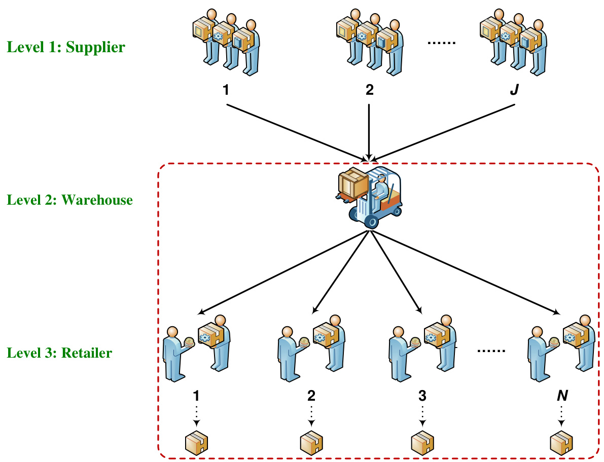
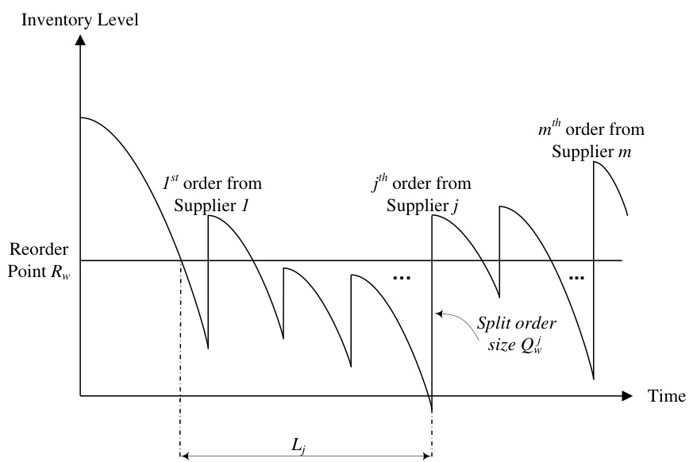
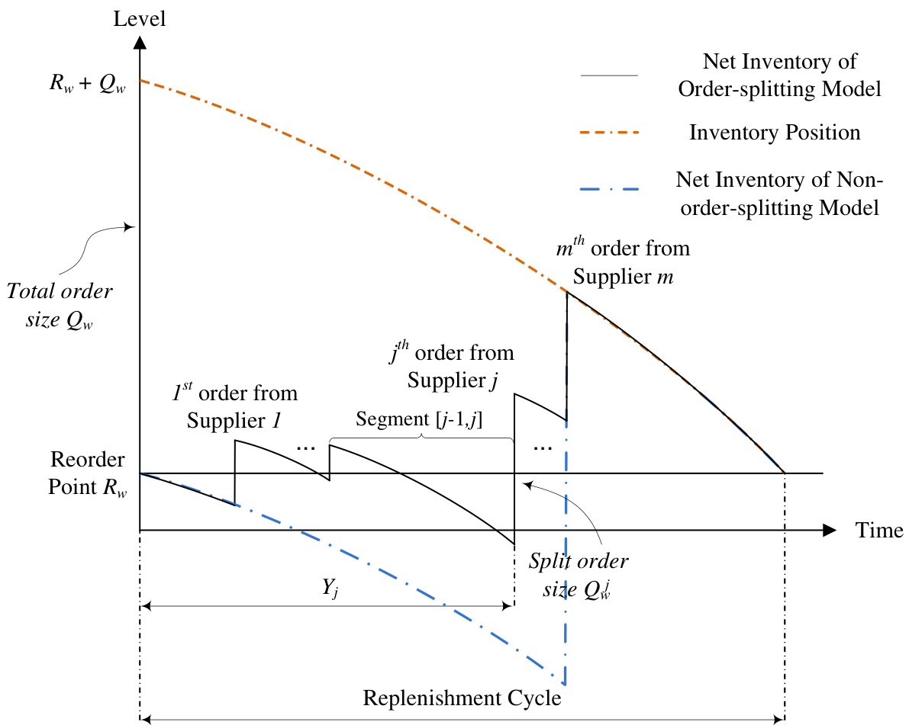
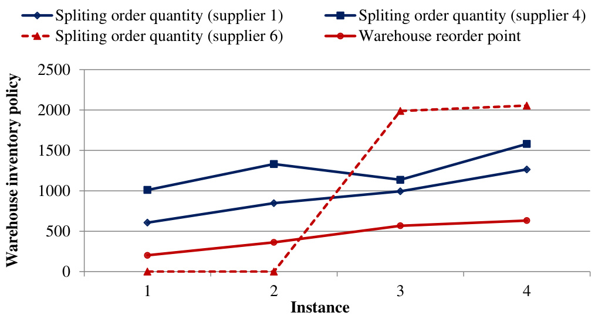
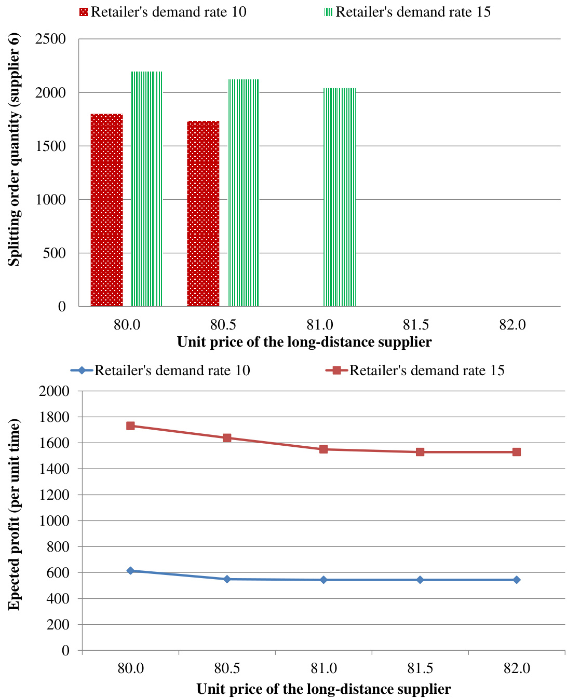
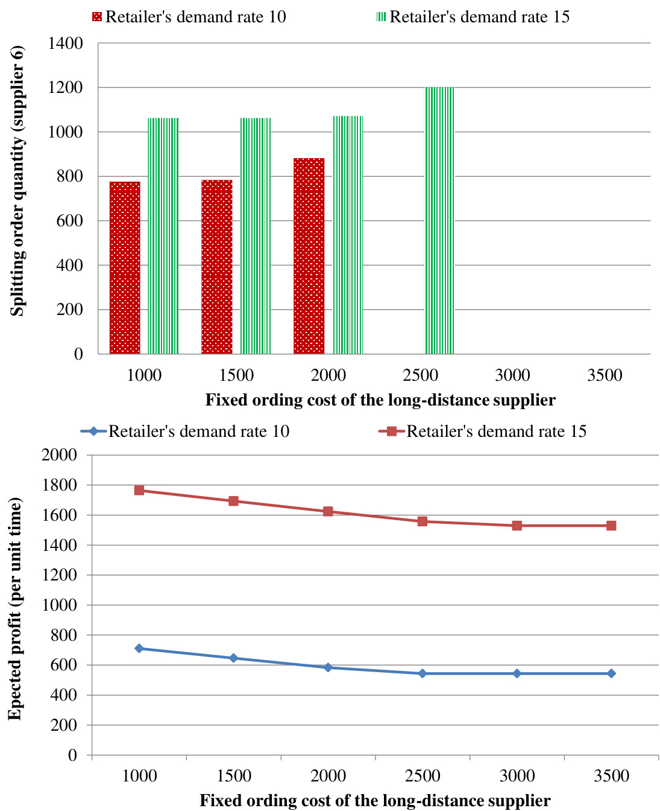
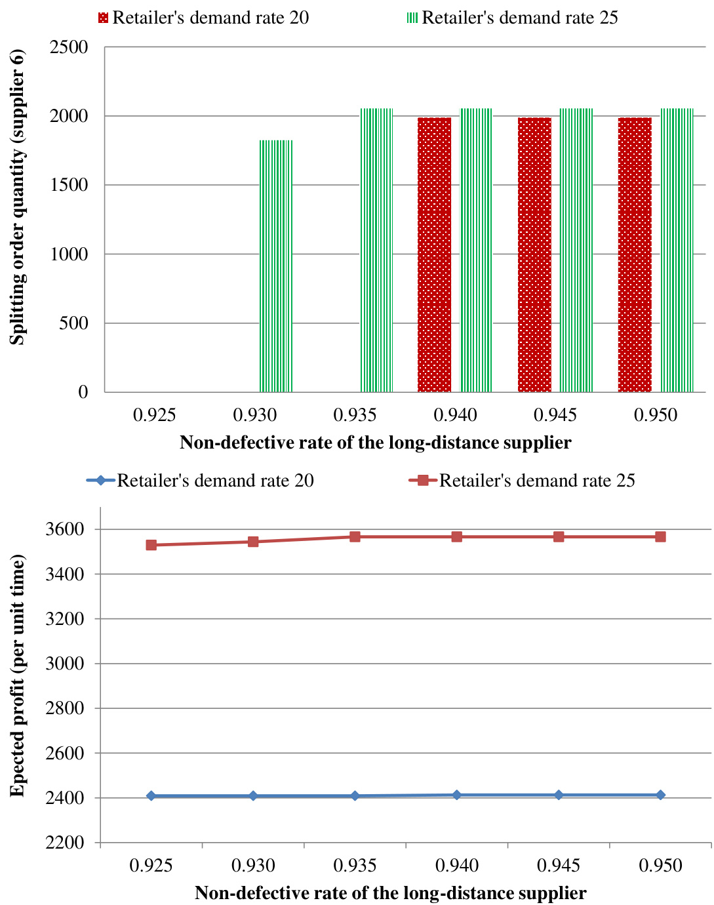

# An Order-Splitting Model for Supplier Selection and Order Allocation in a Multi-echelon Supply Chain  

Yulin Sun $\mathrm{a}$ , Simon Cong Guo $\mathrm{b}$ , Xueping Li $^\mathrm{b,}$ ,∗  

$^{a}$ School of Accounting, Southwestern University of Finance and Economics, Chengdu, Sichuan Province, China   
$^{b}$ Department of Industrial and Systems Engineering, The University of Tennessee at Knoxville, Knoxville, TN 37996, US  

# Abstract  

This paper considers an integrated supplier selection and inventory control problem for a multi-echelon inventory system with an order-splitting policy. A buyer firm consisting of one warehouse and $N$ identical retailers procures a type of product from a group of potential suppliers; the acquisition of the warehouse takes place when the inventory level depletes to a reorder point $R$ , and the order $Q$ is simultaneously split among ${\mathit{m}}$ selected suppliers. We develop an exact analytical model for the order-splitting problem in a multiechelon system, and formulate the supplier selection problem in a Mixed Integer Nonlinear Programming (MINLP) model. This model determines the optimal inventory policy that coordinates stock levels between each echelon of the systems while properly allocating orders among selected suppliers to maximize the expected profit. For verification and validation of the proposed mathematical model, we conduct several numerical analyses and implement simulation models which helps us demonstrate the model’s solvability and effectiveness. Keywords: Supplier selection, Outsourcing, Multi-echelon inventory system, Order Splitting, Mixed Integer Nonlinear Programming (MINLP)  

# 1. Introduction  

Supply chain outsourcing has become mainstream, driven by digitalization, globalization, and ever evolving customer expectations. In today’s increasingly globalized economy, companies face mounting challenges to reducing their operational costs and enlarging their profit margins with regard to procurement and outsourcing (Tsay et al., 2018; Hosseini et al., 2019; Kaur and Prakash Singh, 2021; Hashmi et al., 2021). According to a Gartner study, 80% of the respondents planned to significantly increase their logistics outsourcing budget beyond warehousing and fulfillment in 2020 (Gatner, 2019). As an enabling competitive advantage, outsourcing is widely recognized as a proven way to cut down operational cost, embraced by 93% of the organizations that are adopting or considering cloud solutions (Deloitte, 2018). As modern supply chains have evolved from simple, linear connections between businesses and suppliers to interconnected and interdependent networks spanning across organizations, nations, and continents, it is critical for most industries to form an effective sourcing strategy (Hamdan and Cheaitou, 2017; Yousefi et al., 2021; Li et al., 2021a). This has become a renewed focus as the fallout of COVID-19 (Deloitte, 2020), which put a serve strain on organizations’ supply chains and its impact is being felt across the global economy and the outsourcing relationships intertwined within.  

An essential component of the outsourcing decision is evaluating and selecting the best suppliers. A well-selected set of suppliers makes a strategic difference to an organization’s ability to reduce costs and improve the quality of its end products. Aissaoui et al. (2007) found that most analytical studies on outsourcing decisions have focused on supplier selection, which is usually a multi-criteria decision-making process that depends on a wide range of factors involving such quantitative and qualitative considerations as quality, cost, capacity, delivery, and technical potential. The problem of supplier selection has received great attention in the literature; some relevant literature reviews can be found in (Weber et al., 1991; Boer et al., 2001; Ho et al., 2010). Recent studies have formulated the problem using various mathematical programming models. For instance, Talluri and Narasimhan (2003) proposed a unique approach called ”max-min” for vendor selection by including performance variability into the evaluation process and building two linear programming models to maximize and minimize how well a supplier performed against the best target measures. A weighted linear program was developed by Ng (2008) and applied to the multi-criteria supplier selection problem; the goal was to maximize the supplier score. Additionally, a transformation technique was studied by the authors in Ng (2008) to help solve the proposed model without the use of an optimizer. Recently, in Hammami et al. (2012), the authors developed a mixed-integer programming (MIP) model for the supplier selection problem. The MIP model incorporated inventory decisions, inventory capacity constraints, specific delivery frequency, and transportation capacity based on multiple products and time periods.  

The supplier selection problem has three major decisions: (1) Which supplier should be selected? (2) How much should be ordered? (3) When should the order occur? With regard to these questions, the choice of suppliers is closely intertwined with the inventory control model. Incorporating decisions to trigger orders over time into decisions about supplier selection and order allocation may significantly reduce costs, especially over a long planning horizon (Aissaoui et al., 2007; Guo and Li, 2014; Kaur and Prakash Singh, 2021).  

One important problem related to this area is the integration of inventory lot-sizing and supplier selection, that is, situations in which buyers can simultaneously select the most suitable suppliers for each period and optimize the lot size of each product. For example, Haq and Kannan (2006) developed an integrated supplier selection and multiechelon distribution inventory model. Similar models in supplier selection and inventory lot-sizing can also be found in (Demirtas and Ustun, 2009; Mendoza and Ventura, 2010; Hammami et al., 2012). Although all these studies incorporated inventory decisions with supplier selection, inventory control policies were not considered because the inventory cost used was based on deterministic demand within a specified time period.  

Hammami et al. (2012) indicated that only a few models have incorporated these inventory management-related issues. In the existing literature, it is clear that most research has focused on a single-period demand. For example, Yang et al. (2007) proposes a solution algorithm for a developed nonlinear mathematical model with a single-period stochastic demand for the buyer and multiple suppliers with uncertain yield. Another example is (Zhang and Zhang, 2011), in which a mathematical model is developed to implement the news-vendor inventory model. The model focuses on a single firm with fixed selection cost and places minimum and maximum limitations on the order size under stochastic demand. Awasthi et al. (2009); Yang et al. (2011) provide similar examples where a single-period demand is considered. Obviously, a single-period problem designed for application towards short-term planning horizons is limited when considering inventory policies for an infinite planning horizon with continuous replenishment. More importantly, the extant literature shows that there has been little work done on multi-stage systems, instead only focusing on single buyer performance. However, inventory policies in supply-chain management affect both the single stage and the whole supply chain, and thus serve as the motivations of this research.  

In this research, we develop an analytical model to investigate both the supplier selection problem and the inventory control problem in a serial supply chain with an order-splitting policy. The strategy we work with, of pooling lead-time risks by splitting replenishment orders among multiple suppliers simultaneously, is an attractive sourcing policy that has captured the attention of both academic researchers and corporate managers (Sazvar et al., 2014). In this work, we consider a two-echelon distribution system with a central warehouse and $N$ retailers. The supplier selection process is decided in the first stage of the serial supply chain. The supplier decision is made by a single decision-maker (i.e., a centralized control) and aims to reduce the total cost for the entire supply chain. In addition to considering the inventory holding, ordering, back-order cost, and constraints on the supplier capacity, we take into account the reliability non-defective rate as another criterion to aid in the selection of supplier and to help allocate orders among selected suppliers. The supply chain system is assumed to implement a continuous review policy $(Q,\,R)$ at both the warehouse and the retailer, in which the warehouse’s order size is simultaneously split among selected suppliers, and the retailer adopts the same replenishment policy regardless of which supplier is chosen. To the best of our knowledge, this is the first attempt in the literature to tackle supplier selection in a multi-echelon supply chain with an order-splitting policy.  

The remainder of this article is organized as follows: Section 2 presents our problem definition and assumptions. Section 3 presents the formulation of the proposed multi-echelon inventory model with supplier selection. In Section 4, we implement the model and conduct numerical experiments. Finally, we summarize our work and consider future research directions in Section 5.  

# 2. Problem Definitions  

# 2.1. Model Assumptions  

We base our supplier selection and order quantity allocation problem model on a twoechelon inventory system. We assume that a single decision-maker (i.e., a centralized control) makes the inventory decision and that the decision-maker desires to purchase a single type of product from a set of potential suppliers. Figure 1 depicts the serial supply-chain system with three levels, through which customer demand is satisfied by the sequential flow of raw materials and products. The inventory of a single warehouse is replenished from a set of $S$ chosen suppliers with given lead times. All suppliers in this identified set, at the upper level, are assumed to have been pre-screened by the firm and thus satisfy the buyer’s qualitative criteria (such as service, delivery, maintenance, etc.).  

We assume that this type of product is being supplied to the market at a unit price $\rho$ . For each supplier $j$ , we assume the firm has information on the unit price $p_{j}$ , fixed ordering cost $O_{j}$ , the unit time capacity $c_{j}$ , and the reliability non-defective rate $q_{j}$ representing the historical percentage of “perfect” units (i.e., $0\;<\;q_{j}\;\leq\!1$ ) received from the supplier. In addition, since the buyer firm would not wish to choose any supplier which has very poor historical reliability data, it is assumed that the non-defective rate is significantly larger than zero. Accordingly, the item price, fixed ordering cost, capacity, quality, and the inventory cost regarding choice of the particular supplier are what the final decision is based on.  

Consider a case in which ${\mathit{m}}$ of $S$ total suppliers are selected in our final decisions, as illustrated in Figure 2; for the warehouse, the replenishment order of the stock is made to all the selected suppliers. The order is then split simultaneously among $m$ suppliers, and the total order quantity $Q_{w}$ is expressed as $\textstyle\sum_{j}^{m}Q_{w}^{j}$ , where $Q_{w}^{j}$ denotes the split order size of the selected supplier $j$ . Items are then supplied to $N$ independent identical retailers by the warehouse; a Poisson process is used for the occurrence of demand.  

  
Figure 1: Illustration of the multi-level supplier selection system  

We consider an $N$ -retailer and an $S$ -supplier system in this section. The multi-echelon order-splitting inventory model is built with the following assumptions:  

1. It is assumed that a continuous review ( $Q$ , $R$ ) policy is implemented by the supplychain system at both the warehouse and the retailer; the retailer adopts the same replenishment policy no matter which supplier is chosen.  

(a) Demand that occurs at the retailer is met with the available stock of the retailer. Otherwise, the demand is back-ordered. The inventory position is continuously checked under this policy; a batch size $Q_{r}$ is ordered at the warehouse when the inventory depletes to the reorder point $R_{r}$ . The combination of the on-hand  

  
Figure 2: Illustration of the order split model for the warehouse  

inventory and stock on order, minus the number of outstanding back-orders, defines the inventory position.   
(b) Each order placed at the warehouse has an effective lead time $\omega$ from the time the order is placed to its reception.   
(c) After the replenishment order is received, a FCFS (first-come, first-served) policy is applied to immediately satisfy outstanding back-orders at the retailer.  

2. The warehouse maintains its own inventory based on the order-splitting continuous review $(Q,\,R)$ policy.  

(a) We assume that replenishment orders from the retailer are only satisfied if the on-hand inventory of the warehouse is greater than or equal to the size of the retailer’s replenishment order. Thus, partial replenishment of warehouse orders is not allowed. This is assumed due to our use of a fixed order cost $k$ for each warehouse-to-retailer delivery.   
(b) The order at the warehouse is placed when reorder point $R_{w}$ is reached and will be split among $m$ selected suppliers, and the total order quantity $Q_{w}$ is given as $\textstyle\sum_{j}^{m}Q_{w}^{j}$ , where $Q_{w}^{j}$ denotes the split order size for the selected supplier $j$ .   
(c) The on-hand inventory level just after the final $m^{t h}$ delivery from a supplier exceeds the reorder point $R$ . This assumption is made for the classical continuous review ( $Q$ , $R$ ) system (Hariga, 2010), or otherwise the system cannot commence a renewal process and the decomposition analysis based on a cycle does not work.   
(d) We assume that the integral number of a retailer is a combination of the batch size and the reorder point of the warehouse. This is a commonly used twoechelon inventory system assumption and is thus adopted for our model (Bodt and Graves, 1985; Axsater, 2003). According to Chen and Zheng (1997), this integer-ratio order policy facilitates quantity coordination between facilities and simplifies packaging, transportation, and stock counts.   
(e) The FCFS policy is applied for the fulfillment of outstanding back-orders when the warehouse receives replenishment orders from selected suppliers.  

3. In addition to determining the warehouse and the retailer inventory policy, our model does not capture the inventory process of the supplier. Instead, the decision-maker replenishes the warehouse and retailer inventories by using different suppliers. This is accomplished through a selection process which determines the selected suppliers, the total expected quantity procured from selected suppliers, as well as the frequency of the orders.  

(a) It is assumed that the location of each supplier is different, thus the prices, selection costs, transportation costs, and replenishment lead times vary.   
(b) Assume $S$ different suppliers for each supplier $j$ , and let $O_{j}$ denote the fixed ordering cost each time (i.e., selection cost, transportation cost, etc.); let $p_{j}$ denote the price of a unit item from this supplier.   
(c) The supplier’s lead time $L_{j}$ is constant.   
(d) Supplier $j$ has maximum capacity $c_{j}$ , and non-defective reliability rate $q_{j}$ .  

The objective of the proposed model is to properly select the set of suppliers that best meets capacity limits and quality requirements, allocating order-split quantity for each supplier and determining the inventory policy for stocked items. These steps minimize the expected total cost, consisting of the fixed ordering cost, procurement cost, inventory holding cost, and shortage cost. To solve the above problem, we build a nonlinear programming model and optimize the problem using a commercial solver.  

# 2.2. Notations  

The following notations are used for the mathematical model and through the paper:  

Given Parameters   
$S$ : total number of suppliers   
$N$ : total number of retailers   
$m$ : total number of selected suppliers   
$\lambda_{r}$ : retailer demand rate per day   
$\omega$ : replenishment lead time from warehouse to retailer, in days   
$h$ : holding cost per unit per day   
$b$ : back-order cost per unit per day   
$k$ : retailer’s fixed ordering cost per order   
$\xi$ : minimum acceptable non-defective rate   
$\rho$ : selling price per unit at the market   
$O_{j}$ : warehouse’s fixed ordering cost per order for supplier $j$   
$p_{j}$ : net purchase cost per unit from supplier $j$   
$c_{j}$ : capacity of the $j$ th supplier per day   
$q_{j}$ : non-defective rate of the $j$ th supplier   
$L_{j}$ : replenishment lead time between supplier $j$ and the warehouse, in days   
Decision Variables   
$y_{j}$ : binary variable, set to 1 if supplier $j$ is selected   
$Q_{r}$ : retailer’s order quantity, in units   
$Q_{w}^{j}$ : warehouse’s split order quantity for supplier $j$ , in units of retailer  

batches  

$R_{r}$ : retailer’s reorder point, in units $R_{w}$ : warehouse’s reorder point, in units of retailer batches  

Intermediate Variables  

$U_{r}$ : retailer’s retard time, in days   
$D_{r}$ : retailer’s demand during the delay time, in units   
$\lambda_{w}$ : demand rate at the warehouse per day, in units of retailer batches   
$t$ : time slot starting from the beginning of each replenishment cycle   
$D_{w}$ : warehouse’s demand during the time $t$ , in units   
$I_{r}$ : expected on-hand inventory at retailer, in units   
$I_{w}$ : expected on-hand inventory at warehouse, in units of retailer batches   
$B_{r}$ : expected back-orders at retailer, in units   
$B_{w}$ : expected back-orders at warehouse, in units of retailer batches  

Please note that we use subscripts $r$ and $w$ to differentiate between a retailer and the warehouse. We denote $Q_{w}^{j}$ to the warehouse’s split order quantity for supplier $j$ through the superscript $j$ . Since the retailers are identical, for simplification, we denote $Q_{r}$ and $R_{r}$ to a retailer’s order quantity and reorder point, respectively, instead of $Q_{r}^{j}$ and $R_{r}^{j}$ .  

# 3. Model Formulation  

# 3.1. The Retailer Inventory Analysis  

The inventory of the retailer decreases as demand is met. When the retailer’s inventory level reaches $R_{r}$ , the warehouse places an order in the size of $Q_{r}$ . Recall that in the steady state, the inventory position is uniformly distributed over $(R_{r}+1,\,R_{r}+2,\,\cdots,\,R_{r}+Q_{r})$ . Under a $(Q,\,R)$ policy, a retailer’s expected on-hand inventory can be expressed as  

$$
I_{r}=\frac{Q_{r}+1}{2}+R_{r}+B_{r}-E[D_{r}],
$$  

where $E[D_{r}]$ is the retailer’s expected demand during the delay time. Delay time is a combination of two parts: (1) the replenishment lead time from warehouse-to-retailer; (2) the time between an order being placed by the retailer and the warehouse releasing a batch. $L$ denotes the first part and is assumed to be deterministic. $U_{r}$ denotes the second part, which is commonly called the retard time due to the warehouse stockout. The number of arrival orders in the waiting system is equal to the back-orders of the warehouse, and the sojourn time is equal to the retard time of the retailer (Svoronos and Zipkin, 1988). Thus, the expected retard time at the retailer can be expressed as  

$$
E[U_{r}]=\frac{Q_{r}B_{w}}{N\lambda_{r}},
$$  

so we have  

$$
E[D_{r}]=\lambda_{r}(L+\frac{Q_{r}B_{w}}{N\lambda_{r}}).
$$  

To simplify the expression, we adopt a normal approximation for the retailer’s demand during the delay time (Hopp and Spearman, 2001). Due to the variation in the retard time, the demand during a retailer’s delay time may not exactly follow a Poisson distribution. However, it is a common practice to adopt a Poisson process to model the demand in such a situation. To simplify the expression, we approximate the variance of the retailer’s expected delay time demand as equal to its mean value, i.e., $V[D_{r}]\cong E[D_{r}]$ .  

Thus, by using the normal approximation, the expected back-orders at the retailer $B_{r}$ are computed as follows (see (Hopp and Spearman, 2001)):  

$$
B_{r}=\frac{1}{Q_{r}}[\beta(R_{r})-\beta(R_{r}+Q_{r})],
$$  

$$
\beta(x)=\frac{\sigma^{2}}{2}\{(z^{2}+1)[1-\Phi(z)]-z\phi(z)\},
$$  

$$
z={\frac{x-\theta}{\sigma}},
$$  

where $\theta$ and $\sigma$ represent the mean and standard deviation of the demand during the delay time, respectively. Additionally, the cumulative distribution function (cdf) and probability density function (pdf) of the standard normal distribution are represented by $\Phi$ and $\phi$ respectively. The continuous analog to the second-order loss function $\beta(x)$ is defined by equation (5). By substituting $\theta$ and $\sigma$ in the above equations, we can compute $B_{r}$ in a function using the variables $Q_{r}$ , $R_{r}$ , and $B_{w}$ .  

# 3.2. The Warehouse Analysis  

Calculation of the expected inventory level and back-order level at the warehouse requires an analysis of the demand process first. Recall that each warehouse replenishment order is $Q_{r}$ and that the demand process of each retailer follows a Poisson process. The interval between any two orders is stochastic and depends on $Q_{r}$ and thus, the warehouse demand process is a superposition of the ordering processes for the retailer. Specifically, the warehouse demand process is a superposition of independent renewal processes (i.e., the time between each retailer’s orders is independent and identically distributed random variables), where each has an Erlang inter-renewal time with $Q_{r}$ stages and rate per state $\lambda_{r}$ (Deuermeyer and Schwarz, 1981). Therefore, with the assumption of identical retailers, we derive the warehouse demand rate as follows:  

$$
\lambda_{w}=\frac{N\lambda_{r}}{Q_{r}}.
$$  

For multi-echelon problems, the determination of an effective upstream demand pattern is a challenging task. In this problem, finding an exact distribution for the warehouse demand process is almost impossible. However, Ganeshan (1999) shows that the Poisson process is a strong approximation of the warehouse demand pattern when $N$ is greater than 20. For our research, $N$ is sufficiently large for each scenario, thus the arrival of each retailer’s order is approximately a Poisson process. We make this assumption because large retailers such as Walmart have distribution centers that usually serve 20 or more stores.  

In order to calculate the expected unit inventory level and back-order level, we calculate the total holding and back-order cost in a single complete replenishment cycle. As illustrated in Figure 3, we define a replenishment cycle as the length of time between two successive moments where orders are placed and split. Because the on-hand inventory level just after the ${\mathit{m}}$ th delivery from the final delivered supplier exceeds reorder point $R$ , there are no orders outstanding at the time the inventory position reaches $R$ . Thus, the cycle begins when the inventory position is $Q\,+\,R$ , and ends when the inventory position reaches $R$ . Therefore, the replenishment cycles can be treated as renewal cycles, and the order-triggered times constitute the restart points of the renewal process.  

  
Figure 3: Illustration of the order split model for the warehouse  

In order to calculate the expected inventory and back-order level in a cycle, we study the interval between two simultaneous orders and divide one cycle into a number of segments. As displayed in Figure 3, the defined segment $[j$ -1, $j]$ is the span between ( $j$ -1)th and $j$ th arrival. Thus, if there are $m$ suppliers to be selected, we divide the span of a replenishment cycle into $m{+}1$ segments. We then calculate the total holding/back-order level over each segment and sum up all the segments to get the average holding/back-order level into one cycle.  

We first analyze the total warehouse back-order level in each segment, denoted by $T[B_{w(j-1,j)}]$ , where $j\,=\,1,...S$ . We study the scenarios where all the $S$ suppliers are selected, so that the most general case could be considered. Let $Y_{1}\,<\,Y_{2}\,<\,...\,<\,Y_{S}$ be the order of lead times $L_{1}$ , $L_{2},...,L_{S}$ ; $Y_{j}$ is then the replenishment lead time of the supplier for the $j$ th delivery, or the time duration from the moment when the order is placed until the moment when the $j$ th delivery is made. Thus, the expected back-order level at any given time point $t$ between the $(j-1)^{t h}$ and the $j^{t h}$ deliveries, denoted by $E[B_{w(j-1,j)}(t)]$ , is expressed as the following:  

$$
E[B_{w(j-1,j)}(t)]=E\Big[D_{w}-\big(R_{w}+\sum_{k=1}^{j-1}Q_{w}^{k}\big)\Big]^{+},
$$  

where $t$ is the time slot starting from the beginning of each replenishment cycle when the warehouse places the order to the selected suppliers, and $D_{w}$ denotes the warehouse demand during time interval $t$ . Then let $P(D_{w})$ be the probability mass function (pmf) for warehouse demand during time $t$ ; that is  

$$
P(D_{w})=\frac{e^{-\lambda_{w}t}(\lambda_{w}t)^{D_{w}}}{D_{w}!}.
$$  

Thus, equation (8) is equivalently:  

$$
E[B_{w(j-1,j)}(t)]=\sum_{D_{w}=R_{w}+\sum_{k=1}^{j-1}Q_{w}^{k}}^{\infty}\Big[D_{w}-\big(R_{w}+\sum_{k=1}^{j-1}Q_{w}^{k}\big)\Big]P(D_{w}).
$$  

Let us denote $G(D_{w})$ to be the cumulative distribution function (cdf) for the Poisson demand during the time interval $t$ . Then, a simplified expression for equation (10) is given  

$$
\begin{array}{r c l}{{E[B_{w(j-1,j)}(t)]}}&{{=}}&{{\displaystyle\Big[\lambda_{w}t-(R_{w}+\sum_{k=1}^{j-1}Q_{w}^{k})\Big]+\lambda_{w}t\Big[P(R_{w}+\sum_{k=1}^{j-1}Q_{w}^{k})-G(R_{w}+\sum_{k=1}^{j-1}Q_{w}^{k})\Big]}}\\ {{}}&{{}}&{{+(R_{w}+\sum_{k=1}^{j-1}Q_{w}^{k})G(R_{w}+\sum_{k=1}^{j-1}Q_{w}^{k}),}}\end{array}
$$  

where $\lambda_{w}$ is the demand rate at the warehouse and can be computed by equation (7). The detailed derivation is as follows:  

Proof.  

$$
\begin{array}{r l}{\delta_{n(-i-\frac{1}{2})}(t)}&{=\quad\displaystyle\sum_{m_{n}=n+\frac{1-1}{2}\cdots|\sigma|}^{n}\Big[D_{n}-(R_{+}+\textstyle\sum_{i=1}^{i-1}Q_{i}^{(\frac{1}{i})})P_{i}(D_{n})\cdot}\\ &{=\quad\displaystyle\sum_{m_{n}=0}^{n}\Big[D_{m_{n}}-(R_{+}+\textstyle\sum_{i=1}^{i-1}Q_{i}^{(\frac{1}{i})})P_{i}(D_{n})}\\ &{\quad-\displaystyle\sum_{m_{n}=0}^{n+\frac{1-1}{2}\cdots|\sigma|}-\Big[D_{m_{n}}-(R_{+}+\textstyle\sum_{i=1}^{i-1}Q_{i}^{(\frac{1}{i})})P_{i}(D_{n})}\\ &{\quad-\displaystyle\sum_{m_{n}=0}^{n-1}\Big[D_{m_{n}}-(R_{+}+\textstyle\sum_{i=1}^{i-1}Q_{i}^{(\frac{1}{i})})P_{i}(D_{n})}\\ &{=\quad\lambda_{n}\ell-(R_{+}+\textstyle\sum_{i=1}^{i-1}Q_{i}^{(\frac{1}{i})})-\displaystyle\sum_{m_{n}=0}^{n-1-1}\Big[D_{m_{n}}-(R_{+}+\textstyle\sum_{i=1}^{i-1}Q_{i}^{(\frac{1}{i})})\Big]P_{i}(D_{n})}\\ &{=\quad\lambda_{n}\ell-(R_{+}+\textstyle\sum_{i=1}^{i-1}Q_{i}^{(\frac{1}{i})})-\displaystyle\sum_{m_{n}=1}^{n-1-1}Q_{i}^{(\frac{1}{i})}\,\mathrm{e}^{-\lambda_{n}\ell}\,\mathrm{~\sum_{i=1}^{i-1}\sigma_{i}^{(\frac{1}{i})}\beta_{i}^{(\frac{1}{i})-1}\lambda_{n}\ell}}\\ &{\quad+(R_{+}+\textstyle\sum_{i=1}^{i-1}Q_{i}^{(\frac{1}{i})})\displaystyle\sum_{m_{n}=0}^{n-1}P_{i}(D_{n})}\\ &{\quad+(R_{+}+\textstyle\sum_{i 
$$$$
\begin{array}{r l}{\dot{\Delta}_{n+1}}&{:=-\dot{\Delta}_{n}\Bigg[\hphantom{-}\!\!\!\!\!\!\!\!\!\!\!\!\!\!\!\!\!\!\!\!\!\!\!\!\!\!\!\!\!\!\!\!\!\!\!\!\!\!\!\!\!\!\!\!\!\!\!\!\!\!\!\!\!\!\!\!\!\!\!\!\!\!\!\!\!\!\!\!\!\!\!\!\!\!\!\!\!\!\!\!\!\!\!\!\!\!\!\!\!\!\!\!\!\!\!\!\!\!\!\!\!\!\!\!\!\!\!\!\!\!\!\!\!\!\!\!\!\!\!\!\!\!\!\!\!\!\!\!\!\!\!\!\!\!\!\!\!\!\!\!\!\!\!\!\!\!\!\!\!\!\!\!\!\!\!\!\!\!\!\!\!\!\!\!\!\!\!\!\!\!\!\!\!\!\!\!\!\!\!\!\!\!\!\!\!\!\!\!\!\!\!\!\!\!\!\!\!\!\!\!\!\!\!\!\!\!\!\!\!\!\!\!\!\!\!\!\!\!\!\!\!\!\!\!\!\!\!\!\!\!\!\!\!\!\!\!\!\!\!\!\!\!\!\!\!\!\!\!\!\!\!\!\!\!\!\!\!\!\!\!\!\!\!\!\!\!\!\!\!\!\!\!\!\!\!\!\!\!\!\!\!\!\!\!\!\!\!\!\!\!\!\!\!\!\!\!\!\!\!\!\!\!\!\!\!\!\!\!\!\!\!\!\!\!\!\!\!\!\!\!\!\!\!\!\!\!\!\!\!\!\!\!\!\!\!\!\!\!\!\!\!\!\!\!\!\!\!\!\!\!\!\!\!\!\!\!\!\!\!\!\!\!\!\!\!\!\!\!\!\!\!\!\!\!\!\!\!\!\!\!\!\!\!\!\!\!\!\!\!\!\!\!\!\!\!\!\!\!\!\!\!\!\!\!\!\!\!\!\!\!\!\!-\dot{\!}\!\!\!\!\!\!\!\!\!\!\!\!\!\!\!\!\!\!\!\!\!\!\!\!\!(B_{n}-\frac{1}{n_{2}})\!\!\!\!\!\!\!\!\!\!\!\!\!\!\!\!\!\!\!\!-\!\!\!\!\!\!\!\!\!\!\!\
$$  

The total expected warehouse back-order level in each segment can be computed by integrating the expected back-order level at any time $t$ over the whole segment. The following  

equation is developed:  

$$
\begin{array}{r c l}{T[B_{w(j-1,j)}]}&{=}&{\displaystyle\int_{Y_{j-1}}^{Y_{j}}\bigg(\lambda_{w}t\Big[P(R_{w}+\displaystyle\sum_{k=1}^{j-1}Q_{w}^{k})-G(R_{w}+\displaystyle\sum_{k=1}^{j-1}Q_{w}^{k})+1\Big]}\\ &&{\displaystyle+(R_{w}+\displaystyle\sum_{k=1}^{j-1}Q_{w}^{k})\Big[G(R_{w}+\displaystyle\sum_{k=1}^{j-1}Q_{w}^{k})-1\Big]\bigg)\ \mathrm{d}t.}\end{array}
$$  

Proposition 1. Let $\begin{array}{r}{x=R_{w}+\sum_{k=1}^{j-1}Q_{w}^{k}}\end{array}$ , for any given parameter $x>0,L>0$ , the definite integral of the expected back-order level $E[B_{w(j-1,j)}]$ with the upper boundary $L$ , denoted by $F(x,L)$ is  

$$
F(x,L)=\frac{e^{-\lambda_{w}L}(\lambda_{w}L)^{x+1}(\lambda_{w}L-x)+\left[x+(x-\lambda_{w}L)^{2}\right]\gamma(x+1,\lambda_{w}L)}{2\lambda_{w}\Gamma(x+1)},
$$  

where $\Gamma$ , and $\gamma$ stand for the gamma function, and the lower incomplete gamma function, respectively.  

Proof. According to (11), and substituting $\begin{array}{r}{x=R_{w}+\sum_{k=1}^{j-1}Q_{w}^{k}}\end{array}$ , we get  

$$
\begin{array}{l l l}{F(x,L)}&{=}&{\displaystyle\int_{0}^{L}E[B_{w(j-1,j)}(t)]\;\mathrm{d}t}\\ &{=}&{\displaystyle\int_{0}^{L}\left[(\lambda_{w}t-x)+\lambda_{w}t P(x)+x G(x)-\lambda_{w}t G(x)\right]\,\mathrm{d}t.}\end{array}
$$  

The equation (15) has four parts; in what follows, we separately derive each of them:  

$$
\begin{array}{l l l}{\displaystyle F_{1}(x,L)}&{=}&{\displaystyle\int_{0}^{L}(\lambda_{w}t-x)\ \mathrm{d}t}\\ {\displaystyle}&{=}&{\displaystyle\frac{1}{2}\lambda_{w}t^{2}-x t.}\end{array}
$$  

For $\textstyle\int_{0}^{L}\lambda_{w}t P(x)\mathrm{d}t$ , we have  

$$
{\begin{array}{l l l}{F_{2}(x,L)}&{=}&{\displaystyle\int_{0}^{L}\lambda_{w}t{\frac{e^{-\lambda_{w}t}\left(\lambda_{w}t\right)^{x}}{x!}}~\mathrm{d}t}\\ &{=}&{\displaystyle\int_{0}^{\lambda_{w}L}T{\frac{e^{-T}T^{x}}{\lambda_{w}x!}}~\mathrm{d}T}\\ &{=}&{\displaystyle{\frac{1}{\lambda_{w}x!}}\int_{0}^{\lambda_{w}L}e^{-T}T^{x+1}~\mathrm{d}T}\\ &{=}&{\displaystyle{\frac{\gamma(x+2,\lambda_{w}L)}{\lambda_{w}x!}}.}\end{array}}
$$  

The third part $\begin{array}{r}{\int_{0}^{L}x G(x)\mathrm{d}t}\end{array}$ , denoted as $F_{3}(x,L)$ , can be addressed as  

$$
\begin{array}{r c l}{F_{3}(x,L)}&{\!=}&{\displaystyle\int_{0}^{L}x\sum_{k=0}^{x}\frac{e^{-\lambda_{w}t}(\lambda_{w}t)^{x}}{k!}\;\mathrm{d}t}\\ &{\!=}&{\displaystyle\frac{x}{\lambda_{w}}\int_{0}^{\lambda_{w}L}\sum_{k=0}^{x}\frac{e^{-T}T^{k}}{k!}\;\mathrm{d}T.}\end{array}
$$  

Since for any positive integer $x$ , we have  

$$
\Gamma(x+1,T)=x!\sum_{k=0}^{x}{\frac{e^{-T}T^{k}}{k!}},
$$  

Thus, we have  

$$
F_{3}(x,L)\;\;=\;\;\frac{x}{\lambda_{w}}\int_{0}^{\lambda_{w}L}\frac{\Gamma(x+1,T)}{x!}\;\mathrm{d}T.
$$  

Using integration by parts, we then have  

$$
\begin{array}{r c l}{F_{3}(x,L)}&{=}&{\displaystyle\frac{x}{\lambda_{w}x!}\Big[T\Gamma(x+1,T)-\Gamma(x+2,T)\Big]\Bigg\vert_{0}^{\lambda_{w}L}}\\ &{=}&{\displaystyle\frac{x}{\lambda_{w}x!}\Big[\lambda_{w}L\Gamma(x+1,\lambda_{w}L)-\Gamma(x+2,\lambda_{w}L)+\Gamma(x+2)\Big].}\end{array}
$$  

For the last part, $\begin{array}{r}{\int_{0}^{L}-\lambda_{w}t G(x)\ \mathrm{d}t}\end{array}$ , can be derived similarly as $F_{3}(x,L)$ ; thus,  

$$
\begin{array}{r c l}{F_{4}(x,L)}&{=}&{\displaystyle-\int_{0}^{L}{\lambda_{w}t}\sum_{k=0}^{x}{\frac{e^{-\lambda_{w}t}\left(\lambda_{w}t\right)^{x}}{k!}\ \mathrm{d}t}}\\ &{=}&{\displaystyle-\frac{1}{\lambda_{w}}\int_{0}^{\lambda_{w}L}{\frac{T\Gamma(x+1,T)}{x!}\ \mathrm{d}T}}\\ &{=}&{\displaystyle-\frac{1}{2\lambda_{w}x!}\Big[T^{2}\Gamma(x+1,T)-\Gamma(x+3,T)\Big]\Bigg|_{0}^{\lambda_{w}L}}\\ &{=}&{\displaystyle-\frac{1}{2\lambda_{w}x!}\Big[\lambda_{w}^{2}L^{2}\Gamma(x+1,\lambda_{w}L)-\Gamma(x+3,\lambda_{w}L)+\Gamma(x+3)\Big].}\end{array}
$$  

Finally, we sum the four parts together and convert each gamma function based on the parameter $(x{+}1)$ , so that equation (14) can be obtained. We omit the details for brevity.  

Using the above proposition, the total expected back-order level at the warehouse in each segment can be written as  

$$
T[B_{w(j-1,j)}]=F(R_{w}+\sum_{k=1}^{j-1}Q_{w}^{k},Y_{j})-F(R_{w}+\sum_{k=1}^{j-1}Q_{w}^{k},Y_{j-1}).
$$  

Similarly, the total expected warehouse back-order level between the moment the order is placed and the first delivery in this cycle is given as  

$$
T[B_{w(0,1)}]=\int_{0}^{Y_{1}}E[B_{w(0,1)}(t)]\;\mathrm{d}t=F(R_{w},Y_{1}).
$$  

As for the scenario of the final segment which starts from the last delivery in a cycle, and ends in the final of this cycle (or equivalently the beginning of the next cycle), we could also get  

$$
T[B_{w(m,0)}]\;\;\approx\;\;\int_{Y_{m}}^{T}E[B_{w(m,0)}(t)]\;\mathrm{d}t=F(R_{w}+Q_{w},T)-F(R_{w}+Q_{w},Y_{m}).
$$  

Note that this equation only approximates the calculation since the cycle time at the warehouse is a random variable; we estimate its value by adopting the expected cycle time, denoted by $T$ . In addition, as mentioned in section 2.1, it is assumed that the on-hand inventory level just after the $m$ th delivery exceeds the reorder point R. This indicates that when $R_{w}\ge0$ , the inventory level after the $m$ th delivery is a positive number, or equivalently there is no back-order after the final delivery in a cycle, i.e., $T[B_{w(m,0)}]\approx0$ , when $R_{w}\ge0$ .  

Recall that we approximate the demand process at the warehouse as the Poisson process, which is a renewal process with an exponentially distributed inter-arrival time, and that the sum of $Q_{w}$ independent random variables with the common exponentially distributed functions follows an Erlang- $Q_{w}$ distribution. Thus, the replenishment cycles are independent renewal processes, where each has an Erlang inter-renewal time with $Q_{w}$ stages and rate per state $\lambda_{w}$ . Therefore, $T$ can be expressed as  

$$
T=\frac{Q_{w}}{\lambda_{w}}=\frac{\sum_{k=1}^{m}Q_{w}^{k}Q_{r}}{N\lambda_{r}}.
$$  

Hence, given equations (13) to (19), the expected back-order level is calculated as follows:  

$$
\begin{array}{r c l}{{B_{w}}}&{{=}}&{{\displaystyle\frac{T[B_{w(0,1)}]+\sum_{j=2}^{m}T[B_{w(j-1,j)}]+T[B_{w(m,0)}]}{T}}}\\ {{}}&{{=}}&{{\displaystyle\frac{N\lambda_{r}}{\sum_{k=1}^{m}Q_{w}^{k}Q_{r}}\Biggl\{F(R_{w},Y_{1})+\sum_{j=2}^{m}\left[F(R_{w}+\sum_{k=1}^{j-1}Q_{w}^{k},Y_{j})-F(R_{w}+\sum_{k=1}^{j-1}Q_{w}^{k},Y_{j-1})\right]}}\\ {{}}&{{}}&{{+F(R_{w}+Q_{w},T)-F(R_{w}+Q_{w},Y_{m})\Biggr\}.}}\end{array}
$$  

Similarly to equations (8) to (11), the expected inventory level at any given time point $t$ between the ( $j$ -1)th and the $j$ th deliveries, denoted by $E[I_{w(j-1,j)}(t)]$ , is expressed as the  

following:  

$$
\begin{array}{r c l}{{E[I_{w(j-1,j)}(t)]}}&{{=}}&{{\displaystyle E\Big[(R_{w}+\sum_{k=1}^{j-1}Q_{w}^{k})-D_{w}\Big]^{+}}}\\ {{}}&{{=}}&{{\displaystyle\sum_{D_{w}=0}^{R_{w}+\sum_{j=1}^{j-1}Q_{w}^{k}}\Big[(R_{w}+\sum_{k=1}^{j-1}Q_{w}^{k})-D_{w}\Big]P(D_{w})}}\\ {{}}&{{=}}&{{\displaystyle\lambda_{w}t\Big[P(R_{w}+\sum_{k=1}^{j-1}Q_{w}^{k})-G(R_{w}+\sum_{k=1}^{j-1}Q_{w}^{k})\Big]}}\\ {{}}&{{}}&{{\displaystyle+(R_{w}+\sum_{k=1}^{j-1}Q_{w}^{k})G(R_{w}+\sum_{k=1}^{j-1}Q_{w}^{k}).}}\end{array}
$$  

As a result, the total expected inventory level in each segment, denoted by $T[I_{w(j-1,j)}]$ can be calculated by integrating time $t$ over the whole segment. Then, the calculation for the expected inventory level at the warehouse can be analogously derived as equation (20). However, to simplify the calculation, we use the following property to calculate the warehouse’s expected inventory level $I_{w}$ .  

Proposition 2. For the expected inventory level and back-order level at the warehouse, the following equality holds:  

$$
I_{w}=B_{w}+\frac{Q_{w}}{2}+R_{w}-\lambda_{w}Y_{m}+\frac{\lambda_{w}}{Q_{w}}\sum_{j=2}^{m}\sum_{k=1}^{j-1}Q_{w}^{k}(Y_{j}-Y_{j-1}).
$$  

The proof can be found in the Appendix. In this paper, we simplify the calculation and save computational effort by using the above equality to compute the expected inventory level at the warehouse.  

# 3.3. Mathematical Model  

In this section, we present the order-splitting model for selecting suppliers and allocating orders. The model is based on a multi-echelon inventory system with stochastic Poisson demand. $y_{j}$ is denoted as a binary variable, where $y_{j}=1$ means that supplier $j$ is selected;  

each selected supplier $j$ should satisfy both the capacity and the quality constraint. Thus, when the retailer’s demand rate changes we may select a different set of suppliers.  

The objective function of the proposed model is to maximize the expected total profit per time unit, denoted by $C$ . It consists of several parts: the first part corresponds to the total expected revenue (i.e., the selling value $\rho$ minus the purchase cost $p_{j}$ ) incurred by all units purchased from the selected suppliers. The second part accounts for the total holding and backorder cost. We can substitute the equations derived in sections 3.1 and 3.2 to get the detailed formulations. The third term is used to calculate the unit fixed ordering cost for the retails while the last part represents the unit fixed ordering cost for the warehouse. Notice that the fixed ordering cost is obtained by dividing the total set-up cost per order cycle, by the length of the cycle. We gain insight from the model by examining the tradeoffs among price, ordering, holding, and back-order costs, which then allows us to choose the best supplier(s) and ordering policy. Based on the above-discussed assumptions and variables, we developed the following model:  

$$
\begin{array}{c c l}{{M a x i m i z e\;\;C}}&{{=}}&{{N\lambda_{r}\Big(\rho-\displaystyle\frac{\sum_{j}^{S}Q_{w}^{j}p_{j}}{\sum_{j=1}^{S}Q_{w}^{j}}\Big)-\Big[h(N I_{r}+Q_{r}I_{w})+b(N B_{r}+Q_{r}B_{w})\Big]}}\\ {{}}&{{}}&{{-\displaystyle\frac{N\lambda_{r}}{Q_{r}}k-\displaystyle\frac{N\lambda_{r}}{Q_{r}\sum_{j=1}^{S}Q_{w}^{j}}\sum_{j=1}^{S}y_{j}o_{j}}}\end{array}
$$  

Subject to  

$$
{\frac{N\lambda_{r}}{\sum_{j=1}^{S}Q_{w}^{j}}}Q_{w}^{j}\leq c_{j}y_{j}\qquad j=1,\ldots,S,
$$  

$$
\frac{\sum_{j=1}^{S}Q_{w}^{j}q_{j}}{\sum_{j=1}^{S}Q_{w}^{j}}\ge\xi,
$$  

$$
R_{r}\ge-Q_{r},
$$  

$$
R_{w}\ge-\sum_{j=1}^{S}Q_{w}^{j},
$$  

$$
Q_{r},Q_{w}^{j}\ge0\qquad j=1,\cdot\cdot\cdot\,,S,
$$  

$$
Q_{r},R_{r},Q_{w}^{j},R_{w}:\in\mathbb{Z}\qquad j=1,\cdot\cdot\cdot\cdot,S,
$$  

$$
y_{j}\in\{0,1\}\qquad j=1,\ldots,S.
$$  

Constraint (24) defines the capacity constraint for the selected suppliers. Equation (25) ensures the quality constraint, where the average non-defective rate offered by suppliers should meet the minimum acceptable non-defective rate $\xi$ . In addition, we can show that the optimal $R$ satisfies $R\geq-Q$ for standard cost structures (i.e., linear holding and backorder costs). Therefore, it is assumed to satisfy in equations (26) and (27), which could help limit the computational complexity. Constraints (28) and (29) are included because the minimum size allowed is zero and there are no partial or fractional requests during the whole process.  

# 4. Illustrative Example and Analysis  

In this section, we conduct numerical experiments with the proposed analytical model. To solve the above constrained mixed integer nonlinear programming model, we translate the mathematical model in the Matlab interactive environment and solve it using the Knitro commercial package on a desktop computer with an Intel Core $2^{\mathrm{rM}}$ CPU (2.00 GHz) and 4GB RAM. In particular, we adopt the “active-set” algorithm in Knitro. The active-set algorithm solves a sequence of sub-problems based on a quadratic model of the problem, implementing a sequential linear-quadratic programming algorithm similar in nature to a sequential quadratic programming method but using linear programming sub-problems to estimate the active set (Artelys Knitro, 2021). For more details of this algorithm, please refer to Byrd et al. (2004); Nocedal and Wright (2006). In this numerical study, we configure the Knitro options to activate the “active-set” algorithm. Other available optimization algorithms include “sqp”, “interior-point”, and so on (fmincon Matlab, 2021) through the fmincon solver. We choose “active-set” mainly because it generally uses less memory than the default “interior-point” algorithm. For more detailed implementation of the Matlab code and how the model is prepared for and solved by the Knitro solver, please refer to source code in the the GitHub repository (Li et al., 2021b).  

Table 1: Parameter values used for the experiment   

<html><body><table><tr><td>Parameter</td><td>N</td><td>入r</td><td>h</td><td>b</td><td>p</td><td>k</td><td>3</td></tr><tr><td>Value</td><td>20</td><td>10</td><td>1</td><td>5</td><td>100</td><td>500</td><td>1</td></tr></table></body></html>  

The main purpose of these experiments was to show the solvability of the problem and the effectiveness of the model. Additionally, these experiments helped demonstrate how the model is adopted for the different scenarios of the supplier selection decision-making. Subsection 4.1 presents the parameters that were used for the experiments. In subsection 4.2, we elaborate the results based on the parameter settings. To evaluate the proposed analytical model’s accuracy, we develop the computer simulation model to validate the correctness of the mathematical model in subsection 4.3. In subsection 4.4, we analyze the model based on different demand rate instances. In subsection 4.5, we analyze single versus multiple sourcing models. Finally, in subsection 4.6 we conduct a few sensitivity analyses for a long-distance supplier.  

# 4.1. Parameter Setting  

As mentioned earlier, in this section we assume a sufficiently large number of retailers; $N$ is set at 20. There are six potential suppliers to choose from that may be located in various regions around the world. Thus, we investigate the supplier selection problem based on one firm consisting of one warehouse and twenty identical retailers. We set the demand rate at 10 units per day. The product’s selling price, $\rho$ , is set at 100. We assume the warehouse and retailer unit holding cost and back-order cost to be 1 and 5, respectively. We assume the fixed ordering cost from the warehouse to each retailer to be 500. The lead time for deterministic replenishment from warehouse to retailer is set at 1 (day). These parameters are displayed in Table 1.  

Table 2 depicts additional information for each potential supplier. We assumed that each supplier satisfies the buyer’s qualitative criteria, each with its own fixed ordering cost, various purchasing prices, replenishment lead time, unit time capacity, and non-defective rate. We consider two types of potential suppliers: short-range suppliers (suppliers 1-4) and long-distance suppliers (suppliers 5 and 6). Table 2 shows that the long-distance suppliers charge a lower unit purchasing cost, but have higher defect rates, charge higher fixed-order costs, and require a longer replenishment lead time.  

Table 2: Other parameter settings for potential suppliers   

<html><body><table><tr><td>Supplier candidate (S§)</td><td>1</td><td>2</td><td>3</td><td>4</td><td>5</td><td>6</td></tr><tr><td>Price (pj)</td><td>84.0</td><td>85.0</td><td>83.0</td><td>83.5</td><td>82.8</td><td>82.5</td></tr><tr><td>Ordering cost (o)</td><td>1500</td><td>1000</td><td>2000</td><td>800</td><td>4000</td><td>4800</td></tr><tr><td>Maximum capacity (c)</td><td>180</td><td>160</td><td>150</td><td>190</td><td>180</td><td>210</td></tr><tr><td>Supplier lead time (Lj)</td><td>2</td><td>3</td><td>3</td><td>4</td><td>6</td><td>7</td></tr><tr><td>Non-defective rate (q)</td><td>0.970</td><td>0.975</td><td>0.945</td><td>0.955</td><td>0.950</td><td>0.945</td></tr></table></body></html>  

# 4.2. Analytical Results  

Based on the parameter settings detailed above, Table 3 shows the final selection decision, along with the optimal inventory policy for each level, the order allocation for the selected supplier and the total expected profit. Using the presented settings, suppliers 2 and 3 are selected. Recall that deciding on a supplier depends on the cost structures (e.g., unit cost, fixed ordering cost, inventory cost, and back-order cost) and the capacity and quality constraints. For this scenario, nothing is ordered from the long-distance suppliers (suppliers 5 and 6) even though their unit purchasing costs are the least. This is because the longdistance suppliers (suppliers 5 and 6) have high ordering costs, large replenishment lead times, and/or low non-defect rates.  

# 4.3. Simulation Verification  

The model presented in this section adopts a number of simplifying assumptions and we briefly describe the computer simulation model used for accuracy evaluation of the proposed analytical model.  

Table 3: Decision-making variable solutions   

<html><body><table><tr><td>Final selection list</td><td>Supplier 2, Supplier 3</td></tr><tr><td>Warehouse splitting order c (Q) (Units of Qr) quantity</td><td>Q = 6, Q4 = 10</td></tr><tr><td>Warehouse reorder point (Units of Qr)</td><td>Rw = 2</td></tr><tr><td>Retailer (Qr, Rr) ordering policy 1 (Units)</td><td>(Qr, Rr) =(101, -5)</td></tr><tr><td>Expected p profit ($/day)</td><td>C= 540.05</td></tr></table></body></html>  

Arena simulation software v13.9 was used to implement the simulation model, and we followed the assumptions and parameter settings described in Section 4.1. The ordering quantity and reorder points of each retailer and the warehouse input to the simulation model were determined by using the analytical model. The goal of the simulation was to verify the validity of the expected holding, back-order, and ordering costs by comparing with the analytical method. We did not model any supplier selection process in the simulation model as it is straightforward and the focus of the research is on the exact analytical model rather than optimization via simulation.  

In the simulation model, the initial inventory level and inventory position were arbitrarily set to be 50 for retailers and 10 for the supplier. These settings prevented an unrealistically empty and idle initial inventory status. We then removed the influences of the initial condition by warming up the simulation model. The simulation’s warm-up period was determined by observing the moment stabilization began for the average time-persistent inventory level. For the experiments, the simulation’s warm-up period was set at 30 days in the system, while the model ran for 360 days. To determine the time-persistent average total holding, back-order, and fixed ordering costs, the model was run with 20 replications.  

Table 4 shows the optimal ( $Q$ , $R$ ) policy computed for potential suppliers and the total system costs (holding, back-order and ordering costs) of the optimal policy according to the analytical model. In addition, the replenishment policies and parameter settings served as inputs to the simulation. Thus, table 4 also shows the total costs based on the simulation runs. As may be observed from the results in this table, there was a small relative error between the analytical and simulation models; the relative error was less than $5\%$ .  

Table 4: Fit of the model: analytical vs. simulation results   

<html><body><table><tr><td>Scenario</td><td></td><td>(Q, R) Policy</td><td>System cost</td><td></td><td>Relative error</td></tr><tr><td></td><td>Retailer (units)</td><td>Warehouse (units of Qr)</td><td>($)</td><td>Analytical Simulation ($)</td><td></td></tr><tr><td>1</td><td>(50, 5)</td><td>(15, 14, 50, 0, 0, 10; 10)</td><td>4911.20</td><td>4955.21</td><td>0.90%</td></tr><tr><td>2</td><td>(70,-20)</td><td>(5,10,0, 22,10,0; -4)</td><td>4020.80</td><td>3978.6</td><td>1.05%</td></tr><tr><td>3</td><td>(80, 3)</td><td>(10, 10, 10, 0, 0, 0; 4)</td><td>3693.40</td><td>3708.13</td><td>0.40%</td></tr><tr><td>4</td><td>(101,-5)</td><td>(6, 0, 0, 10, 0, 0; 2)</td><td>2722.40</td><td>2712.30</td><td>0.37%</td></tr><tr><td>5</td><td>(100,-20)</td><td>(0, 24, 35,20,12,8;36)</td><td>9941.90</td><td>10069.01</td><td>1.28%</td></tr><tr><td>6</td><td>(20, 40)</td><td>(23, 15, 10, 8,32, 28; 5)</td><td>6964.50</td><td>7039.90</td><td>1.08%</td></tr></table></body></html>  

Table 5: The optimal policy and expected profit based on different demand rate instance   

<html><body><table><tr><td>Rate (入r)</td><td>Warehouse ordering policy (Rw, Qu) (Units of Qr)</td><td>Retailer ordering policy (Qr, Rr) (Units)</td><td>Expected l profit (C) ($)</td><td>CPU t time (Second)</td></tr><tr><td>10</td><td>(R=2; Q=6, Q4=10)</td><td>(Qr=101, Rr=-5)</td><td>540.05</td><td>115.91</td></tr><tr><td>15</td><td>(Rw=3; Q=7, Q4 =11)</td><td>(Qr=121, Rr=-3)</td><td>1521.82</td><td>59.68</td></tr><tr><td>20</td><td>(R=4; Q=7, Q=8, Q=14)</td><td>(Qr=142, Rr=-1)</td><td>2405.65</td><td>297.04</td></tr><tr><td>25</td><td>(Rw=4; Q=8, Q=10, Q=13)</td><td>(Qr=158, Rr=2)</td><td>3559.40</td><td>50.95</td></tr></table></body></html>  

Such a small error demonstrates a reasonable and acceptable adopted approximation in the mathematical model.  

# 4.4. Demand Rate Analysis  

To analyze the scenarios using different demand rates, an additional three problem instances were solved based on different values of $\lambda_{r}$ , i.e., $\lambda_{r}\,=\,15$ , 20, and 25. Here, all the parameters remained the same as those from section 4.1 except for the demand rate of the retailer. Table 5 summarizes the demand rate value and the optimal order splitting policy for each instance. The table also includes the required CPU times for solving the problem for each case. The time was averaged based on 10 runs. For this case, where we have six potential suppliers, a commercial software package was able to solve the model in a reasonable amount of time.  

As may be observed in this table, it is obvious that the expected profit increases occurred as a result of the increase in demand rate. As the demand rate increased, lower cost suppliers reached their maximum capacity and thus more suppliers were selected. An interesting additional finding was that when the demand rate increased, the chance to select the longdistance suppliers rose. The reason for this is that the demand rate was the multiplier to calculate the total expected revenue (see the first part in the objective function 23) so that the supplier with less unit price value was able to take greater advantage when the demand rate increased. Thus, the long-distance supplier was preferable when the system met more customer demand.  

  
Figure 4: Illustration of the trend for inventory policy at the warehouse under different instances  

In addition, it can be observed that even if the same suppliers were selected in different instances, their was considerable variation in their optimal inventory policies. The replenishment order quantity and reorder point of the retailer increased notably due to the incremental increase of demand since a larger demand requires more cycle and safety stock for low costs to be maintained.  

Figure 4 shows the $(Q,\,R)$ policy at the warehouse under different instances and clearly displays the changes of warehouse ( $Q$ , $R$ ) policy at different instances. An increasing trend is observed in the order quantity and the reorder point due to the incremental increase of demand. We can also see that $R_{w}$ changes were considerably larger than $Q_{w}$ changes.  

Table 6: Investigation of the effect on demand rate when suppliers are not restricted by capacity   

<html><body><table><tr><td>RateWarehouse ordering policy (入r）( 10 100 200</td><td></td></tr><tr><td>(Rw, Q) (Units of Qr)</td><td>Retailer ordering policy Profit (Qr, Rr) (Units) (C) ($) 590.38</td></tr><tr><td>(Rw=6; Q4=14)</td><td>(Qr=100, Rr=-5)</td></tr><tr><td>(Rw=4; Q=7, Q=13)</td><td>(Qr=140,Rr=-1) 2587.73 52547.47</td></tr><tr><td>20 35 (Rw=5; Q=10, Q=17)</td><td>(Qr=182,Rr=8) 6019.66</td></tr><tr><td>(Rw=18; Qw3=13, Q = 13, Q=22)</td><td>(Qr=294,Rr=62) 23654.21 (1=1=1=9=1= (Qr=400, Rr=149)</td></tr></table></body></html>  

# 4.5. Single versus Multiple Sourcing  

In this subsection, we wanted to investigate a scenario in which multiple sourcing rather than single sourcing was a dominant strategy; i.e., when should an order be split? To illustrate this, we studied a scenario in which the suppliers’ capacity constraints are not considered, and a single sourcing strategy is possible. Thus, except for the maximum capacity constraint, all the other parameters were set to be the same as in the previous paragraphs in this section.  

To illustrate the general trends of sourcing strategy more clearly, we investigated the effects of different demand rates. Table 6 displays the the final supplier selection and the replenishment inventory decisions when the supplier is not under capacity constraint. This demonstrates that even if single sourcing is possible, when the demand rate is large, more orders will be split to more suppliers. Similar findings are also found in the literature, such as Sedarage et al. (1999); Abginehchi and Farahani (2010).  

# 4.6. Long-distance Supplier Analysis  

As in the previous section, we wanted to analyze the issues in selecting long-distant suppliers. Besides a high transportation cost (ordering cost), a long-distance supplier often also has a high delivery lead time. As mentioned earlier, we also assumed that the longdistant supplier charges a smaller unit purchase price but has a high defect rate. Previous experiments have shown that high lead time uncertainty leads to large safety stock levels, and thus the expected inventory level will be high. To analyze scenarios where a distant supplier is selected and what quantity should be ordered, we conducted these experiments using parameter changes in the long-distance supplier (price $\left(p_{j}\right)$ , fixed ordering cost $\left(o_{j}\right)$ , supplier lead time $\left(L_{j}\right)$ , and non-defective rate $\left(q_{j}\right)$ ). Based on the parameter settings from section 4.1, we chose a single long-distance supplier (supplier 6) to analyze, modifying one parameter at a time (with other parameters remaining the same), and analyzed the impacts of the variable parameter on both the split order quantity $Q_{w}^{j}$ ( $j=6$ ) and the total expected revenue $C$ for different values of the demand rate instances.  

We first studied a scenario in which $\lambda_{r}$ is 10 and 15. Since supplier 6 was not chosen in the final decision of these instances, by doing the sensitivity analysis we are able to examine the threshold value of each parameter to include supplier 6 (a distant supplier) in the final selection. First, we studied a scenario in which the unit price changes. Figure 5 illustrates the changes in the total split order quantity of supplier 6 and the expected profit per unit time when the unit price changes from 80.0 to 82.0 under different demand rates. It was not surprising to see the split order quantity for the distant supplier fall with the rise in the unit price. From the figure, we see that a long-distance supplier with a unit price greater than 81.5 should not be selected in some cases. The lower side of the figure displays the unit expected profit using similar experimental settings. It can be seen that as the unit price of the long-distance supplier increased, the expected profit decreased, and when the unit price exceeded the threshold value so that a long-distance supplier would not be selected, the expected profit stayed the same.  

Keeping other parameters constant, Figure 6 demonstrates the changes when the fixed ordering cost (i.e., $O_{6}$ ) varies from 1000 to 3500 under the instances where the demand rate is 10 and 15. Unlike in Figure 5, it is clear that the splitting order quantity increased when the fixed ordering cost rose. When it reached the threshold value, no more orders would be split or assigned to this long-distance supplier. The reason for this is that a larger fixed ordering cost requires more order quantity so as to avoid the total fixed ordering cost. When the fixed ordering cost is very large, the long-distance supplier will not necessarily be selected.  

To conduct the sensitivity analysis for the non-defective rate of long distance supplier 6, we first considered scenarios where the demand rate was 10 and 15, respectively. Nevertheless, no changes were observed for the decisions of the proposed model. This is reasonable since the non-defective rate is not the key parameter for determining the total cost of selecting suppliers. Instead, the non-defective rate only affects the constraint function. Thus, when the demand rate is relatively small, the lower cost of a supplier will be selected in the first place. In this subsection, in order to analyze the impact of non-defective rates, we further studied instances when the demand rate was 20 and 25, respectively. Figure 7 demonstrates the impact of the non-defective rate for a long-distance supplier. On the upper side of the figure, it can be seen that a smaller non-defective rate resulted in a smaller splitting order quantity. The lower part of the figure displays the same trend as the previous figures. It is easy to observe that the non-defective rate was not sensitive for the expected profit.  

  
Figure 5: Illustration of the impact of unit price for a long-distance supplier (supplier 6): splitting order quantity for the distant supplier and the unit expected profit decrease with the increasing unit price  

  
Figure 6: Illustration of the impact of fixed ordering cost for a long-distance supplier (supplier 6): splitting order quantity for the distant supplier increases with increasing fixed ordering cost while the unit expected profit decreases with the increasing fixed ordering cost  

# 5. Conclusions  

In this research, a supplier selection and order allocation problem in a multi-echelon system under stochastic demand was investigated under the broad context of outsourcing. We simultaneously considered the supplier selection decisions, among potential suppliers, as well as the inventory control policies, among one warehouse and $N$ identical retailers. We adopted an order-splitting assumption in which a warehouse order was split simultaneously among all the selected suppliers. In addition to the system costs, such as ordering, holding, and back-order costs, this study took into account the capacity and reliability rate as the supplier selection criteria. We developed a mixed integer non-linear programming (MINLP) model to select the best suppliers and determined both the reorder point and the order-split quantities simultaneously at each supply chain echelon so that the total expected profit was maximized. Unlike most similar works in the literature, the proposed model is multi-echelon, and multi-period. To the best of our knowledge, a supplier selection model that considers all of these aspects does not exist in the literature. We conducted extensive numerical experiments that demonstrate the solvability of the problems and effectiveness of the model. Furthermore, we investigated some issues regarding long-distance supplier selection. Finally, a sensitivity analysis for the long-distance suppliers was conducted.  

  
Figure 7: Impact of non-defective rate for a long-distance supplier (supplier 6): splitting order quantity for a distant supplier and the unit expected profit increase with an increasing non-defective rate  

There are several promising areas for future research. First, in this research, we did not consider lead time variations between each supplier to the warehouse. Thus, one possible area of research is to consider stochastic lead times. Secondly, this work might also be extended to situations with multiple products, joint replenishment costs, and quantity discounts. Finally, it is also very important to develop efficient methods to solve the large-size instances of the model for which computational times with commercial software packages may be prohibitively large.  

# Appendix  

Proof of Proposition 2  

Proof. According to equations (11) and (21), the following result is straightforward:  

$$
E[I_{w(j-1,j)}(t)]=(R_{w}+\sum_{k=1}^{j-1}Q_{w}^{j})-\lambda_{w}t+E\Big[B_{w(j-1,j)}(t)\Big].
$$  

The expected inventory level $I_{w}$ can be expressed as  

$$
\begin{array}{r l}{I_{\infty}}&{=\displaystyle\frac{1}{T}\Bigg\{\int_{0}^{Y_{1}}\left(R_{w}-\lambda_{w}t+E\left[B_{w(0,1)}(t)\right]\right)\,\mathrm{d}t}\\ &{\displaystyle~~+\sum_{j=2}^{m}\int_{\gamma_{j-1}}^{\gamma_{j}}\left(R_{w}+\sum_{k=1}^{j-1}Q_{w}^{j}-\lambda_{w}t+E\Big[B_{w(j-1,j)}(t)\Big]\right)\,\mathrm{d}t}\\ &{\displaystyle~~+\int_{Y_{m}}^{T}\left(R_{w}+Q_{w}-\lambda_{w}t+E\Big[B_{w(m,0)}(t)\Big]\right)\,\mathrm{d}t\Bigg\}}\\ &{=\displaystyle\frac{1}{T}\Bigg\{\int_{0}^{T}(R_{w}-\lambda_{w}t)\,\mathrm{d}t+\sum_{j=2}^{m}\int_{\gamma_{j-1}}^{\gamma_{j}}\sum_{k=1}^{j-1}Q_{w}^{j}\,\mathrm{d}t+\int_{\gamma_{m}}^{T}Q_{w}\,\mathrm{d}t\Bigg\}+B_{w}}\\ &{=\displaystyle\frac{1}{T}\left[R_{w}T-\frac{1}{2}\lambda_{w}T^{2}+\sum_{j=2}^{m}\int_{\gamma_{j-1}}^{t}Q_{w}^{j}(Y_{j}-Y_{j-1})+Q_{w}(T-Y_{m})\right]+B_{w}.}\end{array}
$$  

By substituting $T=\frac{Q_{w}}{\lambda_{w}}$ we have  

$$
\begin{array}{r c l}{{I_{w}}}&{{=}}&{{R_{w}-\displaystyle\frac{1}{2}Q_{w}+Q_{w}-\displaystyle\frac{Q_{w}}{T}Y_{m}+\displaystyle\frac{1}{T}\bigg[\displaystyle\sum_{j=2}^{m}\sum_{k=1}^{j-1}Q_{w}^{j}(Y_{j}-Y_{j-1})\bigg]+B_{w}}}\\ {{}}&{{=}}&{{R_{w}+\displaystyle\frac{1}{2}Q_{w}-\lambda_{w}Y_{m}+\displaystyle\frac{\lambda_{w}}{Q_{w}}\sum_{j=2}^{m}\sum_{k=1}^{j-1}Q_{w}^{k}(Y_{j}-Y_{j-1})+B_{w}.}}\end{array}
$$  

As illustrated in Figure 3, the blue dotted line represents the net inventory level when the non-order-splitting model is applied to the system and where the replenishment lead time is equal to $Y_{m}$ in the order-splitting model. Recall that in inventory management, the net inventory level is the on-hand inventory level minus the back-order level, while the inventory position is defined as the net inventory level plus replenishment orders. Clearly displayed in Figure 3, the average net inventory difference between the order-splitting model and the non-order-splitting model in each cycle, defined as $\triangle N[I_{w}]$ , can be expressed as  

$$
\begin{array}{r c l}{{\triangle N[I_{w}]}}&{{=}}&{{\displaystyle\frac{1}{T}\sum_{j=2}^{m}\sum_{k=1}^{j-1}Q_{w}^{k}(Y_{j}-Y_{j-1})}}\\ {{}}&{{=}}&{{\displaystyle\frac{\lambda_{w}}{Q_{w}}\sum_{j=2}^{m}\sum_{k=1}^{j-1}Q_{w}^{k}(Y_{j}-Y_{j-1}).}}\end{array}
$$  

Since for the non-order-splitting model, the net inventory $N[I_{w}]_{n e t}$ is  

$$
N[I_{w}]_{n e t}=\frac{Q}{2}+R_{w}-\lambda_{w}Y_{m}.
$$  

Thus, we can obtain  

$$
\begin{array}{r c l}{{N[I_{w}]}}&{{=}}&{{\displaystyle\frac{Q}{2}+R_{w}-\lambda_{w}Y_{m}+\triangle N I_{w}}}\\ {{}}&{{=}}&{{\displaystyle\frac{Q}{2}+R_{w}-\lambda_{w}Y_{m}+\frac{\lambda_{w}}{Q_{w}}\sum_{j=2}^{m}\sum_{k=1}^{j-1}Q_{w}^{k}(Y_{j}-Y_{j-1}).}}\end{array}
$$  

Hence, the expected inventory level for the order-splitting model at the warehouse is expressed as  

$$
I_{w}=R_{w}+\frac{Q}{2}-\lambda_{w}Y_{m}+\frac{\lambda_{w}}{Q_{w}}\sum_{j=2}^{m}\sum_{k=1}^{j-1}Q_{w}^{k}(Y_{j}-Y_{j-1})+B_{w}.
$$  

This completes the proof.  

# References  

Abginehchi, S. and Farahani, R. Z. (2010). Modeling and analysis for determining optimal suppliers under stochastic lead times. Applied Mathematical Modelling, 34(5):1311–1328.  

Aissaoui, N., Haouari, M., and Hassini, E. (2007). Supplier selection and order lot sizing modeling: A review. Computers & Operations Research, 34(12):3516–3540.  

Artelys Knitro (2021). Knitro / matlab reference. https://www.artelys.com/docs/knitro/3 referenceManual/knitromatlabReference.html.   
Awasthi, A., Chauhan, S., Goyal, S., and Proth, J.-M. (2009). Supplier selection problem for a single manufacturing unit under stochastic demand. International Journal of Production Economics, 117(1):229–233.   
Axsater, S. (2003). Supply chain operations: serial and distribution inventory systems. In A.G. de Kok and S.C. Graves, Eds., Handbooks in Operations Research and Management Science, volume 11, pages 525–559.   
Bodt, M. A. D. and Graves, S. C. (1985). Continuous-review policies for a multi-echelon inventory problem with stochastic demand. Management Science, 31(10):1286–1299.   
Boer, L., Labro, E., and Morlacchi, P. (2001). A review of methods supporting supplier selection. European Journal of Purchasing & Supply Management, 7(2):75–89.   
Byrd, R., Gould, N., Nocedal, J., and Waltz, R. (2004). An algorithm for nonlinear optimization using linear programming and equality constrained subproblems. Mathematical Programming, 100(1):27–48.   
Chen, F. and Zheng, Y.-S. (1997). One-warehouse multiretailer systems with centralized stock information. Operations Research, 45(2):275–287.   
Deloitte (2018). Traditional outsourcing is dead. long live disruptive outsourceing. https://www2.deloitte. com/content/dam/Deloitte/us/Documents/process-and-operations/us-cons-global-outsourcing-survey. pdf.   
Deloitte (2020). How much disruption? deloitte global outsourcing survey 2020. https://www2.deloitte. com/global/en/pages/operations/articles/gx-global-outsourcing-survey.html. Retrieved on 5/29/2021.   
Demirtas, E. A. and Ustun, O. (2009). Analytic network process and multi-period goal programming integration in purchasing decisions. Computers & Industrial Engineering, 56(2):677–690.   
Deuermeyer, B. L. and Schwarz, L. B. (1981). A model for the analysis of system service level in warehouse retailer distribution systems: The identical retailer case. TIMS Studies in the Management Science, 16:163–193.   
fmincon Matlab (2021). The “fmincon” solver. https://www.mathworks.com/help/optim/ug/fmincon.html.   
Ganeshan, R. (1999). Managing supply chain inventories: A multiple retailer, one warehouse, multiple supplier model. International Journal of Production Economics, 59(1-3):341–354.   
Gatner (2019). Why supply chain executives should prioritize logistics outsourcing in 2020. https://www. gartner.com/smarterwithgartner/logistics-outsourcing-trends-in-2020/. Retrieved on 5/29/2021.   
Guo, C. and Li, X. (2014). A multi-echelon inventory system with supplier selection and order allocation under stochastic demand. International Journal of Production Economics, 151:34–47.   
Hamdan, S. and Cheaitou, A. (2017). Supplier selection and order allocation with green criteria: An mcdm and multi-objective optimization approach. Computers Operations Research, 81:282–304.   
Hammami, R., Frein, Y., and Hadj-Alouane, A. B. (2012). An international supplier selection model with inventory and transportation management decisions. Flexible Services and Manufacturing, 24:4–27.   
Haq, A. N. and Kannan, G. (2006). Design of an integrated supplier selection and multi-echelon distribution inventory model in a built-to-order supply chain environment. International Journal of Production Research, 44(10):1963–1985.   
Hariga, M. A. (2010). A single-item continuous review inventory problem with space restriction. International Journal of Production Economics, 128(1):153–158.   
Hashmi, N., Jalil, S. A., and Javaid, S. (2021). Carbon footprint based multi-objective supplier selection problem with uncertain parameters and fuzzy linguistic preferences. Sustainable Operations and Computers, 2:20–29.   
Ho, W., Xu, X., and Dey, P. K. (2010). Multi-criteria decision making approaches for supplier evaluation and selection: A literature review. European Journal of Operational Research, 202(1):16–24.   
Hopp, W. and Spearman, M. (2001). Factory Physics. McGraw-Hill/Irwin, 2nd edition.   
Hosseini, S., Morshedlou, N., Ivanov, D., Sarder, M., Barker, K., and Khaled, A. A. (2019). Resilient supplier selection and optimal order allocation under disruption risks. International Journal of Production Economics, 213:124 – 137.   
Kaur, H. and Prakash Singh, S. (2021). Multi-stage hybrid model for supplier selection and order allocation considering disruption risks and disruptive technologies. International Journal of Production Economics, 231:107830.   
Li, G., Kou, G., Li, Y., and Peng, Y. (2021a). A group decision making approach for supplier selection with multi-period fuzzy information and opinion interaction among decision makers. Journal of the Operational Research Society, pages 1–14.   
Li, X., Guo, C., and Sun, Y. (2021b). Source code for “An order-splitting model for supplier selection and order allocation in a multi-echelon supply chain”. https://github.com/ILABUTK/Supplier Selection and Order Allocation Optimization.   
Mendoza, A. and Ventura, J. A. (2010). A serial inventory system with supplier selection and order quantity allocation. European Journal of Operational Research, 207(3):1304–1315.   
Ng, W. L. (2008). An efficient and simple model for multiple criteria supplier selection problem. European Journal of Operational Research, 186(3):1059–1067.   
Nocedal, J. and Wright, S. J. (2006). Numerical Optimization. Berlin, New York: Springer-Verlag., 2nd edition.   
Sazvar, Z., Jokar, M. R. A., and Baboli, A. (2014). A new order splitting model with stochastic lead times for deterioration items. International Journal of Systems Science, 45(9):1936–1954.   
Sedarage, D., Fujiwara, O., and Luong, H. T. (1999). Determining optimal order splitting and reorder level for N-supplier inventory systems. European Journal of Operational Research, 116(2):389–404.   
Svoronos, A. and Zipkin, P. (1988). Estimating the performance of multi-level inventory systems. Operations Research, 36(1):57–72.   
Talluri, S. and Narasimhan, R. (2003). Vendor evaluation with performance variability: A max-min approach. European Journal of Operational Research, 146(3):543–552.   
Tsay, A. A., Gray, J. V., Noh, I. J., and Mahoney, J. T. (2018). A review of production and operations management research on outsourcing in supply chains: Implications for the theory of the firm. Production and Operations Management, 27(7):1177–1220.   
Weber, C. A., Current, J. R., and Benton, W. (1991). Vendor selection criteria and methods. European Journal of Operational Research, 50(1):2–18.   
Yang, P., Wee, H., Pai, S., and Tseng, Y. (2011). Solving a stochastic demand multi-product supplier selection model with service level and budget constraints using genetic algorithm. Expert Systems with Applications, 38(12):14773–14777.   
Yang, S., Yang, J., and Abdel-Malek, L. (2007). Sourcing with random yields and stochastic demand: A newsvendor approach. Computers & Operations Research, 34(12):3682–3690.   
Yousefi, S., Jahangoshai Rezaee, M., and Solimanpur, M. (2021). Supplier selection and order allocation using two-stage hybrid supply chain model and game-based order price. Operational Research, 21:553–588.   
Zhang, J. and Zhang, M. (2011). Supplier selection and purchase problem with fixed cost and constrained order quantities under stochastic demand. International Journal of Production Economics, 129(1):1–7.  