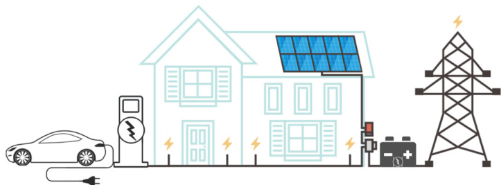
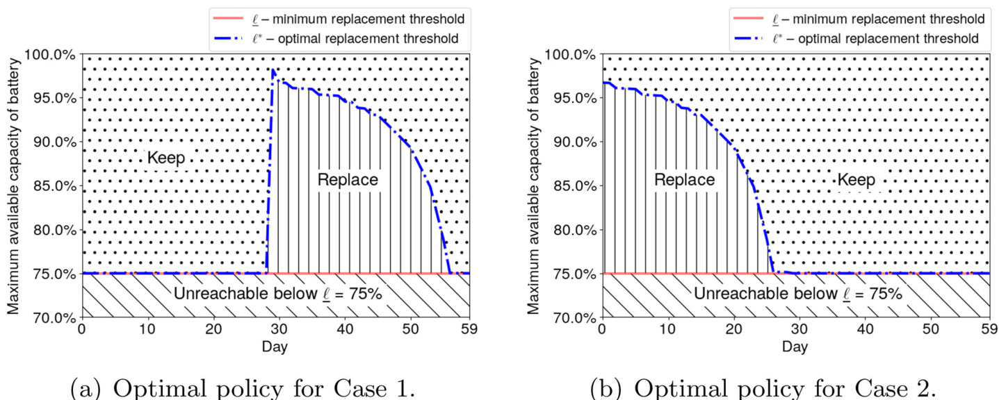
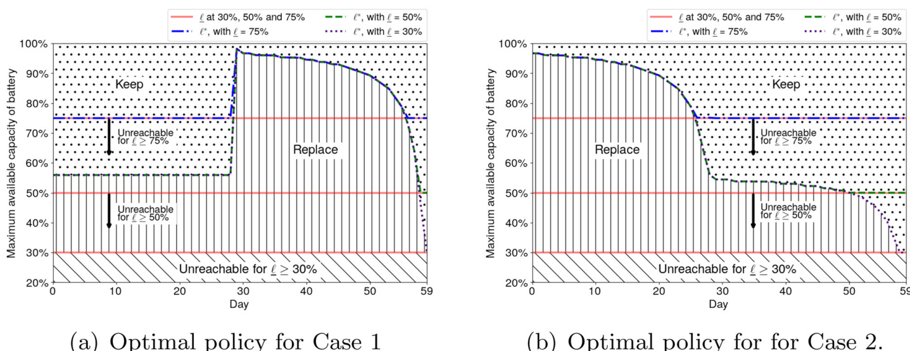

# Optimal utilization of integrated photovoltaic battery systems: An application in the residential sector  

Zeyu Liu, Mohammad Ramshani, Anahita Khojandi & Xueping Li  

To cite this article: Zeyu Liu, Mohammad Ramshani, Anahita Khojandi & Xueping Li (2023): Optimal utilization of integrated photovoltaic battery systems: An application in the residential sector, IISE Transactions, DOI: 10.1080/24725854.2022.2156003  

To link to this article:  https://doi.org/10.1080/24725854.2022.2156003  

# Optimal utilization of integrated photovoltaic battery systems: An application in the residential sector  

Zeyu Liua $\oplus$ Mohammad Ramshanib, Anahita Khojandib $\oplus,$ and Xueping Lib $\oplus$  

aDepartment of Industrial & Management Systems Engineering, West Virginia University, Morgantown, WV; USA; bDepartment of Industrial & Systems Engineering, The University of Tennessee, Knoxville, TN, USA  

# ABSTRACT  

PhotoVoltaic (PV) panels have been increasingly favored by residential users in recent years, due to noticeable reductions in their costs. The PV systems become more effective when combined with battery packages, which store the energy produced by the PV systems for later use. This way, the PV systems are able to provide flexible and reliable services even when the peak demand for electricity misalign with the window of most efficient PV power generation. In this study, we develop an integrated charge/discharge scheme for lithium-ion batteries to maximize their total expected benefit. Specifically, we develop a Markov Decision Process (MDP) model to maximize the battery utilization, subject to uncertainty in weather conditions and electricity demands, while accounting for battery degradation due to calendar aging and charging/discharging cycles. Due to the extremely slow rate of degradation in batteries, the state space of the MDP is excessively large. To solve the problem efficiently, we establish structural properties of the MDP and exploit them to solve the problem. We improve the backward induction algorithm with established structural properties. We further improve the Deep Q-network (DQN) algorithm by proposing two novel algorithms, the augmented DQN (ADQN) algorithm and the stochastic augmented DQN (SADQN) algorithm. Computational results indicate that ADQN and SADQN solve the problem much faster than DQN, with better solution qualities. The ADQN and SADQN algorithms provide flexibility for practitioners in real-world implementations.  

ARTICLE HISTORY Received 2 December 2021 Accepted 30 November 2022  

# KEYWORDS  

Photovoltaic panels;   
lithium-ion batteries;   
Markov decision processes;   
reinforcement learning;   
deep Q-learning  

# 1. Introduction  

The cost of PhotoVoltaic (PV) panels has reduced noticeably in the past few years, turning them into a favorable renewable energy source. In addition, the application of PV panels, especially in the residential sector, has witnessed a noticeable increase during the past years (Ramshani et al., 2020). However, the main challenge in utilizing this source of renewable energy remains in that the demand for electricity does not always align well with when PV panels most efficiently generate electricity, i.e., during night-time or under unfavorable weather. This can be addressed through storing the excessive energy generated by PV panels so that the stored energy can be used when the PV system is unable to function efficiently (Energy Sage, 2020a).  

In the literature, many studies have shown the effectiveness of combining PV systems with battery storage systems (Freitas Gomes et al., 2020). This is especially the case in recent applications in the residential sector (Nyholm et al., 2016; Ranaweera et al., 2017; Mulleriyawage and Shen, 2020). Figure 1 shows an example of the PV–battery system installed for a grid-connected household. Throughout the day (subject to weather patterns and available sunlight hours), the battery stores any excess generated electricity. This stored electricity is later used at night-time when the PV system cannot generate electricity, due to a lack of direct solar radiation. As such, implementing the PV–battery system helps households to increase the self-consumption rate of PVgenerated power, reducing dependency on the grid (Nyholm et al., 2016).  

The lead acid battery is one of the most widely considered storage units for PV systems (Gitizadeh and Fakharzadegan, 2013; Barnes et al., 2015). The lead acid battery is one of the oldest rechargeable solid state battery technologies (Oberhofer and Meisen, 2012) and has been widely used in commercial applications, due to its low cost (DufoLopez et al., 2021). However, a lead acid battery generally has a short lifespan, requires high levels of maintenance, and has a poor energy density (Diouf and Pode, 2015). Such shortcomings render lead acid batteries cost-ineffective for storing a large amount of energy, making them unfit for grid storage systems (Oberhofer and Meisen, 2012).  

According to the U.S. Energy Information Administration (EIA), the most common energy storage agent is Lithium-ion (Li-ion) batteries (DOE, 2020). The high charge and discharge efficiency, low level of requisite maintenance, limited capacity loss during idle time, and the capability of delivering high charging/discharging cycles have made the Li-ion battery a suitable choice for long-term and frequent residential applications, compared with other types of batteries (e.g., lead acid batteries) (Manthiram, 2020). In addition, recent technological advances have set the stage for more cost-efficient Li-ion batteries (U.S. Department of Energy, 2016). Cole and Frazier (2020) project that a 4-hour-duration battery system’s cost starting at $\mathbb{S}380$ per kWh in 2018 will cost $\mathbb{S}207$ per kWh and $\mathbb{S}156$ per kWh in 2030 and 2050, respectively, showing the extent to which battery costs will reduce. As such, battery-connected PV systems are expected to soon become a financially viable alternative to fossil fuels (The Week, 2014) and pave the way for the widespread replacement of fossil fuel-based power generation methods (Manthiram, 2020). In fact, in recent studies, the Li-ion battery has been proven to be a reliable replacement for the lead acid battery (Dufo-Lopez et al., 2021).  

  
Figure 1. An example of battery integrated PV systems for residential use.  

However, challenges still remain in utilizing Li-ion batteries in the residential sector. One of the main practical challenges is that Li-ion batteries often require a battery management system (Parfomak, 2012). This management system is an electronic system with a specialized algorithm that ensures the safety and efficiency of battery operations (Barsukov and Qian, 2013). The strategies of battery management originate from health monitoring and prognostics of machinery, but have developed sizable differences. Since Li-ion batteries show electro-chemical behaviors, the inaccessibility of the chemical reactions inside the batteries causes inconvenience in acquiring battery data, often leaving insufficient data to analyze. Also, monitoring Li-ion batteries results in different types of data from machinery observation, i.e., value-type instead of wave-form data. In addition, Li-ion batteries operate on dynamic profiles that heavily depend on the demand behavior. Thus, the available technologies and algorithms for diagnostics and prognostics of machinery need to be updated before they can be applied to Li-ion batteries (Zhang and Lee, 2011).  

Battery management strategies have been intensively studied in the context of integrating PV systems with battery storage units. Specifically, studies have been performed to estimate the state-of-charge voltage, capacity, and remaining-useful-life in the battery using various approaches, such as linear/nonlinear programming (Keerthisinghe et al., 2014; Ratnam et al., 2015a; Ranaweera et al., 2017; Jiang et al., 2021), dynamic programming (Keerthisinghe et al., 2016; Ranaweera and Midtgård, 2016; Jeddi et al., 2017), heuristic algorithm (Fuselli et al., 2013; Pena-Bello et al., 2017) or simulation (Schibuola et al., 2017). A majority of the studies present results of battery scheduling and management strategies within a short horizon of 24 hours, with several exceptions that project system performances for weeks or even years (Ratnam et al., 2015b; Hassan et al., 2017; Olaszi and Ladanyi, 2017; Watari et al., 2021). Considering that the approximated lifespan of the Li-ion battery is 20 years (Dufo-Lopez et al., 2021), long-term decision making is essential in assessing the cost-effectiveness of the Li-ion battery and the integrated PV–battery system for residential users.  

One of the major disadvantages in long-term battery management strategy analysis is increasing model complexity such that solving the model often becomes computationally expensive or intractable. Since the battery system is charged with PV-generated electricity, modeling battery behavior must consider the uncertainties in PV power generation. Favored by many, optimization models, such as stochastic programming, usually adopt a scenario-based approach to model uncertainties in power generation, resulting in a multi-stage model and a tree structure of scenarios that expands exponentially with the length of the horizon. As a consequence, many current studies have considered uncertainties as fixed parameters at different time-steps (Hassan et al., 2017; Mulleriyawage and Shen, 2020; Watari et al., 2021). These models need to be re-optimized if the uncertainty parameters, such as the PV-generated power, were to change.  

In this article, we aim to develop a battery management strategy that dynamically adapts to the changing environment. In order to model the operations of the integrated PV–battery system, we develop a Markov Decision Process (MDP) model. MDPs have been widely adopted in the literature to model system degradation and to derive optimal policies in a wide range of applications, including the PV–battery system (Keerthisinghe et al., 2014; Raju et al., 2014; Barnes et al., 2015; Raju et al., 2015; Mbuwir et al., 2017). Different from past studies, where battery degradation is not thoroughly studied under uncertain environments, our proposed MDP model optimizes the battery management policy for the PV–battery system and captures the stochastic environment that impacts PV output and battery degradation.  

Since PV panels are only functional when there is sunlight, we separate each day into two periods, the day-time and the night-time. As our problem of interest involves battery management and due to the fact that frequently charging and discharging the battery expedite its degradation and negatively impact its lifespan, we incorporate a well-established physics-based model from the literature into the MDP to model battery aging (Xu et al., 2016). We model battery degradation in a dynamic programming fashion (Xu, 2021), producing battery management policies in longer terms than the literature (Shi et al., 2018). In addition, we focus our attention on PV–battery systems that only allow for charging the battery during the day-time and discharging it during the night-time. Hence, the day-time demand is directly satisfied by either the PV-generated electricity or electricity purchased from the grid (Walker, 2018), and the night-time demand is satisfied by either the battery or electricity purchased from the grid.  

Specifically, during the day-time, our proposed MDP decides whether to replace the battery (due to degradation) or keep it. If the MDP decides to keep the battery, it then prescribes the extent to which the battery should be allowed to be charged, while accounting for peak sunlight hours (subject to weather uncertainties and household demand). At night-time, the MDP decides the amount of power to discharge to satisfy the household demand. If the reserved power is insufficient to address the energy demand, extra electricity is purchased from the grid. As such, the policy space is very large, mainly due to the large number of system states and actions that available to the MDP.  

Often, MDP models are difficult to implement on largescale problems, due to the curse of dimensionality (de Farias and Van Roy, 2003), i.e., the scale of the problem becomes too large for traditional methods to be used in the optimization process. However, recent advances in Reinforcement Learning (RL) have paved the way for finding (near) optimal policies of large-scale MDP problems. In RL, the decision maker learns about the optimal policy through a series of unsupervised trial-and-error procedures, i.e., evaluating the learned policy while interacting with the environment. Especially, the integration of RL and Neural Networks (NNs) has extended the capabilities of RL algorithms to a higher level. Combining deep NNs with RL, i.e., Deep RL (DRL) (Mnih et al., 2015), has resulted in numerous successful implementations in a variety of fields (Levine et al., 2016; Silver et al., 2016).  

One of the most successful DRL algorithms is the Deep Q-Network (DQN), which has achieved human–level control in playing Atari games (Mnih et al., 2015). The DQN makes improvements due to a reduction in the reliance on domain knowledge through the implementation of stochastic gradient descent in automatic feature engineering and end-to-end learning. In this study, we utilize the DQN to overcome the curse of dimensionality and to obtain approximate optimal policy for the MDP. Moreover, to decrease the solution time further, we provide two extensions to the DQN by incorporating structural properties of the MDP.  

Since accurate simulations of battery degradation require a large amount of data to account for various factors, we further adopt a physics-based Machine Learning (ML) approach in this study. Physics-based ML is a growing and promising area of research in artificial intelligence (Gumiere et al., 2020; Vadyala et al., 2021). It combines the power of ML algorithms, such as DRL, with physics-based models, so that ML algorithms learn not only from a simulated environment, but also from models built on concrete physics foundations (Willard et al., 2020). Specifically, we use DRL algorithms to simulate the cost and benefit of battery management policies, and use a well-established physics model in the literature to calculate battery degradation (Xu et al., 2016). In this way, the DRL algorithm demands less data for simulation, but can still accurately model battery degradation.  

In the literature, only a few studies have considered the optimal operations of PV–battery systems in the long term (Raju et al., 2014; Raju et al., 2015; Nyholm et al., 2016;  

Hassan et al., 2017; Olaszi and Ladanyi, 2017), among which even fewer modeled either environmental uncertainties or battery degradation (Raju et al., 2014; Rau et al., 2015), due to the complexity imposed on the model. We summarize the current research progress and trends regarding battery management policies for PV systems in Appendix A. Our study differs from the current literature in significant ways, as it takes into account both uncertainties in PV–battery operations as well as the battery degradation. Further, different from other works in the literature, our study establishes analytical properties of the model, which are leveraged to improve the performance of solution algorithms. This study is also among the first that adopts stateof-the-art DRL methods to find operational policies for PV–battery systems, contributing to the development of smart systems with artificial intelligence technologies.  

The main contributions of this study are as follows. First, we develop an MDP model to optimally control battery utilization in storage-battery-integrated PV systems for residential users. Second, we optimize the financial cost of the integrated PV–battery system during a 2-month horizon, providing intuitive results for real-world implementations. Third, we specifically focus on the longevity of the battery, offering superior battery management policies compared with a commonly used method in practice. Last, but not least, we analytically establish mathematical properties of the MDP model to design novel and efficient algorithms to optimize battery management policies. The proposed algorithms significantly differ from established algorithms in the literature and feature the combination of operations research and artificial intelligence techniques, where mathematical properties unique to our problem are incorporated into backward induction and DRL algorithms to improve performance.  

This article is structured as follows. In Section 2, the key notation is defined and the MDP model is formulated. In Section 3, the MDP model is further analyzed to establish structural properties. In Section 4, results of numerical studies are presented, including visualization of the optimal policies and comparisons with benchmarks. In Section 5, solution algorithms are improved based on the structural properties that are either proved mathematically or observed in the results. Finally, in Section 6, we draw conclusions and provide insights.  

# 2. Model formulation  

In this section, we develop an MDP model to minimize the electricity cost of a household over a finite horizon, by optimizing the utilization of Li-ion battery storage integrated with a PV system. The detailed model is provided below. In addition, Table 6 in Appendix B provides a summary of the notation used in this study.  

We discretize time in units of day, i.e., $t=0,1,...,T_{m a x},$ where $T_{m a x}$ is the maximum number of days considered in the model. Due to different behaviors of the battery during day-time and night-time, we further let $\phi_{t}$ represent the time of the day, where $\phi_{t}=1$ and $\phi_{t}=0$ denote day-time and night-time, respectively.  

We let $s_{t}^{\phi}(\ell,h,\cdot)$ denote the state of the PV–battery system, keeping track of day-night cycles, battery degradation, and available charge. Specifically, we let $\ell,\,\underline{{\ell}}\leq\ell\leq\bar{\ell}$ , denote the maximum available capacity of the current Li-ion battery, expressed as the remaining percentage of the initial capacity of a new battery, where $\bar{\ell}$ is the maximum available capacity and $\underline{{\ell}}$ is the minimum battery replacement threshold, generally recommended by battery manufacturers. In practice, the maximum available capacity $\ell$ can be accurately measured due to recent advances reported in the literature (Shen et al., 2019; Stroe and Schaltz, 2019). We let $h$ , $0\leq$ $h\leq1$ , denote the remaining available charge of the current Li-ion battery. We define $h$ as a percentage of $\ell$ (shown on a scale of 0–1), regardless of $\ell$ :  

We keep track of different attributes of the system during day-time and night-time. During the day-time $\langle\phi=1\rangle$ ), we let the discrete random variable $X(t)$ , with Probability Mass Function (PMF) $P_{X}^{t}(\cdot)$ , denote the peak sunlight hours. As such, we define the day-time $(\phi=1)$ ) state as $s_{t}^{1}(\ell,h,y(x))$ , where $y(x)$ $),\,x\in X(t)$ , denotes the day-time demand-adjusted PV panel output, in percentage of $\ell$ : Note that we do not directly include the day-time demand in our model, as we assume it is directly satisfied by either the PV-generated electricity or electricity purchased from the grid. Therefore, by calibrating $y(x)$ as the amount of electricity left after fulfilling the day-time demand, the optimal battery management policy simply captures the consequences of the day-time demand through $y(x)$ . During the night-time $\left[\phi=0\right]$ ), we let the discrete random variable $D(t)$ , with PMF $P_{D}^{t}(\cdot)$ , denote the night-time household demand. We define the night-time $\left(\phi=0\right)$ state as $s_{t}^{0}(\ell,h,d)$ , where $d\in D(t)$ is the demand at night-time that should either be covered by the battery discharge or electricity purchased from the grid at a unit cost of $\mu$ . Considering that utility companies offer a variety of electricity pricing plans (Knoxville Utilities Board, 2022; Pacific Gas & Electric, 2022), it is difficult to measure the amount of demand under a specific price for general residential users. Thus, in this model, we let $\mu$ be the average electricity price.  

Given the state of the process, different actions may be taken to intervene. At day-time $\;\;\phi=1\;,$ ), the decision maker either replaces the battery, or allows the battery to remain in use and charge the battery with PV-generated power. Specifically, for all $\ell<\ell$ , the only possible action is to replace the battery. For all $\ell\geq\underline{{\ell}}_{:}$ , the possible actions are to replace or to charge the battery, i.e., choose the charge level. If the action is to charge the battery, the set of possible charge levels is restricted by the remaining available capacity to charge, i.e., $1-h$ : In addition, the amount of available power to charge is restricted by the day-time demandadjusted output of PV panels $y(x)$ that depends on the available daily peak sunlight hours. Hence, for the day-time $(\phi=1)$ , when $\ell\geq\underline{{\ell}}$ , we let  

$$
{A}_{t}^{1}=\{a:0\leq a\leq\operatorname*{min}\{1-h,y(x)\}\},
$$  

which captures the set of available charge levels. At nighttime $\left(\phi=0\right)$ ), a decision should be made on the extent of battery discharge. For the night-time $\left[\phi=0\right]$ ), we let  

$$
A_{t}^{0}=\{a:0\leq a\leq h\},
$$  

which captures the set of available discharge levels.  

As mentioned in Section 1, the cells in a Li-ion battery package lose capacity over time. The degradation level of a battery depends on its calendar age as well as its cycle age. Cycle age is defined as the number of full cycles (i.e., the process of charging and discharging) that the battery has had in its lifetime (Xu et al., 2016). Here, we adopt a similar method to that in the literature to model battery degradation $(\mathrm{Xu},\,2021)$ . Specifically, the amount of capacity loss is reduced from the the maximum available capacity $\ell$ each time the battery charges/discharges. To approximate the capacity loss, we use the function provided by Xu et al. (2016). Equation (3) shows the incremental capacity loss in a Li-ion battery cell due to charge, discharge, and aging, i.e.,  

$$
g(\ell,h,\theta_{a}^{\phi},\tau)=1-(1-\ell)e^{-f_{d}(\theta_{a}^{\phi},\tau)},
$$  

where $\theta_{a}^{\phi}$ denotes the amount of power to be charged or discharged, depending on the action $^{\,a}$ and the day-night time $\phi$ , and $f_{d}(\theta_{a}^{\phi},\tau)$ is a function of charge and discharge levels $\theta_{a}^{\phi}$ and the temperature $\tau$ of the battery package. The temperature of the battery, $\tau$ , is considered to be constant and equal to $25^{\circ}C$ for each day. The assumption of constant temperature for the residential users is mild and is expected to be rather easily satisfied as most batteries on the market can be installed indoors (Tesla, Inc., 2021), where room temperature falls within the range of optimal operating temperature $(15{-}35^{\circ}\mathrm{C})$ for Li-ion batteries (Booten et al., 2017; Ma et al., 2018).  

When the battery capacity reduction is severe, the battery can be replaced at a cost, c, so that a brand new battery with the maximum capacity $\bar{\ell}$ , and the remaining charge $h_{0}$ replaces the old battery. Note that when a battery is replaced in day $t,$ it is not available for the entire duration of daytime $\;\;\phi=1\;,$ ) for that given day. It is also assumed that the new battery package has the same type, capacity, and price as the old battery package. Also, we consider a salvage value for the replaced battery, denoted by $c_{0}(\ell)<c_{:}$ , which we assume to be non-decreasing in $\ell$ :  

The minimum total expected discounted cost during the decision making horizon $t=0,1,...,T_{m a x}$ is calculated using the Bellman optimality equation (Puterman, 2014), with a discount factor $\lambda\in[0,1]$ : We define $V_{t}^{1}(\ell,h,y(x))$ as the cost function starting from day $t$ during the day-time $(\phi=1)$ ) and $V_{t}^{0}(\ell,h,d)$ as the cost function starting from day $t$ during the night-time $(\phi=0)$ . In addition, during the day-time $(\phi=1)$ , we define $R_{t}(\ell)$ as the total expected cost under the action “Replace” and $K_{t}(\ell,h,y)$ as the cost under the action “Keep.” Thus, we have  

$$
V_{t}^{1}(\ell,h,y(x))=\left\{\begin{array}{l l}{R_{t}(\ell),}\\ {\quad}\\ {\displaystyle\operatorname*{min}\{R_{t}(\ell),K_{t}(\ell,h,y(x))\},}\end{array}\right.
$$  

otherwise,  

with  

$$
R_{t}(\ell)=c-c_{0}(\ell)+\lambda\cdot\sum_{d\in D(t)}P_{D}^{t}(d)\cdot V_{t}^{0}(\bar{\ell},h_{0},d)
$$  

and  

$$
\begin{array}{r l r}{\lefteqn{K_{t}(\ell,h,y(x))=\operatorname*{min}_{a\in A_{t}^{1}}\left\{\lambda\cdot\sum_{d\in D(t)}P_{D}^{t}(d)\right.}}\\ &{}&{\left.\cdot\;V_{t}^{0}(\ell-g(\ell,h,\theta_{a}^{1},\tau),h+a,d)\right\}.}\end{array}
$$  

Equation (4) states that the total expected cost during the day-time $(\phi=1)$ ) is the total expected cost under the action “Replace,” if the battery degradation level forces the decision maker to replace the battery. Otherwise, the total expected cost is the smaller between replacing the battery or keeping it. In Equation (5), $R_{t}(\ell)$ is calculated as the new battery cost $c_{s}$ , minus the battery salvage value, $c_{0}(\ell)$ , plus the expected discounted cost-to-go starting from the upcoming night-time $(\phi=0)$ with a new battery capacity $\bar{\ell}$ and initial charge $h_{0}$ . In Equation (6), $K_{t}(\ell,h,y(x))$ is calculated as the minimum total expected discounted cost-to-go of the upcoming night-time $\left(\phi=0\right)$ ) with the battery capacity of $\ell-g(\ell,h,\theta_{a}^{1},\tau)$ , adjusted from $\ell$ due to battery aging, and available charge $h+a$ .  

During night-time $(\phi=0)$ , we define $V_{t}^{0}(\ell,h,d)$ as the total expected discounted cost-to-go starting from day $t.$ Thus, we have  

$$
\begin{array}{l}{{V_{t}^{0}(\ell,h,d)=\displaystyle\operatorname*{min}_{a\in A_{t}^{0}}\bigg\{\mu\cdot(d-a\cdot\ell)^{+}+\lambda\cdot\sum_{x\in X(t+1)}P_{X}^{t+1}(x)}}\\ {{\mathrm{~}\cdot\,V_{t+1}^{1}(\ell-g(\ell,h,\theta_{a}^{0},\tau),h-a,y(x))\bigg\},}}\end{array}
$$  

where $(d-a\cdot\ell)^{+}=\operatorname*{max}\{d-a\cdot\ell,\,0\}$ : In Equation (7), the total expected cost $V_{t}^{0}(\ell,h,d)$ is equal to the expected electricity cost not supported by the battery, plus the total expected discounted cost-to-go starting from the upcoming day-time, i.e., day-time at time $t+1$ . Battery aging is represented by $\ell-$ $g(\ell,h,\theta_{a}^{0},\tau)$ , where battery capacity reduces based on the level of discharge at the night-time. Note that when $t=T_{\mathrm{max}},$ , i.e., the last day of the planning horizon, we let $V_{t+1}^{1}(\ell-$ $g(\ell,h,\theta_{a}^{0},\tau),h-a,y(x))=-c_{0}(\ell-g(\ell,h,\theta_{a}^{0},\tau))$ , the salvage value of the battery after usage.  

# 3. Structural properties  

In this section, we formally establish the structural properties of the model. Proofs of the theoretical results in this section are shown in Appendix C. Note that without the loss of generality, the state space can be discretized, so that $\ell\in\{\underline{{\ell}},\underline{{\ell}}+$ $\varepsilon,...,\bar{\ell}-\varepsilon,\bar{\ell}\,\}$ and $h\in\{0,\varepsilon,...,1-\varepsilon,1\}$ , where $\varepsilon\ge0$ and  

$$
\begin{array}{r l}&{\mathfrak{s}=\operatorname*{max}\biggl\{\varepsilon\in\mathbb{R}_{++}:\frac{\ell}{\varepsilon}\in\mathbb{Z}_{++},\frac{g(\ell,h,\theta_{a}^{1},\tau)}{\varepsilon}\in\mathbb{Z}_{++},}\\ &{\quad\,\,\times\,\frac{g(\ell,h,\theta_{a}^{0},\tau)}{\varepsilon}\in\mathbb{Z}_{++}\biggr\}.}\end{array}
$$  

In the following, we consider discretized $\ell$ and $h$ such that $\ell_{1}\leq\ell_{2}$ suggests that $\exists\,k\in\mathbb{N},$ , $\ell_{2}=\ell_{1}+k\varepsilon$ , and $h_{1}\leq h_{2}$ suggests that $\exists\,k\in\mathbb{N}$ , $h_{2}=h_{1}+k\varepsilon$ : In addition, the following assumptions are made throughout the article:  

Assumption 3.1. The salvage value $c_{0}(\ell)$ for a battery with capacity $\ell$ is non-decreasing in $\ell$ :  

Assumption 3.2. The battery degradation level due to charge/discharge follows Equation (3) with a constant temperature $\tau=25^{\circ}C.$ . Additionally, given fixed $h,\ a,$ and $\tau_{z}$ , for any $\varepsilon>0$ ,  

$$
\begin{array}{r l}&{g(\ell+\varepsilon,h,\theta_{a}^{\phi},\tau)\geq g(\ell,h,\theta_{a}^{\phi},\tau)\quad\mathrm{{and}}}\\ &{\qquad\qquad\qquad g(\ell+\varepsilon,h,\theta_{a}^{\phi},\tau)-g(\ell,h,\theta_{a}^{\phi},\tau)\leq\varepsilon.}\end{array}
$$  

Assumption 3.1 suggests that the salvage value of a battery is higher if it has a larger maximum available capacity $\ell$ (Lih et al., 2012). Assumption 3.2 indicates that a battery with a larger maximum available capacity degrades faster (Xu et al., 2016). It also assumes that the difference in the degradation levels, $g(\ell+\varepsilon,h,\theta_{a}^{\phi},\tau)-g(\ell,h,\theta_{a}^{\phi},\tau)$ , is no larger than the minimum difference e in battery capacity. Assumptions 3.1 and 3.2 pave the way for the sufficient condition of a structured optimal policy.  

Next, Lemma 3.3 establishes the monotone behavior of the expected discounted cost-to-go from day $t$ when the decision is to replace the battery with the available capacity $\ell$ :  

Lemma 3.3. For any given day $t,$ for $\phi=1,R_{t}(\ell)$ is nonincreasing in $0\leq\ell\leq\bar{\ell}$ :  

Lemma 3.4 shows an important property of the battery capacity $\ell$ and the degradation $g(\ell,h,\theta_{a}^{\phi},\tau)$ , i.e., after degradation, the new capacity $\ell-g(\ell,h,\theta_{a}^{\phi},\tau)$ is non-increasing in $\ell$ :  

Lemma 3.4. For fixed $h,$ $\theta_{a}^{\phi}$ , and $\tau,$ if $\ell_{1}\leq\ell_{2}$ then $\ell_{1}-g(\ell_{1},h,\theta_{a}^{\phi},\tau)\leq\ell_{2}-g(\ell_{2},h,\theta_{a}^{\phi},\tau)$ :  

Next, Theorem 3.5 establishes the monotonicity of the value function $V^{\phi}(\ell,h,\cdot)$ in $\ell$ for both $\phi=0$ and $\phi=1$ : Note that due to the minimum battery replacement threshold $\underline{{\ell}}$ , Theorem 3.5 does not consider the continuity of the monotonicity across the sets $\ell\in[0,\underline{{\ell}}]$ and in $\ell\in(\underline{{\ell}},\bar{\ell}]$ : Thus, they are treated separately.  

Theorem 3.5. The value function $V_{t}^{\phi}(\ell,h,\cdot)$ is non-increasing in $\ell\in[0,\underline{{\ell}})$ and in $\ell\in[\underline{{\ell}},\bar{\ell}]$ for $\phi=0$ and $\phi=1.$ , i.e., given fixed $\gamma,\ h$ and $d,$ , with $0\leq\ell_{1}\leq\ell_{2}<\underline{{\ell}}$ or $\underline{{\ell}}\le\ell_{1}\le\ell_{2}\le\bar{\ell}.$ , we have  

$$
\begin{array}{r l}&{V_{t}^{1}(\ell_{1},h,y(x))\geq V_{t}^{1}(\ell_{2},h,y(x))\;\;\mathrm{and}\;\;V_{t}^{0}(\ell_{1},h,d)}\\ &{\qquad\qquad\qquad\geq V_{t}^{0}(\ell_{2},h,d).}\end{array}
$$  

When proving Theorem 3.5, Corollary 3.6 can be naturally established, stating that the total expected discounted cost of keeping the battery, $K_{t}(\ell,h)$ , is non-increasing in $\ell\in[\underline{{\ell}},\bar{\ell}]$ : Here, we do not consider the interval $[0,\underline{{\ell}})$  

because of the minimum battery replacement threshold $\ell$ where the action is always to replace when $\ell\leq\underline{{\ell}}$ :  

Corollary 3.6. For any given day $t,$ and remaining available charge $h$ , $K_{t}(\ell,h)$ is non-increasing in $\ell\in[\underline{{\ell}},\bar{\ell}]$ :  

Under the condition that the battery salvage value is constant for all $\ell$ , Corollary 3.6 immediately leads to Theorem 3.7, where we establish that an optimal control-limit policy exists for the day-time value function. The theorem proves the existence of a control-limit $\ell^{*}$ , where the optimal action is always to replace the battery when $\ell<\ell^{*}$ , and it is to keep the battery, otherwise.  

Theorem 3.7. Given a constant battery salvage value, i.e., $c_{0}(\ell)=c_{0}\,\forall\ell,$ , for fixed day $t,$ remaining battery capacity $h,$ and available PV power y, $V_{t}^{1}(\ell,h,y(x))$ has a control-limit optimal policy in the maximum available capacity $\ell$ . That is, there exists an $\ell^{*}\geq\underline{{\ell}}$ such that  

$$
V_{t}^{1}(\ell,h,y(x))=\left\{\begin{array}{l l}{R_{t}(\ell),}&{i f\ \ell<\ell^{*},}\\ {K_{t}(\ell,h,y(x)),}&{o t h e r w i s e.}\end{array}\right.
$$  

# 4. Numerical study  

In this section, we conduct numerical experiments and present the corresponding optimal battery management policies. Specifically, we first provide illustrative examples of the behavior of the optimal policy under different model parameters. Then, we compare the optimal policy with a battery utilization benchmark policy, commonly used in practice.  

To solve the problem, we discretize the state space so that $\ell\in\{\underline{{\ell}},\underline{{\ell}}+\varepsilon,...,\bar{\ell}-\varepsilon,\bar{\ell}\}$ and $h\in\{0,\varepsilon,...,1-\varepsilon,1\}$ , where $\varepsilon\ge0$ is chosen according to Equation (8). Since the MDP model proposed in this study makes decisions within a finite horizon $T_{m a x},$ we use the Backward Induction (BI) algorithm (Puterman, 2014), an exact solution method for MDP, to generate the optimal policies.  

Note that the cost of a battery package with a capacity of $13.5\,\mathrm{\kWhs}$ is on the order of $\mathbb{S}6500$ (e.g., Tesla PowerWall without any extra accessories (Energy Sage, 2020b)). In addition, the average electricity cost is estimated to be on the order of 10.3 cents/kWh for a major city in the southeastern US (Ramshani et al., 2020). For the same city, the demand of an average household, representing the average daily energy consumption, is estimated as $15.0\,\mathrm{\kWhs}$ (Ramshani et al., 2020). We use a discount factor of 0.9997, estimated according to the annual interest rate in the U.S. (Bank, 2021).  

# 4.1. Behavior of the optimal policy  

In this section, we present illustrative examples of the intuitive behavior of the optimal policy under different environmental conditions. In these examples, we calibrate the model in a way that allows for showcasing the structure and behavior of the optimal policy, while keeping the solution time reasonable. Specifically, in the following examples, we consider a time horizon of 2 months ( $\left.T_{m a x}\,=\,60\right)$ ). We set the price of the battery package to $10\%$ of its actual price, and set the electricity cost to 100 times of its actual price. These modifications allow the behavior of the optimal policy to be observed over a short horizon. In addition, we use a “fully charge/discharge policy.” That is, when $\phi=1$ , if the decision is to keep the battery package and charge it, the battery is charged as much as possible, i.e., $A_{t}^{1}=$ $\{0,\operatorname*{min}\{1-h,y(x)\}\}$ : Similarly, when $\phi=0$ , the battery package is discharged completely, i.e., $A_{t}^{0}=\{h\}$ :  

Table 1. Case studies to investigate the effects of changes in possible set of peak sunlight hours in day t, X(t), on the results of the model.   

<html><body><table><tr><td></td><td colspan="2">Values of peak sunlight hours in day t,E(x(t))</td></tr><tr><td>Casestudy</td><td>tE{1,.,30}</td><td>t E{31,..,60}</td></tr><tr><td>Case1</td><td>2</td><td>4</td></tr><tr><td>Case2</td><td>4</td><td>2</td></tr></table></body></html>  

Table 1 shows two different cases designed to capture the effect of changes in the possible set of peak sunlight hours in day $t,\,X(t)$ , on the results of the model. The cases consider 2-month horizons, where $X(t)$ takes the same value for every day during each month (30 days) to showcase the effects of the time spans with higher/lower levels of peak sunlight hours on the results and the behavior of the model.  

Figures 2(a) and 2(b) depict the optimal policy for Cases 1 and 2, respectively, under the “fully charge/discharge policy” with the minimum battery replacement threshold $\underline{{\ell}}=75\%$ , a threshold commonly adopted by battery manufacturers (Dogger et al., 2010; Tant et al., 2012). The figures show that when $X(t)\,=\,2$ , the optimal policy is to use the battery as much as possible, and hence, not to replace the battery package except when it is restricted by the assumptions of the model to do so, i.e., when $\ell\leq\underline{{\ell}}$ : However, for $X(t)=4$ , it is optimal to replace the battery according to a control-limit $\ell^{*}$ , where $\ell^{*}\geq\underline{{\ell}}$ : This suggests that the model chooses to replace the battery, not due to the imposed restriction of $\underline{{\ell}}=75\%,$ but with an aim to maximize battery utilization and minimize the overall cost.  

Figures 2(a) and 2(b) also show that when the optimal replacement threshold $\ell^{*}\geq\underline{{\ell}}_{:}$ , the value of $\ell^{*}$ decreases in $t$ . Moreover, as the model progresses in the time horizon, the marginal reduction of $\ell^{*}$ becomes more drastic. This indicates that the model allows the battery to degrade more as the time approaches the end of the time horizon, where the cost of replacing the battery outweighs the benefit.  

Another interesting observation is that in Figure 2(a), the highest level of $\ell^{*}$ appears at $t\!=\!30$ , when the number of peak sunlight hours is still equal to two. This can be explained through the structure of the model. If the decision is to replace the battery package, the day-time $t$ is dedicated to replacing the battery, and the peak sunlight hours during that given day are lost. Therefore, the optimal policy suggests to replace the battery package a day before the start of the period with high peak sunlight hours. This allows for taking full advantage of the period with high peak sunlight hours, and hence, maximizing the overall income.  

Next, we investigate the impact of three different levels of $\underline{{\ell}}$ on the optimal policy, with $\underline{{\ell}}\in\{30\%,50\%,75\%\}$ : Figures 3(a) and 3(b) show the optimal policies for Cases 1 and 2, respectively, under the “fully charge/discharge policy” with the minimum battery replacement threshold $\underline{{\ell}}\in$ $\{30\%,50\%,75\%\}$ : The figures show that the optimal replacement threshold, i.e., $\ell^{*}$ , follows a similar pattern regardless of the value of $\underline{{\ell}}$ : In addition, Figures 3(a) and 3(b) show that for high sunlight hours, $\ell^{*}$ is the same for all levels of $\ell$ : These observations suggest that the optimal policies when $\underline{{\ell}}$ is higher can be intuitively viewed as partial representations of the optimal policies when $\underline{{\ell}}$ is lower.  

  
Figure 2. Example optimal policies when the minimum battery replacement threshold $\underline{{\ell}}=75\%,$ for the two cases presented in Table 1.  

  
Figure 3. Example optimal policies when battery replacement threshold $\underline{{\ell}}\in\{30\%,50\%,75\%\},$ for the two cases presented in Table 1.  

Figures 3(a) and 3(b) also show that for a given day $t,$ when the future values of peak sunlight hours $X(t)$ are larger, the optimal replacement threshold $\ell^{*}$ is consistently higher. For example, during the first month (30 days), $X(t)$ is larger in Case 2 than in Case 1. The optimal policies for these two cases are respectively plotted in Figures 3(b) and 3(a). As seen in these figures, the optimal replacement thresholds in Figure 3(b) are larger than those in Figure 3(a). Analogous trends can be observed for the second month (30 days) due to the switch in $X(t)$ values in Cases 1 and Case 2, which leads to the optimal replacement thresholds in Figure 3(a) being larger than those in Figure 3(b). Such behavior of the optimal policy is intuitive mainly because when the peak sunlight hours are larger, the battery experiences more severe degradation. Thus, larger optimal replacement thresholds incite more frequent battery replacements, allowing the PV–battery system to become more efficient, so that the solar power can be fully utilized to satisfy residential demands.  

# 4.2. Benchmarking  

Currently, one of the most common practices for the PV–battery systems is to charge the battery package as much as possible, to discharge the battery until the demand is met or the battery is empty, and to replace the battery only when the minimum replacement threshold $\underline{{\ell}}$ is met (Angenendt et al., 2016). In the following, we compare the policy from our model with this commonly used policy as a benchmark over a 2-month horizon for Cases 1 and 2.  

Similar to the experiments in Section 4.1, in order to observe the behavior of the optimal policy over a 2-month horizon, and to solve the model within tractable time, we make modifications to the parameters. Specifically, the price for each kWh of electricity from the grid is multiplied by  

Table 2. Mean, maximum, and standard deviation of the improvements when using the MDP optimal policy, as opposed to the benchmark policy, for cases presented in Table 1.   

<html><body><table><tr><td>Cases</td><td>Mean (%)</td><td>Max (%)</td><td>StandardDeviation (%)</td></tr><tr><td>Case 1</td><td>16.38</td><td>27.54</td><td>4.94</td></tr><tr><td>Case2</td><td>46.25</td><td>59.78</td><td>9.24</td></tr></table></body></html>  

100 and set to $\mathbb{S}10.3$ , and the price for a battery package is set to $10\%$ of the actual battery cost, i.e., $\mathbb{S}620$ with a capacity of $13.5\,\mathrm{kWh}$ , and the night-time demand is set to $15\,\mathrm{kWh}$ . In addition, we let the replacement threshold $\underline{{\boldsymbol{\ell}}}=$ $75\%$ : Here, we restrict the action space by allowing the battery to be half and fully charged/discharged, i.e., $A_{t}^{1}=$ $\{0,0.5\cdot\operatorname*{min}\{1-h,y(x)\},\operatorname*{min}\{1-h,y(x)\}\}$ and $A_{t}^{0}=\{0.5\cdot h,h\}$ :  

Table 2 shows a statistical summary of the reduction in the total expected discounted cost when using the MDP optimal policy, as opposed to the benchmark policy. As seen in Table 2, compared with the benchmark policy, the MDPprescribed optimal policy reduces the total expected discounted cost of implementing the PV–battery system. It can be observed that for Case 1, the mean difference in the total expected discounted cost is smaller than that for Case 2. This is due to the fact that the proposed model aims to find the most profitable replacement threshold under the optimal policy, whereas the benchmark only replaces the battery when $\underline{{\ell}}$ is reached. In addition, since the objective calculates the total expected discounted cost, the earlier the profit is made, the more valuable it is. As a result, the improvement for Case 2 is much more significant than that for Case 1. This is mainly because the optimal policy for Case 2 selects higher replacement thresholds than that in Case 1 in the first 30 days so that the total cost of the PV–battery system can be reduced earlier, compared with Case 1.  

# 5. Improving solution algorithms  

Since the BI algorithm performs value updates for all states across the entire decision making horizon, it becomes inefficient when solving large-scale MDP problems. Note that heuristic search algorithms can also be used to find the optimal policies of MDP problems. However, due to the complexity of our problem, preliminary experiment results show that heuristic search algorithms are less efficient in optimizing the policies than DRL methods. Hence, we propose two novel DRL algorithms, namely, the Augmented DQN (ADQN) and the Stochastic Augmented DQN (SADQN), to solve the problem efficiently. These two algorithms rely on getting “warm started” with preliminary solutions obtained from curated subproblems that are solved using a modified BI algorithm. The modified BI algorithm incorporates the structural properties proved in Section 3 to solve the problems faster. Thus, the proposed algorithms feature significant differences from the established algorithms such as BI and DQN, where knowledge unique to the problem is incorporated into the proposed algorithms to improve the solution efficiency. In the following, we discretize the state space so that $\ell\in\mathcal{L}=\{\underline{{\ell}},\underline{{\ell}}+\varepsilon,...,\bar{\ell}-\varepsilon,\bar{\ell}\}$ and $h\in\mathcal{H}=$ $\{0,\varepsilon,...,1-\varepsilon,1\}$ , where $\varepsilon\ge0$ is chosen according to Equation (8). The DQN algorithm is shown in Appendix D. Based on the DQN algorithm, we propose ADQN and SADQN to improve to the solution quality and to reduce the computational time.  

# 5.1. Proposed algorithms  

The motivation for ADQN and SADQN comes from the results observed in Figure 3. Specifically, Figure 3 suggests that reducing the minimum replacement threshold $\underline{{\ell}}$ does not affect the optimal policy. Thus, we modify the DQN algorithm by incorporating the optimal solution from smaller-scale subproblems. In addition, we utilize the structural property proved in Theorem 3.7 to further reduce the efforts needed to solve the resulting smaller-scale subproblems using the BI algorithm (which we refer to as the modified BI algorithm).  

First, we introduce the modified BI algorithm that includes the threshold-type optimal policy in Theorem 3.7. The algorithm starts from $t=T_{m a x}$ and moves backward by setting $t=t-1$ , until $t\!<\!0$ . At each epoch $t_{:}$ the algorithm first calculates the optimal solution for the night-time $(\phi=0)$ , where the optimal level of discharge is decided according to Equation (7) for every state. Then, the algorithm moves to the day-time $\;\!\phi=1\,\;\;$ ). According to Theorem 3.7, finding the optimal policy for the day-time requires finding the optimal replacement threshold $\ell_{h,y(x),t}^{*}\in\mathcal{L}$ for every pair of $h$ and $y(x)$ , such that the expected cost-to-go $V_{t}^{1}$ is minimized. For fixed $h$ and $y(x)$ , we start the search from $\ell=\bar{\ell}$ and compare $R_{t}(\ell)$ with $K_{t}(\ell,h,y(x))$ : If $R_{t}(\ell)\geq K_{t}(\ell,h,y(x))$ , we let $\ell=$ $\ell-\varepsilon$ and compare the new values, until $\ell=\underline{{\ell}}$ or $R_{t}(\ell)<$ $K_{t}(\ell,h,y(x))$ , suggesting that the current $\ell$ is the optimal replacement threshold at time $t.$ . Hence, we set $\ell_{h,y(x),\,t}^{*}=\ell$ and move backward one step in $t.$ The modified BI algorithm is shown in Appendix E.  

In ADQN and SADQN, the modified BI algorithm is utilized to solve smaller-scale subproblems. These smaller-scale subproblems are created by introducing a surrogate minimum replacement threshold $\underline{{\ell}}^{\prime}$ whose value is set at a higher value than the minimum replacement threshold $\underline{{\ell}}$ of the problem of interest. By letting ${\underline{{\ell}}}^{\prime}\geq{\underline{{\ell}}}$ , we limit the scale of the subproblem because all states with $\ell\leq\underline{{\ell}}^{\prime}$ must replace the battery. For instance, to solve a problem with $\underline{{\ell}}=75\%$ , a subproblem can have the surrogate minimum replacement threshold $\underline{{\ell}}^{\prime}=90\%$ where the battery must be replaced when $\ell$ reaches or goes below $90\%$ . Consequently, AQDN and SADQN first solve the smaller-scale subproblems so that the solutions of the subproblems can be incorporated in the learning process of the NN models. As Figure 3 suggested, changing the minimum replacement threshold $\underline{{\ell}}^{\prime}$ does not affect the correctness of the optimal policy learned by the modified BI algorithm. Thus, the solutions learned by the modified BI algorithm can be “transferred” to the NN models when dealing with the full-scale problem by “warm starting” the NN models and consequently, expediting the learning process.  

<html><body><table><tr><td>Initialize the replay memory D and target network update frequency F; Initialize policy network Q with random weight %; Initialize the target network Q with weights - = ; Set the surrogate minimum replacement threshold f' for the subproblem; Solve the subproblem with f' using modified BI and record the Q-values Q'(s,a) for each state where  ≥ '; for episode = 1 to M do Initialize the state s = s for day O at day-time (Φ = 1); for t=0 to Tmax do for Φ in {1, 0} do</td></tr><tr><td>Following e-greedy policy, select random action a，1 with probability ,</td></tr><tr><td>argmaxa Q(s,a),  otherwise Execute action a in emulator and observe reward r and next state s';</td></tr><tr><td>Store transition (s,a,r,s) in D; Set s = s';</td></tr><tr><td>Sample erandom minibatchof transitions (sj,aj, rj, s,) from D;</td></tr><tr><td>rj if episode terminates at s', (0)s J!(s)0"xeu +! = S [r;+A maxaQ(s,a), otherwise; Perform gradient descent on (Y; - Q(sj, a;))² w.r.t. the network parameter &; Every F steps, set - = ′; end for end for end for</td></tr></table></body></html>  

Next, we introduce the ADQN algorithm. Since in DQN the optimal policy is approximated by the policy network according to the $\mathrm{Q}$ -values $Q(s,\,a)$ described in Appendix D, the policy computed by the modified BI algorithm cannot be directly incorporated. However, the BI algorithm still calculates the Q-values when computing $R_{t}(\ell),\,K_{t}(\ell,h,y(x))$ and $V_{t}^{0}(\ell,h,d)$ using Equations (5), (6) and (7). Thus, in the ADQN algorithm, we first solve a subproblem with a surrogate minimum replacement threshold $\underline{{\ell}}^{\prime}$ : When solving the subproblem with the modified BI algorithm, we record the corresponding Q-values, which we denote by $Q^{\prime}(s,a)$ , for each state and action pair according to Equations (26) to (28) in Appendix D. The ADQN algorithm is consequently “warm started” by using $Q^{\prime}(s,a)$ values as the target value for the corresponding state and action, instead of the value predicted by the target network. As such, the policy network learns the optimal Q-values for part of the state space, thus improving the convergence rate of the algorithm, as well as the solution quality. We show the ADQN algorithm in Algorithm 1. Note that one of the drawbacks of ADQN is that the surrogate minimum replacement threshold $\underline{{\ell}}^{\prime}$ could cause the NN models to converge prematurely and the algorithm to explore insufficiently, especially for $\ell\leq\underline{{\ell}}^{\prime}$ , since the target value $Q^{\prime}(s,a)$ is always constant. This problem is remedied in the SADQN algorithm.  

Finally, we introduce the SADQN algorithm. The SADQN algorithm adopts similar concepts as the ADQN algorithm, but instead of leveraging the solutions from one subproblem, the SADQN algorithm relies on the solutions from multiple subproblems, each with a different surrogate minimum battery replacement threshold. We define $\underline{{\mathcal{L}}}^{\prime}$ as the set of all surrogate thresholds for the subproblems, where each subproblem is associated with a surrogate minimum battery replacement threshold $\underline{{\ell}}^{\prime}\in\underline{{\mathcal{L}}}^{\prime}$ : When training the NN models, we randomly sample a subproblem with $\underline{{\ell}}^{\prime}\in\underline{{\mathcal{L}}}^{\prime}$ and use the corresponding Q-values $Q_{\underline{{\ell}}}^{\prime}\,^{\prime}(s,a)$ as the target value to train the policy network. We show the SADQN algorithm in Algorithm 2. Compared with ADQN, which only uses one surrogate replacement threshold, SADQN “warm starts” the DRL algorithm stochastically with multiple surrogate replacement thresholds. Thus, SADQN inherits the advantages of ADQN, but also overcomes the drawbacks of insufficient exploration by stochastically incorporating optimal policies. Although SADQN spends more time solving the subproblems using the modified BI algorithm, it incorporates the optimal policies from the different subproblems, enhancing the learning process of the NN models, which can consequently lead to higher-quality solutions.  

<html><body><table><tr><td>Algorithm 2 The SADQN algorithm</td></tr><tr><td>Initialize the replay memory D and target network update frequency F; Initialize policy network Q with random weight %;</td></tr><tr><td>Initialize the target network Q with weights - = ; Initialize the battery replacement thresholds C' for the subproblems;</td></tr><tr><td>for f' E C' do Solve the subproblem with f' using modified BI and record the Q-values Q''(s, a) for each state where  ≥ f'; end for</td></tr><tr><td>for episode = 1 to M do Choose a random f' E E'; Initialize the state s= so for day 0at day- time (Φ = 1);</td></tr><tr><td>for t = 0 to Tmax do for Φ in {1, 0} do Following e-greedy policy, select random action a，  with probability ,</td></tr><tr><td>argmaxa Q(s,a), otherwise Executeaction Q inemulatorand observe</td></tr><tr><td>reward r and next state s'; Store transition (s,a,r,s') in D; Set s = s'; Sample random minibatch  of 　 transitions (Sj, aj, rj, s) from D;</td></tr><tr><td>ri if episode terminates at s, Set y;={ r+入 ·maxaQ(s,a), if s;(O) ≥', ( r; +A ·maxaQ(s,a), otherwise;</td></tr></table></body></html>  

<html><body><table><tr><td>Perform</td><td>gradient descent</td><td>on</td><td>(y; - Q(sj, aj))²</td></tr><tr><td></td><td>w.r.t. the network parameter ?;</td><td></td><td></td></tr><tr><td>end for</td><td>Every F steps, set - = ′;</td><td></td><td></td></tr><tr><td>end for</td><td></td><td></td><td></td></tr><tr><td>end for</td><td></td><td></td><td></td></tr></table></body></html>  

# 5.2. Algorithm comparison  

In this section, we evaluate the solution quality and computational time of the developed algorithms, namely, modified BI, ADQN and SADQN. We compare the results between modified BI, DQN, ADQN and SADQN, using modified BI as the benchmark, as it guarantees the optimality of the solutions. Note that we do not include the results of regular BI since preliminary results show that regular BI always performs worse than modified BI. As discussed, since heuristic search algorithms can also be used to optimize MDP problems, in Appendix F, we provide experiment results to show that the DQN algorithm is more suitable to solve our MDP problem than heuristic search algorithms.  

We generate 12 cases using different scenarios of peak sunlight hours with various horizons $(T_{m a x})$ , as shown in Table 3. To fully incorporate stochastic peak sunlight hours in these cases, we consider three scenarios estimated from real-world weather data, where in each scenario, we run the model using four different horizons $(T_{m a x})$ , representing short-term (30 days), medium-term (60 and 120 days) and long-term (365 days) operations. Specifically, in the first scenario (Cases 1–4), we include two weather conditions: Clear or cloudy, defined by the National Center for Environmental Information (National Center for Environmental Information, 2019). Clear and cloudy days are estimated to have 6 and 4 hours of peak sunlight hours (Sengupta et al., 2018). The probabilities of clear and cloudy days follow the discrete distribution of [0.27, 0.73] (National Center for Environmental Information, 2019). In the second scenario (Cases 5–8), three weather conditions are considered: Clear, partly cloudy, and cloudy, estimated to have 6, 4 and 2 hours of peak sunlight hours (Sengupta et al., 2018), with probabilities [0.27, 0.29, 0.44] (National Center for Environmental Information, 2019). In the third scenario (Cases 9–12), we expand the second scenario with further granularity. We consider peak sunlight hours of 6, 5, 4, 3, 2, 1 with probabilities [0.135, 0.135, 0.145, 0.145, 0.22, 0.22]. Note that although this scenario may not be completely drawn from historical data, it generally follows the observed patterns and is considered as it provides a sufficiently dynamic environment to test algorithm performances. Other model parameters not specified here are consistent with Section 4.  

We solve each case using four algorithms: modified BI, DQN, ADQN and SADQN. Algorithms are run to a maximum of 18 hours. The replacement thresholds are set to be $\underline{{\ell}}=75\%$ : We use higher values of $\underline{{\ell}}^{\prime}=95\%$ for ADQN. We set $\underline{{\ell}}^{\prime}\in\underline{{\mathcal{L}}}^{\prime}=\{97\%,98\%,99\%\}$ for SADQN. Since the performance of the modified BI is better than that of the regular BI on every instance, we report algorithm performances of modified BI, DQN, ADQN, and SADQN. In addition, we provide optimality gaps and run time improvements with respect to those calculated using modified BI (if available).  

Specifically, we collect two metrics, the objective value (Obj.) and the total run time $\left(t_{r u n}\right)$ of the algorithms, which include any requisite time for solving subproblems (as in ADQN and SADQN) plus the time for running the DRL algorithms. Note that for modified BI, the objective can be directly obtained, since it learns the optimal policy for every state. However, for DQN, ADQN and SADQN, the learned policies are NN models, and the objective values vary during the training process. Thus, for DQN, ADQN and SADQN, we perform policy evaluations, i.e., we perform 1000 simulation runs under the learned policies and report the average objective values.  

To compare algorithm performances, we further calculate the objective gaps (Gap) and the run time improvements (Impr.). Whenever the modified BI results are available, we use the modified BI as the benchmark. In the cases where the modified BI cannot obtain a complete solution within 18 hours, gaps and improvements are not calculated. For completeness, in Appendix G, we have also calculated the improvements of ADQN and SADQN in all cases in terms of optimality gaps and run times when using DQN as the benchmark.  

The results of the comparison are shown in Table 4. The results suggest that for smaller instances, such as Cases 1–4, which only have two weather conditions, DQN, ADQN and SADQN can solve to the true optimum, with zero gaps in the final objective values. On larger instances, however, the DRL algorithms output only near-optimal policies. Specifically, DQN outputs the solutions with larger gaps compared with ADQN and SADQN. ADQN and SADQN show smaller gaps, since subproblems with higher thresholds $\underline{{\ell}}^{\prime}$ are incorporated into the algorithms, allowing them to improve the quality of the solutions on the basis of DQN. The value of stochastically choosing $\underline{{\ell}}^{\prime}$ is reflected in  

Table 3. Twelve different case studies designed to evaluate the performance of the developed algorithms, where $\chi$ denotes the possible set of peak sunlight hours and $P_{X}$ denotes the probability corresponding to each peak sunlight hours.   

<html><body><table><tr><td>Cases</td><td>X</td><td>Px</td><td>Tmax</td><td>Cases</td><td>X</td><td>Px</td><td>Tmax</td></tr><tr><td>Case 1</td><td>[6, 4]</td><td>[0.27,0.73]</td><td>30</td><td>Case7</td><td>[6,4,2]</td><td>[0.27,0.29,0.44]</td><td>120</td></tr><tr><td>Case2</td><td>[6, 4]</td><td>[0.27,0.73]</td><td>60</td><td>Case8</td><td>[6,4,2]</td><td>[0.27,0.29,0.44]</td><td>365</td></tr><tr><td>Case3</td><td>[6, 4]</td><td>[0.27,0.73]</td><td>120</td><td>Case9</td><td>[6,5,4,3,2,1]</td><td>[0.135,0.135,0.145,0.145,0.22,0.22]</td><td>30</td></tr><tr><td>Case4</td><td>[6, 4]</td><td>[0.27,0.73]</td><td>365</td><td>Case10</td><td>[6,5,4,3,2,1]</td><td>[0.135,0.135,0.145,0.145,0.22,0.22]</td><td>60</td></tr><tr><td>Case5</td><td>[6,4,2]</td><td>[0.27,0.29,0.44]</td><td>30</td><td>Case 11</td><td>[6,5,4,3,2,1]</td><td>[0.135,0.135,0.145,0.145,0.22,0.22]</td><td>120</td></tr><tr><td>Case6</td><td>[6,4,2]</td><td>[0.27,0.29,0.44]</td><td>60</td><td>Case 12</td><td>[6,5,4,3,2,1]</td><td>[0.135,0.135,0.145,0.145,0.22,0.22]</td><td>365</td></tr></table></body></html>  

SADQN, which shows the smallest optimality gaps compared with modified BI, with large improvements over DQN, despite initially spending extra time on solving subproblems.  

Comparing the total algorithm run times, DQN generally solves faster than modified BI, with longer run times on only a few instances. ADQN and SADQN mostly take longer to solve smaller instances, since they require solving one or more subproblems before the DRL algorithms. The negative Impr. in Table 4 means that the algorithm in comparison (DQN, ADQN, or SADQN) solves the instance slower than modified BI. Negative improvements only appear in smaller instances, i.e., Cases 1–4, where only two possible scenarios are considered. In this case, the problem scale is relatively small, allowing exact algorithms such as modified BI to gain the computational advantage through algebraic operations. In contrast, DRL algorithms require repeated simulations to generate learning data, causing longer computation time.  

However, more importantly, for larger instances, ADQN and SADQN show improvements in the algorithm run time compared with modified BI. Especially, on Case 10, SADQN is able to solve the problem up to over $50\%$ faster, with less than $1\%$ of optimality gap. Compared with SADQN, ADQN is able to improve the run time more, up to over $60\%$ , since it only solves one subproblem in advance. As a consequence, ADQN also provides solutions with slightly larger optimality gaps than SADQN. Comparing ADQN and SADQN with DQN, we can observe that adding subproblems to the DRL algorithm is indeed valuable. Although DQN solves the instances faster than ADQN and SADQN, it also outputs solutions with worse quality.  

Therefore, the ADQN and SADQN algorithms provide flexibility for practitioners to choose from in real-world implementations, where ADQN provides a good policy within a short amount of time, and SADQN polishes the policy further, but requires more time in solving subproblems in advance.  

# 6. Conclusion and future work  

In this study, we develop an integrated charge/discharge scheme for Li-ion batteries to maximize their total expected benefit. Specifically, we develop an MDP model to optimally decide the charge/discharge levels of the PV–battery system to satisfy the electricity demand for residential users under a stochastic environment. In addition, we study the mathematical properties of the MDP model, and establish the existence of a threshold-type optimal policy. This property, along with observations made about the policy, is further leveraged to devise new algorithms. Specifically, due to the extremely slow rate of degradation in batteries, the state space of the MDP is excessively large. Thus, we propose novel solution algorithms, namely, modified BI, ADQN and SADQN, to solve the problem efficiently. The proposed algorithms heavily modify established algorithms in the literature, i.e., BI and DQN, by leveraging the established structural properties and observations. Numerical studies show that the MDP model produces an intuitive optimal policy, which outperforms a commonly used battery replacement policy in practice. The results also indicate that the proposed ADQN and SADQN algorithms produce faster and better solutions than established benchmark algorithms from the literature.  

There are limitations to this study that call for further research. First, the electricity demand of the residential user is simplified, such that only the demand during the nighttime are taken into consideration. The MDP model can be extended with more detailed modeling regarding dynamic demand structures in both day-time and night-time that highlight peak usage hours. Second, we have only modeled the peak sunlight hours using a probability distribution, but more uncertainties can be incorporated, such as weather conditions and seasonality, which impose bigger challenges on efficient solution algorithms. Third, the maximum available battery capacity is assumed to be observable by the model. In practice, noisiness in battery capacity measurement presents opportunities to use partially observable MDP to model the battery state of health. Finally, this study employs household data averaged across an entire city, lacking the case study using the data collected from individual real-world households. It would be interesting to study the performance of the MDP model implemented on real-world households using their individual electricity demand data, including more realistic electricity loads such as charging electric vehicles.  

# Funding  

This research is partially supported by Defense Advanced Research Project Agency (DARPA) D17AP00007.  

# Notes on contributors  

Zeyu Liu is an assistant professor in the Department of Industrial and Management Systems Engineering at West Virginia University. He received his PhD in industrial engineering from The University of Tennessee, Knoxville in 2022. His research interests include optimization under uncertainty, data-driven analytics, reinforcement learning, and agent-based simulation, with applications in healthcare, infrastructure resilience, energy systems, transportation systems, and space logistics. Dr. Liu received the “Harvey J. Greenberg Research Award” from the INFORMS Computing Society in 2022. He is a member of INFORMS and IISE.  

Mohammad Ramshani received his PhD in industrial engineering from The University of Tennessee, Knoxville in 2019. His research interests focus around optimization under uncertainty, renewable energy and climate change, sustainable supply networks, reinforcement learning, and agent-based simulation.  

Anahita Khojandi is an associate professor in the Department of Industrial and Systems Engineering and the Director of Reliability and Maintainability Engineering Program at the University of Tennessee, Knoxville (UTK). She joined UTK in August 2014, after receiving her MS and PhD in industrial engineering from the University of Pittsburgh in 2009 and 2014, respectively, and her B.S. in industrial engineering from Sharif University of Technology in 2008. Her research interests include decision-making under uncertainty and partial information, machine learning, and data mining with a wide range of applications. She is a member of INFORMS, IISE, and IEEE.  

Xueping Li is a Professor and Dan Doulet Faculty Fellow in the Department of Industrial and Systems Engineering, Co-Director of the Health Innovation Technology and Simulation (HITS) Lab, and the founding Director of the Ideation Laboratory (iLab) at the University of Tennessee - Knoxville. He holds a PhD from Arizona State University. His research areas include complex system modeling, simulation, and optimization with broad applications in supply chain logistics, healthcare, and energy systems. He is a member of IISE, ASEE, IEEE, and INFORMS.  

# ORCID  

Zeyu Liu $\oplus$ http://orcid.org/0000-0003-0562-2661  
Anahita Khojandi $\oplus$ http://orcid.org/0000-0001-6818-2048  
Xueping Li $\oplus$ http://orcid.org/0000-0003-1990-0159  

# Data availability statement  

The data that support the findings of this study are openly available in the Github repository Integrated PV-battery System at https://github.- com/ILABUTK/Integrated_PV-battery_System.  

# References  

Angenendt, G., Zurm€uhlen, S., Mir-Montazeri, R., Magnor, D. and Sauer, D.U. (2016) Enhancing battery lifetime in PV battery home storage system using forecast based operating strategies. Energy Procedia, 99, 80–88.   
Bank. (2021) Real interest rate – United States. https://data.worldbank. org/indicator/FR.INR.RINR?locations $:=$ US (accessed 20 August 2022).   
Barnes, A.K., Balda, J.C. and Escobar-Mejia, A. (2015) A semi-Markov model for control of energy storage in utility grids and microgrids with PV generation. IEEE Transactions on Sustainable Energy, 6(2), 546–556.   
Barsukov, Y. and Qian, J. (2013) Battery Power Management for Portable Devices, Artech House, Boston, MA.   
Booten, C., Robertson, J., Christensen, D., Heaney, M., Brown, D., Norton, P. and Smith, C. (2017) Residential indoor temperature study. Technical report, National Renewable Energy Lab. (NREL), Golden, CO, USA.   
Cole, W. and Frazier, A. (2020) Cost projections for utility-scale battery storage: 2020 update. Technical report, National Renewable Energy Lab. (NREL), Golden, CO, USA.   
de Farias, D.P. and Van Roy, B. (2003) The linear programming approach to approximate dynamic programming. Operations Research, 51(6), 850–865.   
Diouf, B. and Pode, R. (2015) Potential of lithium-ion batteries in renewable energy. Renewable Energy, 76, 375–380.   
DOE. (2020) Battery Storage in the United States: An update on market trends. https://www.eia.gov/analysis/studies/electricity/batterystorage/pdf/battery_storage.pdf (accessed 20 August 2022).   
Dogger, J.D., Roossien, B. and Nieuwenhout, F.D. (2010) Characterization of li-ion batteries for intelligent management of distributed grid-connected storage. IEEE Transactions on Energy Conversion, 26(1), 256–263.   
Dufo-Lopez, R., Cortés-Arcos, T., Artal-Sevil, J.S. and Bernal-Agustin, J.L. (2021) Comparison of lead-acid and li-ion batteries lifetime prediction models in stand-alone photovoltaic systems. Applied Sciences, 11(3), 1099.   
Energy Sage. (2020a) Storing solar energy: How solar batteries work. https://bit.ly/32GeyvN (accessed 20 August 2022).   
Energy Sage. (2020b) The Tesla Powerwall Home Battery complete review. https://news.energysage.com/tesla-powerwall-battery-complete-review/ (accessed 20 August 2022).   
Freitas Gomes, I.S., Perez, Y. and Suomalainen, E. (2020) Coupling small batteries and PV generation: A review. Renewable & Sustainable Energy Reviews, 126, 109835.   
Fuselli, D., De Angelis, F., Boaro, M., Squartini, S., Wei, Q., Liu, D. and Piazza, F. (2013) Action dependent heuristic dynamic programming for home energy resource scheduling. International Journal of Electrical Power & Energy Systems, 48, 148–160.   
Gitizadeh, M. and Fakharzadegan, H. (2013) Effects of electricity tariffs on optimal battery energy storage sizing in residential PV/storage systems, in 2013 International Conference on Energy Efficient Technologies for Sustainability, IEEE Press, Piscataway NJ, pp. 1072–1077.   
Gumiere, S.J., Camporese, M., Botto, A., Lafond, J.A., Paniconi, C., Gallichand, J. and Rousseau, A.N. (2020) Machine learning vs. physics-based modeling for real-time irrigation management. Frontiers in Water, 2, 8.   
Hassan, A.S., Cipcigan, L. and Jenkins, N. (2017) Optimal battery storage operation for PV systems with tariff incentives. Applied Energy, 203, 422–441.   
Jeddi, B., Mishra, Y. and Ledwich, G. (2017) Dynamic programming based home energy management unit incorporating PVS and batteries, in 2017 IEEE Power & Energy Society General Meeting, IEEE Press, Piscataway NJ, pp. 1–5.   
Jiang, Y., Kang, L. and Liu, Y. (2021) Multi-objective design optimization of a multi-type battery energy storage in photovoltaic systems. Journal of Energy Storage, 39, 102604.   
Keerthisinghe, C., Verbi c, G. and Chapman, A.C. (2014) Evaluation of a multi-stage stochastic optimisation framework for energy management of residential pv-storage systems, in 2014 Australasian Universities Power Engineering Conference (AUPEC), pp. 1–6. IEEE Press, Piscataway NJ, pp. 1–6.   
Keerthisinghe, C., Verbi c, G. and Chapman, A.C. (2016) Energy management of PV-storage systems: ADP approach with temporal difference learning, in 2016 Power Systems Computation Conference (PSCC), IEEE Press, Piscataway NJ, pp. 1–7.   
Knoxville Utilities Board. (2022) Residential rates. https://www.kub.org/ bills-payments/understand-your-bill/residential-rates/ (accessed 20 August 2022).   
Levine, S., Finn, C., Darrell, T. and Abbeel, P. (2016) End-to-end training of deep visuomotor policies. The Journal of Machine Learning Research, 17(1), 1334–1373.   
Lih, W.-C., Yen, J.-H., Shieh, F.-H. and Liao, Y.-M. (2012) Second use of retired lithium-ion battery packs from electric vehicles: Technological challenges, cost analysis and optimal business model, in 2012 International Symposium on Computer, Consumer and Control, IEEE Press, Piscataway NJ, pp. 381–384.   
Ma, S., Jiang, M., Tao, P., Song, C., Wu, J., Wang, J., Deng, T. and Shang, W. (2018) Temperature effect and thermal impact in lithium-ion batteries: A review. Progress in Natural Science: Materials International, 28(6), 653–666.   
Manthiram, A. (2020) A reflection on lithium-ion battery cathode chemistry. Nature Communications, 11(1), 1–9.   
Mbuwir, B.V., Ruelens, F., Spiessens, F. and Deconinck, G. (2017) Battery energy management in a microgrid using batch reinforcement learning. Energies, 10(11), 1846.   
Mnih, V., Kavukcuoglu, K., Silver, D., Rusu, A.A., Veness, J., Bellemare, M.G., Graves, A., Riedmiller, M., Fidjeland, A.K., Ostrovski, G. et al. (2015) Human-level control through deep reinforcement learning. Nature, 518(7540), 529.   
Mulleriyawage, U. and Shen, W. (2020) Optimally sizing of battery energy storage capacity by operational optimization of residential PV-battery systems: An Australian household case study. Renewable Energy, 160, 852–864.   
National Center for Environmental Information. (2019) Comparative climatic data for the United States through 2019. https://www.ncdc. noaa.gov/sites/default/files/attachments/CCD-2019New.pdf (accessed 20 August 2022).   
Nyholm, E., Goop, J., Odenberger, M. and Johnsson, F. (2016) Solar photovoltaic-battery systems in Swedish households – self-consumption and self-sufficiency. Applied Energy, 183, 148–159.   
Oberhofer, A. and Meisen, P. (2012) Energy storage technologies & their role in renewable integration. Global Energy Network Institute, 1. http://www.geni.org/globalenergy/research/energy-storage-technologies/Energy-Storage-Technologies.pdf (accessed 20 August 2022).   
Olaszi, B.D. and Ladanyi, J. (2017) Comparison of different discharge strategies of grid-connected residential PV systems with energy storage in perspective of optimal battery energy storage system sizing. Renewable and Sustainable Energy Reviews, 75, 710–718.   
Pacific Gas & Electric. (2022) Find your best rate plan. https://www. pge.com/en_US/residential/rate-plans/how-rates-work/find-my-bestrate-plan.page (accessed 20 August 2022).   
Parfomak, P.W. (2012) Energy storage for power grids and electric transportation: A technology assessment. Congressional Research Service. https://crsreports.congress.gov/product/pdf/R/R42455/7 (accessed 20 August 2022).   
Pena-Bello, A., Burer, M., Patel, M.K. and Parra, D. (2017) Optimizing PV and grid charging in combined applications to improve the profitability of residential batteries. Journal of Energy Storage, 13, 58–72.   
Puterman, M.L. (2014) Markov Decision Processes: Discrete Stochastic Dynamic Programming, John Wiley & Sons, Hoboken, NJ.   
Raju, L., Milton, R. and Sibi, S. (2014) Reinforcement learning for optimal energy management of a solar microgrid. In 2014 IEEE Global Humanitarian Technology Conference-South Asia Satellite (GHTCSAS), IEEE Press, Piscataway NJ, pp. 183–188.   
Raju, L., Sankar, S. and Milton, R. (2015) Distributed optimization of solar micro-grid using multi agent reinforcement learning. Procedia Computer Science, 46, 231–239.   
Ramshani, M., Khojandi, A., Li, X. and Omitaomu, O. (2020) Optimal planning of the joint placement of photovoltaic panels and green roofs under climate change uncertainty. Omega, 90, 101986.   
Ranaweera, I. and Midtgård, O.M. (2016) Optimization of operational cost for a grid-supporting PV system with battery storage. Renewable Energy, 88, 262–272.   
Ranaweera, I., Midtgård, O.-M. and Korpås, M. (2017) Distributed control scheme for residential battery energy storage units coupled with PV systems. Renewable Energy, 113, 1099–1110.   
Ratnam, E.L., Weller, S.R. and Kellett, C.M. (2015a) An optimization-based approach to scheduling residential battery storage with solar PV: Assessing customer benefit. Renewable Energy, 75, 123–134.   
Ratnam, E.L., Weller, S.R. and Kellett, C.M. (2015b) Scheduling residential battery storage with solar PV: Assessing the benefits of net metering. Applied Energy, 155, 881–891.   
Schibuola, L., Scarpa, M. and Tambani, C. (2017) Influence of charge control strategies on electricity import/export in battery-supported photovoltaic systems. Renewable Energy, 113, 312–328.   
Sengupta, M., Xie, Y., Lopez, A., Habte, A., Maclaurin, G. and Shelby, J. (2018) The National Solar Radiation Data Base (nsrdb). Renewable and Sustainable Energy Reviews, 89, 51–60.   
Shen, S., Sadoughi, M., Chen, X., Hong, M. and Hu, C. (2019) A deep learning method for online capacity estimation of lithium-ion batteries. Journal of Energy Storage, 25, 100817.   
Shi, Y., Xu, B., Tan, Y., Kirschen, D. and Zhang, B. (2018) Optimal battery control under cycle aging mechanisms in pay for performance settings. IEEE Transactions on Automatic Control, 64(6), 2324–2339.   
Silver, D., Huang, A., Maddison, C.J., Guez, A., Sifre, L., Van Den Driessche, G., Schrittwieser, J., Antonoglou, I., Panneershelvam, V., Lanctot, M. et al. (2016) Mastering the Game of Go with deep neural networks and tree search. Nature, 529(7587), 484–489.   
Stroe, D.-I. and Schaltz, E. (2019) Lithium-ion battery state-of-health estimation using the incremental capacity analysis technique. IEEE Transactions on Industry Applications, 56(1), 678–685.   
Tant, J., Geth, F., Six, D., Tant, P. and Driesen, J. (2012) Multiobjective battery storage to improve PV integration in residential distribution grids. IEEE Transactions on Sustainable Energy, 4(1), 182–191.   
Tesla, Inc. (2021) Powerwall $^+$ owner’s manual & safety instructions. https:// tesla-cdn.thron.com/static/FXC5ME_Tesla_Powerwall__Owner_Manual_ENNA__1_2NTCVX.pdf?xse $v=1$ &response-content-disposition=inline%3Bfile name%3D%22powerwall-plus-owners-manual-en-na.pdf%22 (accessed 20 August 2022).   
The Week. (2014) Does solar energy have a battery problem? http://theweek.com/articles/444064/does-solar-energy-have-battery-problem (accessed 20 August 2022).   
U.S. Department of Energy. (2016) Advanced batteries 2016 annual progress report. https://www.energy.gov/eere/vehicles/downloads/ advanced-batteries-2016-annual-progress-report (accessed 20 August 2022).   
Vadyala, S.R., Betgeri, S.N., Matthews, J.C. and Matthews, E. (2021) A review of physics-based machine learning in civil engineering. Results in Engineering, 13, 100316.   
Walker, H. (2018) Best practices for operation and maintenance of photovoltaic and energy storage systems. Technical report, National Renewable Energy Lab.(NREL), Golden, CO (United States).   
Watari, D., Taniguchi, I., Goverde, H., Manganiello, P., Shirazi, E., Catthoor, F. and Onoye, T. (2021) Multi-time scale energy management framework for smart PV systems mixing fast and slow dynamics. Applied Energy, 289, 116671.   
Willard, J., Jia, X., Xu, S., Steinbach, M. and Kumar, V. (2020) Integrating scientific knowledge with machine learning for engineering and environmental systems. arXiv preprint arXiv: 2003.04919.   
Xu, B. (2021) Dynamic valuation of battery lifetime. IEEE Transactions on Power Systems, 37(3), 2177–2186.   
Xu, B., Oudalov, A., Ulbig, A., Andersson, G. and Kirschen, D. (2016) Modeling of lithium-ion battery degradation for cell life assessment. IEEE Transactions on Smart Grid, 9(2), 1131–1140.   
Zhang, J. and Lee, J. (2011) A review on prognostics and health monitoring of Li-ion battery. Journal of Power Sources, 196(15), 6007–6014.  