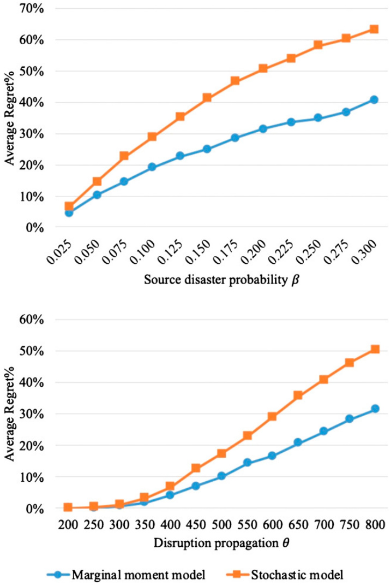

This article was downloaded by: [2001:da8:1002:6004::1c32] On: 09 October 2021, At: 01:57 Publisher: Institute for Operations Research and the Management Sciences (INFORMS) INFORMS is located in Maryland, USA  

  

# INFORMS Journal on Computing  

Publication details, including instructions for authors and subscription information: http://pubsonline.informs.org  

A General Model and Efficient Algorithms for Reliable Facility Location Problem Under Uncertain Disruptions  

Yongzhen Li , Xueping Li , Jia Shu , Miao Song , Kaike Zhang  

# To cite this article:  

Yongzhen Li , Xueping Li , Jia Shu , Miao Song , Kaike Zhang  (2021) A General Model and Efficient Algorithms for Reliable Facility Location Problem Under Uncertain Disruptions. INFORMS Journal on Computing  

Published online in Articles in Advance 26 Aug 2021 https://doi.org/10.1287/ijoc.2021.1063  

Full terms and conditions of use: https://pubsonline.informs.org/Publications/Librarians-Portal/PubsOnLine-Terms-andConditions  

This article may be used only for the purposes of research, teaching, and/or private study. Commercial use or systematic downloading (by robots or other automatic processes) is prohibited without explicit Publisher approval, unless otherwise noted. For more information, contact permissions@informs.org.  

The Publisher does not warrant or guarantee the article’s accuracy, completeness, merchantability, fitness for a particular purpose, or non-infringement. Descriptions of, or references to, products or publications, or inclusion of an advertisement in this article, neither constitutes nor implies a guarantee, endorsement, or support of claims made of that product, publication, or service.  

Copyright © 2021, INFORMS  

Please scroll down for article—it is on subsequent pages  

# informs.  

With 12,500 members from nearly 90 countries, INFORMS is the largest international association of operations research (O.R.) and analytics professionals and students. INFORMS provides unique networking and learning opportunities for individual professionals, and organizations of all types and sizes, to better understand and use O.R. and analytics tools and methods to transform strategic visions and achieve better outcomes.  

For more information on INFORMS, its publications, membership, or meetings visit http://www.informs.org  

# A General Model and Efficient Algorithms for Reliable Facility Location Problem Under Uncertain Disruptions  

Yongzhen Li,a Xueping Li,b Jia Shu,c Miao Song,d Kaike Zhang  

a Department of Management Science and Engineering, School of Economics and Management, Southeast University, Nanjing, Jiangsu 210096, China; b Department of Industrial and Systems Engineering, The University of Tennessee at Knoxville, Knoxville, Tennessee 37996; c School of Management and Economics, University of Electronic Science and Technology of China, Chengdu, Sichuan 611731, China; d Department of Logistics and Maritime Studies, Faculty of Business, The Hong Kong Polytechnic University, Hong Kong, China   
Contact: liyongzhen@seu.edu.cn, $\circledcirc$ https://orcid.org/0000-0003-1710-8360 (YL); xueping.li@utk.edu,   
$\oplus$ https://orcid.org/0000-0003-1990-0159 (XL); jshu@seu.edu.cn, $\circledcirc$ https://orcid.org/0000-0003-3417-6234 (JS);   
miao.song@polyu.edu.hk, $\circledcirc$ https://orcid.org/0000-0002-2617-4338 (MS); kaikezhang@gmail.com (KZ) Received: April 23, 2019   
Revised: February 13, 2020; August 16, 2020; November 18, 2020; December 8, 2020   
Accepted: December 26, 2020   
Published Online in Articles in Advance: August 26, 2021  

https://doi.org/10.1287/ijoc.2021.1063  

Copyright: $\scriptstyle{\widehat{\mathbb{C}}}$ 2021 INFORMS  

Abstract. This paper studies the reliable uncapacitated facility location problem in which facilities are subject to uncertain disruptions. A two-stage distributionally robust model is formulated, which optimizes the facility location decisions so as to minimize the fixed facility location cost and the expected transportation cost of serving customers under the worst-case disruption distribution. The model is formulated in a general form, where the uncertain joint distribution of disruptions is partially characterized and is allowed to have any prespecified dependency structure. This model extends several related models in the literature, including the stochastic one with explicitly given disruption distribution and the robust one with moment information on disruptions. An efficient cutting plane algorithm is proposed to solve this model, where the separation problem is solved respectively by a polynomial-time algorithm in the stochastic case and by a column generation approach in the robust case. Extensive numerical study shows that the proposed cutting plane algorithm not only outperforms the best-known algorithm in the literature for the stochastic problem under independent disruptions but also efficiently solves the robust problem under correlated disruptions. The practical performance of the robust models is verified in a simulation based on historical typhoon data in China. The numerical results further indicate that the robust model with even a small amount of information on disruption correlation can mitigate the conservativeness and improve the location decision significantly.  

Summary of Contribution: In this paper, we study the reliable uncapacitated facility location problem under uncertain facility disruptions. The problem is formulated as a twostage distributionally robust model, which generalizes several related models in the literature, including the stochastic one with explicitly given disruption distribution and the robust one with moment information on disruptions. To solve this generalized model, we propose a cutting plane algorithm, where the separation problem is solved respectively by a polynomial-time algorithm in the stochastic case and by a column generation approach in the robust case. The efficiency and effectiveness of the proposed algorithm are validated through extensive numerical experiments. We also conduct a data-driven simulation based on historical typhoon data in China to verify the practical performance of the proposed robust model. The numerical results further reveal insights into the value of information on disruption correlation in improving the robust location decisions.  

History: Accepted by Andrea Lodi, Area Editor for Design & Analysis of Algorithms–Discrete. Funding: This work was supported by the National Natural Science Foundation of China [Grants 71525001, 71801112, 71831004, 71922901, and 72091213], the Jiangsu Provincial Six Talent Peaks Project [Grant TD-RJFW-001], the Jiangsu Province $\langle{333^{\prime\prime}}$ Project [Grant BRA2018068], the Hong Kong Research Grants Council General Research Fund [Grant 15212617E], the National Science Foundation [Grant CMMI-1634975], and the Ideation Laboratory (iLab) at the University of Tennessee, Knoxville.  

Supplemental Material: Data and the online supplement are available at https://doi.org/10.1287/ ijoc.2021.1063.  

# 1. Introduction  

The uncapacitated facility location problem (UFLP) is one of the most well-studied location problems. It is concerned with how to locate facilities among a given set of potential locations and how to serve a given set of customers with known demand rate using these facilities. The objective usually minimizes the total cost, including the fixed cost of setting up facilities and the transportation cost of serving customers. In the classical UFLP, facilities are assumed to be always available once constructed. However, in reality, facilities may fail from time to time due to disruptive events, such as natural disasters, terrorist attacks, or labor strikes. Though facility disruption is rare, once it occurs, serious interruptions and huge losses can occur. For example, in 2005, Hurricane Katrina shut down the oil refineries in the Gulf of Mexico. About 2 million barrels per day of refining capacity was lost initially, and it took months before oil production and refining were fully restored (Bamberger and Kumins 2005, Cashell and Labonte 2005). One example of facility disruption in the manufacturing industry was a fire in March 2000 at the Philips microchip factory in Albuquerque, New Mexico, which supplied Ericsson with microchips for its mobile phones. The fire left Ericsson millions of chips short, which interrupted the production of phones and eventually brought a potential revenue loss of at least $\mathbb{S}400$ million (Latour 2001). More examples in supply chain management can be found in Sheffi (2001), Christopher and Peck (2004), and Tang (2006). In view of the damage and losses resulting from facility disruptions, it is crucial to locate facilities wisely and design a reliable supply chain network that can withstand facility disruptions.  

In recent decades, the reliable facility location problem under uncertain facility disruptions has been studied extensively. The two categories of existing work are based on differing assumptions about facility disruptions. Some works assume the facility disruptions occur independently, which is a reasonable assumption for disruptions caused by, for example, facility contamination or plant fire. Stochastic approaches are generally applied in these works, which sometimes suffer from computational efficiency. The other category of works considers natural disaster disruptions such as floods or earthquakes, which simultaneously affect multiple facilities in the area. These works assume the facilities disrupt with correlations and model this problem by either a scenario-based stochastic approach or robust optimization, the latter of which is sometimes criticized as overly conservative. In this paper, we propose a general two-stage distributionally robust model, which bridges the stochastic problem under independent disruptions and the robust problem under correlated disruptions. Efficient algorithms are proposed to solve this model. Moreover, we also analyze the value of explicit correlation information in mitigating the conservativeness of robust approaches.  

This paper examines the reliable uncapacitated facility location problem (RUFLP) with the consideration of uncertain facility disruptions. The disruptions are described as a random binary vector with uncertain joint distribution belonging to a preset ambiguity set. The ambiguity set is constructed according to the features of disruptive events considered in the reliable facility location problem. Note that geographically close locations are more likely to be affected by the same disruptive event, as are adjacent facilities in the supply chain. Therefore, the ambiguity set is characterized by given pieces of information, where each piece of information corresponds to the probability of a disruptive event and the associated sets of affected/ unaffected facilities. For instance, consider the RUFLP under the threat of typhoons. The affected areas of a typhoon are closely related to the landing place, the landing intensity, and the typhoon track. Thus, the ambiguity set can be defined based on the frequency of typhoons landed in certain locations and the set of affected locations along the typhoons’ tracks, which are available from the historical data. More importantly, as can be seen in Section 3, the proposed ambiguity set generalizes several ambiguity sets in the literature and can capture various dependency structures for disruptions.  

We also notice that, in addition to uncertain facility disruptions, some relevant works on disruptive events also consider other kinds of uncertainties, including demand (An et al. 2014), facility coverage (Lutter et al. 2017, Santos et al. 2019), facility capacity (AhmadiJavid and Seddighi 2013), and transportation connection (Azad et al. 2013). This paper focuses on uncertain facility disruptions, assuming that all the other parameters are deterministic. Particularly, demand is assumed to be deterministic. We claim that this paper is readily extended to the case when the uncertain demand is independent of the facility disruption. This independent demand case applies for many supply chain networks for general goods where the demand is determined exogenously by the market and is quite irrelevant to the facility disruptions. For instance, Thailand suffered from severe floods during the 2011 monsoon season. As approximately $43\%$ of the world’s hard disk drives were produced in Thailand, the floods significantly reduced hard disk drive shipments in Thailand and severely affected electronic companies around the world (Haraguchi and Lall 2015). However, according to Chongvilaivan (2012), “the global demand remains robust.” More recently, Typhoon Mangkhut, the largest storm landed in China in 2018, made landfall in Guangdong, China, and adversely affected many companies with suppliers and partners located in the area. Despite the supply disruption, some affected companies (e.g., Pop! Promos, a company supplying promotional products) faced stable orders and maintained the ability to fulfill orders from redundant sources (Ruvo 2018). The independence between demand and disruption is also widely assumed in location-inventory problems with uncertain demand and disruption (Qi et al. 2010). Moreover, the disruption-correlated uncertain demand can be easily incorporated in our approach if (1) the stochastic demand is modeled by scenarios depending on uncertain disruptions in the scenario-based stochastic model, or (2) the demand is defined as a linear function of uncertain disruptions, for example, the settings in An et al. (2014) and Azad and Hassini (2019). More details on these generalizations can be found in Appendix A.2 of the online supplement.  

In the literature, the reliable facility location problems considering facility disruptions are generally built upon certain classical models (Snyder et al. 2006). This paper is based on the UFLP, one of the most classical and commonly used facility location models. Thus, we consider the facility location decision and the transportation decision. Relevant works based on other facility location models also consider the demand allocation decision (Azad et al. 2013), the inventory positioning decision (Qi et al. 2010, most of which are based on location-inventory problems), as well as the vehicle routing decision (Xie et al. 2015b, most of which are based on location-routing problems). In this paper, we formulate a two-stage distributionally robust model with a preset ambiguity set for the distribution of disruptions. The facility location decision is made in the first stage before the disruptions, and the transportation decision is made in the second stage with the realized disruption information. The objective is to minimize the fixed facility setup cost and the expected transportation cost of serving customers under the worst-case disruption distribution.  

The RUFLP in this paper is clearly NP-hard as it takes the UFLP, a well-known NP-hard problem, as a special case. The two-stage distributionally robust model formulated in a general form makes this problem more difficult. To solve this problem, we develop a cutting plane (CP) algorithm, where the separation problem is exactly the evaluation of the worst-case expected transportation cost. For the stochastic case, the separation problem is solved by a proposed polynomialtime algorithm under the assumption that the conditional disruption probability can be obtained easily. For the robust case, the separation problem is solved by a column generation approach.  

The main contributions of this paper can be summarized as follows:  

• We formulate a general model for the reliable facility location problem, which extends several models in the literature, including the stochastic one with explicitly given disruption distribution and the robust one with given marginal and/or cross disruption probability.  

• A cutting plane algorithm is developed, where the separation problem is solved respectively by a polynomial-time algorithm in the stochastic case and by a column generation approach in the robust case. The efficiency and effectiveness of the proposed algorithm are validated through extensive numerical experiments.  

• The value of considering exact correlation information in the robust problem is analyzed by comparing the proposed robust model with the one based on marginal moment information. The comparison indicates that the robust model based on marginal disruption probability is sometimes overly conservative, and even a small amount of information on disruption correlation can improve the location decision significantly.  

The rest of this paper is organized as follows. In Section 2, we review the related literature. In Section 3, the two-stage distributionally robust model is formulated with the generally characterized ambiguity set for disruption distribution. In Section 4, the cutting plane algorithm is introduced, with the framework presented first, followed by the detailed methods to efficiently evaluate the worst-case expected transportation cost for the stochastic case and the robust case, respectively. Extensive numerical experiments are conducted in Section 5 to validate the performance of the proposed cutting plane algorithm. In the last section, this paper is concluded with discussion of future works.  

# 2. Literature Review  

Facility disruptions are widely considered based on various classical facility location problems, including the UFLP, the set-covering problem, the maximum covering problem, the $p$ -median problem, the capacitated fixed cost facility location problem, and the multiallocation hub location problem. To keep this literature review focused, we primarily review the UFLP-based works, that is, the RUFLP. For the works based on other classical facility location problems, we refer to Snyder et al. (2006, 2016) for more detailed and extensive reviews. In what follows, we first review the stochastic and robust facility location problems, respectively, and then review the distributionally robust optimization approach, which is the methodology adopted in this paper.  

# 2.1. On Stochastic Facility Location Problems  

The RUFLP considering independent disruptions was first studied by Snyder and Daskin (2005). They are motivated by a facility location problem in 49 cities in the United States, and find that facility disruption in a certain city may result in a significant increase in transportation costs. By assuming that facility disruptions occur independently of identical probabilities, they formulate the RUFLP into a linear integer program and propose a Lagrangian relaxation algorithm. The assumption of identical disruption probabilities, as assumed in Snyder and Daskin (2005), greatly simplifies the model formulation and the solution method of the RUFLP. When this assumption is relaxed, it becomes difficult to calculate the expected transportation cost associated with the disruptions. To address this difficulty, attempts are made by Shen et al. (2011), Cui et al. (2010), Aboolian et al. (2013), and so on. Shen et al. (2011) extend the model of Snyder and Daskin (2005) by considering site-dependent disruption probabilities. They propose a nonlinear integer programming model where the expected transportation cost is calculated using highly nonlinear multiplicative terms. Several heuristic algorithms are developed to solve the proposed nonlinear model. Cui et al. (2010) propose another nonlinear mixed integer programming model that allows site-dependent disruption probabilities. By applying certain linearization techniques, they reformulate the nonlinear model into a compact mixed integer linear model, which is then solved by a Lagrangian relaxation algorithm. Aboolian et al. (2013) consider the same nonlinear model as Cui et al. (2010). Instead of using the linearization techniques in Cui et al. (2010), they develop an approximation algorithm based on a local search and cutting plane procedure. They show that their method outperforms the Lagrangian relaxation algorithm proposed by Cui et al. (2010) in both solving time and solution quality.  

Another direction is to study the RUFLP by assuming correlated disruption. Liu et al. (2009) and Shen et al. (2011) formulate scenario-based models, which incorporate the correlated disruptions by properly defined scenarios. However, their models suffer from poor numerical efficiency, especially when the number of scenarios increases. Some works study the interdependent facility disruptions based on special physical structures, such as ripple effect and supporting stations. Liberatore et al. (2012) study the ripple effect, which occurs when the facility disruptions propagate, that is, a failure in one facility will cause capacity losses in other facilities. The ripple effect is captured by a deterministic two-dimensional correlation matrix describing the pair-wise capacity losses. Li et al. (2013) and Xie et al. (2015a) introduce an extra layer of supporting stations, each of which is properly connected to certain facilities, to describe the correlated disruptions. In their work, each supporting station fails independently with identical probabilities, and the failures in supporting stations cause the connected facilities to fail as well. In addition, Li and Ouyang (2010), Berman and Krass (2011), Berman et al. (2013), and Lim et al. (2013) apply the continuum approximation approach to approximate the RUFLP with correlated disruptions as a continuous location problem. In these works, the correlated disruptions are captured by conditional probabilities, beta-binomial distribution (Li and Ouyang 2010), correlation coefficients (Berman and Krass 2011, Berman et al. 2013), and correlated binomial random variables (Lim et al. 2013), respectively.  

# 2.2. On Robust Facility Location Problems  

Thus far, all the aforementioned works consider the reliable facility location problem in stochastic settings, where the disruption probabilities are exactly known. As this paper proposes a general formulation in the form of a distributionally robust model, we further review the relevant robust models considering correlated disruptions.  

In the context of robust reliable facility location, there is a large amount of literature that considers interdiction, that is, the intentional attack of facilities (e.g., a terrorist strike) designed to cause maximum disruption on a network. These works usually focus on the question of how to fortify existing facilities (i.e., immunize the facilities from disruptions), or how to locate new facilities from a given set of potential sites, so as to minimize the demand-weighted distance from customers to nondisrupted facilities under the worst-case interdiction. The former question is studied in the so-called fortification-interdiction problems (Church and Scaparra 2007; Scaparra and Church 2008a,b; Liberatore et al. 2011, 2012), whereas the latter is studied in the location-interdiction problems (O’Hanley and Church 2011, An et al. 2014). Most of these works formulate robust models following the min-max-min framework, where the innermost problem minimizes the demand-weighted distance from customers to nondisrupted facilities, the problem in the middle represents the actions of an interdictor who attempts to maximize the minimal distance through interdictions, and the outermost problem minimizes the consequence of the worst-case interdiction through fortification/location decisions. These interdiction models differ from ours in two aspects. First, rather than considering the intentional interdiction endogenously caused by a malicious agent, we are concerned with the probabilistic disruption exogenously caused by natural events. We refer to Golany et al. (2009) for a discussion of the differences between the intentional interdiction and the probabilistic disruption. Second, all of these interdiction models minimize the cost associated with the worst-case interdiction over all possible scenarios, whereas our model minimizes the expected cost corresponding to the worst-case distribution.  

More recently, Lu et al. (2015) propose a distributionally robust reliable facility location model, which is closely related to this paper and to our knowledge is the only distributionally robust model on the RUFLP. In their work, the facility disruptions are allowed to be correlated with an uncertain joint distribution captured by the marginal disruption probability of each facility. They optimize the expected transportation and penalty cost under the worst-case distribution as we do. By proving the worst-case distribution, their robust model is simplified into a stochastic model, which is solved by the standard Benders decomposition method. Our work extends Lu et al. (2015) by considering a general ambiguity set for disruption distribution, which is not limited to the one specified by the marginal disruption probability of each facility. Besides, the cutting plane algorithm we propose can solve the general robust model without knowing/proving the worst-case distribution. More importantly, based on the general formulation, we could incorporate available correlation information explicitly in the robust model. As can be seen in the numerical study, even a small amount of information on disruption correlation can mitigate the conservativeness of the robust marginal moment model and improve the location decision significantly.  

# 2.3. On Distributionally Robust Optimization  

In this work, the RUFLP is studied in the framework of distributionally robust optimization (DRO), also known as minimax stochastic programming. DRO was pioneered by Scarf (1958) and studied extensively in recent decades with abundant theoretical analysis (Delage and Ye 2010, Wiesemann et al. 2014, and references therein) and a tremendous amount of applications in areas such as facility location, inventory management, scheduling, and finance. A DRO model typically optimizes the worst-case expectation over all the distributions in a prespecified ambiguity set. Thus, it is widely believed that DRO bridges stochastic programming, which optimizes the expectation under a given distribution, and classical robust optimization, which optimizes the worst-case objective value over all the possible realizations of uncertain parameters in a prespecified uncertainty set.  

In the DRO literature, existing works consider a wide range of forms for the ambiguity sets depending on specific context (Shapiro 2006 and references therein). The most popular type of the ambiguity set is based on moment information, for example, the exact moments (Bertsimas and Popescu 2005, Bertsimas et al. 2010), the bounds on moments (El Ghaoui et al. 2003, Delage and Ye 2010), or other generalized forms (Wiesemann et al. 2014). In this paper, we consider a specific ambiguity set, which is closely related to the moment-based ambiguity set and reflects the features of disruptive events for facilities. We describe the facility disruptions as a random binary vector. The ambiguity set for its uncertain joint distribution is characterized by certain pieces of information. Each piece of information corresponds to the probability of a disruptive event or scenario and the associated sets of affected and/or unaffected facilities. This enables the proposed ambiguity set to represent any dependency structure for the disruptions. Moreover, the proposed set takes several ambiguity sets in the literature as special cases, including a singleton with a unique distribution as in stochastic programming and those with exact values or bounds of moments. We notice that more recently Ben-Tal et al. (2013), Bayraksan and Love (2015), and Esfahani and Kuhn (2018) propose ambiguity sets using phi-divergences, which measure the distance between the uncertain distribution and the true one. Although in certain circumstances the phi-divergence ambiguity set is believed to be less conservative than the moment-based one, it is difficult to uniquely specify correlations among random variables.  

The tractability of a DRO model relies on both the nominal problem and the ambiguity set. For some well-structured problem classes, for example, the newsvendor problem, with certain ambiguity sets, the DRO models have closed-form solutions for the worstcase distributions and can be solved by stochastic programming approaches (Scarf 1958, Popescu 2007, Lu et al. 2015). It is more common that the analytical worst-case distribution is not available. In this case, global optimization approaches are applied after reformulating the DRO models into tractable optimization problems, for example, large-scale convex programs (Wiesemann et al. 2014). This work also falls into this category, which adopts the cutting plane algorithm to efficiently solve the large-scale reformulation. We further refer to Chen et al. (2008), Goh and Sim (2010), See and Sim (2010), Kuhn et al. (2011), and Li et al. (2017) for another stream of work that considers the linear decision rule to solve or approximate the two-stage DRO models.  

In this paper, we reformulate the distributionally robust model as a mixed integer linear program based on the Benders decomposition. In the literature, the Benders decomposition is usually applied to solve two-stage scenario-based stochastic models. Specifically, the two-stage model is decomposed into a largescale formulation with a large number of constraints and then solved by the cutting plane algorithm with valid Benders cuts added iteratively. In this paper, however, we apply the Benders decomposition to solve the DRO model. In the cutting plane algorithm, the separation problem to identify valid cuts is solved by column generation and the classical Benders cut is reformulated and simplified by exploiting the closedform solution to certain subproblems. We notice that some relevant works also propose cutting plane algorithms to solve robust problems. For example, Zeng and Zhao (2013) present a column-and-constraint generation method to solve two-stage robust optimization problems, also known as robust adjustable or adaptable optimization problems. In their algorithm, both constraints and columns are added simultaneously to the master problem in each iteration. The underlying robust model and the idea of the algorithm in their work are very different from those in this paper. Xu et al. (2018) propose a cutting plane algorithm framework to solve moment-based DRO models. This paper considers an ambiguity set more general than the moment-based one.  

In sum, this work significantly differs from existing stochastic models under correlated disruptions. On the other hand, in contrast to the robust models considering uncertain disruptions, this work is essentially different from the interdiction models in terms of the nature of disruptions, and greatly generalizes the relevant distributionally robust models in the literature.  

# 3. Model Formulation  

Consider the problem of locating facilities from a set $J=\{1,\ldots,|J|\}$ of potential locations to serve a set $I=$ $\{1,\ldots,|I|\}$ of customers. The demand rate of customer $i\in I$ is $d_{i}$ . The fixed setup cost to open facility $j\in J$ is $f_{j}$ and the unit shipment cost from facility $j$ to customer i is $c_{i j}$ . If the demand of customer $i$ is not served, a unit penalty cost $c_{i0}$ is incurred. We assume $c_{i0}\geq c_{i j}$ for all $i\in I$ and $j\in J,$ which indicates that any customer should be served as long as there is an available facility.  

Facilities are unreliable with unexpected failures. Let $\tilde{\boldsymbol{\xi}}=(\tilde{\xi}_{1},\dots,\tilde{\xi}_{|J|})^{\top}$ represent the failure status of all the facilities, where $\tilde{\xi}_{j}\overset{\mathtt{\Delta}}{\in}\{0,1\}$ is 1 if facility $j$ is online and 0 if it is disrupted. The set of all possible realizations of $\tilde{\xi}$ is denoted by  

$$
\Xi:=\left\{\left(\xi_{1},\ldots,\xi_{|J|}\right)^{\top}\Big|~\xi_{j}\in\{0,1\}~~\forall j\in J\right\}=\{0,1\}^{|J|}.
$$  

For any realization $\xi\in\Xi,$ let $p_{\xi}:=\mathrm{Prob}(\tilde{\xi}=\xi)$ be the probability that the corresponding disruptive scenario $\xi$ occurs. A distribution of $\tilde{\xi}$ can then be represented by a vector $\pmb{p}$ of $p_{\xi}$ for all $\xi\in\Xi$ . Note that $\pmb{p}$ has $2^{|J|}$ components as the cardinality of $\Xi$ is $2^{|J|}$ . Due to the high dimensionality, it is often challenging to determine the distribution $\pmb{p}$ of facility failures. Consequently, we assume that the distribution is partially characterized by $n$ pieces of information. For any $k\in\{1,\ldots,n\}.$ , the $k$ th piece of information specifies that the probability of all facilities in set $A_{k}$ being online and all facilities in set $B_{k}$ being disrupted is within the interval $[q_{k},\overline{{q}}_{k}],$ that is, $\mathrm{Prob}(\tilde{\xi}_{j}=1\;\;\forall j\in A_{k},\;\;\tilde{\xi}_{j}=0$ $\forall j\in B_{k})\in[\underline{{q}}_{k},\overline{{\overline{{q}}}}_{k}]$ . Therefore, the distribution $\pmb{p}$ should be contained in the following set $P$ :  

$$
P:=\left\{p\in\left[0,1\right]^{\left(2^{|I|}\right)}\right|\sum_{\substack{\xi\in\Xi\left|\xi_{j}=1\right.\forall j\in A_{k},\ldots}}p_{\xi}\in\left[q_{\underline{{k}}},\overline{{q}}_{k}\right]\,\forall k\in\left\{1,\ldots,n\right\},\,\sum_{\xi\in\Xi}p_{\xi}=1\right\}.
$$  

To the best of our knowledge, the definition of $P$ generalizes the characterization of disruption distribution in several existing works. Some special cases are discussed as follows:  

• Stochastic model. The case with a completely known distribution $_p$ can be viewed as $P$ being a singleton defined by $2^{|j|}$ pieces of information, that is, $n=$ $\breve{2}^{|J|}$ and $q_{k}=\overline{{q}}_{k}$ for all $k=1,\dotsc,n$ in (1). Specially for the scenario-based stochastic model with $S$ scenarios, $P$ can be viewed as a singleton defined by $S$ pieces of information. In this case, we have $n=S$ and $q_{k}=\overline{{q}}_{k}$ for all $k=1,\ldots,S,$ which corresponds to the probability for scenario $k$ . The sets $A_{k}$ and $B_{k}$ correspond to the set of online and offline facilities in scenario $k,$ respectively.  

• Marginal distribution model. In this case, $P$ can be characterized by $\lvert J\rvert$ pieces of information, each of which specifies the marginal probability for a facility to be online. More specifically, let $\mathrm{Prob}(\tilde{\xi}_{j}=1)=q_{j}$ for any $j\in J$ and $P$ can be written as  

$$
P=\{p\in\left[0,1\right]^{\left(2^{|J|}\right)}\big|\sum_{\xi\in\Xi\vert\xi_{j}=1}p_{\xi}=q_{j}\ \ \forall j\in J,\sum_{\xi\in\Xi}p_{\xi}=1\}.
$$  

In other words, we have $n=|J|,A_{k}=\{k\},B_{k}=\emptyset$ and ${\underline{{q}}}_{k}={\overline{{q}}}_{k}=q_{k}$ for all $k=1,\dotsc,|J|$ in (1). Note that Lu et al. (2015) consider the same characterization of disruption probability.  

Moment model. Note that the $\kappa$ th cross moment of the random variables $\tilde{\xi}_{j}$ where $j\in\{j_{1},\dotsc,j_{\kappa}\}\subseteq J$ is $\mathbb{E}_{p}[\prod_{j=j_{1}}^{j_{\kappa}}\tilde{\xi}_{j}]=\mathrm{Prob}(\tilde{\xi}_{j}=1\mathbf{\omega}^{'}\forall j\in\{j_{1},\dots,j_{\kappa}\})$ . Thus, the set $P$ can be used to represent the set of distributions specified by the moments of $\tilde{\xi}$ . In particular, suppose that the marginal moment of $\tilde{\xi}_{j}$ is $q_{j}$ for any $j\in J.$ , whereas the cross moment of $\tilde{\xi}_{j_{1}}$ and $\tilde{\xi}_{j_{2}}$ for any $j_{1},j_{2}\in J$ and $j_{1}<j_{2}$ is $q_{j_{1}j_{2}}$ . Then the set $P$ specified by the first two moments can be written as  

$$
P=\left\{p\in\left[0,1\right]^{\left(2^{|J|}\right)}\left|\begin{array}{l l}{\displaystyle\sum_{\xi\in\Xi\mid\xi_{j}=1}p_{\xi}=q_{j},}&{\forall j\in J,}\\ {\displaystyle\sum_{\xi\in\Xi\mid\xi_{j_{1}}=\xi_{j_{2}}=1}p_{\xi}=q_{j_{1}j_{2}},}&{\forall j_{1},j_{2}\in J,j_{1}<j_{2},}\\ {\displaystyle\sum_{\xi\in\Xi}p_{\xi}=1}&{}\end{array}\right.\right\},
$$  

that is, we have $n=|J|(|J|+1)/2$ in (1). Note that the ambiguity set $P$ in (1) also generalizes other moment models with higher moments, partial moment information, and/or probabilities falling in certain intervals.  

Based on the available information, we need to set up facilities to serve customers. The facility setup decision is denoted by $\pmb{x}=\left(x_{1},\ldots,x_{|J|}\right)^{\top}$ , where $x_{j}\in\{0,1\}$ is 1 if facility $j$ is set up, and 0 otherwise. To decide $x,$ all the cost components, including the fixed setup cost $f_{j}$ to open facility $j\in J,$ the unit transportation cost $c_{i j}$ from facility $j\in J$ to customer $i\in I,$ and the unit penalty cost $c_{i0}$ when customer $i\in I$ is not served, should be taken into consideration at the same time. As all the facilities are uncapacitated, any customer should be served by the closest open facility that is not disrupted. Therefore, given the decision $_{x}$ and the realization $\xi$ of the disruption status, the total transportation and penalty cost to serve all the customers is  

$$
Q(\boldsymbol{x},\boldsymbol{\xi}):=\sum_{i\in I}d_{i}\operatorname*{min}_{j\in J\bigcup\{0\}|\boldsymbol{x}_{j}\boldsymbol{\xi}_{j}=1}c_{i j},
$$  

where we assume $x_{0}\equiv1$ and $\xi_{0}\equiv1$ . The unit penalty cost $c_{i0}$ is incurred only when all the open facilities are disrupted. Recall that the disruption status $\tilde{\xi}$ is uncertain. If the distribution of $\tilde{\xi}$ is completely known, we can consider the expectation of $\bar{Q}(x,\tilde{\xi})$ to decide $_{x}$ . However, the distribution of $\tilde{\xi}$ can only be characterized by the ambiguity set $P$ . Thus, we instead consider the worst-case expectation of $Q(x,\tilde{\xi})$ among all the distributions in the ambiguity set $P,$ that is, $\operatorname*{max}_{p\in P}\mathbb{E}_{p}[Q(x,\tilde{\xi})]$ . As a result, an optimal decision $_{x}$ should minimize both the fixed setup cost and the worstcase expected transportation and penalty cost, which leads to the following robust optimization problem:  

$$
\mathcal{P}\mathrm{:~}\operatorname*{min}_{\boldsymbol{x}\in\{0,1\}^{|J|}}\left\{\sum_{j\in J}f_{j}\boldsymbol{x}_{j}+\operatorname*{max}_{\boldsymbol{p}\in P}\mathbb{E}_{\boldsymbol{p}}[Q(\boldsymbol{x},\tilde{\boldsymbol{\xi}})]\right\}.
$$  

Obviously, model (3) is an NP-hard problem, as it generalizes the UFLP, which is a well-known NP-hard problem. The NP-hardness suggests that no polynomial-time algorithm exists for model (3) unless $\mathrm{P}=\mathrm{NP}$ . However, as can be seen in Section 4, we can reformulate model (3) into a mixed integer linear program with a large number of constraints and then apply the cutting plane algorithm to solve it.  

# 4. Cutting Plane Algorithm  

Let $\eta$ replace the worst-case expected transportation and penalty cost, then model (3) turns into  

$$
\mathcal{P}\colon\quad\operatorname*{min}_{\boldsymbol{x}\in\{0,1\}^{|J|},\eta\in\mathbb{R}}\left\{\sum_{j\in J}f_{j}\boldsymbol{x}_{j}+\eta\bigg|\eta\ge\mathbb{E}_{p}\big[Q\big(\pmb{x},\tilde{\xi}\big)\big],\quad\forall p\in P\right\}.
$$  

We notice that, when a stochastic model is considered, that is, when $P$ is defined as a singleton containing a completely known distribution, there is exactly one constraint in model (4). However, when a robust model is considered where $P$ is generally defined as in (1), there are an infinite number of constraints in model (4) as $P$ contains an infinite number of distributions. This makes model (4) a difficult problem to solve.  

To solve model (4) when $P$ is generally defined, we propose a cutting plane algorithm. As we shall see, the performance of the proposed cutting plane algorithm relies on the efficient evaluation of $\begin{array}{r}{\operatorname*{max}_{p\in P}\!\mathbb{E}_{p}[\check{Q}(x,\tilde{\xi})],}\end{array}$ that is, the worst-case expected transportation and penalty cost. Therefore, in the remainder of this section, we first present the general framework of the proposed cutting plane algorithm as follows, and then show how to evaluate $\mathrm{max}_{p\in P}\mathbb{E}_{p}[Q(x,\tilde{\xi})]$ efficiently.  

# Algorithm CP  

Step 0. Consider a finite set $\Lambda$ , each member of which is a collection $(p,y)$ such that $p\in P$ and $y\in\{0,1\}^{|J|}$ , that is, $\Lambda\subseteq\{(p,y)|\dot{p^{\prime}}\in\dot{P},y\in\{0,1\}^{|J|}\}$ .  

Step 1. Solve the following problem:  

$$
\begin{array}{r l}&{~\mathcal{R P}\colon\underset{x\in\{0,1\}^{|l|},}{\mathrm{min}}\quad\sum_{j\in J}f_{j}x_{j}+\eta}\\ &{\quad\quad\:\:\eta\in\mathbb{R}}\\ &{\quad\quad\:\mathrm{s.t.}\ \eta\geq\mathbb{E}_{p}[Q(\pmb{y},\tilde{\xi})]}\\ &{\quad\quad\:+\displaystyle\sum_{j\in J}(\mathbb{E}_{p}[Q(\pmb{y}\vee z_{j},\tilde{\xi})]-\mathbb{E}_{p}[Q(\pmb{y},\tilde{\xi})])\cdot x_{j},\:\forall(\pmb{p},\pmb{y})\in\Lambda,}\end{array}
$$  

and obtain an optimal solution $(\boldsymbol{x}^{*},\boldsymbol{\eta}^{*})$ . In $\mathcal{R P},\,z_{j}$ denotes the vector of the same dimension as $_y$ such that $z_{j}=1$ and $z_{l}=0$ for all $l\neq j,$ and $\vee$ represents the operation of taking componentwise maximum.  

Step 2. Evaluate the worst-case expected transportation and penalty cost, and obtain the worst-case distribution, that is, solve the separation problem $Z_{s e p}(x^{*}):=$ $\operatorname*{max}_{p\in P}\mathbb{E}_{p}[Q(x^{*},\tilde{\xi})]$ and obtain the optimal solution $\pmb{p}^{*}$ . Particularly, if a stochastic model is considered, that is, $P$ is defined as a singleton $\{p^{\dagger}\},$ we have $Z_{s e p}(x^{*})=$ $\mathbb{E}_{p^{\dagger}}[Q(x^{*},\tilde{\xi})]$ and $p^{*}=p^{\dagger}$ .  

Step 3. If $\eta^{*}\geq Z_{s e p}(x^{*}),$ , return $x^{*}$ as an optimal solution to model (4). Otherwise, that is, $\eta^{*}<Z_{s e p}(x^{*}),$ add $(p^{*},x^{*})$ into $\Lambda,$ or equivalently, add the valid cut  

$$
\eta\geq\mathbb{E}_{p^{*}}[Q(x^{*},\tilde{\xi})]+\sum_{j\in J}\left(\mathbb{E}_{p^{*}}[Q(x^{*}\vee z_{j},\tilde{\xi})]-\mathbb{E}_{p^{*}}[Q(x^{*},\tilde{\xi})]\right)\cdot x_{j}
$$  

into $\mathcal{R P}$ . Go to Step 1.  

The following theorem guarantees that Algorithm CP provides an exact solution to model (4).  

Theorem 1. Algorithm CP solves model (4) to optimality within a finite number of iterations.  

The proof of Theorem 1 can be found in Appendix A.3 of the online supplement. In the proof, model (4) is first reformulated according to Benders decomposition. The reformulation is then written as a tractable mixed integer linear program, which is exactly model $\mathcal{R P}$ including all valid cuts in the form of (5).  

In Algorithm CP, Step 1 is to solve problem $\mathcal{R P},$ , which is a mixed integer linear program with a moderate number $(|\Lambda|)$ of constraints and hence readily solved by commercial solvers like CPLEX. Step 2 is to evaluate $\operatorname*{max}_{p\in P}\mathbb{E}_{p}[Q(x^{*},\tilde{\xi})]$ for given $x^{*}$ , whereas Step 3 is to formulate the valid cut (5) based on $\operatorname*{max}_{p\in P}\mathbb{E}_{p}[Q(x^{*},\tilde{\xi})]$ . Apparently, both Step 2 and Step 3 can be easily implemented, as long as $\operatorname*{max}_{p\in P}\mathbb{E}_{p}$ $[Q(x^{*},\tilde{\xi})]$ can be evaluated efficiently.  

To develop an efficient approach to evaluate $\begin{array}{r}{\operatorname*{max}_{p\in P}\mathbb{E}_{p}[Q(\hat{\boldsymbol{x}}^{*},\tilde{\boldsymbol{\xi}})],}\end{array}$ we notice that different situations are encountered depending on the definition of $P$ . To be more specific, if a robust model is considered where $P$ is generally defined as in (1), the separation problem $Z_{s e p}(x^{*})$ turns into a linear program with an exponential number of decision variables, which happens not to be easy. On the other hand, if a stochastic model is considered where $P=\{p^{\dagger}\},$ we do not need to solve $Z_{s e p}(x^{*})$ because the disruption distribution is completely known. However, evaluating $\mathbb{E}_{p^{\dagger}}[Q(x^{*},\tilde{\xi})]$ may be difficult because $\begin{array}{r}{\mathbb{E}_{p^{+}}[Q(x^{*},\tilde{\xi})]=\sum_{\xi\in\Xi|p_{\xi}^{\dagger}>0}\ Q(x^{*},\xi)}\end{array}$ and $p^{\dagger}$ may contain a large number of non-zero entries. As a typical example, if the disruption of each facility is independent, as assumed in most existing works, then $p^{\dagger}$ consists of $2^{|J|}$ non-zero entries.  

In view of these different situations, we discuss the evaluation of $\operatorname*{max}_{p\in P}\mathbb{E}_{p}[Q(x^{*},\tilde{\xi})]$ for stochastic and robust models in the following two subsections, respectively.  

4.1. Separation Problem of the Stochastic RUFLP When a stochastic model is considered, where $P=\{p^{\dagger}\}$ , the separation problem can be simplified as $Z_{s e p}(\dot{\pmb x}^{*})=\mathbb{E}_{p^{\dagger}}[Q(\pmb x^{*},\tilde{\xi})]$ . Therefore, rather than solving the optimization problem as in the robust case, we only need to evaluate $\mathbb{E}_{p^{\dagger}}[Q(x^{*},\tilde{\xi})]$ . Note that $\begin{array}{r}{\mathbb{E}_{p^{\dagger}}\bigl[Q(x^{*},\tilde{\xi})\bigr]=\sum_{\xi\in\Xi|p_{\xi_{-}^{\flat}}^{\dagger}0}Q(x^{*},\xi)}\end{array}$ . If $\left|\{\xi\in\Xi|p_{\xi}^{\dagger}>0\}\right|$ is moderate, for example, the scenario-based stochastic model with a moderate number of scenarios, we can evaluate $\mathbb{E}_{p^{\dagger}}[Q(x^{*},\tilde{\xi})]$ directly by simple summation. For instance, if $S=|\{\xi\in\Xi|p_{\xi}^{\dagger}>0\}|,$ , then the evaluation of $\mathbb{E}_{p^{\dagger}}[Q(x^{*},\tilde{\xi})]$ can be completed in $O(S|I||J|)$ . However, in more general cases, $p^{\hat{\mathsf{f}}}$ may contain a large number of nonzero entries, for example, $2^{|J|}$ non-zero entries if the facility disruptions are independent, which makes the evaluation of $\mathbb{E}_{p^{\dagger}}[Q(x^{*},\tilde{\xi})]$ very tricky.  

To address this difficulty, we assume that the conditional disruption probabilities, that is, the disruption probability of a facility given that some other facilities are disrupted, can be calculated in $O(1)$ . Several examples fall into this category, including the one with independent disruptions, the one with a closed-form formula to compute the probability for any subset of facilities to fail simultaneously, and another where the correlations of disruptions are induced from shared hazard exposure and follow certain known patterns as assumed in Li and Ouyang (2010). With this assumption, the evaluation of $\mathbb{E}_{p^{\dagger}}[Q(x^{*},\tilde{\xi})]$ can be completed efficiently by Algorithm 1.  

Algorithm 1 (Evaluate $\mathbb{E}_{p^{\dagger}}[Q(x^{*},\tilde{\boldsymbol{\xi}})]$ for Given $x^{*}$ and $p^{\dagger}$ ) Require: The facility location decision $x^{\ast}$ and the disruption distribution $p^{\dagger}$ .  

Ensure: The value of $\mathbb{E}_{p^{\dagger}}[Q(x^{*},\tilde{\xi})]$  

1: for each customer $i\in I$ do Step A (lines 1–3)  

2: Sort all the facilities in $\{j\in J|x_{j}^{*}=1\}\cup\{0\}$ in the nondecreasing order of unit transportation/penalty cost. Let $\begin{array}{r}{N:=\sum_{j\in J}x_{j}^{*},}\end{array}$ , that is, the number of open facilities in decision $x^{*}$ , and denote $L_{i}:=\left\{j_{1},\dotsc,j_{N+1}\right\}$ as the list of indexes of facilities satisfying cij ≤ : : : ≤ cij .  

$$
\begin{array}{r}{\begin{array}{l l}{c o s t\leftarrow c o s t+\gamma\times(1-\mathrm{Prob}(\xi_{j_{t}}\overleftarrow{=}0|\xi_{j_{1}}=0,\ldots,}\\ {\xi_{j_{t-1}}=0))\times d_{i}c_{i j_{t}}}\\ {\gamma\leftarrow\gamma\times\mathrm{Prob}(\xi_{j_{t}}=0|\xi_{j_{1}}=0,\ldots,\xi_{j_{t-1}}=0)}\end{array}}\end{array}
$$  

# 10: end for  

In Algorithm 1, variable $\gamma$ stores the joint disruption probability of facilities $j_{1},\dots,j_{t},$ that is, $\gamma={\mathrm{Prob}}(\xi_{j_{1}}=$ $0,\ldots,\ \xi_{j_{t}}=0)$ , and variable cost stores the value of $\mathbb{E}_{p^{\dagger}}[Q(x^{\dagger},\tilde{\xi})]$ . Step A is to sort a list of at most $|J|$ facilities for $|I|$ times, thus Step A runs in $O(|I||J|\mathrm{log}|J|)$ . As we assume that the conditional probability $\mathrm{Prob}({\xi}_{j_{t}}=$ $0|\xi_{j_{1}}=0,\ldots,\xi_{j_{t-1}}=0)$ can be obtained in $O(1)$ , Step B runs in $O(|J|)$ and hence lines 5–11 run in $O(|I||J|)$ . To summarize, Algorithm 1 runs in $O(|I||J|\mathrm{log}\,|J|+|I||J|),$ that is, $O(|I||J|\log|J|)$ .  

To implement Algorithm CP for the stochastic model, we must discuss the algorithmic details in formulating the valid cut (5) for given $x^{*}$ and $p^{\dagger}$ . On one hand, for the scenario-based stochastic model, if $S=$ $\left|\{\xi\in\Xi|p_{\xi}^{\dagger}>0\}\right|$ is moderate, then it is trivial that the valid cut (5) can be formulated in $O(S|I||J|^{2})$ . On the other hand, with the aforementioned assumption about conditional disruption probability, we can develop an efficient Algorithm 2 to formulate the valid cut. In Algorithm 2, variables cost and $c o s t(j)$ store the values of $\breve{\mathbb{E}}_{p^{\dagger}}[Q(x^{*},\tilde{\xi})]$ and $\mathbb{E}_{p^{+}}[Q(x^{*}\!\vee\!z_{j},\tilde{\xi})],$ respectively. Note that $c o s t(j)=c o s t$ for all $j\in J$ such that $x_{j}^{*}=1$ . Thus we only need to calculate $c o s t(j)$ for all $j\in J$ such that $x_{j}^{*}=0$ . As discussed earlier, in Algorithm 2, line 1 runs in $O(|I||J|\log|J|)$ , and lines 3–6 run in $O(|I||J|)$ . Similar to Step B in Algorithm 1, Step C runs in $O(|J|)$ as well, thus lines 7–17 run in $\dot{O}(|I||J|^{2})$ . Therefore, Algorithm 2 runs in $O(|I||J|\!|\log|J|+|I||J|+|I||J|^{2}),$ , that is, $O(|I||J|^{2})$ .  

Algorithm 2 (Formulate the Valid Cut (5) for Given $x^{*}$ and $p^{\dagger}$ )  

Require: The facility location decision $x^{*}$ and the disruption distribution $p^{\dagger}$ .  

Ensure: The valid cut (5)  

$$
\gamma\!\leftarrow\!1
$$  

$$
\begin{array}{r l}&{c o s t(j)\xleftarrow{c o s t(j)}+\gamma\times(1-\mathrm{\dot{Prob}}(\xi_{j_{t}}=0|\xi_{j_{1}}=0))}\\ &{0,\dots,\xi_{j_{t-1}}=0))\times d_{i}c_{i j_{t}}}\\ &{\gamma\leftarrow\gamma\times\mathrm{Prob}(\xi_{j_{t}}=0|\xi_{j_{1}}=0,\dots,\xi_{j_{t-1}}=0)}\end{array}
$$  

$$
c o s t)\cdot x_{j}
$$  

4.2. Separation Problem of the Robust RUFLP When a robust model is considered, the separation problem $Z_{s e p}({\pmb x})=\operatorname*{max}_{{p\in P}}\mathbb{E}_{p}[Q({\pmb x},\tilde{{\pmb\xi}})]$ for a given $_{x}$ can be written as  

$$
\begin{array}{r l r}{\lefteqn{Z_{s e p}(x)=\operatorname*{max}_{p\xi\geq0}\sum_{\xi\in\Xi}Q(x,\xi)p_{\xi}}}\\ &{}&{\mathrm{s.t.}\displaystyle\sum_{\xi\in\Xi}p_{\xi}=1,}\\ &{}&{\sum_{\xi\in\Xi}|\xi_{j}\!\!\!\!\!\!\sum_{\eta\in A_{k},\xi_{j}=0}^{}\!\!\!\!\!\!p_{\xi}\!\le\!\overline{{q}}_{k},\quad\forall k\!=\!1,\!...,n,}\\ &{}&{\!\!\!\!\!\!\!\!\!\!\!\!\!\!\!\!\!\!\!\!\!\!\!\!\!\!\!\!\!\!\!\!\!\!\!\!\!\!\!\!\!\!\!\!\!\!\!\!\!\!\!\!\!\!\!\!\!\!\!\!\!\!\!\!\!\!\!\!\!\!\!\!\!\!\!\!\!\!\!\!\!\!\!\!\!\!\!\!\!\!\!\!\!\!\!\!\!\!\!\!\!\!\!\!\!\!\!\!\!\!\!\!\!\!\!\!\!\!\!\!\!\!\!\!\!\!\!\!\!\!\!\!\!\!\!\!\!\!\!\!\!\!\!\!\!\!\!\!\!\!\!\!\!\!\!\!\!\!\!\!\!\!\!\!\!\!\!\!\!\!\!\!\!\!\!\!\!\!\!\!\!\!\!\!\!\!\!\!\!\!\!\!\!\!\!\!\!\!\!\!\!\!\!\!\!\!\!\!\!\!\!\!\!\!\!\!\!\!\!\!\!\!\!\!\!\!\!\!\!\!\!\!\!\!\!\!\!\!\!\!\!\!\!\!\!\!\!\!\!\!\!\!\!\!\!\!\!\!\!\!\!\!\!\!\!\!\!\!\!\!\!\!\!\!\!\!\!\!\!\!\!\!\!\!\!\!\!\!\!\!\!\!\!\!\!\!\!\!\!\!\!\!\!\!\!\!\!\!\!\!\!\!\!\!\!\!\!\!\!\!\!\!\!\!\!\!\!\!\!\!\!\!\!\!\!\!\!\!\!\!\!\!\!\!\!\!\!\!\!\!\!\!\!\!\!\!\!\!\!\!\!\!\!\!\!\!\!\!\!\!\!\!\!\!\!\!\!\!\!\!\!\!\!\!
$$  

where the constraints are from the general definition of $P$ as in (1).  

For the separation problem in (6), we have the following theorem, the proof of which can be found in Appendix B.3 of the online supplement.  

Theorem 2. Given $x\in\{0,1\}^{|J|}.$ , the separation problem in (6) is NP-hard.  

The NP-hardness of $Z_{s e p}(x)$ suggests that there is no polynomial-time algorithm for it. Nevertheless, the fact that $Z_{s e p}(x)$ is a linear program with an exponential number of decision variables motivates us to apply a column generation approach to solve it.  

Implementing a column generation approach to solve $Z_{s e p}(x)$ is identical to implementing a cutting plane approach to solve the corresponding dual problem, that is, $Z_{s e p}^{D}({\boldsymbol{x}})$ as follows:  

$$
\begin{array}{r l}&{Z_{s e p}^{D}(x)=\underset{\alpha,\overline{{\beta}},\underline{{\beta}}}{\mathrm{min}}\ \alpha+\underset{k=1}{\overset{n}{\sum}}\left(\overline{{q}}_{k}\overline{{\beta}}_{k}-\underline{{q}}_{k}\underline{{\beta}}_{k}\right)}\\ &{\qquad\qquad\mathrm{s.t.}\quad\alpha+\underset{k\in\{1,\dots,n\}\backslash\xi_{j}=1\ \forall\in A_{k},\,\xi_{j}=0\ \forall\in B_{k}}{\sum}\left(\overline{{\beta}}_{k}-\underline{{\beta}}_{k}\right)}\\ &{\qquad\qquad\geq Q(x,\xi),\quad\forall\xi\in\Xi,}\\ &{\qquad\qquad\overline{{\beta}}_{k}\geq0,\beta_{k}\geq0,\quad\forall k=1,\dots,n,}\end{array}
$$  

where $\alpha,\overline{{\beta}}_{k}$ and $\underline{{\beta}}_{k}$ for all $k=1,\dotsc,n$ are the dual variables associated with the constraints in model (6), and $\boldsymbol{\overline{{\beta}}}$ and $\underline{{\beta}}$ are the vectors of $\overline{{\beta}}_{k}$ and $\underline{{\beta}}_{k}$ for all $k=1,\dotsc,n,$ respectively. The column generation approach, or the cutting plane approach, starts from the relaxed problem of model (7) with only a subset of constraints considered. In each iteration, we solve the relaxed problem and obtain the dual solution $\alpha^{*},\overline{{\beta}}^{*},\underline{{\beta}}^{*}$ . Then, the following pricing problem (also known as the reduced cost problem), denoted as $R C(x)$ ,  

$$
\begin{array}{r l}&{R C(x)}\\ &{\quad:=\underset{\xi\in\Xi}{\operatorname*{max}}\,\underbrace{\left(Q(x,\xi)-\alpha^{*}-\sum_{k\,\in\,\{1,\dots,n\}\atop k_{j}=1\ \forall j\in A_{k},\xi_{j}=0\ \forall j\in B_{k}}\right.\kern-\nulldelimiterspace}\left.\overline{{\beta}}_{k}^{*}-\underline{{\beta}}_{k*}\right)\Biggr\},}\end{array}
$$  

is solved to identify violated constraints. Note that a special case of $R C(x)$ with $P$ characterized by the first two moments is presented in model (15) in Appendix A.2 of the online supplement. The objective value of $R C(x)$ indicates whether there are violated constraints for the current dual solution. Specifically, if $R C(x)\leq0,$ all the constraints in model (7) are satisfied and the column generation algorithm terminates with the current solution as an optimal solution. Otherwise, that is, $R C(x)>0,$ , the optimal solution to $R C(x)$ provides a violated constraint to be added to the relaxed problem. The updated relaxed problem is then solved, and this process continues and repeats until an optimal solution is returned or the relaxed problem turns out to be infeasible.  

In general, the pricing problem $R C(x)$ is a highly nonlinear integer program. Furthermore, for $R C(x)$ we have the following corollary, which is a direct result from the proof of Theorem 2.  

Corollary 1. Given $x\in\{0,1\}^{|J|}$ and the values of dual variables $\alpha^{*},{\bar{\beta}}^{*}$ , and $\underline{{\beta}}^{*}$ , the problem $R C(x)$ is NP-hard.  

When implementing the column generation approach, the pricing problem needs to be solved many times to identify valid columns or decision variables, thus the efficiency of solving the pricing problem significantly affects the efficiency of the whole algorithm. Although the pricing problem (8) is shown to be NP-hard, indicating that no polynomial-time algorithm exists unless $\mathrm{P}=\mathrm{NP},$ we can instead reformulate it into an equivalent integer program with a moderate number of decision variables and constraints, which can be solved satisfactorily by commercial solvers such as CPLEX. The equivalent reformulation is presented in the following theorem, the proof of which can be found in Appendix A.3 of the online supplement.  

Theorem 3. Let Ak   {ak1, : : : , a|kA and $B_{k}=\{b_{k}^{1},\ldots,b_{k}^{|B_{k}|}\}$ for any $k\in\{1,\ldots,n\}$ . Then model (8) is equivalent to  

$$
\begin{array}{r l r}{\lefteqn{R C(\alpha)=\operatorname*{max}_{\xi\in\frac{\Theta}{2},\atop\xi\in\frac{\Theta}{2},\atop\operatorname{tan}}\sum_{i\in1}d_{i}\pi_{i}-\alpha-\displaystyle\sum_{k=1}^{n}\biggl(\overline{{\beta}}_{k}-\underline{{\beta}}_{k}\biggr)\lambda_{k}}}\\ &{}&{\quad\quad\:\forall i\in I_{j}\dag,\zeta_{j}+c_{i0}(1-x_{j}\xi_{j}),\qquad\quad\forall i\in I_{j}\dag,j\in J,}\\ &{}&{\quad\quad\:\lambda_{k}\leq\xi_{j},\qquad\quad\forall k\in\{1,\ldots,n\},j\in A_{k},}\\ &{}&{\quad\quad\:\lambda_{k}\leq1-\xi_{j},\qquad\quad\forall k\in\{1,\ldots,n\},j\in B_{k},}\\ &{}&{\quad\quad\:\lambda_{k}\geq\displaystyle\sum_{j\in A_{k}}\xi_{j}+\sum_{j\in B_{k}}(1-\xi_{j})-|A_{k}|-|B_{k}|+1,}\\ &{}&{\quad\quad\quad\forall k\in\{1,\ldots,n\},}\\ &{}&{\quad\quad\quad\lambda_{k}\geq0,}\end{array}
$$  

where $\pi$ and $\lambda$ are the vectors of $\pi_{i}$ and $\lambda_{k},$ respectively.  

According to Theorem 3, we can equivalently reformulate the pricing problem $R C(x)$ in (8), which is a highly nonlinear integer program, as model (9), which is a mixed integer linear program. Although model (9) has more decision variables and constraints than model (8), its numbers of variables and constraints are  

Thus far, a column generation approach is proposed to evaluate $\operatorname*{max}_{p\in P}\check{\mathbb{E}}_{p}[Q(x^{*},\tilde{\xi})]$ for given $x^{\ast}$ and to derive the worst-case distribution $\pmb{p}^{*}$ . To implement Algorithm CP for the robust model, we must further discuss the algorithmic details in formulating the valid cut (5) for given $x^{*}$ and $\pmb{p}^{*}$ .  

Given $x^{*}$ and $\pmb{p}^{*}$ , a direct way to formulate the valid cut (5) is presented in Algorithm 3. Similar to Algorithm 2, variables cost and $c o s t(j)$ in Algorithm 3 store the values of $\mathbb{E}_{p^{*}}[Q(x^{*},\tilde{\xi})]$ and $\mathbb{E}_{p^{*}}[Q(x^{*}\!\vee\!z_{j},\tilde{\xi})],$ respectively, and we only need to calculate $c o s t(j)$ for all $j\in J$ such that $x_{j}^{*}=0$ .  

Algorithm 3 (Formulate the Valid Cut (5) for Given $x^{*}$ and $p^{*}$ )  

Require: The facility location decision $x^{\ast}$ and the disruption distribution $\pmb{p}^{*}$ .  

Ensure: The valid cut (5)  

$$
|J|+|I|+n{\mathrm{~and~}}|I||J|+\sum_{k=1}^{n}(|A_{k}|+|B_{k}|+2)\leq|I||J|+n(|J|+2),
$$  

$$
c_{\operatorname*{min}}\leftarrow c_{i0}
$$  

respectively, and hence are still polynomial in the input size, that is, $\lvert I\rvert,\,\lvert J\rvert$ and $n$ . Therefore, model (9) can readily be solved by solvers such as CPLEX.  

As an illustration of Theorem 3, we consider $P$ defined as in (2), which is characterized by the first two moments of $\tilde{\xi}.$ , that is, $n=|J|(|J|+1)/2$ . The corresponding $R C(x)$ in (15) in Appendix A.2 of the online supplement can be reformulated as  

$$
c_{\operatorname*{min}}\gets\operatorname*{min}\left\{c_{\operatorname*{min}}\,,c_{i j}\right\}
$$  

$$
Q\gets Q+d_{i}c_{\operatorname*{min}}
$$  

$$
\dot{Q}(j)\gets Q(j)+d_{i}\mathrm{min}\left\{c_{\mathrm{min}}\,,c_{i j}\right\}
$$  

$$
Q(j)\longleftarrow Q(j)+d_{i}c_{\mathrm{min}}
$$  

$$
\begin{array}{r l r}{R C(\boldsymbol{x})=}&{\underset{\boldsymbol{\xi}\in\boldsymbol{\Xi},\boldsymbol{\mathit{\tau}}_{\le\boldsymbol{\mu}}}{\operatorname*{max}}\,\sum_{i\in I}d_{i}\pi_{i}-\alpha-\underset{j\in J}{\sum_{\boldsymbol{j}}}\beta_{j}\xi_{j}}&{-\underset{j_{1},j_{2}\in J,j_{1}<j_{2}}{\sum_{\boldsymbol{j}}}\beta_{j_{1}j_{2}}\lambda_{j_{1}j_{2}}}\\ &{\boldsymbol{\pi}{,\boldsymbol{\lambda}},\boldsymbol{\mu}}&\\ &{\mathrm{s.t.}\quad\pi_{i}\le c_{i j}x_{j}\xi_{j}+c_{i0}(1-x_{j}\xi_{j}),\quad\quad\forall i\in I,j\in J,}\\ &{}&{\lambda_{j_{1}j_{2}}\le\xi_{j_{1}},\quad\quad\quad\quad\quad\quad\quad\forall j_{1},j_{2}\in J,j_{1}<j_{2},}\\ &{}&{\lambda_{j_{1}j_{2}}\le\xi_{j_{2}},\quad\quad\quad\quad\quad\quad\quad\forall j_{1},j_{2}\in J,j_{1}<j_{2},}\\ &{}&{\lambda_{j_{1}j_{2}}\ge\xi_{j_{1}}+\xi_{j_{2}}-1,\quad\quad\quad\forall j_{1},j_{2}\in J,j_{1}<j_{2},}\\ &{}&{\lambda_{j_{1}j_{2}}\ge0,}\end{array}
$$  

$$
c o s t)\cdot x_{j}
$$  

As $P$ is characterized by $n$ pieces of information, given $\pmb{p}^{*}$ as the optimal solution to $Z_{s e p}(x^{*}),$ we have $|\{\xi\in\Xi$ $|p_{\xi}^{*}>0\}|\leq n+1,$ , thus Algorithm 3 runs in $O(n|I||J|)$ .  

We end this section by comparing Algorithm 2 and Algorithm 3. Recall that in Section 4.1, the distribution for the stochastic model is given as $p^{\dagger}$ . If $n^{\prime}=|\{\xi\in$ $\Xi|p_{\xi}^{\dagger}>0\}|$ is moderate, Algorithm 3 for the robust model can be also applied to the stochastic case, whose computational complexity is $O(n^{\prime}|I||J|)$ . If $n^{\prime}<|J|,$ Algorithm 3 is more efficient than Algorithm 2, which runs in $O(|I||J|^{2})$ . On the other hand, Algorithm 2, designed for the stochastic model, can be applied to the robust model as well if we make the same assumption that the conditional disruption probabilities can be calculated in $O(1)$ . Furthermore, if $\lvert J\rvert$ is significantly smaller than $n$ , then Algorithm 2, which runs in  

$O(|I||J|^{2}).$ , is more efficient than Algorithm 3, which runs in $O(n|I||J|)$ .  

# 5. Numerical Study  

In this section, we implement the proposed cutting plane algorithm to solve the stochastic and robust RUFLP, evaluate its performance, and demonstrate its advantages by comparing it with existing algorithms. The numerical study consists of the following two parts:  

i. For the stochastic RUFLP, we consider instances with independent disruptions following Aboolian et al. (2013). In Section 5.1, we compare the proposed cutting plane algorithm with the search-and-cut (SnC) algorithm by Aboolian et al. (2013), which to our knowledge is among the best algorithms for the problem with independent disruptions.  

ii. For the robust RUFLP, we consider the instances with the marginal moment and the partial cross moment of disruption probabilities. In Section 5.2, we compare the proposed robust model with the stochastic one and the one by Lu et al. (2015), the latter of which to our knowledge is the only work that considers a distributionally robust model for the RUFLP. To further demonstrate the practical performance of the two robust models, a data-driven simulation is conducted in Section 5.3 based on historical typhoon data in China.  

The computation in Sections 5.1 and 5.2 is conducted based on the same data set (from 1990 census data) as used in Aboolian et al. (2013) and Lu et al. (2015), whereas that in Section 5.3 is based on the public available typhoon data in China. The data sets are available in the online supplemental material. All the computational experiments are coded with $C++$ and implemented using ILOG CPLEX Academic Initiative Edition 12.7.  

5.1. Numerical Results on the Stochastic RUFLP For the stochastic RUFLP, we implement the proposed cutting plane algorithm based on the same instances as in Aboolian et al. (2013) and compare it with the SnC algorithm by Aboolian et al. (2013).  

The computation is conducted based on the instances with 50, 75, and 100 nodes, where each node represents a potential location as well as an aggregated demand point. The demand, the fixed facility setup cost, the unit transportation cost, and the unit penalty cost are set in the same way as in Aboolian et al. (2013) based on the data set. Facility disruption in each node happens independently and the disruption probability $1-q_{j}$ of facility $j$ is given as $1-q_{j}=0.01+$ $\hat{0}.1\alpha e^{-D_{j}/400}.$ , which is the same as in Aboolian et al. (2013). Specifically, $D_{j}$ is the great circle distance in miles between node $j$ and New Orleans, Louisiana, the center of Hurricane Katrina (we change the notation $d_{j}$ in Aboolian et al. (2013) to $D_{j}$ in this paper to avoid confusion). The value $0.1\alpha$ can be interpreted as the probability that a disastrous event happens at the source New Orleans. Following Aboolian et al. (2013), we set the value of $\alpha$ from 1.0 to 1.5 with a step length of $0.05,$ that is, the occurrence probability of disaster at the source is set from 0.1 to 0.15 with a step length of 0.005. To show the impact of $\alpha$ on the disruption probability, we take the 50-nodes instances as an example, where the minimum, median, and maximum values of $D_{j}$ for all $j\in J$ are 16, 1,023, and 2,731 miles, respectively. When $\alpha$ changes from 1.0 to 1.5, the corresponding minimal, median, and maximal disruption probabilities at corresponding facilities change from 0.1060, 0.0178, and 0.0101 to 0.1540, 0.0216, and 0.0102, respectively.  

The proposed cutting plane algorithm is implemented following the framework of Algorithm CP introduced in Section 4. In each iteration, the relaxed master problem $\mathcal{R P}$ is solved by CPLEX under standard settings for mixed integer linear programs, the expected transportation cost is evaluated by Algorithm 1, and the valid cut is formulated by Algorithm 2. For the SnC algorithm proposed by Aboolian et al. (2013), we fix the maximum assignment level $R$ to the number of nodes so that its objective values are comparable with ours. The neighborhood size is set to be 3 to achieve the best performance according to their computational results. Both algorithms are solved to a $0.5\%$ optimality gap or a maximum CPU time of 3,600 seconds, whichever occurs first. Specifically, the optimality gap is the relative gap between the best lower bound and the best upper bound so far. For the proposed cutting plane algorithm, the best lower bound is the optimal objective value of the relaxed master problem in the last iteration, and the best upper bound is the objective value corresponding to the best feasible solution so far. For the SnC algorithm by Aboolian et al. (2013), the lower and upper bounds are specially designed and obtained, in short, by solving a specific mixed integer program and by implementing a neighborhood search starting from the current lower bound, respectively.  

Table 1 summarizes the computational results. The first two columns indicate the instance with the number of nodes and the value of $\alpha$ . In this study, we consider 33 instances in total. For each instance, we report the CPU time in seconds, the optimality gap, the total number of cuts, the number of open facilities in the best feasible solution, and the best upper bound when the algorithm terminates in the columns titled “CPU time,” $\prime\mathrm{Gap,}^{\prime\prime}\mathrm{\Delta^{\prime\prime}\#C u t,^{\prime\prime}\Sigma^{\prime\prime}\#O p e n,^{\prime\prime}}$ and ${}^{\prime\prime}\mathrm{UB},{}^{\prime\prime}$ respectively, under the name of the corresponding algorithm.  

From Table 1, we first observe that the proposed cutting plane algorithm significantly outperforms the SnC algorithm with respect to computational time, as shown in the column titled “CPU time.” For example, for the instance with 50 nodes and $\alpha=1.00$ , the proposed cutting plane algorithm solves this instance in 1.6 seconds and is around 31 times faster than the SnC algorithm, which takes 51.4 seconds. For other instances with 50 or 75 nodes, the proposed cutting plane algorithm runs about 14 to 92 times faster than the SnC algorithm does. Particularly for the instances with 100 nodes, the SnC algorithm fails to solve 10 out of 11 instances to an optimality gap of $0.5\%$ within 3,600 seconds, whereas the proposed cutting plane algorithm solves all the instances within 400 seconds.  

Table 1. Numerical Results on the Stochastic RUFLP   

<html><body><table><tr><td colspan="2">Instance</td><td colspan="5">Cutting plane algorithm</td><td colspan="5">SnC algorithm</td></tr><tr><td>Nodes</td><td></td><td>CPU time (s)</td><td>Gap (%)</td><td>#Cut</td><td>#Open</td><td>UB (×103)</td><td>CPU time (s)</td><td>Gap (%)</td><td>#Cut</td><td>#Open</td><td>UB (×103)</td></tr><tr><td>50</td><td>1.00</td><td>1.6</td><td>0.04</td><td>179</td><td>9</td><td>1,020.6</td><td>51.4</td><td>0.38</td><td>23</td><td>9</td><td>1,020.2</td></tr><tr><td>50</td><td>1.05</td><td>1.5</td><td>0</td><td>183</td><td>9</td><td>1,021.0</td><td>50.5</td><td>0.50</td><td>23</td><td>9</td><td>1,021.0</td></tr><tr><td>50</td><td>1.10</td><td>2.4</td><td>0</td><td>165</td><td>9</td><td>1,021.9</td><td>61.6</td><td>0.46</td><td>27</td><td>9</td><td>1,021.9</td></tr><tr><td>50</td><td>1.15</td><td>2.3</td><td>0</td><td>199</td><td>9</td><td>1,022.8</td><td>74.9</td><td>0.49</td><td>31</td><td>9</td><td>1,022.8</td></tr><tr><td>50</td><td>1.20</td><td>2.3</td><td>0</td><td>201</td><td>9</td><td>1,023.6</td><td>82.3</td><td>0.47</td><td>33</td><td>9</td><td>1,023.6</td></tr><tr><td>50</td><td>1.25</td><td>1.6</td><td>0.49</td><td>153</td><td>9</td><td>1,025.0</td><td>86.6</td><td>0.47</td><td>35</td><td>9</td><td>1,024.5</td></tr><tr><td>50</td><td>1.30</td><td>2.0</td><td>0</td><td>205</td><td>9</td><td>1,025.3</td><td>100.9</td><td>0.48</td><td>39</td><td>9</td><td>1,025.3</td></tr><tr><td>50</td><td>1.35</td><td>1.8</td><td>0.42</td><td>195</td><td>9</td><td>1,026.2</td><td>111.0</td><td>0.48</td><td>42</td><td>9</td><td>1,026.2</td></tr><tr><td>50</td><td>1.40</td><td>2.3</td><td>0.11</td><td>207</td><td>9</td><td>1,027.0</td><td>135.7</td><td>0.49</td><td>49</td><td>9</td><td>1,027.0</td></tr><tr><td>50</td><td>1.45</td><td>1.7</td><td>0.49</td><td>219</td><td>9</td><td>1,027.8</td><td>160.8</td><td>0.40</td><td>56</td><td>9</td><td>1,027.8</td></tr><tr><td>50</td><td>1.50</td><td>1.9</td><td>0</td><td>232</td><td>9</td><td>1,028.5</td><td>161.9</td><td>0.49</td><td>57</td><td>9</td><td>1,028.5</td></tr><tr><td>75</td><td>1.00</td><td>15.9</td><td>0</td><td>320</td><td>10</td><td>1,148.5</td><td>224.1</td><td>0.41</td><td>24</td><td>10</td><td>1,148.5</td></tr><tr><td>75</td><td>1.05</td><td>17.2</td><td>0</td><td>379</td><td>10</td><td>1,149.5</td><td>247.6</td><td>0.42</td><td>26</td><td>10</td><td>1,149.5</td></tr><tr><td>75</td><td>1.10</td><td>12.7</td><td>0.20</td><td>352</td><td>10</td><td>1,152.8</td><td>261.0</td><td>0.47</td><td>27</td><td>10</td><td>1,150.5</td></tr><tr><td>75</td><td>1.15</td><td>16.9</td><td>0</td><td>338</td><td>10</td><td>1,151.5</td><td>318.4</td><td>0.46</td><td>32</td><td>10</td><td>1,151.5</td></tr><tr><td>75</td><td>1.20</td><td>14.8</td><td>0</td><td>358</td><td>10</td><td>1,152.5</td><td>394.8</td><td>0.49</td><td>38</td><td>10</td><td>1,152.5</td></tr><tr><td>75</td><td>1.25</td><td>19.2</td><td>0.20</td><td>353</td><td>10</td><td>1,155.8</td><td>474.1</td><td>0.44</td><td>44</td><td>10</td><td>1,153.5</td></tr><tr><td>75</td><td>1.30</td><td>21.8</td><td>0.48</td><td>414</td><td>10</td><td>1,160.0</td><td>543.7</td><td>0.43</td><td>49</td><td>10</td><td>1,154.5</td></tr><tr><td>75</td><td>1.35</td><td>23.2</td><td>0</td><td>413</td><td>10</td><td>1,155.5</td><td>590.3</td><td>0.50</td><td>52</td><td>10</td><td>1,155.5</td></tr><tr><td>75</td><td>1.40</td><td>18.6</td><td>0</td><td>328</td><td>10</td><td>1,156.5</td><td>701.7</td><td>0.49</td><td>59</td><td>10</td><td>1,156.5</td></tr><tr><td>75</td><td>1.45</td><td>18.5</td><td>0.43</td><td>361</td><td>10</td><td>1,157.5</td><td>878.8</td><td>0.50</td><td>70</td><td>10</td><td>1,157.5</td></tr><tr><td>75</td><td>1.50</td><td>28.5</td><td>0.28</td><td>488</td><td>10</td><td>1,161.8</td><td>1,033.9</td><td>0.50</td><td>79</td><td>10</td><td>1,158.5</td></tr><tr><td>100</td><td>1.00</td><td>246.7</td><td>0.38</td><td>849</td><td>13</td><td>1,248.9</td><td>2,708.4</td><td>0.50</td><td>67</td><td>13</td><td>1,248.9</td></tr><tr><td>100</td><td>1.05</td><td>218.1</td><td>0.31</td><td>834</td><td>13</td><td>1,253.6</td><td>3,620.9</td><td>0.53</td><td>80</td><td>13</td><td>1,249.8</td></tr><tr><td>100</td><td>1.10</td><td>262.4</td><td>0.23</td><td>931</td><td>13</td><td>1,253.5</td><td>3,644.7</td><td>0.63</td><td>82</td><td>13</td><td>1,250.7</td></tr><tr><td>100</td><td>1.15</td><td>299.4</td><td>0.45</td><td>872</td><td>12</td><td>1,255.1</td><td>3,649.9</td><td>0.76</td><td>81</td><td>13</td><td>1,251.6</td></tr><tr><td>100</td><td>1.20</td><td>257.7</td><td>0.45</td><td>690</td><td>13</td><td>1,252.4</td><td>3,650.0</td><td>0.87</td><td>82</td><td>13</td><td>1,252.4</td></tr><tr><td>100</td><td>1.25</td><td>263.4</td><td>0.33</td><td>830</td><td>13</td><td>1,253.3</td><td>3,632.3</td><td>0.99</td><td>81</td><td>13</td><td>1,253.3</td></tr><tr><td>100</td><td>1.30</td><td>281.4</td><td>0.46</td><td>846</td><td>13</td><td>1,257.8</td><td>3,610.0</td><td>1.11</td><td>81</td><td>13</td><td>1,254.2</td></tr><tr><td>100</td><td>1.35</td><td>259.4</td><td>0.40</td><td>872</td><td>13</td><td>1,260.1</td><td>3,638.0</td><td>1.23</td><td>82</td><td>13</td><td>1,255.1</td></tr><tr><td>100</td><td>1.40</td><td>259.1</td><td>0.45</td><td>779</td><td>13</td><td>1,259.0</td><td>3,611.3</td><td>1.35</td><td>81</td><td>13</td><td>1,256.0</td></tr><tr><td>100</td><td>1.45</td><td>306.3</td><td>0.24</td><td>929</td><td>13</td><td>1,256.9</td><td>3,641.2</td><td>1.46</td><td>82</td><td>13</td><td>1,256.9</td></tr><tr><td>100</td><td>1.50</td><td>398.9</td><td>0</td><td>1,100</td><td>13</td><td>1,257.8</td><td>3,617.9</td><td>1.58</td><td>82</td><td>13</td><td>1,257.8</td></tr></table></body></html>  

It is further observed that the efficiency of the SnC algorithm is quite sensitive to the value of $\alpha,$ , that is, the CPU time increases acutely with the value of $\alpha$ . For example, for the instances with 75 nodes, as the value of $\alpha$ increases from 1.00 to 1.50, the CPU time of the $\mathsf{S n C}$ algorithm increases from 224.1 seconds to 1,033.9 seconds. This observation is consistent with that in Aboolian et al. (2013). In contrast, for the proposed cutting plane algorithm, the CPU time remains stable with the increase in $\alpha$ . For example, as the value of $\alpha$ increases from 1.00 to 1.50, the CPU time for the instances with 75 nodes ranges from 12.7 seconds to 28.5 seconds. Some instances with a larger value of $\alpha$ are solved even faster. This observation demonstrates the stable and robust performance of the proposed cutting plane algorithm.  

Secondly, for both algorithms, the number of cuts added is moderate and increases modestly with the problem size, as shown in the column titled “#Cuts.” For example, for the instance with 50 nodes and $\alpha=1.00_{\phantom{10}}$ , the cutting plane algorithm and the SnC algorithm add 179 and 23 cuts, respectively. When the problem size increases, for example, for the instance with 75 nodes and $\alpha=1.00_{\phantom{10}}$ , two algorithms add 320 and 24 cuts, respectively. This indicates that, although theoretically there are an exponential number of cuts to be added when applying the cutting plane algorithm, only a very small portion of them are actually needed to obtain an optimal solution.  

It is interesting that the proposed cutting plane algorithm adds many more cuts but solves faster than the SnC algorithm. This observation can be justified as follows. Note from the column titled $\,^{\prime\prime}\mathrm{UB^{\prime\prime}}$ that the best upper bound of two algorithms are close to each other, even for the instances with 100 nodes, where the SnC algorithm fails to reduce the optimality gap to and below $0.5\%$ . One can infer that the SnC algorithm generates a good upper bound quickly, but updates the lower bound slowly, making the optimality gap converge inefficiently. In contrast, the proposed cutting plane algorithm adds more cuts into the relaxed master problem, which gives a good lower bound because the lower bound is obtained by solving the relaxed master problem at the current iteration.  

# 5.2. Numerical Results on the Robust RUFLP  

For the robust RUFLP, we consider the model with the marginal moment and the partial cross moment of disruption probabilities, which is referred to as the cross moment model. The cross moment model is solved by the cutting plane algorithm in Section 4 to numerically validate the effectiveness and efficiency of the proposed algorithm. The proposed cross moment model is compared with the marginal moment model in Lu et al. (2015), which makes reliable location decisions based on marginal disruption probabilities and is the only distributionally robust model on the RUFLP to our knowledge. The comparison between the cross moment model and the marginal moment model demonstrates the value of cross moment information in making location decisions. We also compare the cross moment model with the stochastic model, which assumes independent disruptions among facilities. The comparison between the cross moment model and the stochastic model illustrates the value of correlation information in decision making.  

We consider instances with 20, 50, 75, and $100\ \mathrm{no-}$ des. Following Lu et al. (2015), the marginal disruption probability is given by $1-q_{j}=\beta e^{-D_{j}/\tilde{\theta}}$ for all $j\in J$ . Specifically, the parameter $D_{j}$ denotes the great circle distance in miles between node $j$ and New Orleans, the center of Hurricane Katrina. The parameter $\beta$ measures the source disaster occurrence probability, that is, the probability that a disastrous event happens at the source New Orleans. The parameter $\theta$ measures the disruption propagation effect, where the larger $\theta$ indicates that the disaster affects a larger area. In this numerical study, $\beta$ takes the value of 0.1 or 0.2, and $\theta$ takes the value of 200, 400, or 800, similar to the settings in Lu et al. (2015). For the partial cross moment, it is assumed that if the distance between any two facilities is no less than 2500 kilometers, then the disruptions of these two facilities are independent, that is, the cross disruption probability of these two facilities, say facilities $j$ and $k,$ is $1-(\dot{q_{j}}+q_{k}-q_{j k})=(1-q_{j})(1-q_{k})$ . In this data set, the number of facility pairs with cross disruption probability is 7, 24, 42, and 115 for the instances with 20, 50, 75, and 100 nodes, respectively. Taking the marginal probability into account, the value of $n$ , that is, the number of pieces of information used to define the ambiguity set $P$ in (1), equals 27, 74, 117, and 225, respectively, for the corresponding instances. To illustrate the scalability of the proposed algorithm for larger $n$ values, we conduct additional numerical studies and the results are presented in Appendix B.2 of the online supplement. The demand, the fixed facility setup cost, the unit transportation cost, and the unit penalty cost are generated in a similar way as in Lu et al. (2015) based on the same data set.  

The cross moment model is solved by Algorithm CP. In each CP iteration, the relaxed master problem $\mathcal{R P}$ is solved by CPLEX under the standard setting for mixed integer linear programs. The separation problem $Z_{s e p}$ is handled by the column generation approach in Section 4.2, where the reduced cost $R C$ is obtained by solving a revised formulation of model (10) in accordance with the partial cross moment information. A warm start is performed to solve the separation problem in each CP iteration. Note that each column in the separation problem $Z_{s e p}$ corresponds to a specific disruption scenario $\xi$ . Some trivial columns are always considered in the column generation master problem, including the columns with all facilities online/offline, the columns with only one facility online/offline, and the columns with a pair of facilities corresponding to a cross moment online/offline. Besides, the columns generated in the previous CP iteration are randomly preserved and inherited to the next CP iteration for a better column generation start. Furthermore, Algorithm CP considers valid CP cuts (5) characterized by optimal solutions $\boldsymbol{p}^{*}$ and $x^{*}$ to $Z_{s e p}$ and $\mathcal{R P},$ respectively. Notice that it is also possible to get a valid CP cut even if $\boldsymbol{p}^{*}$ and $x^{*}$ are not optimal. Thus, to speed up the convergence, in certain randomly selected CP iterations, suboptimal solutions of the separation problem $Z_{s e p}$ and the relaxed master problem $\mathcal{R P}$ are also used to generate the CP cuts.  

As for the two benchmark problems, the marginal moment model is also solved following the framework of Algorithm CP, where the evaluation of the worst-case transportation cost is based on the closedform worst-case distribution in Lu et al. (2015). The stochastic model is solved in the same way as in Section 5.1. For all the three models, Algorithm CP terminates when the optimality gap, that is, the relative gap between the best upper bound (the objective value corresponding to the best feasible solution) and the best lower bound (the optimal objective value of $\mathcal{R P}$ in the current CP iteration), is no more than $0.5\%$ . The algorithm then outputs the best feasible solution, which is regarded as an optimal solution in the following discussion. Indeed, we observe from additional numerical experiments (which are not reported for conciseness) that, for some instances if we set a lower stopping gap, for example, $0.01\%$ or even $0\%$ (i.e., the algorithm terminates only if the best lower bound equals the best upper bound, or equivalently, $\eta^{*}\geq$ $Z_{s e p}(x^{*})$ as in Step 3 of Algorithm CP), the algorithm may output the same solution as the one with the stopping gap being $0.5\%$ . This implies that the algorithm actually finds an optimal solution before the optimality gap reaches $0.5\%$ and takes some more time to reduce the optimality gap (or prove the optimality) by improving the best lower bound.  

The numerical results are shown in Table 2. The first three columns represent the instances defined by the combination of (nodes, $\beta,\ \theta)$ . Thus, 24 instances are considered in total. For each instance, the cross moment model in this paper, the marginal moment model in Lu et al. (2015), and the stochastic model with independent disruptions are solved, respectively. For each model, the solution time, the number of cutting plane cuts, the number of open facilities in the best feasible solution, and the objective value of the best feasible solution (i.e., the best upper bound) are recorded accordingly in the columns titled “CPU time,” “#Cut,” “#Open,” and “Obj.” Particularly for the cross moment model, there are three columns under the name “CPU time”: (i) the column titled “Total” records the total CPU time to solve the instance, (ii) the column titled $^{\prime\prime}Z_{s e p}{^{\prime\prime}}$ records the cumulative CPU time to solve $Z_{s e p},$ that is, to identify the valid cut (5) in the cutting plane process, and (iii) the column titled ${}^{\prime\prime}R C^{\prime\prime}$ records the cumulative CPU time to solve $R C,$ that is, to identify the valid column for $Z_{s e p}$ in the column generation process.  

To evaluate the value of cross moment information in making reliable location decisions, we further calculate the regret and the relative regret of ignoring cross moment information in the columns titled “Regret” and $^{\prime\prime}\mathrm{Regret}^{0}/\mathrm{o}^{\prime\prime}$ under the name “Marginal moment model,” respectively. Similarly, we calculate the regret and the relative regret of ignoring the correlation information in the columns titled “Regret” and “Regret%” under the name “Stochastic model,” respectively. The regret of the marginal moment model (or the stochastic model) denotes the cost increase of ignoring the cross moment information (or the correlation information) and implementing the location decisions by the marginal moment model (or the stochastic model). To be specific, let $x^{\dagger}$ be the optimal location decision by the marginal moment model or the stochastic model, $P_{\mathrm{CM}}$ be the set of distributions in the cross moment model, and $\mathrm{Obj}_{\mathrm{CM}}$ be the optimal objective value of the cross moment model. Then Regret and Regret% can be calculated as follows:  

$$
\begin{array}{r l}{\mathrm{Regret}\ \ }&{=f^{\top}x^{\dagger}+\underset{p\in P_{\mathrm{CM}}}{\mathrm{max}}\,\mathbb{E}_{p}[Q(x^{\dagger},\tilde{\xi})]-\mathrm{Obj_{CM}}}\\ {\mathrm{Regret}^{\scriptscriptstyle0}\!\!\!}&{=100\cdot\mathrm{Regret}/\mathrm{Obj_{CM}}.}\end{array}
$$  

From Table 2 we have several observations.  

First, the proposed cutting plane algorithm can solve the cross moment model within reasonable CPU time with a moderate number of cutting plane cuts added (cf. column “Total” under “CPU time” and column $\scriptstyle{^{\prime\prime}\#\mathrm{Cut}^{\prime\prime}}$ of “Cross moment model”). Instances with 20 or 50 nodes can be solved efficiently within two seconds or one minute with less than 25 or 120 cutting plane cuts added, respectively, whereas those with 75 and 100 nodes can be solved within two and six hours with less than 1,000 cuts added, respectively. Considering the frequency of making location decisions, the computational effort required by the proposed model and algorithm is satisfactory.  

For most instances, the solving time of the separation problem $Z_{s e p}$ takes up more than half of the CPU time and this percentage goes to more than $80\%$ for the instances with 100 nodes (cf. column $^{\prime\prime}Z_{s e p}{^{\prime\prime}}$ under “CPU time” of “Cross moment model”). When solving $Z_{s e p}$ by the column generation approach, the computation of the reduced cost $R C$ takes a significant amount of time for most instances (cf. column ${}^{\prime\prime}R C^{\prime\prime}$ under “CPU time” of “Cross moment model”). The long solving time of the separation problem explains why the CPU time of the cross moment model is much longer than that of the marginal moment model or the stochastic model (cf. column “CPU time” of “Marginal moment model” or “Stochastic model”). For the marginal moment model, we use the closedform worst-case distribution in Lu et al. (2015), whereas for the stochastic model, the facility disruptions are assumed to be independent. In both cases, there is no need to solve the separation problem by the column generation approach, and hence the CPU time is much shorter.  

Second, the number of open facilities in the solution roughly increases with the number of nodes, the value of $\beta$ (the source disaster probability), and the value of $\theta$ (the disruption propagation effect), for all the models (cf. column $^{\prime\prime}$ ). As a matter of fact, we observe from the computing process (which is not reported for conciseness) that the location decision and the number of open facilities fluctuate significantly as the algorithm converges. This implies that the robust models (both the cross moment model and the marginal moment model) along with the proposed algorithm make a complex tradeoff between opening more facilities to serve demand nodes with lower transportation cost and opening fewer facilities for a smaller risk of correlated facility disruptions.  

We also notice that the cross moment solution opens more facilities than the marginal moment solution for most instances, especially for those with a larger value of $\theta$ . For example, for the instance (20, 0.1/0.2, 800), the cross moment model opens five facilities whereas the marginal moment model opens four facilities. This observation may be because the cross moment model makes the location decision based on the cross moment information, that is, the independence of certain facility pairs, hence it is natural for the cross moment model to aggressively open more facilities that are independent of one another. In contrast, the marginal moment model makes the location decision ignoring the independent information, thus it tends to be more conservative, opening fewer facilities. The only exception is the instance (100, 0.2, 800), where the cross moment solution opens seven facilities whereas the marginal moment solution opens eight facilities. This contrasting observation can be explained by the incidental fact that the marginal moment solution happens to open two facilities that are independent of each other.  

Table 2. Numerical Results on the Robust RUFLP   

<html><body><table><tr><td>37.66 6.65 91.38 0.30 38.36 4.44 68.31 2.72 41.47 0.09 6.92 70.03 0.09 4.70 46.44 0.09 9.50 79.17 0 0 0 0 0 0 2.89 0.45 7.72 0.02 3.02 0.33 6.17 0.22 3.65 0.01 0.57 7.20 0.01 0.39 4.30 0.01 0.83 8.40 0 0 0 0 0</td></tr><tr><td>4.98 5.06 5.22 5.02 5.15 5.48 29'9 6.62 6.75 6.58 6.69 6.96 7.50 7.53 294 96 8.06 8.15 8.33 8.09 8.25 8.57</td></tr><tr><td>4 4 4 4 4 4 6 6 6 6 6 6 7 7 6 6 7 7 7 7 7 7 7 7</td></tr><tr><td>9 9 1 9 10 3 3 3 2 56 5 5 6 56 90 3 8 109 7 8 172</td></tr><tr><td>2 2 2 5 4.8 3 9.5 10.5 5.7 991 8.3 22.9 14.6 28.7 51.0 62.4 61.9</td></tr><tr><td></td></tr><tr><td>24.88 50.64 0.21 0.73 32.79 0.18 4.39 55.39 0.05 2.64 35.35 6.75 56.61 0.09 4.47 39.05 8.68 3.63 0 0 0 0 0 0 1.91 4.28 0.01 0.05 2.58 0.01 0.32 5.01 0.21 3.11 0.56 5.82 0.01 0.38 3.61 0.75 0.39 0 0 0 0 0</td></tr><tr><td>5.03 6.11 9.58 5.10 649 12.72 6.60 7.15 10.45 6.63 7.68 14.04 7.52 8.14 11.92 7.57 8.81 16.10 8.08 12.86 8.13 9.45 17.29</td></tr><tr><td></td></tr><tr><td>4 4 4 4 4 4 6 6 6 6 6 6 6 6 6 7 6 6 7 7 7 7 7 8</td></tr><tr><td>9 4 15 9 1 9 5 3 3 3 7 29 9 9 5 6 9 3 65 9 9</td></tr><tr><td>()an) 2 3 2 3 1.6 9 6.8 11.9 6.6 14.3 10.7 8 20.7 40.4 32.6 61.3 59.1</td></tr><tr><td>27.1</td></tr><tr><td>5.03 6.11 494 5.10 649 8.44 6.59 7.10 6.61 7.36 9.04 7.52 7.93 8.81 8.25 10.28 8.08 8.39 9.25 8.13 8.69</td></tr><tr><td>10.61</td></tr><tr><td>4 4 5 4 4 5 6 7 6 7 6 7 7 7 7 7 6 7 7 7 7 7 7 10 17 17 10 2 2 3 7 78 9 117 50 164 3 109 734 64 128 239 88 143 815 3 9 2 90 9.8 14.5 15 8.0 19.8 76.8 130.7 9.4 80.4 747.9 292.1 6,522.2 3,630.1 21.7 4,397.8 12,782.4 3 2 5 3 13.6 18.0 2 10.9 24.8 37.3 136.7 223.9 48.5 135.4 1,152.4 1,000.3 10,772.8 4,753.1 829.6 6,455.0 17,057.7 das 90 0 3 12 7 21.6 25.8 8.5 17.8 38.7 48.5 168.9 339.6 66.4 183.2 4,066.6 1,055.8 10,936.7 5,034.9 892.4 6,630.9 20,659.3 IR1OI 200 10 800 200 10 800 200 400 800 200 400 800 00 400 800 200 400 800 00 400 800 200 400 800 0.1 2 2 2 2 100 20 50 5</td></tr></table></body></html>  

Recall that each combination of (nodes, $\beta,\;\theta)$ only corresponds to one instance whose parameters are calculated based on the 1990 census data. To eliminate the incidental issues, we conduct further numerical experiments based on randomly generated instances with 20 nodes. The details of the numerical studies are presented later in this section and also in Appendix B.3 of the online supplement. It is observed in Appendix B.3 of the online supplement that the cross moment model opens more facilities on average than the marginal moment model. On the other hand, the stochastic model opens the least number of facilities on average among the three models for most randomly generated instances. This observation can be explained by the fact that the stochastic model assumes independent disruptions for all the facility pairs, thus it tends to make the most optimistic location decision with the least number of open facilities. Note that the numerical studies in Appendix B.3 of the online supplement also report how the number of open facilities for all three models change with $\beta$ and $\theta$ . To sum up the comparison of the location decisions by the three models, we could infer that, with more facility pairs having independent disruptions (or in other words, with more information on correlation specifying independent disruptions), the number of open facilities of the cross moment model is likely to increase first (deviating from the marginal moment decision) and then decrease (tending to the stochastic decision). Interestingly, this insight is partially verified by the numerical results in Appendix B.2 of the online supplement.  

Third, the regret of ignoring cross moment information fluctuates greatly for different instances and it can be substantial for some instances (cf. the columns “Regret” and “Regret%” of “Marginal moment mod$\mathrm{el^{\prime\prime}}$ ). As can be observed from the columns under “Marginal moment model,” the value of Regret% generally increases with the number of nodes and the values of $\beta$ and $\theta_{.}$ , ranging from $0\%$ to $56.61\%$ . For most instances with $\theta=800$ , the value of Regret% is above  

$24\%$ , implying that the cost increases by at least $24\%$ if one ignores the cross moment information and implements the location decision by the marginal moment model in these instances. The only exception is the instance (100, 0.2, 800), where the value of Regret% suddenly decreases to $3.63\%$ , compared to $8.68\%$ in instance (100, 0.2, 400) and $39.05\%$ in instance (100, 0.1, 800). This is because the marginal moment model happens to choose some facilities that are independent of one another. The worst-case expected transportation cost of the marginal moment decision is consequently close to that of the cross moment decision, which is determined based on the independent cross moment information. As a result, the value of Regret% is small.  

We also observe that the regret of ignoring correlation fluctuates greatly for different instances and is tremendous for some instances (cf. columns “Regret” and “Regret%” of “Stochastic model”). Note that Lu et al. (2015) compare the stochastic model with the marginal moment model to reveal the regret of ignoring correlation, whereas in this work, we compare the stochastic model with the cross moment model. As can be observed from the columns under “Stochastic model,” the value of Regret% generally increases with the number of nodes and the values of $\beta$ and $\theta,$ ranging from $0\%$ to $91.38\%$ . For most instances with $\theta=800$ , the value of Regret% is above $37\%,$ implying that the cost increases by at least $37\%$ if one ignores the correlation and implements the location decision by the stochastic model assuming independent disruptions in these instances.  

To clearly see how the values of Regret% of the marginal moment model and the stochastic model change with $\beta$ and $\theta$ , we conduct further experiments based on randomly generated instances with 20 nodes. In these instances, we randomly generate the location, the demand, and the fixed facility setup cost of each node, based on which the unit transportation cost and the marginal/cross disruption probabilities are calculated accordingly. To see how the values of Regret% change with the value of $\beta,$ we fix the value of $\theta$ to 800 and set the value of $\beta$ from 0.025 to 0.300 with a step length of 0.025. To see how the values of Regret% change with the value of $\theta$ , we fixed the value of $\beta$ to 0.2 and set the value of $\theta$ from 200 to 800 with a step length of 50. For each value of $\beta$ or $\theta$ , 100 scenarios are randomly generated, and the average value of Regret% is calculated and presented in Figure 1. More details of the numerical studies based on the randomly generated instances can be found in Appendix B.3 of the online supplement. Figure 1 shows that the regret of the stochastic model is generally larger than that of the marginal moment model, indicating that the regret of ignoring correlation is generally higher than that of ignoring cross moment information. As the value of $\beta$ increases, the average Regret% of the marginal moment model increases significantly, from around $5\%$ to around $40\%$ , whereas the increase of the average Regret% of the stochastic model is substantially larger, ranging from around $6\%$ to around $63\%$ . A similar observation can be made when we increase the value of $\theta$ . With the increasing value of $\theta,$ , the average Regret% of the marginal moment model grows from around $0\%$ to around $31\%,$ , whereas that of the stochastic model grows from around $0\%$ to around $50\%$ .  

  
Figure 1. (Color online) Impact of $\beta$ and $\theta$ on Average Regret%  

# 5.3. Data-Driven Simulation  

To compare the aforementioned two robust models in more practical disastrous situations, we conduct the following data-driven simulation based on the historical typhoon data in China.  

The data are collected by the Shanghai Typhoon Institute and the Shenzhen Meteorology Bureau of the China Meteorology Administration.1 The data set covers all typhoons landed in China from 1949 to 2019 and records typhoon information such as serial number, typhoon name, landing location, landing time, landing intensity, and typhoon track.  

In this simulation, we extract the data from 2007 to 2019, which includes 100 typhoons in total. Each typhoon is regarded as one scenario and the track of the typhoon indicates the affected locations in this scenario. To have a discrete location set, we focus on the southeast coastal area of China, which is the area most frequently affected by typhoons in China, and divide this area into 16 locations according to the provincial administrative division. The 16 locations are East Guangdong (including Shenzhen, Hong Kong, and Macau), West Guangdong, South Fujian, North Fujian, South Hainan, North Hainan, South Taiwan, North Taiwan, South Zhejiang, North Zhejiang, Guangxi, Jiangsu, Jiangxi, Shandong, Anhui, and Shanghai, among which five provinces or districts are divided into two parts due to the high frequency of typhoon hits. For each location, the demand is set as the population and the fixed location cost is estimated according to the housing price. The unit transportation cost between any two locations is proportional to the distance between them.  

The results are presented in Table 3. We first use the data from 2008 to 2017, which covers 75 typhoon scenarios, to generate the marginal/cross disruption probabilities (cf. columns under “Data from 2008 to $2017^{\prime\prime})$ . To have more observations, we also use the data from 2007 to 2016, which covers 74 typhoon scenarios, to generate these parameters (cf. columns under “Data from 2007 to $2016^{\prime\prime}$ ). The cross moment model (cf. $\mathbf{\Psi}^{\prime\prime}\mathbf{CM^{\prime\prime}})$ and the marginal moment model (cf. $\mathbf{\mathcal{M}M^{\prime\prime}}$ ) are compared. For each model, the solution time, the number of CP cuts, the number of open locations in the optimal solution, and the name of the open locations are recorded accordingly in the rows titled “CPU time,” “#Cut,” “#Open,” and “Open locations.” The fixed location cost, the worst-case expected transportation cost, and the total cost (i.e., the objective value) of the optimal solution are presented in the rows titled $^{\prime\prime}{\mathrm{Cost}}^{\prime\prime}$ followed by “Location,” “Transportation,” and “Total,” respectively. The data in 2018–2019 or 2017–2019 are used as testing scenarios to evaluate the performance of the optimal solutions by the two robust models. Specifically, we calculate the total cost of the corresponding solutions under the typhoon scenario 2017, 2018, and 2019, respectively (cf. row “Total cost” of “Scenario 2017,” “Scenario $2018,^{\prime\prime}$ and “Scenario 2019,” respectively). The relative total cost increase of the MM model comparing to the CM model is also presented in the row titled “Total $_\mathrm{cost\%^{\prime\prime}}$ of the corresponding scenario.  

If we use the data from 2008 to 2017 to generate the disruption probabilities (cf. the columns under “Data from 2008 to 2017”), it can be observed that both models can be solved in short CPU time with a moderate number of CP cuts generated. Both models open four locations, but the CM and the MM models open Jiangsu and Shanghai, respectively, in addition to the three locations in both solutions (i.e., Guangxi, Jiangxi, and Shandong). Interestingly, the MM model chooses Shanghai as one of the open locations, leading to a very high location cost (cf. row “Location” of $\mathrm{^\prime{Cost}^{\prime\prime}}$ ). This is because the MM model is more conservative in the sense that it optimizes the worst-case expected transportation cost based on the marginal moment information, and the corresponding worst-case expected transportation cost is higher than that of the CM model. Thus, the MM model tends to open some locations (i.e., Shanghai in this case) with high fixed location cost but low unit transportation cost, so as to decrease the worst-case expected transportation cost as far as possible and achieve the balance between the location cost and the transportation cost in the objective function.  

Table 3. Numerical Results on Simulation Based on Historical Typhoon Data   

<html><body><table><tr><td></td><td></td><td colspan="2">Data from 2008 to 2017</td><td colspan="2">Data from 2007 to 2016</td></tr><tr><td></td><td></td><td>CM</td><td>MM</td><td>CM</td><td>MM</td></tr><tr><td colspan="2">CPU time (s)</td><td>31.99</td><td>0.12</td><td>50.02</td><td>0.04</td></tr><tr><td colspan="2">#Cut</td><td>133</td><td>14</td><td>84</td><td>8</td></tr><tr><td colspan="2">#Open</td><td>4</td><td>4</td><td>4</td><td>4</td></tr><tr><td colspan="2">Open locations</td><td>Jiangsu,</td><td>Shanghai,</td><td>Anhui,</td><td>Shanghai,</td></tr><tr><td colspan="2"></td><td>Guangxi,</td><td>Guangxi,</td><td>Guangxi,</td><td>Guangxi,</td></tr><tr><td></td><td></td><td>Jiangxi,</td><td>Jiangxi,</td><td>Jiangxi,</td><td>Jiangxi,</td></tr><tr><td>Cost (× 106)</td><td></td><td>Shandong</td><td>Shandong</td><td>Shandong</td><td>Shandong</td></tr><tr><td></td><td>Location</td><td>7.03</td><td>14.53</td><td>6.25</td><td>14.53</td></tr><tr><td></td><td>Transportation</td><td>13.69</td><td>14.23</td><td>13.92</td><td>14.23</td></tr><tr><td></td><td>Total (i.e., Obj)</td><td>20.71</td><td>28.75</td><td>20.17</td><td>28.75</td></tr><tr><td>Scenario2017</td><td>Total cost (× 106)</td><td></td><td></td><td>11.38</td><td>19.79</td></tr><tr><td></td><td>Total cost%</td><td></td><td></td><td></td><td>73.90%</td></tr><tr><td>Scenario 2018</td><td>Total cost (× 106)</td><td>13.10</td><td>20.53</td><td>12.01</td><td>20.53</td></tr><tr><td></td><td>Total cost%</td><td></td><td>56.72%</td><td></td><td>71.03%</td></tr><tr><td>Scenario2019</td><td>Total cost (× 106)</td><td>12.08</td><td>19.42</td><td>10.99</td><td>19.42</td></tr><tr><td></td><td>Total cost%</td><td></td><td>60.72%</td><td></td><td>76.74%</td></tr></table></body></html>  

Under the testing scenarios 2018 and 2019 (cf. rows “Scenario $2018^{\prime\prime}$ and “Scenario $2019^{\prime\prime}$ ), the total costs of both robust models are much lower than the worst-case counterparts, that is, the optimal objective values of the robust models (cf. row “Total” of $^{\prime\prime}\mathrm{Cost^{\prime\prime}})$ . For example, the total costs of the CM and the MM models under scenario 2018 are 13.10 and 20.53 million, respectively, whereas the worst-case counterparts are 20.71 and 28.75 million, respectively. However, the MM model bears a total cost that is $56.72\%$ and $60.72\%$ higher than the CM model under the two testing scenarios, respectively.  

If we use the data from 2007 to 2016 to generate the disruption probabilities (cf. the columns under “Data from 2007 to $2016^{\prime\prime}$ ), it can be observed that the optimal solution of the CM model is different from the counterpart under “Data from 2008 to $2017^{\prime\prime}$ with the open location Jiangsu changed to Anhui, whereas that of the MM model remains the same (cf. row “Open location”). In a certain sense, this indicates that the CM model is more sensitive to the input data and can better utilize the information, especially the correlation information in this simulation. As for the performance under the testing scenarios (cf. rows “Scenario 2017,” “Scenario $2018,^{\prime\prime}$ and “Scenario $2019^{\prime\prime})$ , the MM model still bears a higher total cost than the CM model. Moreover, the relative total cost increases are higher than those under “Data from 2008 to $2017,^{\prime\prime}$ for example, raising from $56.72\%$ to $71.03\%$ under scenario 2018.  

# 6. Conclusions  

In this paper, we study the reliable supply chain network design problem that generalizes the classical uncapacitated facility location problem by considering uncertain facility disruptions. This problem is formulated as a distributionally robust model in a general form, which extends several existing models, including the stochastic model with given disruption distribution, the robust model with marginal disruption probability, and the robust model with cross disruption probability. To solve this model, an efficient cutting plane algorithm is proposed, where the separation problem is solved, respectively, by a polynomial-time algorithm in the stochastic case and a column generation approach in the robust case. Extensive numerical studies show that the proposed cutting plane algorithm not only outperforms the best algorithm in the literature for the stochastic model with independent disruptions, but also efficiently solves the robust model with correlated disruptions.  

This paper can be extended to the case with uncertain demand when the demand is independent of facility disruption, or the dependency between demand and disruption is scenario-based or defined by certain linear functions. However, the proposed approach cannot be easily applied to handle more general dependency between demand and facility disruption, which is one limitation of this work. Another limitation is that the facilities are all uncapacitated, and the inventory positioning decisions are not considered in this work. In our future work, this UFLP-based problem will be extended to incorporate the inventory positioning and allocation decisions. Moreover, if this problem is considered in a general supply chain with customer sourcing decisions, it might be interesting to study how the customer sourcing decisions are affected by facility disruption or supplier reliability.  

# Acknowledgments  

The authors are grateful to the associate editor and the two anonymous reviewers for their constructive and insightful comments.  

# Endnote  

1 Data source: Shanghai Typhoon Institute (http://tcdata.typhoon.   
org.cn) and Shenzhen Meteorology Bureau (http://tf.121.com.cn).  

# References  

Aboolian R, Cui T, Shen ZJM (2013) An efficient approach for solving reliable facility location models. INFORMS J. Comput. 25(4):720–729.   
Ahmadi-Javid A, Seddighi AH (2013) A location-routing problem with disruption risk. Transportation Res. Part E Logist. Transportation Rev. 53:63–82.   
An Y, Zeng B, Zhang Y, Zhao L (2014) Reliable p-median facility location problem: Two-stage robust models and algorithms. Transportation Res. Part B Methodological 64:54–72.   
Azad N, Hassini E (2019) A Benders decomposition method for designing reliable supply chain networks accounting for multimitigation strategies and demand losses. Transportation Sci. 53(5):1287–1312.   
Azad N, Saharidis GK, Davoudpour H, Malekly H, Yektamaram SA (2013) Strategies for protecting supply chain networks against facility and transportation disruptions: An improved Benders decomposition approach. Ann. Oper. Res. 210(1):125–163.   
Bamberger RL, Kumins L (2005) Oil and gas: Supply issues after Katrina. Technical report, Congressional Research Service, Library of Congress, Washington, DC.   
Bayraksan G, Love DK (2015) Data-driven stochastic programming using phi-divergences. The Operations Research Revolution, INFORMS TutORials in Operations Research (INFORMS, Catonsville, MD), 1–19.   
Ben-Tal A, Den Hertog D, De Waegenaere A, Melenberg B, Rennen G (2013) Robust solutions of optimization problems affected by uncertain probabilities. Management Sci. 59(2):341–357.   
Berman O, Krass D (2011) On n-facility median problem with facilities subject to failure facing uniform demand. Discrete Appl. Math. 159(6):420–432.   
Berman O, Krass D, Menezes MB (2013) Location and reliability problems on a line: Impact of objectives and correlated failures on optimal location patterns. Omega 41(4):766–779.   
Bertsimas D, Doan XV, Natarajan K, Teo CP (2010) Models for minimax stochastic linear optimization problems with risk aversion. Math. Oper. Res. 35(3):580–602.   
Bertsimas D, Popescu I (2005) Optimal inequalities in probability theory: A convex optimization approach. SIAM J. Optim. 15(3):780–804.   
Cashell BW, Labonte M (2005) The macroeconomic effects of Hurricane Katrina. Technical report, Congressional Research Service, Library of Congress, Washington, DC.   
Chen X, Sim M, Sun P, Zhang J (2008) A linear decision-based approximation approach to stochastic programming. Oper. Res. 56(2):344–357.   
Chongvilaivan A (2012) Thailand’s 2011 flooding: Its impact on direct exports and global supply chains. Technical report, ARTNeT working paper series, EconStor, Bangkok.   
Christopher M, Peck H (2004) Building the resilient supply chain. Internat. J. Logist. Management 15(2):1–14.   
Church RL, Scaparra MP (2007) Protecting critical assets: The r-interdiction median problem with fortification. Geographical Anal. 39(2):129–146.   
Cui T, Ouyang Y, Shen ZJM (2010) Reliable facility location design under the risk of disruptions. Oper. Res. 58(4):998–1011.   
Delage E, Ye Y (2010) Distributionally robust optimization under moment uncertainty with application to data-driven problems. Oper. Res. 58(3):595–612.   
El Ghaoui L, Oks M, Oustry F (2003) Worst-case value-at-risk and robust portfolio optimization: A conic programming approach. Oper. Res. 51(4):543–556.   
Esfahani PM, Kuhn D (2018) Data-driven distributionally robust optimization using the Wasserstein metric: Performance guarantees and tractable reformulations. Math. Programming 171(1–2):115–166.   
Goh J, Sim M (2010) Distributionally robust optimization and its tractable approximations. Oper. Res. 58(4-part-1):902–917.   
Golany B, Kaplan EH, Marmur A, Rothblum UG (2009) Nature plays with dice—Terrorists do not: Allocating resources to counter strategic vs. probabilistic risks. Eur. J. Oper. Res. 192(1):198–208.   
Haraguchi M, Lall U (2015) Flood risks and impacts: A case study of Thailand’s floods in 2011 and research questions for supply chain decision making. Internat. J. Disaster Risk Reduction 14:256–272.   
Kuhn D, Wiesemann W, Georghiou A (2011) Primal and dual linear decision rules in stochastic and robust optimization. Math. Programming 130(1):177–209.   
Latour A (2001) A fire in Albuquerque sparks crisis for European cell-phone giants: Nokia handles shock with aplomb as Ericsson of Sweden gets burned. Wall Street Journal (January 29), https://www.wsj.com/articles/SB980720939804883010.   
Li X, Ouyang Y (2010) A continuum approximation approach to reliable facility location design under correlated probabilistic disruptions. Transportation Res. Part B Methodological 44(4):535–548.   
Li X, Ouyang Y, Peng F (2013) A supporting station model for reliable infrastructure location design under interdependent disruptions. Transportation Res. Part E Logist. Transportation Rev. 60:80–93.   
Li Y, Shu J, Song M, Zhang J, Zheng H (2017) Multisourcing supply network design: Two-stage chance-constrained model, tractable approximations, and computational results. INFORMS J. Comput. 29(2):287–300.   
Liberatore F, Scaparra MP, Daskin MS (2011) Analysis of facility protection strategies against an uncertain number of attacks: The stochastic r-interdiction median problem with fortification. Comput. Oper. Res. 38(1):357–366.   
Liberatore F, Scaparra MP, Daskin MS (2012) Hedging against disruptions with ripple effects in location analysis. Omega 40(1):21–30.   
Lim MK, Bassamboo A, Chopra S, Daskin MS (2013) Facility location decisions with random disruptions and imperfect estimation. Manufacturing Service Oper. Management 15(2):239–249.   
Liu C, Fan Y, Ordo´ ˜nez F (2009) A two-stage stochastic programming model for transportation network protection. Comput. Oper. Res. 36(5):1582–1590.   
Lu M, Ran L, Shen ZJM (2015) Reliable facility location design under uncertain correlated disruptions. Manufacturing Service Oper. Management 17(4):445–455.   
Lutter P, Degel D, Bu¨ sing C, Koster AM, Werners B (2017) Improved handling of uncertainty and robustness in set covering problems. Eur. J. Oper. Res. 263(1):35–49.   
O’Hanley JR, Church RL (2011) Designing robust coverage networks to hedge against worst-case facility losses. Eur. J. Oper. Res. 209(1):23–36.   
Popescu I (2007) Robust mean-covariance solutions for stochastic optimization. Oper. Res. 55(1):98–112.   
Qi L, Shen ZJM, Snyder LV (2010) The effect of supply disruptions on supply chain design decisions. Transportation Sci. 44(2): 274–289.   
Ruvo C (2018) Typhoon impacts some promo productproducing factories in China. Advertising Specialty Institute (September 18), https://www.asicentral.com/news/newsletters/ promogram/september-2018/typhoon-impacts-some-promo -product-producing-factories-in-china/.   
Santos MC, Luss H, Nace D, Poss M (2019) Proportional and maxmin fairness for the sensor location problem with chance constraints. Discrete Appl. Math. 261:316–331.   
Scaparra MP, Church RL (2008a) A bilevel mixed-integer program for critical infrastructure protection planning. Comput. Oper. Res. 35(6):1905–1923.   
Scaparra MP, Church RL (2008b) An exact solution approach for the interdiction median problem with fortification. Eur. J. Oper. Res. 189(1):76–92.   
Scarf H (1958) A Min-Max Solution of an Inventory Problem (Stanford University Press, Stanford, CA), 201–209.   
See CT, Sim M (2010) Robust approximation to multiperiod inventory management. Oper. Res. 58(3):583–594.   
Shapiro A (2006) Worst-case distribution analysis of stochastic programs. Math. Programming 107(1–2):91–96.   
Sheffi Y (2001) Supply chain management under the threat of international terrorism. Internat. J. Logist. Management 12(2):1–11.   
Shen ZJM, Zhan RL, Zhang J (2011) The reliable facility location problem: Formulations, heuristics, and approximation algorithms. INFORMS J. Comput. 23(3):470–482.   
Snyder LV, Atan Z, Peng P, Rong Y, Schmitt AJ, Sinsoysal B (2016) OR/MS models for supply chain disruptions: A review. IIE Trans. 48(2):89–109.   
Snyder LV, Daskin MS (2005) Reliability models for facility location: The expected failure cost case. Transportation Sci. 39(3):400–416.   
Snyder LV, Scaparra MP, Daskin MS, Church RL (2006) Planning for disruptions in supply chain networks. Tutorials Oper. Res. 2:234–257.   
Tang CS (2006) Robust strategies for mitigating supply chain disruptions. Internat. J. Logist. Res. Appl. 9(1):33–45.   
Wiesemann W, Kuhn D, Sim M (2014) Distributionally robust convex optimization. Oper. Res. 62(6):1358–1376.   
Xie S, Li X, Ouyang Y (2015a) Decomposition of general facility disruption correlations via augmentation of virtual supporting stations. Transportation Res. Part B Methodological 80:64–81.   
Xie W, Ouyang Y, Wong SC (2015b) Reliable location-routing design under probabilistic facility disruptions. Transportation Sci. 50(3):1128–1138.   
Xu H, Liu Y, Sun H (2018) Distributionally robust optimization with matrix moment constraints: Lagrange duality and cutting plane methods. Math. Programming 169(2):489–529.   
Zeng B, Zhao L (2013) Solving two-stage robust optimization problems using a column-and-constraint generation method. Oper. Res. Lett. 41(5):457–461.  