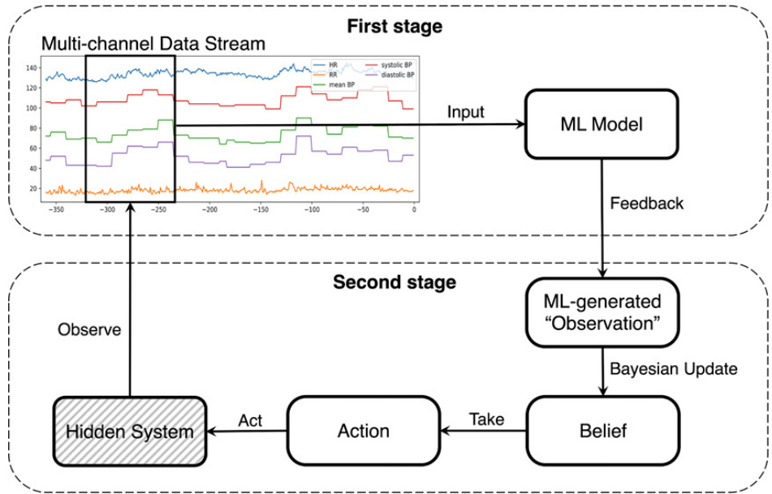
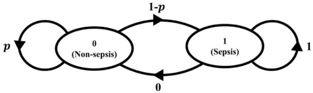
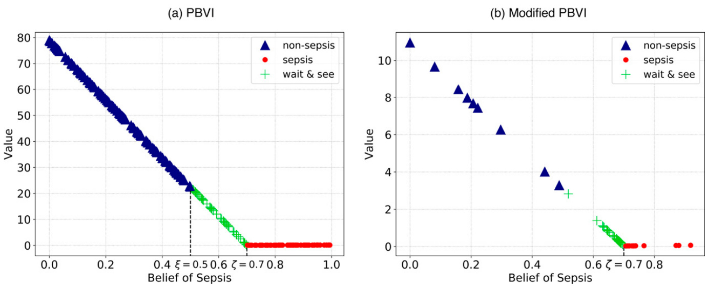
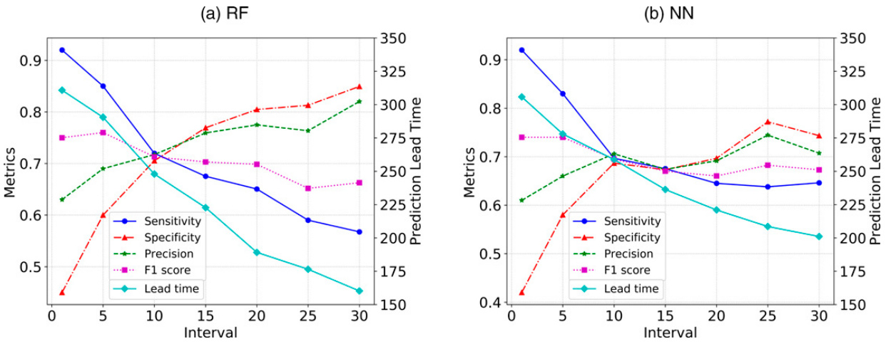
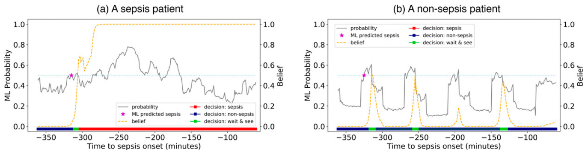
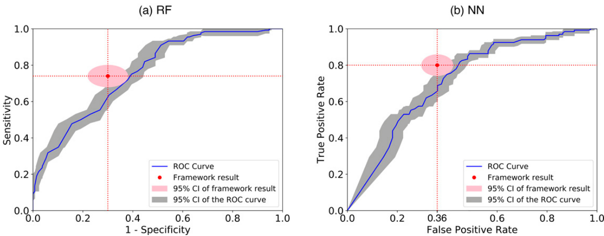

  

# INFORMS Journal on Computing  

Publication details, including instructions for authors and subscription information: http://pubsonline.informs.org  

A Machine Learning–Enabled Partially Observable Markov Decision Process Framework for Early Sepsis Prediction  

Zeyu Liu, Anahita Khojandi, Xueping Li, Akram Mohammed, Robert L Davis, Rishikesan Kamaleswaran  

# To cite this article:  

Zeyu Liu, Anahita Khojandi, Xueping Li, Akram Mohammed, Robert L Davis, Rishikesan Kamaleswaran (2022) A Machine Learning–Enabled Partially Observable Markov Decision Process Framework for Early Sepsis Prediction. INFORMS Journal on Computing  

Published online in Articles in Advance 22 Mar 2022  

https://doi.org/10.1287/ijoc.2022.1176  

# Full terms and conditions of use: https://pubsonline.informs.org/Publications/Librarians-Portal/PubsOnLine-Terms-andConditions  

This article may be used only for the purposes of research, teaching, and/or private study. Commercial use or systematic downloading (by robots or other automatic processes) is prohibited without explicit Publisher approval, unless otherwise noted. For more information, contact permissions@informs.org.  

The Publisher does not warrant or guarantee the article’s accuracy, completeness, merchantability, fitness for a particular purpose, or non-infringement. Descriptions of, or references to, products or publications, or inclusion of an advertisement in this article, neither constitutes nor implies a guarantee, endorsement, or support of claims made of that product, publication, or service.  

Copyright © 2022, INFORMS  

Please scroll down for article—it is on subsequent pages  

# informs.  

With 12,500 members from nearly 90 countries, INFORMS is the largest international association of operations research (O.R.) and analytics professionals and students. INFORMS provides unique networking and learning opportunities for individual professionals, and organizations of all types and sizes, to better understand and use O.R. and analytics tools and methods to transform strategic visions and achieve better outcomes. For more information on INFORMS, its publications, membership, or meetings visit http://www.informs.org  

# A Machine Learning–Enabled Partially Observable Markov Decision Process Framework for Early Sepsis Prediction  

Zeyu Liu,a Anahita Khojandi,a,\* Xueping Li,a Akram Mohammed,b Robert L Davis,b Rishikesan Kamaleswaranc  

a Department of Industrial and Systems Engineering, University of Tennessee, Knoxville, Tennessee 37996; b Center for Biomedical Informatics-Pediatrics, University of Tennessee Health Science Center, Memphis, Tennessee 38163; c Departments of Biomedical Informatics, Pediatrics, and Emergency Medicine, Emory University School of Medicine, Atlanta, Georgia 30322   
\*Corresponding author   
Contact: zeyu.liu@utk.edu, https://orcid.org/0000-0003-0562-2661 (ZL); khojandi@utk.edu, https://orcid.org/0000-0001-6818-2048 (AK); xueping.li@utk.edu, https://orcid.org/0000-0003-1990-0159 (XL); amoham18@uthsc.edu (AM); rdavis88@uthsc.edu (RLD);   
rkamaleswaran@emory.edu (RK) Received: July 29, 2020   
Revised: April 29, 2021; November 13, 2021; January 21, 2022   
Accepted: January 29, 2022   
Published Online in Articles in Advance: March 22, 2022  

https://doi.org/10.1287/ijoc.2022.1176  

Copyright: $\scriptstyle{\widehat{\mathbb{C}}}$ 2022 INFORMS  

Abstract. Sepsis is a life-threatening condition, caused by the body’s extreme response to an infection. In the United States, 1.7 million cases of sepsis occur annually, resulting in 265,000 deaths. Delayed diagnosis and treatment are associated with higher mortality rates. An exponential rise in the availability of medical data has allowed for the development of sophisticated machine learning algorithms to predict sepsis earlier than the onset. However, these models often underperform, as the training data are retrospective and do not fully capture the uncertain future. In this study, we develop a novel framework, which we refer to as MLePOMDP, to leverage and combine the underlying, high-level knowledge about sepsis progression and machine learning (ML) for classification. Specifically, we use a hidden Markov model to describe sepsis development at a high level, where the ML model makes the higher-order “observations” from temporal data. Consequently, a partially observable Markov decision process (POMDP) model is developed to make classification decisions. We analytically establish that the optimal policy is of threshold-type, which we exploit to efficiently optimize MLePOMDP. MLePOMDP is calibrated and tested using high-frequency physiological data collected from bedside monitors. Different from past POMDP-based frameworks, MLePOMDP is developed for a prediction task using a very small state definition, produces highly interpretable results, and accounts for a novel and clinically meaningful action space. Our results show that MLePOMDP outperforms machine learning–based benchmarks by up to $8\%$ in precision. Importantly, MLePOMDP is able to reduce false alarms by up to $28\%$ . An additional experiment is conducted to show the generalizability of MLePOMDP to different patient cohorts.  

Summary of Contribution: This study develops a novel real-time decision support framework for early sepsis prediction by integrating well-known machine learning models (random forest and neural networks) with a well-established sequential decision-making model, namely, a partially observable Markov decision process (POMDP). The structural properties of the optimal policy are further explored and a threshold-type structure is established, which is then leveraged to develop a customized algorithm to solve the problem more efficiently. The resulting framework demonstrates the benefit of applying POMDPs to augment machine learning outputs. Specifically, the framework results in the reduction of false alarms in sepsis predictions where decisions are made in real time, hence improving the overall prediction precision.  

History: Accepted by Paul Brooks, Area Editor for Applications in Biology, Medicine, and Healthcare.   
Funding: This work was supported by the Science Alliance, University of Tennessee.  

Supplemental Material: The online appendices are available at https://doi.org/10.1287/ijoc.2022.1176.  

Keywords: partially observable Markov decision processes $\bullet$ medical decision making $\bullet$ sepsis $\bullet$ real-time predictive analytics • hierarchical modeling  

# 1. Introduction  

Sepsis is a life-threatening organ dysfunction caused by a dysregulated host response to infection (Singer et al. 2016). In the United States, 1.7 million cases of sepsis occur annually, resulting in 265,000 deaths (Rhee et al. 2017, Dantes and Epstein 2018). Overall, sepsis mortality rate in hospitals is on the order $35.3\%$ , with a $25.8\%$ mortality rate in the intensive care units (ICUs) (Sakr et al. 2018). Early detection of sepsis is extremely important, as mortality rate increases in treatment delay. Per one estimate, this rate increases by approximately $8\%$ per each hour of delayed diagnosis and treatment (Shashikumar et al. 2017). The urgency of early sepsis detection has incentivized the development of many predictive analytical approaches, where sophisticated statistical models are built to predict at-risk patients early (Fleuren et al. 2020).  

A majority of the existing work involves developing machine learning (ML) algorithms to predict whether a patient would develop sepsis (Islam et al. 2019, Fleuren et al. 2020, Moor et al. 2021). Among the algorithms, many have used proof-of-concept methods where sepsis prediction has occurred as a one-time decision (e.g., Desautels et al. 2016, Taylor et al. 2016, McCoy and Das 2017, Shashikumar et al. 2017, van Wyk et al. 2017, Khojandi et al. 2018b, Wang et al. 2018, Barton et al. 2019, Chiew et al. 2019), whereas others have taken a step further to develop ML-based algorithms for potential real-time implementation (e.g., Gultepe et al. 2014; Henry et al. 2015; Calvert et al. 2016; Futoma et al. 2017; Khoshnevisan et al. 2018; Lin et al. 2018; Nemati et al. 2018; Fagerstro¨m et al. 2019; Moor et al. 2019; van Wyk et al. 2019a,b; Kok et al. 2020; Liu et al. 2021; Rafiei et al. 2021; Shashikumar et al. 2021). New advances regarding the latter have been partly fueled by the 2019 PhysioNet Computing in Cardiology Challenge (e.g., Abromavicius et al. 2020, He et al. 2020, Nesaragi and Patidar 2020, Reyna et al. 2020).  

Although significant advancements were made in early sepsis prediction by adopting ML techniques, it is important to acknowledge the inherent shortcomings of ML algorithms. Data used to train ML models for prediction are by necessity reliant on retrospective data. Because these models learn from historical data, they often fail to generalize well to new unseen data, especially when the environments in which the models are deployed change dynamically (Haas et al. 2011). Another major pitfall of ML-based predictions is that no matter how complex the predictive model, prescriptive decisions are still made using thresholdbased methods. For instance, in a classification problem using ML methods, such as random forest (RF) or neural network (NN), it is common to classify an input to the class with the maximal confidence (Hastie et al. 2017). Particularly, in sepsis prediction problems, an ML model predicts a “probability” that a patient has sepsis. Then, the probability is compared with an a priori threshold (typically 0.5) to classify the subject as a sepsis/nonsepsis patient.  

As a result, current sepsis prediction methods often suffer from low specificity (true negative rate), especially when implemented in real time (Giuliano 2007, Gultepe et al. 2014, Henry et al. 2015, Shashikumar et al. 2017, Chiew et al. 2019, Islam et al. 2019). This is mainly because the imposed threshold is not flexible enough to filter out false positives, resulting in a relatively high false alarm rate. Excessive false alarms could cause alarm fatigue, which contributed to 566 deaths in the United States from 2005 to 2008 (Cvach  

2012). Alarm fatigue is especially harmful in a cohort with unbalanced classes. The prevalence of sepsis in the ICU is on the order of $10\%{-}15\%$ (Rhee et al. 2017, Sakr et al. 2018). As such, given the unbalanced ratio of sepsis to nonsepsis patients, even a moderate false positive rate can cause a significant number of false alarms (Saito and Rehmsmeier 2015). Hence, before the adoption of sepsis detection algorithms as part of early warning systems in hospitals, it is important to develop real-time algorithms that are not only highly sensitive but also particularly specific and precise (i.e., present a low false alarm rate).  

In this study, we develop a real-time early sepsis prediction framework that addresses two shortcomings of $\mathrm{ML},$ including their lack of adaptability to dynamically changing circumstances and their reliance on an a priori threshold. This novel framework embeds an ML-based predictive model into a prescriptive model to make classification decisions. Specifically, we develop an ML-based predictive model and integrate it into a partially observable Markov decision process (POMDP) model.  

We refer to this ML-enabled POMDP framework as MLePOMDP. In MLePOMDP, the ML model “peeks” into the hidden state of the patient in real time through ML-based “observations,” while simultaneously accounting for the patient’s underlying disease progression at a high level to construct an accurate understanding of his or her health state to enable improved decision making. The “decisions” are “predictions” of the future state of the patient, made based on the temporal changes in high-frequency bedside monitor data. These decisions would draw the attention of the ICU bedside staff to at-risk patients as early as possible, while ensuring enough confidence in them to avoid false alarms.  

Our proposed MLePOMDP models sepsis progression at a high level using binary states and embeds ML into Markov models to address sepsis prediction. Apart from ML-based algorithms to predict sepsis, perhaps the most closely related works to ours are those that jointly use ML and Markov models to prescribe interventions in sepsis treatment (Komorowski et al. 2018, Saria 2018, Li et al. 2020). In these studies, patient health states are either estimated using k-means clustering or modeled by a recurrent neural network (RNN), resulting in hundreds of states. This results in a lack of interpretability in the model output. In contrast, in this study, we create a novel way of integrating ML and Markov models for sepsis prediction that keeps the state definition very small. This makes the model amenable to structural analysis and provides interpretability and explainability, which are extremely important for early warning systems.  

The main contributions of this study are as follows. First, this study proposes a compact two-stage early prediction framework, namely, MLePOMDP, by integrating ML and POMDP models. MLePOMDP provides flexibility in the choice of ML model, allowing the framework to be easily recalibrated using a wide range of ML models and be readily used in a large array of applications. Second, MLePOMDP can be viewed as an alternative and extension to higherorder Markov decision processes. Because the inputs to the model are time series data, the number of decision epochs are extremely large, and hence the problem is very difficult to solve using existing solution methods. Therefore, the model is set up in a way to remain amenable to structural analysis. The study formally establishes the structural properties of the model, which are leveraged to devise an efficient solution algorithm for the corresponding POMDP model. In addition, this work contributes to the state-of-theart early sepsis prediction. The case study presented is one of a handful performed that uses high-frequency physiological data collected at the bedside to predict sepsis in real time according to the Sepsis-3 criteria. In addition, it contributes to an even smaller set of existing works that focus on false alarm reduction. Lastly, it is one of the first studies to introduce an expanded, and clinically relevant, set of predictions (through the introduction of wait $\scriptstyle{\mathcal{E}}\,^{}$ see, in addition to sepsis/nonsepsis) that would further support real-time implementation as part of early warning systems.  

# 2. Model Formulation  

We consider the development of sepsis in the human body as a stochastically evolving system, where the ground truth of sepsis is unknown to an outside observer. A traditional ML model, which only relies on historical data to predict the future, lacks a comprehensive understanding of the system dynamics and its future evolution. To improve model performance, we provide the model with knowledge of the future by assuming that the underlying state of the system evolves according to a Markov chain (Karlin and Taylor 1975). As such, we can capture the complex dynamics of the system using a higher-order hidden Markov model (HOHMM) (Hadar and Messer 2009). However, it is generally difficult to estimate the parameters of these models. Therefore, we instead exploit ML to capture the complex interactions of features from high-dimensional data sets and use ML predictions to construct a first-order hidden Markov model (HMM) (Krishnamurthy 2016).  

In a first-order HMM, the future evolution of the system depends on the past only through the current state, and the underlying health state of the patient (sepsis or nonsepsis) can only be inferred through observations. To make observations, we use an ML model on the raw multichannel physiological data streams to obtain “aggregated predictions” about the underlying state of the system. Note that, as in most ML models, these predictions (now observations for HMM) are not necessarily accurate. Therefore, we use these observations in the HMM to update belief states over time and develop a POMDP model to determine the optimal predictions for the system, overall enhancing the predictive power of the embedded ML model.  

Figure 1 demonstrates an overview of MLePOMDP. For the sake of simplicity, we present MLePOMDP in two stages. In the first stage, temporal data from the system are used by a trained ML model to make a prediction about the current system state. These predictions are fed to a second-stage POMDP model as partial observations. The observations are used to update the belief about the state of the system. Actions are taken based on the belief and generate immediate rewards/costs. The system then continues to evolve, and the process continues. The goal is to identify the optimal policy that maximizes the total expected reward generated by the system.  

  
Figure 1. (Color online) An Overview of the MLePOMDP Framework   
Notes. In the first stage, the multichannel data stream monitoring the hidden system is fused using an ML model. In the second stage, the ML-generated probabilities are used as observations to update the belief about the underlying state of the system. Action is taken based on this belief, which in turn (potentially) modifies the state of this evolving system.  

In general, MLePOMDP is very flexible. It allows for a large class of ML models to be integrated into POMDPs, as long as the outputs of the ML models are treated as observations of hidden systems. In addition, MLePOMDP expands the capability of Markov models. Traditionally, Markov models are widely used to solve problems with limited system states or observations in each state, mainly to reduce the computational burden (Langville and Stewart 2004, Lin et al. 2004, Sleptchenko and Johnson 2015, Khojandi et al. 2018a). However, with the help of ML models, MLePOMDP is able to take high-dimensional data as input, where the number of features considered imposes no computational burden on the Markov models themselves. This is because, in MLePOMDP, ML models first extract vital information from highdimensional data, which POMDPs use to make “informed” decisions while accounting for the knowledge of system dynamics.  

# 2.1. First-Stage Model  

To develop ML models for real-time detection of sepsis in multichannel high-frequency data streams, we use overlapping sliding time windows introduced in previous studies (van Wyk et al. 2019a, b; Liu et al. 2021). Specifically, we extract features using three time windows of length 0.25 hour, 0.5 hour, and 1 hour, applied to the physiological data and moving forward every minute, until one hour before sepsis onset. For each of the time windows, mean, minimum, maximum, standard deviation, variance, skewness, kurtosis, and slope (per best-fitting line using linear regression) are extracted from four vital signs: heart rate (HR), respiratory rate (RR), blood pressure (BP), and oxygen saturation $({\mathrm{SpO}}_{2})$ . Additionally, for HR, RR, and BP, entropy is calculated with the one-hour time window. After preprocessing, a total of 144 features are extracted from patients’ physiological data at each time epoch.  

In this study, we use random forest (RF) and neural network (NN) as our ML-based prediction models. Note that we also consider RNNs as an alternative; however, because the results are ultimately unfavorable, we only include the details about these models in Online Appendix A.  

RF is a supervised ML model that ensembles multiple decision trees. The probability of sepsis is calculated as the mean predicted sepsis probabilities of the trees in the forest. RF is generally robust against overfitting and requires little hyperparameter tuning. One of the most important parameters to tune in RF is the number of trees in the forest, which is optimized according to the out-of-bag (OOB) error (Breiman 2001). Additionally, we train a fully connected NN as an alternative first-stage model. Specifically, we construct the NN as a multilayer perceptron (MLP) with one neuron in the output layer so that the output represents the probability of sepsis. NN can model highly nonlinear relationships between variables; however, it generally requires extensive efforts in hyperparameter tuning to achieve good performance while remaining generalizable. As such, the NN structure is selected using a 10-fold cross-validation based on the crossentropy loss.  

For both the RF and the NN models, predictions are made every minute, starting from hour 1, through the end of the horizon. Note that, because a windowbased approach to extract features is used, the first prediction is made one hour (equal to the length of the largest window) after the beginning of the observation horizon. The stream of predicted probabilities of sepsis is used as observations in the second stage.  

# 2.2. Second-Stage Model  

We formulate the second-stage decision-making model as a discrete-time infinite-horizon POMDP. A POMDP model is defined as a tuple with seven elements: $\langle S,A,T,R,\Omega,O,b_{0}\rangle$ . We let $t\in\left\{0,1,\ldots,\infty\right\}$ denote decision epochs for the model, and we let $s_{t}\in$ $S:=\{0,1\}$ denote the underlying health state of the patient, where $s_{t}=0$ represents nonsepsis and $s_{t}=1$ represents sepsis.  

We let $a_{t}\in A=\{\mathcal{N},\mathcal{W},S\}$ denote the action at time $t,$ where $a_{t}=\mathcal{N}$ corresponds to marking the patient as nonsepsis, $a_{t}=\mathcal{W}$ corresponds to wait $\scriptstyle{\mathcal{E}}\,^{}$ see, and $a_{t}=S$ corresponds to diagnosis of sepsis. Action $a_{t}=S$ is a stopping action; that is, when $a_{t}=S,$ an alert is issued to draw the attention of the bedside staff to start treatment, at which point the problem terminates. Note that actions $\mathcal{N}$ and $\mathcal{W}$ both imply that observation must be continued; however, they differ in terms of practical implications at the bedside. Specifically, $\mathcal{N}$ suggests that the model is confident that the patient is nonsepsis, and, hence, the bedside staff attention is not required at all. In contrast, $\mathcal{W}$ suggests that the model is not confident enough to decide whether the patient has sepsis or not, and hence watchful observation is required.  

The patient’s underlying state evolves dynamically. We let $p$ denote the probability that a nonsepsis patient remains nonsepsis at the next time epoch, in the absence of a sepsis prediction (i.e., $a\neq S$ ). In addition, we assume that sepsis patients cannot be cured without outside medical intervention. As such, a sepsis patient always remains in the sepsis state, in the absence of a sepsis prediction (i.e., $a\neq S$ ). Figure 2 summarizes the transition diagram among the states $s\in S$ for $a\neq S$ . We let $P$ denote the one-step transition probability matrix (TPM) under action $a\in\{\mathcal{N},\mathcal{W}\},$ where $P(s,s^{\prime})$ denotes the transition probability from state $s$ to state $s^{\prime}$ under action $a\in\{\mathcal{N},\mathcal{W}\}$ ; that is,  

$$
P={\binom{p}{0}}\quad1-p\quad
$$  

where rows and columns are $s$ and $s^{\prime}$ , respectively, in the order of 0, 1. Finally, we let $T(s,s^{\prime},a)$ denote the transition function from state s to state $s^{\prime}$ under action $a$ . Clearly, for all $s\in S,\,T(s,s^{\prime},a)=P(s,s^{\prime})$ when $a\in$ $\{\mathcal{N},\mathcal{W}\},\,\bar{T}(s,s^{\prime},S)=1$ if $s{'}=1$ , and $T(s,s^{\prime},S)=0$ if $s^{\prime}=0$ .  

the belief is updated as follows:  

At each time epoch $t,$ an observation $o_{t}\in O$ is made by the first-stage ML model. This observation is the predicted probability that the patient has sepsis. Specifically, we let $O$ be a discrete set whose elements are bounded between 0 and 1. Let $\Omega$ denote the probability of observing $o_{t}$ in state $s_{t};$ that is, $\Omega(o_{t},s_{t})=\mathrm{Pr}(O=o_{t}\mid S=s_{t})$ . Note that, in this POMDP model, observations are made only under actions $\mathcal{N}$ and $\mathcal{W},$ and the actions themselves do not affect the observation probability.  

Based on the underlying dynamic of the process and the observations made, a belief vector $b_{t}\in B$ is constructed whose elements denote the probability of being in the sepsis/nonsepsis states. That is, we let $\begin{array}{r}{b_{t}=\bar{(b(0),b(1))},\bar{\sum}_{s_{t}\in S}b(s_{t})=\bar{1},}\end{array}$ where $b(s_{t})$ denotes the belief of being in state $s_{t}\in S$ . The belief about the underlying state of the process can be represented as a conditional probability, $b_{t}:=\operatorname*{Pr}(s_{t}\mid b_{0},o_{1},\dots,o_{t-1},o_{t}),$ , where the vector $b_{0}$ is the initial belief about the state of the system. In this study, we assume that patients are nonsepsis when admitted into the ICU; hence, we let $b_{0}=(1,0)$ . At time $t,$ given that the patient is still under observation and the observation $o_{t}\in O$ is made,  

  
Figure 2. Transition Diagram Among the Hidden States $s\in S$ in the Absence of a Sepsis Prediction $(a\neq S)$  

$$
b(s_{t})=\frac{\Omega(o_{t},s_{t})\sum_{s_{t-1}\in S}{P(s_{t-1},s_{t})b(s_{t-1})}}{\sum_{s_{t}\in S}{\Omega(o_{t},s_{t})\sum_{s_{t-1}\in S}{P(s_{t-1},s_{t})b(s_{t-1})}}}.
$$  

Note that the belief $b_{t}\in B$ is different from ML-predicted probabilities; the belief $b_{t}$ is updated at each decision epoch, while the patient is still under observation, with a new observation made using the first-stage ML model. This allows the belief to incorporate the history of predictions made by the ML model.  

After taking an action, an immediate reward $\boldsymbol{r}(s,a)$ : $S\times A\to\mathbb{R}$ is gained; that is,  

$$
r(0,a)=\left\{\!\!\begin{array}{l l}{R_{t n},}&{\quad a=\mathcal{N},}\\ {R_{d},}&{\quad a=\mathcal{W},\quad r(1,a)=\left\{\!\!\begin{array}{l l}{-R_{f n},\quad}&{a=\mathcal{N},}\\ {R_{d},}&{a=\mathcal{W},}\\ {R_{t p},}&{a=\mathcal{S},}\end{array}\right.}
$$  

where $R_{t n},\,R_{f p},\,R_{f n},$ and $R_{t p}$ are positive constants, representing the magnitude of rewards and costs associated with true negative, false positive, false negative, and true positive predictions, respectively. In addition, $R_{d}$ is a positive constant representing the reward of taking the action wait $\scriptstyle{\mathcal{E}}\,^{}$ see, which may temporarily delay the diagnosis. The seemingly counterintuitive choice of $R_{d}$ as a positive constant encourages the POMDP to slightly delay sepsis prediction until more information is available.  

The objective of the POMDP model is to maximize the total expected reward. Let $V_{t}(b)$ denote the total expected reward-to-go at time epoch $t$ . The Bellman optimality equations of the POMDP (Bellman 1957) can be written as follows:  

$$
\begin{array}{r l}&{~~~~V_{t}(b)\!=\!\operatorname*{max}\{Q_{t}(b,\!\mathcal{N}),Q_{t}(b,\!\mathcal{W}),Q_{t}(b,\!S)\},}\\ &{Q_{t}(b,\!S)\!=\!\displaystyle\sum_{s_{t}\in S}\!b(s_{t})\!\cdot\!r(s_{t},\!S),}\end{array}
$$  

$$
\begin{array}{r l}&{Q_{t}(b,a)\!=\!\underset{s_{t}\in S}{\sum}b(s_{t})r(s_{t},a_{t})\!+\!\underset{s_{t}\in S}{\sum}b(s_{t})\!\underset{o_{t}\in O}{\sum}\Omega(o_{t},s_{t})}\\ &{\quad\quad\quad\quad\underset{s_{t+1}\in S}{\sum}P(s_{t},s_{t+1})V_{t+1}(b^{\prime})\ \forall a\!\in\!\{\mathcal{N},\mathcal{W}\},}\end{array}
$$  

where $b^{\prime}$ is the updated belief vector at time $t+1$ after observing $o_{t}$ in $s_{t}$ per Equation (2). Note that when $a=$ ${\mathcal{S}},Q_{t}(b,a)$ only consists of one part (i.e., a lump-sum terminal reward), but when $a\in\{\mathcal{N},\mathcal{W}\},$ it consists of two parts, namely, the expected immediate reward in the current state and the expected reward-to-go, starting from the state to which the system transitions. In this model, the expected undiscounted reward is calculated; that is, the discount factor is set to one. This is because we opt to value future reward equivalent to immediate reward. This is partly because the decision periods considered are very small (i.e., one to a few minutes), and patients usually stay in the ICU for a limited amount of time (Moitra et al. 2016). Hence, discounting the future rewards could suggest inappropriately small values for sepsis detection in the near future. Note that this does not cause any convergence issues; although the POMDP is of infinite horizon, the prediction process terminates in finite time, as the state $s=1$ is absorbing, with an optimal stopping action (i.e., $a=S$ ).  

# 3. Structural Properties  

In this section, we formally establish the structural properties of the second-stage POMDP model. The properties allow us to devise an efficient solution approach for the problem. All proofs are included in Online Appendix B.  

First, we introduce the definition of monotone likelihood ratio (MLR) ordering (Krishnamurthy 2016).  

Definition 1. Let $v_{1},\,v_{2}$ be two $n$ -dimensional vectors, $v_{1},v_{2}\in\mathbb{R}^{n}$ . Then, $v_{1}$ is dominated by $v_{2}$ with respect to the MLR ordering, denoted by $v_{1}\leq_{r}v_{2},$ if  

$$
v_{1}(i)v_{2}(j)\leq v_{2}(i)v_{1}(j),\quad\forall i<j,\,i,j\in\{1,2,\ldots,n\}.
$$  

Note that for two-state POMDP, MLR ordering is equivalent to first-order stochastic dominance (Krishnamurthy 2016). Here, we opt to use MLR ordering since it represents a more generic approach to prove monotonicity for the POMDP value function and allows the extensions to multistate (more than two) state spaces. In the remainder of this section, to simplify the notation, for $b\in B$ , we let $q=b(1),q\in[0,1],$ so that $b=(1-q,q)$ . Next, Lemma 1 establishes conditions for MLR ordering in $b\in B$ .  

Lemma 1. Let $b_{1}=(1-q_{1},q_{1}),b_{2}=(1-q_{2},q_{2}),\,q_{1},q_{2}\in[0,1],$ , denote two belief vectors in the belief space, $b_{1},b_{2}\in B$ . Then, $b_{2}$ dominates $b_{1}$ with respect to the MLR ordering; that is, $b_{1}\leq_{r}b_{2},$ if and only if $q_{1}\leq q_{2}$ .  

Let $\pi:B\rightarrow A$ denote a policy that prescribes the action to take in each belief, and let $\pi^{*}$ denote the optimal policy that maximizes the total expected reward-to-go starting from belief $b_{t}$ . Given the optimal policy $\pi^{*}$ , for any given belief $b_{t}\in B$ , the optimal action at time $t,$ denoted by $a_{t}^{*},$ , is given by $a_{t}^{*}=\pi^{*}(b_{t})=\operatorname*{argmax}_{a\in A}\{Q_{t}(b,a)\}$ .  

Next, we partition the belief space $B$ into subsets per the optimal action $a_{t}^{*}$ and establish the behavior of the value function in the corresponding subspaces. Let $\mathcal{R}_{a}=\left\{b:b\in B,\pi^{*}(b)=a\right\}$ denote the set of beliefs in which the action $a\in A=\{\mathcal{N},\mathcal{W},S\}$ is optimal. For instance, a belief $b_{t}\in\mathcal{R}_{S}$ suggests that the optimal action at time $t$ is the stopping action $a_{t}^{*}=S$ under the optimal policy $\pi^{*}$ . First, we prove structural properties of the model in the subset $\mathcal{R}_{\mathcal{S}}$ . Specifically, Proposition 1 proves the monotonicity of the value function $V(b)$ in subspace $\mathcal{R}_{S}$ .  

Proposition 1. The value function $V(b)$ is MLR increasing in the subspace $\mathcal{R}_{S}$ . That is, $V(b_{1})\leq V(b_{2})$ , where $b_{1}\leq_{r}b_{2},\,b_{1},b_{2}\in\mathcal{R}_{S}$ .  

The value function of a POMDP is piecewise linear, and it is convex when the objective is to maximize the value function (Sondik 1971). It has also been established that the belief subspace in which the stopping action is optimal, in this case $\mathcal{R}_{S},$ is a convex set (Krishnamurthy 2016). Next, we exploit this fact to establish that the optimal policy $\pi^{*}$ has a thresholdtype structure. Specifically, Theorem 1 proves that there exists a threshold $\zeta\in[0,1]$ in the belief of being in state sepsis, $b(1)_{.}$ , at and above which it is optimal to mark patients as septic and issue an alert, and below which it is optimal to continue patient observation.  

Theorem 1. Let $b=(1-q,q),b\in B,q\in[0,1]$ . There exists a threshold $\zeta\in[0,1]$ in the belief of being in state sepsis, $b(1)=q.$ , such that  

$$
a^{*}=\pi^{*}(b)=\binom{S,\;\;\;\;\;\;\;\;\;\;\;\;\;i f\;q\geq\zeta,\;\;}{\mathcal{N\;o r\;\mathcal{W}}},\;\;\;o t h e r w i s e.
$$  

Equivalently, $b\in\mathcal{R}_{S}$ if $q\in[\zeta,1)$ and $b\in\mathcal{R}_{\mathcal{N}}\cup\mathcal{R}_{\mathcal{W}},$ otherwise.  

Therefore, Theorem 1 establishes that, under the optimal policy, there is a threshold $\zeta\in[0,1]$ that splits the interval [0, 1] into two convex subsets corresponding to actions $a\in\{S\}$ and $a\in A-\{S\}=\{{\mathcal{N}},{\mathcal{W}}\}$ . As such, the subset $\mathcal{R}_{\mathcal{N}}\cup\mathcal{R}_{\mathcal{W}}$ is also a convex subset of $B$ . Note that Equation (7) only suggests that $\mathcal{N}$ and $\mathcal{W}$ are candidate optimal actions when $q<\zeta$ and does not provide any information as to when one or the other may be optimal.  

Next, consider the following assumption.  

# Assumption 1. $R_{t n}\geq R_{d}$ .  

Assumption 1 implies that the magnitude of reward for the correct nonsepsis prediction (i.e., true negative) is larger than the magnitude of reward for the wait $\scriptstyle{\mathcal{E}}\,^{}$ see action, which in essence temporarily delays diagnosis in exchange for further information.  

Theorem 2 proves that, in region $\mathcal{R}_{\mathcal{N}}\cup\mathcal{R}_{\mathcal{W}},$ under Assumption 1, the optimal policy $\pi^{*}$ has a thresholdtype structure. Specifically, it establishes that there exists a threshold $\xi\in[0,\zeta)$ in the belief of being sepsis, $b(1)_{.}$ , at and above which it is optimal to wait $\scriptstyle{\mathcal{E}}\,^{\!}$ see, and below which it is optimal to mark the patients as nonsepsis.  

Theorem 2. Let $b=(1-q,q)$ , $q\in[0,\zeta)$ . Under Assumption 1, there exists a threshold $\xi\in[0,\zeta]$ in the belief of being in state sepsis, $b(1)=q,$ , such that  

$$
a^{*}=\pi^{*}(b)=\left\{\mathcal{N},\begin{array}{l l}{i f\ q<\xi,}\\ {o t h e r w i s e,}\end{array}\right.
$$  

where $\begin{array}{r}{\xi=\frac{R_{t n}-R_{d}}{R_{t n}+R_{f n}}}\end{array}$ . Equivalently, $b\in\mathcal{R}_{\mathcal{N}}$ if $q\in[0,\xi)$ and $b\in\mathcal{R}_{\mathcal{W}},$ otherwise.  

Finally, Corollary 1 characterizes the structure of optimal policy $\pi^{*}$ in the entire belief space.  

Corollary 1. Let $b=(1-q,q),b\in B,q\in[0,1]$ . The optimal policy $\pi^{*}$ has a threshold-type structure, and there exists two thresholds $0\leq\xi\leq\zeta\leq1$ such that  

$$
a^{*}=\pi^{*}(b)=\left\{\begin{array}{l l}{N,}&{i f\ q<\xi,}\\ {\mathcal{W},}&{i f\ \xi\leq q<\zeta,}\\ {S,}&{o t h e r w i s e.}\end{array}\right.
$$  

Equivalently, $b\in\mathcal{R}_{\mathcal{N}}$ if $q\in[0,\xi)$ , $b\in\mathcal{R}_{\mathcal{W}}$ if $q\in[\xi,\zeta)$ , and $b\in{\mathcal{R}}_{S},$ , otherwise.  

# 4. Solution Approach  

In this section, we discuss the solution approach in both the first and second stages. Specifically, we describe an existing solution approach for the secondstage POMDP model and then outline how we incorporate the structural properties established in Section 3 into the solution algorithm to improve its efficiency.  

Note that MLePOMDP is extremely flexible, allowing for any predictive model (first stage) to be paired and integrated with the decision-making process (second stage) to solve real-time classification tasks that involve stochastically evolving systems. However, this flexibility does not complicate the solution approach, as the two stages can be modeled and optimized individually. Specifically, the first-stage ML model can be developed and optimized using an array of existing machine learning libraries. In our case study, ML models are implemented and optimized using the Python scikit-learn library (Oliphant 2007, Pedregosa et al. 2011). The NN model is trained with the Adam algorithm (Kingma and Ba 2014).  

Solving a POMDP model is challenging. Various classes of exact and approximate solution methods exist for POMDPs. Exact solution algorithms can solve small instances of POMDP models to optimality, for example, Monahan’s algorithm, Sondik’s algorithm, and the witness algorithm (Krishnamurthy 2016). However, solving models with extremely large policy spaces using exact approaches is often intractable due to the curse of dimensionality (Roy et al. 2005). Approximate methods can mitigate this problem. These methods include the  

MDP-based approximations such as point-based value iteration (PBVI) (Pineau et al. 2003, Spaan and Vlassis 2005), grid-based approximations (Zhou and Hansen 2001, Bonet 2002) and other hybrid heuristic methods (Lin et al. 2004). In addition, cutting-edge artificial intelligence (AI) techniques, such as reinforcement learning (RL) (Kunnumkal and Topaloglu 2008, Wang et al. 2019), can also be used to solve large-scale POMDP problems. There are also specialized algorithms that solve optimal stopping POMDPs, such as a linear approximation algorithm that estimates the stopping threshold (Krishnamurthy 2011). However, due to sizable differences in model formulations, especially in the reward structure and special properties required in the observation probability matrix, assumptions made in the established algorithms are not fully satisfied in our second-stage POMDP. Thus, it is difficult to directly apply the algorithms in the literature to this study.  

Per our preliminary experiments, using exact algorithms to solve the second-stage POMDP model is too time-consuming. Thus, we propose a modified PBVI algorithm to solve this POMDP model. The PBVI algorithm uses two main steps of point-based value backup and belief point set expansion. As such, instead of evaluating all the beliefs in the belief space, the algorithm only focuses on the belief points that are important to the solution structure. The PBVI algorithm produces “good enough” solutions with less computational time.  

In order to solve the second-stage POMDP model more efficiently, we incorporate the structural properties proved in Section 3 into the PBVI algorithm. Recall that the value function is convex and piecewise linear (Krishnamurthy 2016). Specifically, the value function $V(b)$ can be represented as a set of $\alpha$ -vectors $\mathcal{V}=\{\alpha_{0},\alpha_{1},\ldots,\alpha_{n}\}$ :  

$$
V(b)=\operatorname*{max}_{\alpha\in V}\sum_{s\in S}\alpha(s)\cdot b(s),
$$  

where each $\alpha$ -vector is an $|S|$ dimension hyperplane. Thus, $\mathcal{V}=\{\alpha_{0},\alpha_{1},\ldots,\alpha_{n}\}$ is the solution to the optimality equations. In the algorithm, we estimate the value function through $\alpha$ -vectors on specific belief points.  

Note that according to Theorem 2, we are able to compute the threshold $\xi$ between action $a=\mathcal{N}$ and $a=\mathcal{W}$ directly. Thus, in our problem, the sole purpose of the modified PBVI algorithm is to estimate the threshold $\zeta$ between action $a=\mathcal{W}$ and $a=S$ . To achieve this goal, we incorporate a local search heuristic algorithm into the PBVI algorithm that gradually reduces the searching neighborhood, until it converges to the threshold with an acceptable error.  

Algorithm 1 (Modified PBVI with Local Belief Expansion) 1 Input the iteration threshold of local belief expansion $M_{\sun}$ , the number of beliefs $\eta$ to be sampled in each local belief expansion, acceptable errors $\epsilon_{1}$ and $\epsilon_{2};$ 2 Initialize the number of belief expansions $n=0$ , the belief set $\mathcal{B}=\left\{b_{0}=(1,0)\right\}$ , the $\alpha$ -vector set $\mathcal{V}=\{\alpha_{0}^{N}=(0,0)\},$ the candidate interval for local belief expansion $I=[\xi,1]_{\scriptscriptstyle\!\!\perp}$ ; 3 repeat 4 repeat 5 $\mathcal{V}^{\prime}\gets\mathcal{V}_{\prime}$ ; 6 $\nu\leftarrow\alpha$ -vectors backup according to Equations (11)–(15); 7 unti $\begin{array}{r}{|\,|\alpha_{b}^{a}\cdot b-\alpha_{b}^{a^{\prime}}\cdot b|\leq\epsilon_{1},\quad\forall\alpha_{b}^{a}\in\mathcal{V},\alpha_{b}^{a^{\prime}}\in\mathcal{V}^{\prime};}\end{array}$ 8 if $n<M,$ , then 9 Randomly sample $q_{1},\ldots,q_{|B|}$ from the interval [0, 1];   
10 Add new beliefs b′1   (1 − q1, q1), : : : , b′B $(q_{|B|},1-q_{|B|})$ into the set $\boldsymbol{\mathrm{\Delta}}\boldsymbol{\mathrm{\Omega}}_{\boldsymbol{B}}$ ;   
11 else   
12 $I(0)\leftarrow\operatorname*{max}\{q:b=(1-q,q),\ \forall\alpha_{b}^{\mathcal{W}}\in\mathcal{V}\};$   
13 $I(1)\gets\operatorname*{min}\{q:b=(1-q,q),\ \forall\alpha_{b}^{S}\in\mathcal{V}\}.$ ;   
14 Randomly sample $q_{1},\ldots,q_{\eta}$ from the interval $I_{c}$ ;   
15 Add new beliefs $b_{1}^{\prime}\stackrel{\cdot\cdot}{=}(1-q_{1},q_{1}),\ldots,b_{\eta}^{'}=$ $(q_{\eta},1-q_{\eta})$ into the set $\boldsymbol{\mathrm{\Delta}}\boldsymbol{\mathrm{\Omega}}^{\beta}$ ;   
16 end   
17 until $I(1)-I(0)\leq\epsilon_{2}$ .  

As mentioned, the PBVI algorithm can be divided into two steps: the backup of $\alpha$ -vectors and the expansion of beliefs. After every belief expansion, $\alpha$ -vectors are backed up. We use the similar algorithmic design for the modified PBVI algorithm, but we add a separate “local” belief expansion that only considers certain parts of the belief space. Note that the successful estimation of the threshold $\zeta$ depends on a set of “good-enough” $\alpha$ -vectors that roughly capture the shape of the value function so that local values within the neighborhood of $\zeta$ can be estimated more accurately. Thus, the local belief expansion only starts after several iterations of regular belief expansions. Let $n=$ $1,2,\ldots$ be the number of performed belief expansions, and let $M$ be a threshold. When $n\mathrm{~<~}M,$ we perform regular belief expansions; when $n\geq M,$ we perform local belief expansions. In the following, we discuss the algorithm in detail.  

First, we initialize the set of belief points $\mathcal{B}=\{b_{0}=(1,0)\},$ under the assumption that the patient does not have sepsis at the beginning of the observation horizon. In the algorithm, each $\alpha$ -vector corresponds to a specific belief $b$ and action $a$ . Thus, we initialize the set of $\alpha$ -vector $\mathcal{V}=\{\alpha_{b_{0}}^{N}=(0,0)\},$ bseuggignensitningg  otfh atth ep aotibesnetrsv aartieo cno nhsoirdiezroend. Additionally, we initialize the number of belief expansions $n=0$ .  

Then, we start to back up the $\alpha$ -vectors according to the following equations (Pineau et al. 2003):  

$$
\begin{array}{r l r}&{\Gamma^{a,*}\gets\alpha^{a,*}(s)=r(s,a)\qquad}&{\forall a\in A,}\\ &{\Gamma^{a,o}\gets\alpha^{a,o}(s)=\displaystyle\sum_{s^{\prime}\in S}P(s,s^{\prime})\Omega(o,s^{\prime})\alpha_{b}^{a^{\prime}}(s^{\prime})\qquad}\\ &{\qquad\qquad\qquad\qquad\qquad\quad\forall a\in\{X,\mathcal{W}\},o\in O,\alpha_{b}^{a^{\prime}}\in\mathcal{V},}\\ &{\Gamma_{b}^{a}\gets\Gamma^{a,*}\qquad}&{\forall a\in\{\mathcal{S}\},}\\ &{\Gamma_{b}^{a}\gets\Gamma^{a,*}+\displaystyle\sum_{o\in O}\operatorname*{argmax}(\alpha\cdot b)\qquad}&{\forall a\in\{\mathcal{N},\mathcal{W}\},}\\ &{\mathcal{V}\gets\operatorname*{argmax}\{\Gamma_{b}^{a}\cdot b\}\qquad}&{\forall b\in\mathcal{B}.}\end{array}
$$  

After one iteration of the backup, each $\alpha$ -vector $\alpha_{b}^{a}\in\mathcal{V}$ corresponds to a belief point in the set $\boldsymbol{\mathrm{\Delta}}\boldsymbol{\mathrm{\Omega}}_{\boldsymbol{B}}$ and an action $a\in A$ . The backup process runs in loops until for some $\epsilon_{1}>0$ , the set of $\alpha$ -vectors $\nu_{n}$ at iteration $n$ satisfies  

$$
\begin{array}{r}{|\alpha_{b}^{a}\cdot b-\alpha_{b}^{a^{\prime}}\cdot b|\leq\epsilon_{1},\quad\forall\alpha_{b}^{a}\in\mathcal{V}_{n},\alpha_{b}^{a^{\prime}}\in\mathcal{V}_{n-1},}\end{array}
$$  

so that the estimated value function converges under error $\epsilon_{1}$ .  

When the value function converges and $n<M,$ , we expand the set of beliefs in $\boldsymbol{B}$ . In our problem, the belief space $B$ is small; that is, it is sufficient to consider $b(1)\in[0,1]$ . Thus, at each expansion, it suffices to randomly sample $|\boldsymbol{B}|$ new points $q_{1},\ldots,q_{|B|}$ from the interval [0, 1], representing the new beliefs of being in the sepsis state. The newly generated beliefs $\breve{b_{1}^{\prime}}=$ $(1-q_{1},\stackrel{\cdot}{q}_{1}),\ldots,b_{|B|}^{'}=(q_{|B|},1-\stackrel{\cdot}{q_{|B|}})$ into the set $\boldsymbol{B}$ . As such, after every expansion, the size of $\boldsymbol{\mathrm{\Delta}}\boldsymbol{\mathrm{\Omega}}_{\boldsymbol{B}}$ grows twice as large as before. After the expansion, $\alpha$ -vectors corresponding to the newly generated beliefs are initialized with vectors of 0 in $\mathcal{V}$ . Then, the algorithm backs up the $\alpha$ -vectors.  

After $M$ iterations of regular belief expansions, that is, $n\geq M,$ , we start a local search of the threshold $\zeta$ . Now, let $b_{\mathcal{W}}=(1-q_{\mathcal{W}},q_{\mathcal{W}}),b_{\mathcal{W}}\in\mathcal{R}_{\mathcal{W}},$ be the belief with the maximum belief of sepsis among those for whom the corresponding optimal action is $\mathcal{W}$ . Similarly, let $b_{S}=(1-\bar{q_{S}},q_{S}),b_{S}\in\bar{\mathcal{R}}_{S},$ be the belief with the minimum belief of sepsis among those for whom the corresponding optimal action is $\boldsymbol{S}$ . The threshold $\zeta$ should be somewhere in the interval $I=[q_{\mathcal{W}},q_{S}]$ . Thus, we only have to expand the beliefs inside the interval $I$ . Similar to the regular belief expansion, we randomly sample $\eta$ new belief points in the interval I and add to the set $\boldsymbol{\mathrm{\Delta}}\boldsymbol{\mathrm{\Omega}}_{\boldsymbol{B}}$ . After the local belief expansion, the algorithm backs up the $\alpha$ -vectors associated with the newly generated beliefs. The entire algorithm stops when, for some $\epsilon_{2}>0,\,q_{\mathcal{S}}-q_{\mathcal{W}}\leq\epsilon_{2}$ . Therefore, the algorithm estimated the threshold $\zeta$ with $\epsilon_{2}$ error. Algorithm 1 presents the pseudocode.  

# 5. Computational Analysis  

In this section, we first discuss the data and their sources. Due to space limitations, the complete discussion on how these data are used to calibrate MLePOMDP, for example, tuning the ML models and estimating the POMDP model parameters, are described in Online Appendix C. We then present an example optimal policy under the PBVI algorithm and the modified PBVI algorithm described in Section 4 and comment on the computational time savings. Next, we introduce benchmarks and compare MLePOMDP performance with those of the benchmarks using the ICU data. Finally, we compare MLePOMDP performance with those of the benchmarks using an external data set and show that MLePOMDP is generalizable to a different cohort.  

# 5.1. Data  

We use two separate data sources in this study. We refer to these data sets as “ICU data” and “eICU data.” In the following, we describe these data sets in detail. We collect physiological data in six distinct ICU facilities from a large hospital system in the southeastern region of the United States, using the proprietary Cerner CareAware iBus platform (Cerner Corporation 2018). In the following, we use “ICU data” to refer to this data set. Only basic vital signs are included in this study: HR, RR, (mean, systolic, and diastolic) noninvasive BP, and ${\mathrm{SpO}}_{2}$ . A majority of the vital signs are captured on a minute-by-minute basis. In rare cases, when blood pressure values are collected with lower frequencies, the data are imputed with the last observation carried forward (LOCF). Through the study, we follow the ethical principles from the Declaration of Helsinki for medical research involving human subjects. This study was reviewed properly by the Institutional Review Board at the University of Tennessee Health Science Center (21-08088-XP). Sepsis is defined using the Sepsis-3 criteria (Singer et al. 2016). Patient characteristics of the ICU data are summarized in Online Appendix D (available online).  

From the ICU data, two data sets were created with different lengths of the observation horizon. The first data set contains data starting from seven hours before sepsis onset until one hour before sepsis onset, with a horizon of six hours. The second data set contains data from 11 hours before sepsis onset until one hour before onset, with a horizon of 10 hours. The former data set has 441 sepsis and 441 nonsepsis patients, and the latter has 317 sepsis and 317 nonsepsis patients.  

In order to externally validate MLePOMDP performance, we employ the eICU Collaborative Research Database (Pollard et al. 2018), a database containing patient cohorts from various hospitals that are admitted to the ICU during 2014–2015. To ensure feasibility as well as generalizability, we bootstrap 10 smaller data sets from the entire eICU database, each containing 500 sepsis and 500 nonsepsis patients, with sixhour observation horizons. Patient data are collected until one hour before sepsis onset. We use the term “eICU data” to refer to this data set. Different from the ICU data, which are generally collected on a minute-byminute basis, HR and RR in the eICU data are collected every five minutes and noninvasive BPs are collected aperiodically. The data collected with frequencies lower than five minutes are imputed with LOCF. Diagnosis of sepsis and its time of onset are identified in a similar manner as in the ICU data. Source codes for the eICU experiment can be found online (https://github.com/ILABUTK/MLePOMDP_ Early_Sepsis_Detection).  

# 5.2. Illustrative Example of the Optimal Policy  

Figure 3 demonstrates the optimal policies obtained using the PBVI algorithm and the modified PBVI algorithm with local belief expansions described in Section 4. The observation probabilities used in the corresponding problem are estimated using the first-stage RF model outputs from a cohort in the ICU cross-validation training set. For demonstration purpose, in Figure 3, we let $R_{t n}=$ $2,R_{f\!p}\!=\!1,R_{f\!n}\!=\!0,R_{t\!p}\!=\!1,$ and $R_{d}=1$ , where the threshold $\xi$ can be easily calculated to be 0.5. As seen in the figures, as the belief of being in state sepsis increases, the optimal action changes from marking the patient as nonsepsis $({\mathcal{N}}),$ , to wait $\scriptstyle{\mathcal{E}}\,^{}$ see $(\mathcal{W})$ , and finally to marking the patient as septic $(S)$ and issuing an alert for the bedside staff.  

Overall, the optimal policies are consistent with the structural properties proved in Section 3; that is, there exists a threshold-type structure in the optimal policy. Further, in the belief region where sepsis action is optimal, the value function is increasing. Note that, in the figure, the final estimated values are different. Because the modified PBVI algorithm aims to find the structural threshold in the belief space, the algorithm does not iterate enough times to back up the $\alpha$ -vectors to provide an accurate estimation of the value function.  

The optimal policy obtained from the PBVI algorithm (Figure 3(a)), calculates $\xi=0.5$ and $\zeta=0.703$ . In comparison, the optimal policy obtained from the modified PBVI algorithm with local belief expansions (Figure 3(b)), does not provide the threshold $\xi,$ as it can be calculated in advance. The threshold $\zeta$ is calculated to be 0.701, which is very close to that obtained by the PBVI algorithm.  

Note that PBVI and modified PBVI are both approximate methods. In addition, note that Algorithm 1 in modified PBVI combines value iteration with a local search heuristic algorithm, so it is difficult to quantify the optimality gap or compare its solution with other policies such as the one-step lookahead policy (Yasuda 1988). However, when developing the termination condition for metaheuristic algorithms, a common way is to manually impose an “optimality gap.” Consistent with this practice, we introduce $\epsilon_{2}$ in Algorithm 1. Hence, this algorithm terminates when $I(1)-I(0)\leq\epsilon_{2},$ where I(0) and $I(1)$ are sepsis beliefs associated with optimal actions $a_{0}=\mathcal{W}$ and $a_{1}=S,$ respectively. As such, when the algorithm terminates, the optimality gap is neglectable. In this study, we chose $\epsilon_{2}=0.005,$ , so the solution gap between PBVI and modified PBVI is negligible at best.  

  
Figure 3. (Color online) The Optimal Policy Obtained Using the Regular PBVI Algorithm (Left Panel) and the Modified PBVI Algorithm with Local Belief Expansions Described in Section 4 (Right Panel)  

The solution times for reaching these similar optimal policies are, however, very different. To provide a comparison, we run both algorithms under 10 different observation matrix sets and report the average computational time and a $95\%$ confidence interval. The regular PBVI algorithm takes on average 537.95 $(\pm10.22)$ seconds to solve, whereas the modified PBVI algorithm with local belief expansion takes on average 147.71 $(\pm9.82)$ seconds. Therefore, in general, the modified PBVI algorithm with local belief expansions reduces the computational time by over $70\%$ , compared with the regular PBVI algorithm.  

# 5.3. Benchmark  

We compare the performance of MLePOMDP with models developed using standard ML. In this study, we use RF and NN as the first-stage model. As discussed in Section 2.1, we also conduct experiments where we consider RNNs, especially long short-term memory (LSTM) networks. The results are overall unfavorable for our cohort, compared with RF and NN results, and, hence, we only include these results in Online Appendix A.  

In this study, experiments are conducted in a realtime fashion, where actions are taken in every decision epoch throughout the observation horizon (for completeness, the “snapshot” first-stage ML model performances measured at static timestamps are shown in Online Appendix E). The benchmark method represents decision making in a traditional ML classification model (e.g., based on RF or NN), where decisions are made by applying a 0.5 threshold to the predicted probability. To implement the ML models, we apply a 0.5 threshold to the first-stage output. If/when the probability is larger than 0.5, we classify the patient as septic and the process terminates. Six metrics are considered to evaluate performance: Sensitivity, specificity, precision, F1 score, area under the curve (AUC), and “lead time to sepsis.” Note that the AUC is only calculated to evaluate the performance of the first-stage ML models, since the second-stage POMDP makes sepsis/ nonsepsis decisions directly and does not have an adjustable threshold to produce AUC. Also, note that we define “lead time to sepsis” as the length of time between when a model makes a sepsis diagnosis for a patient and the time of sepsis as marked by Sepsis-3 definition. In Online Appendix F, we present the results of the changes in this lead time as a function of the classification threshold used in the ML models.  

We design experiments to compare the performance of MLePOMDP with that of the benchmark. Specifically, we investigate the impact of the choice of ML model (RF vs. NN), the ratio of sepsis to nonsepsis patients (1:1 vs. 1:3), and the decision-making interval for the POMDP model as part of the two-stage framework (one minute vs. five minutes). In the following sections, we only show the results from data sets with six-hour observation horizons. The performance metrics for the 10-hour observation horizon data sets are summarized in Online Appendix G. In addition, we present results of a sensitivity analysis on the secondstage policy in Online Appendix H, using various reward structures.  

Since 1:1 is the ratio of sepsis to nonsepsis patients in the training data sets for both stages, using a 1:1 ratio makes the testing data set consistent with the training data sets in the sense of class composition. We also use the ratio of 1:3 (sepsis to nonsepsis patients) to model a more realistic testing situation. Since approximately $13.6\%{-39.3\%}$ patients develop sepsis in hospitals (Rhee et al. 2017, Sakr et al. 2018), the 1:3 ratio $25\%$ patients) is roughly the estimated average of the sepsis prevalence. Note that, in the case of unbalanced data, due to the limited number of sepsis patients, we do not investigate a ratio more skewed than 1:3. Also note that, in the case of varying the decision-making interval, the first-stage models are still trained with one-minute data when available (i.e., in ICU data). For every time epoch, the observations made by the ML model are fed to the second-stage POMDP model to update the belief. In the case of five-minute decision-making intervals, the decisions are simply made every five minutes instead of every one minute. Under a larger decision interval (i.e., five minutes), the transition probability matrix is recalibrated to reflect the corresponding process.  

# 5.4. MLePOMDP Performance on the ICU Data  

First, we compare the performance of MLePOMDP and the benchmarks under the 1:1 (balanced) sepsisto-nonsepsis patient ratio. The performance metrics for the six-hour observation horizon data set are summarized in Table 1. As seen in Table 1, generally under the benchmarks, sensitivity is very high (0.92–0.98), but specificity is relatively low (0.23–0.42). In comparison, under MLePOMDP, the sensitivity is slightly lower (0.83–0.92), but specificity is much higher (0.42–0.60). As a result, under MLePOMDP, the precision improves by $2\%{-}8\%$ and the F1 score improves by up to $3\%$ . The improvements in specificity, precision, and F1 score are statistically significant under a 0.05 confidence level $\mathit{\ddot{t}}$ -test $p$ -values $<0.05$ ).  

Under MLePOMDP, the lead time to sepsis decreases slightly as MLePOMDP generally takes more time to diagnose a patient as having sepsis. In addition, interestingly, larger decision intervals (five minutes vs. one minute) result in improvement in some of the performance metrics of MLePOMDP, for example, an increase of up to $28\%$ and $8\%$ in specificity and precision, respectively. However, this change also results in a decrease in lead time by up to one hour. It is important to note that despite such decreases in lead time, the shortest lead time is still more than four hours prior to sepsis onset.  

We conduct sensitivity analysis to further investigate the impact of decision-making interval length on MLePOMDP performance metrics. Figure 4 presents MLePOMDP performance metrics where the decisionmaking interval ranges from one minute to 30 minutes. Note that, as discussed earlier, first-stage ML model predictions are made every minute. As seen in the figure, sensitivity and lead time to sepsis generally increase, and specificity and precision generally decrease in interval length. The F1 score remains relatively unchanged for short interval lengths and then decreases at a slow rate in interval length. This suggests that the false positives can be safely lowered by slightly increasing the decision-making interval to allow the model to gain confidence in its decisions. It is important to note that, although prediction time decreases in interval length, MLePOMDP still detects sepsis approximately four hours before sepsis onset at the 10-minute decision-making interval. This analysis is also conducted on the 10-hour observation horizon. Results, included in Online Appendix G, present similar behaviors.  

Next, we present the implications of using MLePOMDP, as opposed to the benchmark, on individual patients to draw further insights. Figure 5 presents the time series of a sepsis patient and a nonsepsis patient, along with the decisions made for these patients under the benchmark and MLePOMDP. The benchmark, represented by the constant dashed line at 0.5, indicates that a patient has sepsis when the gray line, representing the ML-estimated probability of sepsis, exceeds it for the first time (marked by stars). The decisions made by MLePOMDP are marked by a bold colored line on the bottom of the plots, which are made as a function of MLePOMDP-estimated belief of sepsis shown by the orange lines.  

Table 1. Performance Metrics Under MLePOMDP and Benchmarks for ICU Data with Six-Hour Observation Horizon, with 1:1 Sepsis-to-Nonsepsis Patient Ratio   

<html><body><table><tr><td></td><td colspan="6">Metrics</td></tr><tr><td>Experimentsetup</td><td>Sensitivity</td><td>Specificity</td><td>Precision</td><td>F1 score</td><td>Lead time (minutes)</td><td>First-stage AUC</td></tr><tr><td>RF-Benchmark-1</td><td>0.95 (±0.04)</td><td>0.38 (±0.09)</td><td>0.61 (±0.04)</td><td>0.74 (±0.04)</td><td>321.46 (±13.39)</td><td>0.76(± 0.07)</td></tr><tr><td>RF-MLePOMDP-1</td><td>0.92 (±0.04)</td><td>0.45 (±0.07)</td><td>0.63 (±0.03)</td><td>0.75 (±0.03)</td><td>310.77 (±12.07)</td><td></td></tr><tr><td>NN-Benchmark-1</td><td>0.98 (±0.03)</td><td>0.23 (±0.08)</td><td>0.56 (±0.03)</td><td>0.71 (±0.02)</td><td>327.15 (±8.59)</td><td>0.72(± 0.06)</td></tr><tr><td>NN-MLePOMDP-1</td><td>0.92 (±0.04)</td><td>0.42 (±0.08)</td><td>0.61 (±0.03)</td><td>0.74 (±0.03)</td><td>305.76 (±10.53)</td><td></td></tr><tr><td>RF-Benchmark-5</td><td>0.92(±0.05)</td><td>0.42 (±0.13)</td><td>0.62 (±0.05)</td><td>0.74 (±0.05)</td><td>319.01 (±8.90)*</td><td>0.76(± 0.06)</td></tr><tr><td>RF-MLePOMDP-5</td><td>0.85 (±0.07)</td><td>0.60 (±0.11)*</td><td>0.69 (±0.06)</td><td>0.76 (±0.05)</td><td>290.47 (±10.48)</td><td></td></tr><tr><td>NN-Benchmark-5</td><td>0.97 (±0.04)</td><td>0.30 (±0.07)</td><td>0.58 (±0.03)</td><td>0.73 (±0.03)</td><td>319.38 (±10.95)</td><td>0.73(± 0.06)</td></tr><tr><td>NN-MLePOMDP-5</td><td>0.83 (±0.08)</td><td>0.58 (±0.05)*</td><td>0.66 (±0.04)</td><td>0.74 (±0.05)</td><td>277.94 (±12.39)</td><td></td></tr></table></body></html>

Note. Mean and $95\%$ confidence intervals are shown. † The experiment setup is reported according to “First stage - Second stage - Interval.” $^\ast$ Statistically larger (paired t-test $p$ -value $<0.05$ ).  

  
Figure 4. (Color online) MLePOMDP Performance Metrics on the ICU Data with Six-Hour Observation Horizon, Where the Decision-Making Interval Length Ranges from One Minute to 30 Minutes   
Note. RF and NN are used in the first stage.  

As seen in Figure 5(a), the sepsis patient is correctly classified by both benchmark and MLePOMDP. Recall that we collected patient physiological data until one hour before sepsis onset. The benchmark identifies the patient as septic at time $-315,$ that is, 315 minutes before Sepsis-3 definition is met. MLePOMDP is more cautious about marking the patient as septic. Around the same time as benchmark marking the patient as septic, MLePOMDP changes its recommendation from nonsepsis to wait $\scriptstyle{\mathcal{E}}\,^{\!}$ see. MLePOMDP continues to observe the patient, and, after the ML-estimated probability increases further, MLePOMDP forms a strong belief that the patient has sepsis, thus making the correct decision of sepsis at around time $-305$ , that is, 305 minutes before Sepsis-3 definition is met. Here,  

MLePOMDP marks the patient as septic later than the benchmark; however, this figure only provides one side of the comparison between MLePOMDP and the benchmark.  

As seen in Figure 5(b), the ML-estimated probability stream crosses the 0.5 threshold multiple times over the course of the observation horizon, incorrectly marking the patient as septic and sounding a false alarm. In contrast, MLePOMDP is more cautious about making a sepsis decision as the ML-estimated probability starts to increase. As seen in the figure, starting from time $-320$ , that is, 320 minutes before the Sepsis-3 definition is met, it switches its recommendation from nonsepsis only to wait $\scriptstyle{\mathcal{E}}\,^{}$ see, where it continues to observe the patient. Although the belief of sepsis first increases, after a short while, it declines as the ML-estimated probability decreases, and hence MLePOMDP reverses its decision back to nonsepsis. This process repeats two more times during the observation horizon. Hence, overall, thanks to the cautious monitoring and belief updating enabled by the wait $\scriptstyle{\mathcal{E}}\,^{}$ see action, MLePOMDP is able to correctly classify the nonsepsis patient, which was incorrectly marked by the benchmark.  

  
Notes. ML-predicted probabilities are shown with a gray solid line, and the star marks when this ML-based benchmark marks a patient as having sepsis. MLePOMDP-estimated beliefs that the patient has sepsis are shown by an orange line, and the colored bars on the bottom of the figures show the decisions made by MLePOMDP. Both patients are correctly classified by MLePOMDP.  

Next, we compare the performance of MLePOMDP and the benchmarks under the 1:3 (unbalanced) sepsis-to-nonsepsis patient ratio. Note that MLePOMDP is still trained with balanced data to avoid bias toward any class. Table 2 presents the results for the six-hour observation horizon data set. The results for the 10-hour observation horizon data set are summarized in Online Appendix G. As seen in Table 2, the improvements are consistent with the previous results in Table 1. Under MLePOMDP, specificity, precision, and F1 score improve, which are countered by a slight decrease in sensitivity and lead time. The improvements in specificity, precision, and F1 score are statistically significant under the 0.05 confidence level (t-test $p$ -values $<0.05$ ).  

Next, we investigate whether the observed improvement in performance from benchmark to MLePOMDP is due to the choice of the ML classification threshold, previously set to 0.5 for the benchmark. Specifically, we use the ROC curve (Hastie et al. 2017) to compare MLePOMDP with the benchmark, evaluated at various thresholds. Figure 6 presents the ROC curves for both RFand NN-based benchmarks, against the point-estimate for MLePOMDP, using the six-hour observation horizon, with a 10-minute decision interval and 1:1 (balanced) sepsis-to-nonsepsis patient ratio. Note that we obtain only a single point-estimate for MLePOMDP, as there is no threshold to adjust for this method. As the figures show, in both cases, MLePOMDP results lie at the upper-left side of the ROC curve, suggesting that no matter which threshold is used, MLePOMDP always outperforms the benchmark. Additional experiments are conducted on the unbalanced test data set and/or 10-hour observation horizon. The results remain consistent.  

# 5.5. MLePOMDP Performance on the eICU Data  

Next, we present the results of an additional experiment on the eICU data set. Note that the eICU data are collected every five minutes. Here, we also set the decision-making interval to five minutes. The experiment is conducted on the data with a six-hour observation horizon, using both 1:1 and 1:3 sepsis-to-nonsepsis patient ratios.  

Performance metrics of MLePOMDP are summarized in Table 3. For both 1:1 (balanced) and 1:3 (unbalanced) test sets, the results are consistent with those observed with the ICU data set in Tables 1 and 2, respectively. Specifically, under MLePOMDP, sensitivity is slightly lower than that under benchmarks, that is, 0.85–0.92 compared with 0.90–0.93; however, specificity is much higher, that is, 0.32–0.58 compared with 0.19–0.48. As a result, under MLePOMDP, precision improves by up to $5\%$ and $6\%$ for 1:1 and 1:3 patient ratios, respectively, without compromising the F1 score. Indeed, for the RF model, under the 1:3 patient ratio, the F1 score improves for up to $5\%$ . The improvements in specificity, precision, and F1 score under the 1:3 patient ratio are statistically significant under the 0.05 confidence level (t-tests $p$ -values $<0.05$ ).  

# 6. Discussion  

In this study, we develop a novel two-stage classification framework, which we refer to as MLePOMDP, and showcase its performance in early sepsis detection, where MLePOMDP outperforms ML-based benchmarks (van Wyk et al. 2019a, b; Liu et al. 2021). We show that, without any additional data, by applying the second stage of MLePOMDP, precision of sepsis detection increases by up to $9\%$ . The ROC curves of benchmarks, plotted against the results of MLePOMDP, illustrate that no matter how the benchmarks are used to make decisions (i.e., given any classification threshold), the two-stage framework always outperforms the benchmarks. The results obtained under MLePOMDP are especially promising, as they suggest that, under unbalanced data sets, MLePOMDP statistically improves specificity and precision, hence resulting in fewer instances of false alarms if implemented in practice. All results are shown to be generalizable using external data sets (eICU data).  

Table 2. Performance Metrics Under MLePOMDP and Benchmarks for ICU Data with Six-Hour Observation Horizon, with 1:3 Sepsis-to-Nonsepsis Patient Ratio   

<html><body><table><tr><td></td><td colspan="6">Metrics</td></tr><tr><td>Experimentsetup</td><td>Sensitivity</td><td>Specificity</td><td>Precision</td><td>F1 score</td><td>Lead time (minutes)</td><td>First-stage AUC</td></tr><tr><td>RF-Benchmark-1</td><td>0.95 (±0.08)</td><td>0.38 (±0.11)</td><td>0.33 (±0.06)</td><td>0.48 (±0.07)</td><td>306.56 (±19.36)</td><td>0.76(± 0.09)</td></tr><tr><td>RF-MLePOMDP-1</td><td>0.93 (±0.09)</td><td>0.45 (±0.09)*</td><td>0.35 (±0.05)</td><td>0.50 (±0.06)</td><td>294.22 (±18.61)</td><td></td></tr><tr><td>NN-Benchmark-1</td><td>0.98 (±0.06)</td><td>0.23 (±0.08)</td><td>0.28 (±0.03)</td><td>0.43 (±0.04)</td><td>317.05 (±12.10)</td><td>0.71(± 0.07)</td></tr><tr><td>NN-MLePOMDP-1</td><td>0.95 (±0.08)</td><td>0.43 (±0.09)</td><td>0.34 (±0.05)</td><td>0.50 (±0.06)*</td><td>292.04 (±15.48)</td><td></td></tr><tr><td>RF-Benchmark-5</td><td>0.98 (±0.06)</td><td>0.42 (±0.09)</td><td>0.34 (±0.04)</td><td>0.51 (±0.05)</td><td>304.58 (±11.31)</td><td>0.75(±0.08)</td></tr><tr><td>RF-MLePOMDP-5</td><td>0.88 (±0.09)</td><td>0.62 (±0.08)*</td><td>0.42 (±0.08)</td><td>0.57 (±0.09)</td><td>282.61 (±14.70)</td><td></td></tr><tr><td>NN-Benchmark-5</td><td>0.98 (±0.05)</td><td>0.30 (±0.09)</td><td>0.30 (±0.03)</td><td>0.46 (±0.04)</td><td>311.42 (±11.49)</td><td>0.72(± 0.07)</td></tr><tr><td>NN-MLePOMDP-5</td><td>0.80 (±0.11)</td><td>0.57(±0.08)*</td><td>0.38 (±0.08)*</td><td>0.51 (±0.07)*</td><td>278.22 (±8.36)</td><td></td></tr></table></body></html>

Note. Mean and $95\%$ confidence intervals are shown. † The experiment setup is reported according to “First stage $^-$ Second stage - Interval.” $^\ast$ Statistically larger (paired t-test $p$ -value $<0.05$ ).  

  
Figure 6. (Color online) ROC Curves for Both RF- and NN-Based Benchmarks, Against the Point-Estimate for MLePOMDP, Using the Six-Hour Observation Horizon, with 1:1 Sepsis-to-Nonsepsis Patient Ratio   
Notes. Second stage decisions are made every 10 minutes. Shaded areas present $95\%$ confidence intervals.  

Compared with state-of-the-art early sepsis prediction studies that use the Sepsis-3 definition, MLePOMDP provides promising results. In the main results, MLePOMDP demonstrates higher precision (0.34–0.42, compared with 0.32 in the literature; Wang et al. 2018), as well as a higher F1 score (0.50–0.57, compared with 0.47 in the literature; Desautels et al. 2016) under similar sepsis prevalences. Moreover, MLePOMDP detects more sepsis patients than methods proposed in the literature, with sepsis sensitivity ranging from 0.83 to 0.95, compared with 0.61 to 0.85 reported in previous studies (Desautels et al. 2016, McCoy and Das 2017, Nemati et al. 2018, Wang et al. 2018, Barton et al. 2019, He et al. 2020). In the literature, AUC has been widely used as a metric for early sepsis prediction models, ranging from 0.78 to 0.99 for the state-of-the-art ML models. As we have discussed, MLePOMDP does not produce an AUC score due to the lack of an adjustable threshold, making it difficult to directly compare AUC. However, the results from Tables 1 and 2 and Figure 6 suggest that MLePOMDP outperforms first-stage ML models, whose AUC scores range from 0.71 to 0.76.  

However, it is important to note that a further detailed one-to-one comparison of MLePOMDP with the extensive sepsis prediction literature may be infeasible, mainly due to various nuances in our model setup. In Online Appendix I, we have organized a large number of past studies in the literature with respect to their various considered attributes, including sepsis definition, data resolution, variable type, model, time windows, and testing method. We exclude model performances in the table because the studies are too versatile to be compared with each other fairly, and any direct comparisons using results from individual studies would be misleading. Next, we discuss the main differences of this study from the literature in more detail.  

First, we define sepsis according to the most recent sepsis definition, namely, the Sepsis-3 definition, whereas many studies use the older definition, namely, the Sepsis2 definition (Gultepe et al. 2014, Henry et al. 2015, Calvert et al. 2016, Taylor et al. 2016, Futoma et al. 2017, Shashikumar et al. 2017, van Wyk et al. 2017, Khojandi et al. 2018b, Khoshnevisan et al. 2018, Lin et al. 2018, Chiew et al. 2019, van Wyk et al. 2019a, b). Note that the Sepsis-2 definition is more consistent with patient physiological and laboratory data, whereas Sepsis-3 relies on parameters that are more complex and are not immediately observable from patient physiological data, such as the Glasgow coma score of the central nervous system or therapeutic interventions targeting the cardiovascular system. Hence, although the use of the Sepsis-3 definition as the indicator for sepsis makes our study more aligned with current practice, it makes the prediction task in our study much more difficult due to the less direct relationship between our input and output variables.  

Table 3. Performance Metrics Under MLePOMDP and Benchmarks for eICU Data with Six-Hour Observation Horizon, with 1:1 and 1:3 Sepsis-to-Nonsepsis Patient Ratio   

<html><body><table><tr><td></td><td colspan="6">Metrics</td></tr><tr><td>Experimentsetup</td><td>Sensitivity</td><td>Specificity</td><td>Precision</td><td>F1 score</td><td>Lead time (minutes)</td><td>First-stage AUC</td></tr><tr><td>RF-Benchmark-1:1</td><td>0.90 (±0.02)</td><td>0.45 (±0.03)</td><td>0.62 (±0.01)</td><td>0.74 (±0.01)</td><td>345.90 (±0.75)</td><td>0.85(± 0.01)</td></tr><tr><td>RF-MLePOMDP-1:1</td><td>0.89 (±0.05)</td><td>0.56 (±0.06)*</td><td>0.67 (±0.01)</td><td>0.76 (±0.01)</td><td>344.14 (±0.67)</td><td></td></tr><tr><td>NN -Benchmark -1:1</td><td>0.93 (±0.02)</td><td>0.19 (±0.02)</td><td>0.53 (±0.01)</td><td>0.68 (±0.01)</td><td>348.51 (±0.59)</td><td>0.75(± 0.01)</td></tr><tr><td>NN -MLePOMDP -1:1</td><td>0.85 (±0.03)</td><td>0.32 (±0.03)</td><td>0.56 (±0.01)</td><td>0.67 (±0.01)</td><td>343.29 (±0.89)</td><td></td></tr><tr><td>RF-Benchmark-1:3</td><td>0.90 (±0.03)</td><td>0.48 (±0.03)</td><td>0.36 (±0.02)</td><td>0.52 (±0.02)</td><td>343.39 (±1.09)</td><td>0.62(± 0.04)</td></tr><tr><td>RF-MLePOMDP-1:3</td><td>0.92 (±0.03)</td><td>0.58 (±0.04)</td><td>0.42 (±0.03)</td><td>0.57(±0.03)</td><td>342.15 (±0.93)</td><td></td></tr><tr><td>NN-Benchmark-1:3</td><td>0.93 (±0.02)</td><td>0.19 (±0.02)</td><td>0.27 (±0.01)</td><td>0.42 (±0.01)</td><td>346.06 (±0.69)</td><td>0.85(± 0.01)</td></tr><tr><td>NN-MLePOMDP-1:3</td><td>0.85 (±0.04)</td><td>0.33(±0.02)*</td><td>0.29 (±0.01)</td><td>0.43 (±0.01)</td><td>341.73 (±0.68)</td><td></td></tr></table></body></html>

Note. Mean and $95\%$ confidence intervals are shown. † The experiment setup is reported according to “First stage $^-$ Second stage - Ratio.” $^\ast$ Statistically larger (paired t-test $p$ -value $<0.05$ ).  

Second, we only include a minimal set of patient physiological signals that are easily acquired from bedside monitors. In comparison, results from laboratory tests are often included in past studies as additional features (Gongalves et al. 2014, Taylor et al. 2016, Futoma et al. 2017, Shashikumar et al. 2017, Nemati et al. 2018, Chiew et al. 2019). This has the potential to make the translation of our study easier in practice but makes the study not easily comparable with other existing studies.  

Third, we collect the physiological signals at a high frequency (in one-minute intervals), but many past studies use data with lower frequencies (Gongalves et al. 2014, Shashikumar et al. 2017, Barton et al. 2019, Calvert et al. 2019, Chiew et al. 2019, Fagerstr¨om et al. 2019, Moor et al. 2019, He et al. 2020, Kok et al. 2020). High-frequency data are an integral part of MLePOMDP, where temporal information is leveraged in the first stage and decisions can be temporarily delayed in the second stage to improve their accuracy. As such, comparisons between MLePOMDP and models developed at much lower data frequencies are not appropriate.  

Last, but not least, in previous studies, the trained prediction models are typically tested at a “snapshot” in time, that is, tested once at fixed time points, for example, 4, 8, or 12 hours before sepsis onset (Desautels et al. 2016, Nemati et al. 2018, Barton et al. 2019, Rafiei et al. 2021, Shashikumar et al. 2021). However, such a testing method is somewhat artificial. Hence, in this study, we test the model in a real-time setting, where MLePOMDP makes new predictions in every time epoch (e.g., every minute in the ICU data) as new data become available, until the patient is classified as septic. As such, the model is evaluated with “temporal” metrics (van Wyk et al. 2019a, Liu et al. 2021). That is, only one positive prediction is required throughout the observation horizon for sepsis (true positive) patients to be correctly classified; but for nonsepsis (true negative) patients, MLePOMDP must make correct predictions at every decision epoch throughout the observation horizon for such correct classification. To the best of our knowledge, in the literature, only very few use real-time evaluation and the Sepsis-3 definition to categorize patients (McCoy and Das 2017, Fagerstro¨m et al. 2019, Liu et al. 2021). We chose to test MLePOMDP in the real-time setting to remain consistent with clinical practice, where the medical staff could be overwhelmed by excessive false alarms. Hence, MLePOMDP is beneficial, as it constructs beliefs about the state of the patient and optimizes when such beliefs should be acted upon to improve patient (and alarm) management.  

Nonetheless, MLePOMDP shows great promise when compared with state-of-the-art methods used in early sepsis prediction. For instance, as seen in Online Appendix A, our results show that MLePOMDP (particularly, the first-stage RF and NN models) outperforms LSTM, a commonly used method for early sepsis detection for our cohort. This is especially the case in terms of metrics such as specificity, precision, F1 score, and AUC.  

In MLePOMDP, the first-stage ML model captures the temporal changes in patient physiological data and condenses them into an aggregated measure of the likelihood of sepsis. The predictions then are in turn used as observations in the HMM model. This reduces the need to formally model the process as an HOHMM whose parameters can be very difficult to estimate. It is important to acknowledge that such a measure is necessary, as the process indeed is of higher order; our preliminary experiments showed that using a simple POMDP (without ML) to detect sepsis significantly underperforms the presented results with respect to all performance metrics.  

In terms of theory, the second-stage POMDP can be considered as an extension to the classical quickest change detection model (Krishnamurthy 2016), where two actions (continue and stop) are employed to identify an absorbing state as soon as possible. In MLePOMDP, the decision process consists of three actions sepsis (stop), nonsepsis (continue), and wait $\scriptstyle{\mathcal{E}}\,^{\!}$ see. Per our preliminary experiments, only using the stop action and the continue action would result in a lower specificity, limiting the performance improvements. Thus, the third action, wait $\scriptstyle{\mathcal{E}}\,^{}$ see, which acts as a buffer between the stopping action and the continuing action (see, e.g., Figure 5), has interesting implications on the performance of MLePOMDP. Such a “trichotomous” approach, which involves a “waiting” decision (in addition to the usual positive and negative predictions), has also been explored in the recently proposed twothreshold problem (TTP) to great success (Garcia et al. 2020). In this study, MLePOMDP employs a similar approach but uses beliefs to incorporate patient history and make dynamic decisions. In essence, the “waiting” action in MLePOMDP serves as a proxy for smoothing. That is, when the ML-predicted probability momentarily increases above the classification threshold (e.g., 0.5), over the course of the observation period, it prevents the algorithms from rushing to a false positive decision, should the ML-predicted probability safely decrease. From another perspective, the wait $\scriptstyle{\mathcal{E}}\,^{\!}$ see action tolerates “errors” made by the ML model by creating a buffer, during which it continues observing the system to update the belief and allows the algorithm to build confidence in its prediction before making a decision.  

Overall, in healthcare-related detection problems, it is common to use methods that focus solely on earlier detection. But this study suggests that sometimes taking a step back is a better way to move forward. By delaying the detection for less than an hour, MLePOMDP is able to eliminate a large number of false alarms (i.e., an up to $28\%$ increase in specificity). This will not only help save medical resources but also improve resource allocation so that medical assistance is focused on those who are most at risk for developing critical conditions. Nevertheless, it is worth emphasizing that this improvement is at the expense of statistically lower sensitivity (in most cases) and shorter lead time to sepsis prediction when compared with benchmarks. For the one-minute prediction interval, sensitivity is reduced by $2\%{-}6\%$ and sepsis is predicted 10.69–25.01 minutes later. Practitioners should take these effects into account in clinical implementations. As such, we consider MLePOMDP to be a clinical decision support tool, rather than a fully automatic artificial intelligence decision maker. Thus, expertise from clinicians is still critical in sepsis diagnosis.  

In general, this study is one of the first to demonstrate the benefits of combining predictive and prescriptive analytics. It sheds light on the great potential of “guided” ML models, where predictions/classifications are made based on the knowledge of the future. In MLePOMDP, the future is described by a Markov model, which is popular in many fields, such as energy (Cai et al. 2018), environmental engineering (Kwon et al. 2018), recognition (Ghanbari Azar and Seyedarabi 2020), and robotics (Vakanski et al. 2012). In this study, we only consider two ML models, namely, RF and NN. However, MLePOMDP is overall very flexible, and, by appropriately adjusting the POMDP model, MLePOMDP can be paired with other types of predictive models, from simple linear models such as linear regression to more complicated neural networks such as LSTMs.  

The flexibility grants great opportunities for MLePOMDP to be implemented in various applications. For example, in healthcare applications, patient data can be collected in real time to predict symptoms such as cardiac arrest (Blomberg et al. 2019), diabetes (Nibareke and Laassiri 2020), and many coronary diseases (Sultan Bin Habib et al. 2019). Currently, ML models have been developed to make such predictions from real-time data. As such, MLePODMP can provide an opportunity to integrate these ML-estimated probabilities within a probabilistic model to improve the overall performance. Similarly, MLePODMP can be applied in other applications where time series data are collected in real time and used to make predictions about the state of a system, such as anomaly detection (Watts 2021) and machine maintenance (Susto et al. 2015). Further, it is also possible to extend MLePOMDP to multiclass classification or even regression problems, where regression can be viewed as classification with increased class granularity. In this case, the ML models predict probabilities/weights of different classes and the POMDP makes decisions about the correct classes according to the ML outputs. As such, potential applications include, but are not limited to, weather forecasting (Hewage et al. 2020), financial management (Lopez de Prado 2018), and energy systems (Heidari and Khovalyg 2020).  

# 7. Conclusion and Future Work  

In this study, we combined the predictive power of ML models with the prescriptive power of the POMDP model and developed a novel two-stage framework, MLePOMDP, for classification tasks. We showcase the performance of MLePOMDP in early sepsis detection. Additionally, we prove structural properties of the POMDP model. Specifically, we establish that the optimal policy is of threshold-type. Consequently, we exploit the structural properties to design an efficient algorithm that solves the POMDP model more than $70\%$ faster than a well-accepted algorithm in the literature.  

Our results suggest that MLePOMDP outperforms benchmark ML models by up to $9\%$ in precision. Especially, under MLePOMDP, up to $28\%$ of false alarms are eliminated, reducing the potential burden on the bedside staff and potentially improving the overall care. All results are further validated on an external data set with a cohort of different characteristics.  

There are several limitations to our work. First, we only construct and evaluate MLePOMDP for a binary classification task. Although an extension to multiclass classification tasks is apparent, it is still interesting to explore as part of future work. Moreover, future work includes extending MLePOMDP to other prediction tasks such as regression, without invoking the curse of dimensionality. Second, the ML models are retrained for the eICU data due to sizable differences between the ICU and the eICU data, especially in patient characteristics. The underperformance of ML models in the case of a mismatch between training and testing cohorts is reportedly mentioned in many studies in the literature (e.g., Pennells et al. 2014, Riley et al. 2016). Hence, more efforts are required to develop sepsis prediction models that generalize well to a different cohort. Finally, in this study, a two-state Markov chain is used to capture the dynamic of sepsis evolution. Although the proposed Markov chain helps MLePOMDP to “peek” in the future and improve upon benchmark, given the aggressive development of sepsis, a multistate Markov chain, where the states represent the severity of sepsis, could better capture the progression of sepsis. However, it remains a challenge to estimate proper transition probabilities of the multistate Markov chain, considering that the field lacks a formal definition of levels of sepsis progression. Nonetheless, using a multistate Markov chain in MLePOMDP stands to provide a more granular representation of the disease progression and include additional history about the evolution of the process, hence potentially improving the results further.  

# Acknowledgments  

The authors thank the associate editor and the three anonymous referees for their constructive comments. In addition, the authors acknowledge and thank Lokesh K Chinthala, Brian Marshall, Brian Williams, and Deepthi Kurup for their support.  

# References  

Abromavicius V, Plonis D, Tarasevicius D, Serackis A (2020) Twostage monitoring of patients in intensive care unit for sepsis prediction using non-overfitted machine learning models. Electronics 9(7):1133.   
Barton C, Chettipally U, Zhou Y, Jiang $Z,$ Lynn-Palevsky A, Le S, Calvert J, Das R (2019) Evaluation of a machine learning algorithm for up to 48-hour advance prediction of sepsis using six vital signs. Comput. Biology Medicine 109:79–84.   
Bellman RE (1957) Dynamic Programming (Princeton University Press, Princeton, NJ).   
Blomberg SN, Folke F, Ersbøll AK, Christensen HC, Torp-Pedersen C, Sayre MR, Counts CR, Lippert FK (2019) Machine learning as a supportive tool to recognize cardiac arrest in emergency calls. Resuscitation 138:322–329.   
Bonet B (2002) An epsilon-optimal grid-based algorithm for partially observable Markov decision processes. Sammut C, Hoffmann AG, eds. Proc. 19th Internat. Conf. Machine Learning (Morgan Kaufmann, San Francisco), 51–58.   
Breiman L (2001) Random forests. Machine Learning 45:5–32.   
Cai Y, Shi X, Shao H, Wang R, Liao S (2018) Energy efficiency state identification in milling processes based on information reasoning and hidden Markov model. J. Cleaner Production 193:397– 413.   
Calvert J, Saber N, Hoffman J, Das R (2019) Machine-learning-based laboratory developed test for the diagnosis of sepsis in highrisk patients. Diagnostics 9(1):20.   
Calvert JS, Price DA, Chettipally UK, Barton CW, Feldman MD, Hoffman JL, Jay M, Das R (2016) A computational approach to early sepsis detection. Comput. Biology Medicine 74:69–73.   
Cerner Corporation (2018) Careaware iBus. Retrieved May 10, https://www.cerner.com/pages/careaware.   
Chiew CJ, Liu N, Tagami T, Wong TH, Koh ZX, Ong MEH (2019) Heart rate variability based machine learning models for risk prediction of suspected sepsis patients in the emergency department. Medicine 98(6):e14197.   
Cvach M (2012) Monitor alarm fatigue: An integrative review. Biomedical Instrumentation Tech. 46(4):268–277.   
Dantes RB, Epstein L (2018) Combatting sepsis: A public health perspective. Clinical Infectious Diseases 67(8):1300–1302.   
Desautels T, Calvert J, Hoffman J, Jay M, Kerem Y, Shieh L, Shimabukuro D, et al. (2016) Prediction of sepsis in the intensive care unit with minimal electronic health record data: A machine learning approach. JMIR Medical Informatics 4(3):e28.   
Fagerstro¨m J, Ba˚ng M, Wilhelms D, Chew MS (2019) LiSep LSTM: A machine learning algorithm for early detection of septic shock. Sci. Rep. 9:15132.   
Fleuren LM, Klausch TLT, Zwager CL, Schoonmade LJ, Guo T, Roggeveen LF, Swart $\mathrm{EL},$ et al. (2020) Machine learning for the prediction of sepsis: A systematic review and metaanalysis of diagnostic test accuracy. Intensive Care Medicine 46:383–400.   
Futoma J, Hariharan S, Heller K, Sendak M, Brajer N, Clement M, Bedoya A, O’Brien C (2017) An improved multi-output gaussian process RNN with real-time validation for early sepsis detection. Proc. Machine Learning Healthcare 68:1–12.   
Garcia GGP, Lavieri MS, Jiang R, McCrea MA, McAllister TW, Broglio SP (2020) Data-driven stochastic optimization approaches to determine decision thresholds for risk estimation models. IISE Trans. 52(10):1098–1121.   
Ghanbari Azar S, Seyedarabi H (2020) Trajectory-based recognition of dynamic Persian sign language using hidden Markov model. Comput. Speech Language 61:101053.   
Giuliano KK (2007) Physiological monitoring for critically ill patients: Testing a predictive model for the early detection of sepsis. Amer. J. Critical Care 16(2):122–130.   
Gongalves JM, Portela F, Santos MF, Silva A, Machado J, Abelha A (2014) Real-time predictive analytics for sepsis level and therapeutic plans in intensive care medicine. Internat. J. Healthcare Inform. Systems Informatics 9(3):36–54.   
Gultepe $\mathrm{E},$ Green JP, Nguyen H, Adams J, Albertson T, Tagkopoulos I (2014) From vital signs to clinical outcomes for patients with sepsis: A machine learning basis for a clinical decision support system. J. Amer. Medical Inform. Assoc. 21:315–325.   
Haas P, Maglio P, Selinger P, Tan W-C (2011) Data are dead without what-if models. Proc. VLDB Endowment 4(12):1486– 1489.   
Hadar U, Messer H (2009) High-order hidden Markov models— estimation and implementation. Proc. 15th IEEE/SP Workshop Statist. Signal Processing (IEEE, Piscataway, NJ), 249–252.   
Hastie T, Tibshirani R, Friedman J (2017) The Elements of Statistical Learning: Data Mining, Inference, and Prediction (Springer, New York).   
He $Z,$ Du L, Zhang P, Zhao R, Chen X, Fang Z (2020) Early sepsis prediction using ensemble learning with deep features and artificial features extracted from clinical electronic health records. Critical Care Medicine 48(12):e1337–e1342.   
Heidari A, Khovalyg D (2020) Short-term energy use prediction of solar-assisted water heating system: Application case of combined attention-based LSTM and time-series decomposition. Solar Energy 207:626–639.   
Henry KE, Hager DN, Pronovost PJ, Saria S (2015) A targeted realtime early warning score (TREWScore) for septic shock. Sci. Translational Medicine 7(299):ra122.   
Hewage P, Behera A, Trovati M, Pereira E, Ghahremani M, Palmieri F, Liu Y (2020) Temporal convolutional neural (TCN) network for an effective weather forecasting using time-series data from the local weather station. Soft Comput. 24(21):16453–16482.   
Islam M, Nasrin T, Walther BA, Wu CC, Yang HC, Li Y-C (2019) Prediction of sepsis patients using machine learning approach: A meta-analysis. Comput. Methods Programs Biomedicine 170: 1–9.   
Karlin S, Taylor HM (1975) A First Course in Stochastic Process, 2nd ed. (Academic Press, San Diego).   
Khojandi A, Maillart LM, Prokopyev OA, Roberts MS, Saba SF (2018a) Dynamic abandon/extract decisions for failed cardiac leads. INFORMS J. Comput. 64(2):633–651.   
Khojandi A, Tansakul V, Li X, Koszalinski RS, Paiva W (2018b) Prediction of sepsis and in-hospital mortality using electronic health records. Methods Inform. Medicine 57(04):185–193.   
Khoshnevisan F, Ivy J, Capan M, Arnold R, Huddleston JM, Chi M (2018) Recent temporal pattern mining for septic shock early prediction. Proc. 2018 IEEE Internat. Conf. Healthcare Informatics (IEEE, Piscataway, NJ), 229–240.   
Kingma DP, Ba J (2014) Adam: A method for stochastic optimization. Preprint, submitted December 22, https://arxiv.org/abs/1412.6980.   
Kok C, Jahmunah V, Oh SL, Zhou X, Gururajan R, Tao X, Cheong KH, Gururajan ${\mathrm{R}},$ Molinari F, Acharya U (2020) Automated prediction of sepsis using temporal convolutional network. Comput. Biology Medicine 127:103957.   
Komorowski M, Celi LA, Badawi O, Gordon AC, Faisal AA (2018) The artificial intelligence clinician learns optimal treatment strategies for sepsis in intensive care. Nature Medicine 24:1716– 1720.   
Krishnamurthy V (2011) Bayesian sequential detection with phasedistributed change time and nonlinear penalty—a POMDP lattice programming approach. IEEE Trans. Inform. Theory 57(10): 7096–7124.   
Krishnamurthy V (2016) Partially Observed Markov Decision Processes: From Filtering to Controlled Sensing (Cambridge University Press, Cambridge, UK).   
Kunnumkal S, Topaloglu H (2008) Exploiting the structural properties of the underlying Markov decision problem in the q-learning algorithm. INFORMS J. Comput. 20(2):288–301.   
Kwon M, Kwon HH, Han D (2018) A spatial downscaling of soil moisture from rainfall, temperature, and AMSR2 using a Gaussian-mixture nonstationary hidden Markov model. J. Hydrology 564:1194–1207.   
Langville AN, Stewart WJ (2004) Testing the nearest Kronecker product preconditioner on Markov chains and stochastic automata networks. INFORMS J. Comput. 16(3):300–315.   
Li $\mathrm{L},$ Albert-Smet I, Faisal AA (2020) Optimizing medical treatment for sepsis in intensive care: From reinforcement learning to pretrial evaluation. Preprint, submitted March 13, https://arxiv. org/abs/2003.06474.   
Lin $Z Z,$ Bean JC, White CC (2004) A hybrid genetic/optimization algorithm for finite-horizon, partially observed Markov decision processes. INFORMS J. Comput. 16(1):27–38.   
Lin C, Zhang Y, Ivy J, Capan M, Arnold R, Huddleston JM, Chi M (2018) Early diagnosis and prediction of sepsis shock by combining static and dynamic information using convolutional-LSTM. Proc. IEEE Internat. Conf. Healthcare Informatics (IEEE, Piscataway, NJ), 219–228.   
Liu $Z,$ Khojandi A, Mohammed A, Li X, Chinthala LK, Davis $\operatorname{RL},$ Kamaleswaran R (2021) HeMA: A hierarchically enriched machine learning approach for managing false alarms in real time: A sepsis prediction case study. Comput. Biology Medicine 131:104255.   
Lopez de Prado M (2018) Advances in Financial Machine Learning (Wiley, New York).   
McCoy A, Das R (2017) Reducing patient mortality, length of stay and readmissions through machine learning-based sepsis prediction in the emergency department, intensive care unit and hospital floor units. BMJ Open Quality 6:e000158.   
Moitra VK, Guerra C, Linde-Zwirble WT, Wunsch H (2016) Relationship between ICU length of stay and long-term mortality for elderly ICU survivors. Critical Care Medicine 44(4):655–662.   
Moor M, Horn M, Rieck B, Roqueiro D, Borgwardt K (2019) Early recognition of sepsis with Gaussian process temporal convolutional networks and dynamic time warping. Doshi-Velez F, Fackler J, Jung K, Kale D, Ranganath R, Wallace B, Wiens J, eds. Proc. Fourth Machine Learning Healthcare Conference (PMLR, Ann Arbor, MI), 2–26.   
Moor M, Rieck B, Horn M, Jutzeler CR, Borgwardt K (2021) Early prediction of sepsis in the ICU using machine learning: A systematic review. Frontiers in medicine 8:348.   
Nemati S, Holder A, Razmi F, Stanley MD, Clifford GD, Buchman TG (2018) An interpretable machine learning model for accurate prediction of sepsis in the ICU. Critical Care Medicine 46(4):547–553.   
Nesaragi N, Patidar S (2020) Early prediction of sepsis from clinical data using ratio and power-based features. Critical Care Medicine 48(12):e1343–e1349.   
Nibareke T, Laassiri J (2020) Using big data-machine learning models for diabetes prediction and flight delays analytics. J. Big Data 7(1):1–18.   
Oliphant TE (2007) Python for scientific computing. Comput. Sci. Engrg. 9(3):10–20.   
Pedregosa F, Varoquaux G, Gramfort A, Michel V, Thirion B, Grisel O, Blondel M, et al. (2011) Scikit-learn: Machine learning in Python. J. Machine Learning Res. 12:2825–2830.   
Pennells L, Kaptoge S, White IR, Thompson SG, Collaboration ERF, Stehouwer C, Wood AM (2014) Assessing risk prediction models using individual participant data from multiple studies. Amer. J. Epidemiology 179(5):621–632.   
Pineau J, Gordon G, Thrun S (2003) Point-based value iteration: An anytime algorithm for POMDPS. Proc. 18th Internat. Joint Conference Artificial Intelligence (Morgan Kaufmann, San Francisco), 1025–1030.   
Pollard TJ, Johnson AEW, Raffa JD, Celi LA, Mark RG, Badawi O (2018) The eICU collaborative research database, a freely available multi-center database for critical care research. Sci. Data 5:180178.   
Rafiei A, Rezaee A, Hajati F, Gheisari S, Golzan M (2021) SSP: Early prediction of sepsis using fully connected LSTM-CNN model. Comput. Biology Medicine 128:104110.   
Reyna MA, Josef CS, Jeter R, Shashikumar SP, Westover MB, Nemati S, Clifford GD, Sharma A (2020) Early prediction of sepsis from clinical data: The PhysioNet/Computing in Cardiology Challenge 2019. Critical Care Medicine 48(2):210–217.   
Rhee C, Dantes R, Epstein L, Murphy DJ, Seymour CW, Iwashyna TJ, Kadri SS, et al. (2017) Incidence and trends of sepsis in US hospitals using clinical vs claims data, 2009-2014. JAMA 318(13):1241–1249.   
Riley RD, Ensor J, Snell KIE, Debray TPA, Altman DG, Moons KGM, Collins GS (2016) External validation of clinical prediction models using big datasets from e-health records or IPD meta-analysis: Opportunities and challenges. BMJ 353:i3140.   
Roy N, Gordon G, Thrun S (2005) Finding approximate POMDP solutions through belief compression. J. Artificial Intelligence Res. 23:1–40.   
Saito T, Rehmsmeier M (2015) The precision-recall plot is more informative than the ROC plot when evaluating binary classifiers on imbalanced datasets. PLoS ONE 10(3):e0118432.   
Sakr Y, Jaschinski U, Wittebole X, Szakmany T, Lipman J, Namendys-Silva SA, Martin-Loeches I, Leone M, Lupu MN, Vincent JL (2018) Sepsis in intensive care unit patients: Worldwide data from the intensive care over nations audit. Open Forum Infectious Diseases 5(12):ofy313.   
Saria S (2018) Individualized sepsis treatment using reinforcement learning. Nature Medicine 24(11):1641–1642.   
Shashikumar SP, Josef CS, Sharma A, Nemati S (2021) DeepAISE— an interpretable and recurrent neural survival model for early prediction of sepsis. Artificial Intelligence Medicine 113:102036.   
Shashikumar SP, Stanley MD, Sadiq I, Li Q, Holder A, Clifford GD, Nemati S (2017) Early sepsis detection in critical care patients using multiscale blood pressure and heart rate dynamics. J. Electrocardiology 50(6):739–743.   
Singer M, Deutschman CS, Seymour CW, Shankar-Hari M, Annane D, Bauer M, Bellomo R, et al. (2016) The third international consensus definitions for sepsis and septic shock (Sepsis-3). JAMA 315(8):801–810.   
Sleptchenko A, Johnson ME (2015) Maintaining secure and reliable distributed control systems. INFORMS J. Comput. 27(1):103–117.   
Sondik EJ (1971) The optimal control of partially observable Markov processes. Unpublished doctoral dissertation, Stanford University, Stanford, CA.   
Spaan M, Vlassis N (2005) Perseus: Randomized point-based value iteration for POMDPs. J. Artificial Intelligence Res. 24:195–220.   
Sultan Bin Habib AZ, Tasnim T, Billah MM (2019) A study on coronary disease prediction using boosting-based ensemble machine learning approaches. Proc. 2nd Internat. Conf. Innovation Engrg. Tech. (ICIET) (IEEE, Piscataway, NJ), 1–6.   
Susto GA, Schirru A, Pampuri S, McLoone S, Beghi A (2015) Machine learning for predictive maintenance: A multiple classifier approach. IEEE Trans. Industr. Inform. 11(3):812–820.   
Taylor RA, Pare JR, Venkatesh AK, Mowafi H, Melnick ER, Fleischman W, Hall MK (2016) Prediction of in-hospital mortality in emergency department patients with sepsis: A local big datadriven, machine learning approach. Academic Emergency Medicine 23(3):269–278.   
Vakanski A, Mantegh I, Irish A, Janabi-Sharifi F (2012) Trajectory learning for robot programming by demonstration using hidden Markov model and dynamic time warping. IEEE Trans. Systems Man Cybernetics Part B 42(4):1039–1052.   
Van Wyk F, Khojandi A, Kamaleswaran R (2019a) Improving prediction performance using hierarchical analysis of real-time data: A sepsis case study. IEEE J. Biomedical Health Informatics 23(3):978–986.   
Van Wyk F, Khojandi A, Kamaleswaran R, Akbilgic O, Nemati S, Davis RL (2017) How much data should we collect? A case study in sepsis detection using deep learning. Proc. 2017 IEEE Healthcare Innovations Point Care Tech. (HI-POCT) (IEEE, Piscataway, NJ), 109–112.   
Van Wyk F, Khojandi A, Mohammad A, Begoli E, Davis R, Kamaleswaran R (2019b) A minimal set of physiomarkers in continuous high frequency data streams predict adult sepsis onset earlier. Internat. J. Medical Informatics 122:55–62.   
Wang RZ, Sun CH, Schroeder PH, Ameko MK, Moore CC, Barnes LE (2018) Predictive models of sepsis in adult ICU patients. Proc. 2018 IEEE Internat. Conf. Healthcare Informatics (ICHI) (IEEE, Piscataway, NJ), 390–391.   
Wang Y, He H, Tan X (2019) Robust reinforcement learning in POMDPs with incomplete and noisy observations. Preprint, submitted February 15, https://arxiv.org/abs/1902.05795.   
Watts J (2021) A dynamic deep reinforcement learning-Bayesian framework for anomaly detection. Preprint, submitted February, http://dx.doi.org/10.13140/RG.2.2.35285.55526.   
Yasuda M (1988) The optimal value of Markov stopping problems with one-step look ahead policy. J. Appl. Probability 25(3):544–552.   
Zhou R, Hansen E (2001) An improved grid-based approximation algorithm for POMDPs. Proc. 17th Internat. Joint Conf. Artificial Intelligence (Morgan Kaufmann, San Francisco), 707–714.  