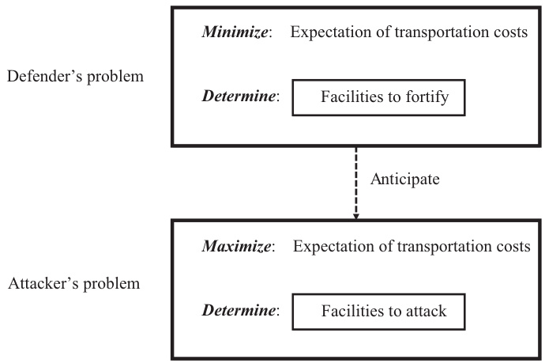
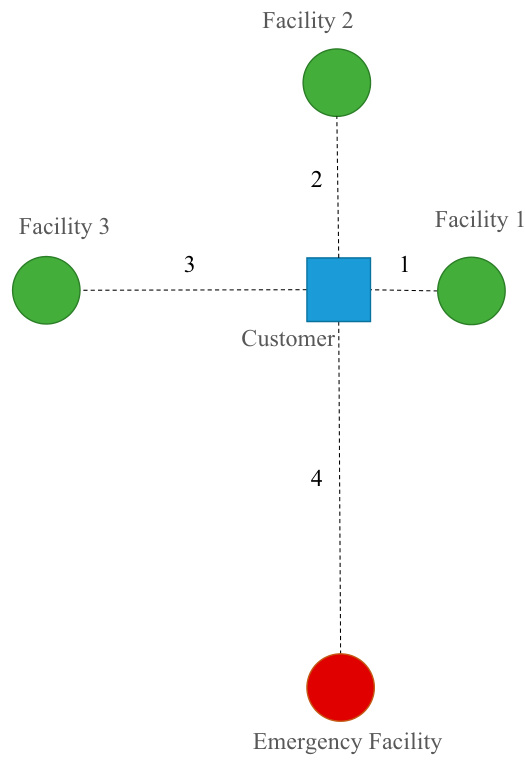

This article was downloaded by: [96.60.253.233] On: 02 January 2023, At: 18:21 Publisher: Institute for Operations Research and the Management Sciences (INFORMS) INFORMS is located in Maryland, USA  

  

# INFORMS Journal on Computing  

Publication details, including instructions for authors and subscription information: http://pubsonline.informs.org  

Efficient Solution Methods for a General r-Interdiction Median Problem with Fortification  

Kaike Zhang, Xueping Li, Mingzhou Jin  

# To cite this article:  

Kaike Zhang, Xueping Li, Mingzhou Jin (2022) Efficient Solution Methods for a General r-Interdiction Median Problem with Fortification. INFORMS Journal on Computing 34(2):1272-1290. https://doi.org/10.1287/ijoc.2021.1111  

# Full terms and conditions of use: https://pubsonline.informs.org/Publications/Librarians-Portal/PubsOnLine-Terms-andConditions  

This article may be used only for the purposes of research, teaching, and/or private study. Commercial use or systematic downloading (by robots or other automatic processes) is prohibited without explicit Publisher approval, unless otherwise noted. For more information, contact permissions@informs.org.  

The Publisher does not warrant or guarantee the article’s accuracy, completeness, merchantability, fitness for a particular purpose, or non-infringement. Descriptions of, or references to, products or publications, or inclusion of an advertisement in this article, neither constitutes nor implies a guarantee, endorsement, or support of claims made of that product, publication, or service.  

Copyright $\circledcirc2021$ , INFORMS  

Please scroll down for article—it is on subsequent pages  

# informs.  

With 12,500 members from nearly 90 countries, INFORMS is the largest international association of operations research (O.R.) and analytics professionals and students. INFORMS provides unique networking and learning opportunities for individual professionals, and organizations of all types and sizes, to better understand and use O.R. and analytics tools and methods to transform strategic visions and achieve better outcomes. For more information on INFORMS, its publications, membership, or meetings visit http://www.informs.org  

# Efficient Solution Methods for a General r-Interdiction Median Problem with Fortification  

Kaike Zhang,a Xueping Li,a Mingzhou Jina  

a Department of Industrial and Systems Engineering, University of Tennessee, Knoxville, Tennessee 37996 Contact: kzhang7@vols.utk.edu (KZ); xueping.li@utk.edu, $\circledcirc$ https://orcid.org/0000-0003-1990-0159 (XL); jin@utk.edu, https://orcid.org/0000-0002-2387-8129 (MJ)  

Received: November 5, 2019   
Revised: August 24, 2020; March 18, 2021; May 30, 2021; June 20, 2021   
Accepted: June 21, 2021   
Published Online in Articles in Advance: December 3, 2021  

https://doi.org/10.1287/ijoc.2021.1111  

Copyright: 2021 INFORMS  

Abstract. This study generalizes the $r$ -interdiction median (RIM) problem with fortification to simultaneously consider two types of risks: probabilistic exogenous disruptions and endogenous disruptions caused by intentional attacks. We develop a bilevel programming model that includes a lower-level interdiction problem and a higher-level fortification problem to hedge against such risks. We then prove that the interdiction problem is supermodular and subsequently adopt the cuts associated with supermodularity to develop an efficient cutting-plane algorithm to achieve exact solutions. For the fortification problem, we adopt the logic-based Benders decomposition (LBBD) framework to take advantage of the two-level structure and the property that a facility should not be fortified if it is not attacked at the lower level. Numerical experiments show that the cutting-plane algorithm is more efficient than benchmark methods in the literature, especially when the problem size grows. Specifically, with regard to the solution quality, LBBD outperforms the greedy algorithm in the literature with an up-to $13.2\%$ improvement in the total cost, and it is as good as or better than the tree-search implicit enumeration method.  

Summary of Contribution: This paper studies an $r$ -interdiction median problem with fortification (RIMF) in a supply chain network that simultaneously considers two types of disruption risks: random disruptions that occur probabilistically and disruptions caused by intentional attacks. The problem is to determine the allocation of limited facility fortification resources to an existing network. It is modeled as a bilevel programming model combining a defender’s problem and an attacker’s problem, which generalizes the $r$ -interdiction median problem with probabilistic fortification. This paper is suitable for IJOC in mainly two aspects: (1) The lower-level attacker’s interdiction problem is a challenging high-degree nonlinear model. In the literature, only a total enumeration method has been applied to solve a special case of this problem. By exploring the special structural property of the problem, namely, the supermodularity of the transportation cost function, we developed an exact cutting-plane method to solve the problem to its optimality. Extensive numerical studies were conducted. Hence, this paper fits in the intersection of operations research and computing. (2) We developed an efficient logic-based Benders decomposition algorithm to solve the higher-level defender’s fortification problem. Overall, this study generalizes several important problems in the literature, such as RIM, RIMF, and RIMF with probabilistic fortification (RIMF-p).  

History: Accepted by David Alderson, Area Editor for Network Optimization: Algorithms and Applications.  

Funding: This work was supported in part by the National Science Foundation [Grant CMMI 1634975].   
Supplemental Material: The online supplement is available at https://doi.org/10.1287/ijoc.2021.1111.  

Keywords: r-interdiction median problem with fortification $\bullet$ facility location problem $\bullet$ supply chain disruption $\bullet$ cutting-plane method • Benders decomposition  

# 1. Introduction  

Production and distribution facilities are among the most critical components in supply chain networks. When such facilities fail, whether caused by natural disasters, such as hurricanes and earthquakes, or by intentional or unintentional human actions, such as labor strikes, fires, cyberattacks, and terrorist strikes, massive negative effects often follow, including substantial increases in both service costs and customer dissatisfaction. To improve supply chain reliability and resilience, both proactive and reactive mitigation options can be used to counter the risk of facility disruptions. One proactive option is to add redundant facilities in the network design phase, so that the system can still perform well, even when some facilities are disrupted. Another option is to harden or fortify facilities such that they have a smaller chance of being disrupted. The risk of facility disruption decreases by introducing built-in redundancy, investing in enhanced facility infrastructure, and working to assure rapid recovery from disruption. In this article, we study how to fortify existing facilities against potential disruptions.  

The issue of supply chain reliability considering disruption risks has received increasing attention in the past few decades from researchers. However, most studies have considered only the probabilistic risk that models natural disasters, as in Snyder and Daskin (2005), Cui et al. (2010), and Aboolian et al. (2013), and the worst-case risk that models man-made attacks, as in Church and Scaparra (2007), Scaparra and Church (2008a), and Zhu et al. (2013). In reality, however, disruption risks from different sources often exist simultaneously. Therefore, we argue that it is beneficial to have a general model that is able to consider different disruption risks at the same time.  

The model we present in this work considers a generalized $r$ -interdiction median problem with fortification (RIMF). The RIMF was first introduced by Church and Scaparra (2007). In the RIMF, a network of $k$ operating facilities is given. Facilities are assumed to have unlimited capability such that customers are always served by the nearest facility. There exists a malicious attacker who seeks the most critical $r$ facilities to attack such that the effect of the attack on the network’s performance is maximized. The damage is measured by the increase in total weighted distance between customers and their nearest operating facility after the attacks. The RIMF solves the problem of allocating protective resources to the most critical $h$ facilities in anticipation of the worst-case loss when $r$ facilities are attacked. In the original RIMF, it was assumed that an attack on a protected facility would have no effect and that an attack on an unprotected facility would certainly be successful.  

Despite precautions, a fortified facility may still be disrupted by an attack. Therefore, Zhu et al. (2013) have proposed the $r$ -interdiction median problem with probabilistic fortification $\mathrm{(RIMF-}p\mathrm{)}$ ), in which any facility, even a protected one, can be disrupted by an attack with some given probability of success. The RIMF- $-p$ adds uncertainty in the forms of both fortification and interdiction to the RIMF. We study an extension of the $\mathrm{RIMF}{-}p$ with simultaneous risk of probabilistic disruption and intentional attacks. The proposed model includes the $\mathrm{RIMF}{-}p$ as a special case, and the RIMF- ${\boldsymbol{\cdot}}{\boldsymbol{p}}$ includes the original RIMF and the $r$ - interdiction median (RIM) problem (Church et al. 2004) as special cases. We present a bilevel mixedinteger nonlinear programming (MINLP) model for the problem. Due to its high degree of nonlinearity, the model is difficult to solve using standard approaches for bilevel programming models. Even for the lower-level problem alone, that is, the attacker’s problem, there is no efficient solution method proposed in the literature. In this paper, we present an efficient cutting-plane method that exactly solves the attacker’s problem. For the upper-level problem, that is, the network defender’s problem, we propose solution methods based on the logic-based Benders decomposition framework.  

Based on how a disruption risk is modeled, the research on supply chain disruptions is divided into two main streams. Snyder and Daskin (2005), Cui et al. (2010), Shen et al. (2011), and Aboolian et al. (2013) have modeled facility disruption as a probabilistic random event. The objective is to minimize the expected costs under all failure scenarios, and the problem is referred to as the reliable facility location problem (RFLP). Snyder et al. (2016) have classified this kind of risk as an exogenous risk that cannot be affected by the decision maker’s action and is modeled using stochastic processes. The problem takes the failure risk into consideration at the supply chain design phase, and the solution to the problem determines the optimal facility locations. The facility fortification option is absent in most of these models, except for those in Lim et al. (2010) and Li et al. (2013). Lim et al. (2010) have studied the reliable facility location problem, in which both unreliable and reliable facilities (i.e., those that cannot be disrupted) can be set up. In the model, each customer is assigned to at most one unreliable facility, as well as one reliable facility as a backup. However, this approach may be unrealistic when an unreliable facility fails but a customer can be served by a closer unreliable facility. Li et al. (2013) extended Lim et al. (2010)’s problem by considering a limited fortification budget.  

Another stream originates from the work of Church et al. (2004) and Church and Scaparra (2007). Their models consider the disruption risks caused by intelligent intentional attacks. In these models, the disruptions are modeled explicitly by decision variables rather than random events. Snyder et al. (2016) have classified this kind of risk as endogenous. Anticipating worst-case attacks, their objective is to fortify an existing network to minimize network costs. Church et al. (2004) proposed two interdiction models: the RIM problem and the $r$ -interdiction covering problem (RIC). In the RIM problem, the attacker needs to choose $r$ facilities to interdict among the $k$ existing facilities to maximize the increase in the weighted distance. Church and Scaparra (2007) extended the previous study of the RIM problem (Church et al. 2004) by adding a level of fortification decision. This problem is referred to as the RIMF problem. In the RIMF problem, the defender wants to protect the network by fortifying $h$ facilities to minimize costs in the worstcase scenario, that is, when an attacker destroys $r$ unfortified facilities. Scaparra and Church (2008b) reformulate the model as a maximal covering problem with precedence constraints in which the model can provide lower and upper bounds to the problem. The bounds are then used to reduce the size of the original model proposed by Church and Scaparra (2007). Scaparra and Church (2008a) formulate the RIMF problem as a bilevel integer programming model and propose a solution method based on a tree-search implicit enumeration procedure. Aksen et al. (2010) studied the fortification problem with a budget constraint in which the model determined the optimal number of facilities to fortify instead of using a predetermined number. They assumed that there was a capacity expansion cost when a customer was reassigned to a noninterdicted facility. Liberatore et al. (2012) considered the correlation effects between the facilities, as well as the fact that one attack may affect more than one facility. The facilities being affected may simply lose some of their capacity.  

Zhu et al. (2013) introduced probabilistic factors into the fortification model by assuming that an attack is successful only when all defense units allocated in the facility have failed to intercept it. They proposed a model that generalizes the RIMF’s bilevel formulation with probabilistic factors. However, they did not provide an efficient algorithm to solve the lower-level model, so a brute force total enumeration was used to find the solution. Zhang et al. (2014) considered random attacks, which may occur because of misplaced attacks or natural disasters. Their model requires explicitly enumerating all attack patterns, and the number of patterns grows exponentially; as a result, only the most modest instances can be solved.  

As we can see, there is ample established research in the literature to handle risks classified as endogenous by Snyder et al. (2016), such as RIM (Church et al. 2004), RIMF (Church and Scaparra 2007), and RIMF- $\cdot p$ (Zhu et al. 2013). On the other hand, exogenous risks are considered in the RFLP, such as by Snyder and Daskin (2005), Cui et al. (2010), Lim et al. (2010), Shen et al. (2011), and Aboolian et al. (2013). In the past, these two lines of research were developed rather independently, and two types of risk were considered separately. In practice, however, both types of disruption risks exist and can happen at the same time, including nature disasters (e.g., winter storms, hurricanes, and earthquakes), and intentional or unintentional human actions (e.g., cyberattacks, labor strikes, tariffs). Thus, there is a need for a holistic approach to handle both uncertainties simultaneously, which we demonstrate in the online supplement. Models with or without the consideration of both uncertainties simultaneously can lead to different fortification and attack decisions.  

In this work, we propose a bilevel model for a general RIMF problem that considers probabilistic disruptions and intelligent interdictions simultaneously. Efficient algorithms are developed for solving both lower-level and upper-level problems. Hence, the major contribution of the paper is twofold. First, we prove the supermodularity for the attacker’s problem, to which, thus far in the literature, only total enumeration methods were applied. Second, we develop efficient solution methods to the attacker’s interdiction problem and the defender’s fortification problem. Thus, this research generalizes several important problems in the literature, including the RIM, RIMF, and $\mathrm{RIMF}{-}p$ . Moreover, the overall framework is applicable to other network optimization problems such as critical infrastructure and cyber-physical systems that face both natural disasters and intentional attacks.  

The remainder of the paper is organized as follows: In Section 2, a general $r$ -interdiction median with fortification problem is described and formulated. Section 3 discusses some properties of the model. Solution algorithms are developed in Section 4. The computational study is reported in Section 5. The conclusion and recommendations for future research are discussed in Section 6.  

# 2. Problem Definition and Formulation  

Consider an existing supply network with a set of operating facilities $J=\left\{1,\ldots,k\right\}$ and a set of customer demand aggregation points $I=\left\{1,\ldots,\left|\right.I\right|\right\}$ . Each customer $i\in I$ has demand given by $d_{i}$ . The unit shipment cost from facility $j\in J$ to customer $i\in I$ is $c_{i j}$ . The efficiency of the system is measured by the total weighted distance between the customers and the facilities. The capacity of a facility is assumed to be unlimited. Thus, a customer is always served by the nearest working facility. Furthermore, we assume that there is an emergency facility 0 to model the costs of lost sales. If the demand of customer $i\in I$ is not served, then a unit penalty cost $c_{i0}$ is incurred. Without loss of generality, we assume that $c_{i0}\geq c_{i j}$ for all $i\in I$ and $j\in J.$ ; that is, any customer will be served if there is at least one available facility. Let $J^{+}$ denote the set of open facilities, including the emergency facility; that is, $J^{+}=\{0,1,\ldots,k\}$ .  

Facilities face two types of disruption risks simultaneously: (1) probabilistic, exogenous risks and (2) worst-case, endogenous risks. The two types of risks are independent of each other. A facility may fail if either of these two disruption risks takes effect. For exogenous risks, facility $j$ fails with probability $q_{j}$ .  

Facility disruptions caused by exogenous risks are independent across facilities. Endogenous risks are modeled by an attacker with $r$ interdiction resources. Each unit of these resources can be used to attack a facility; however, two or more units cannot be used on the same facility. If a facility is not fortified, then an attack succeeds with certainty. However, if the facility is fortified, then the probability of successful attack is $w$ . The total number of fortified locations is bounded above by $h$ due to limited defensive resources. The problem is to determine $h$ locations to fortify to minimize expected transportation costs and to anticipate worst-case attacks.  

The problem can be viewed as a leader-follower game, as illustrated by Figure 1: the leader, that is, the network planner or defender, aims to minimize costs by making fortification decisions; the follower, that is, the attacker, then tries to interdict the network to maximize the damage. The following bilevel model is formulated by adding the probabilistic disruption factor to the RIMF- $\cdot p$ model proposed by Zhu et al. (2013).  

Defender’s decision variables:  

$$
z_{j}={\left\{\begin{array}{l l}{1,}&{{\mathrm{~if~}}{\mathrm{facility~}}j{\mathrm{~is~fortified}};}\\ {0,}&{{\mathrm{~otherwise.}}}\end{array}\right.}
$$  

Attacker’s decision variables:  

$$
s_{j}={\left\{\begin{array}{l l}{1,}&{{\mathrm{~if~}}{\mathrm{facility~}}j{\mathrm{~is~attacked}};}\\ {0,}&{{\mathrm{~otherwise}}.}\end{array}\right.}
$$  

The fortification problem (FP) is written as  

$$
\operatorname*{min}F(z)
$$  

$$
{\begin{array}{r l}&{{\mathrm{subject~to~(s.t.)}}\quad\displaystyle\sum_{j\in J}z_{j}\leq h}\\ &{z_{j}\in\{0,1\}}\end{array}}
$$  

We denote by $F(z)$ the expected transportation cost under the worst-case attack for a fortification decision $z;F(z)$ is computed by solving the attacker’s problem.  

  

Denote by $p_{j}$ the failure probability of facility $j,$ which is an expression related to $s_{j}$ :  

$$
p_{j}=1-(1-q_{j})(1-s_{j}w^{z_{j}}).
$$  

When $z_{j}=0$ , that is, when the facility is not fortified, $w^{z j}=1$ , and the facility is disrupted with certainty when it is attacked; that is, $p_{j}=1$ , as long as $s_{j}=1$ . Otherwise, the facility fails when either the probabilistic disruption, with probability $q_{j},$ takes place or when an intentional attack succeeds, with probability $\boldsymbol{w}$ . We want to note that the extension in Equation (3) from the literature is nontrivial. As it provides us a holistic approach to handle both endogenous and exogenous uncertainties simultaneously, such a unified model brings modeling complexities. The presence of both fortification decisions $z_{j}$ and probabilistic disruptions $q_{j}$ leads to computational challenges, which motivates us to further develop efficient algorithms.  

We can then compute the probability that customer $i$ is assigned to its vth closest facility as the following:  

$$
\beta_{i}^{v}=(1-p_{i_{v}})\times\prod_{l=1}^{v-1}p_{i_{l}},
$$  

where $i_{v}$ is the index of vth closest facility of $i$ . Defining $c_{i}^{v}=c_{i,i_{v}}d_{i},$ the expected transportation costs can be expressed as follows:  

$$
\sum_{i\in I}\sum_{v=1}^{|J^{+}|}c_{i}^{v}\beta_{i}^{v}=\sum_{i\in I}\sum_{v=1}^{|J^{+}|}c_{i}^{v}(1-p_{i_{v}})\times\prod_{l=1}^{v-1}p_{i_{l}}.
$$  

Thus, $F(z)$ is computed by solving the attacker’s problem (AP):  

$$
\begin{array}{r l r}{\lefteqn{F(z)=\operatorname*{max}\sum_{i\in I}\sum_{v=1}^{|I^{+}|}c_{i}^{v}(1-p_{i_{v}})\times\prod_{l=1}^{v-1}p_{i_{l}}}}\\ &{}&{\sum_{j\in J}s_{j}\le r}\\ &{}&{p_{j}=1-(1-q_{j})(1-s_{j}w^{z_{j}})\qquad}&{\forall j\in J^{+}}\\ &{}&{s_{j}\in\{0,1\},}\end{array}
$$  

In the bilevel model, the defender makes an upperlevel decision, and the objective is to minimize expected transportation costs under a worst-case attack by solving the attacker’s problem. Constraints (2) and (7) model the limited resources of the defender and attacker, respectively. The attacker’s objective is to maximize the expected transportation costs after launching attacks.  

The difficulty of the attacker’s problem arises from the high degree of nonlinearity in its objective function. Even for a special case such as the one studied by Zhu et al. (2013), in which only disruptions caused by intentional attacks are considered, there is no efficient solution method developed other than enumeration. For the fortification problem, only a greedy heuristic method is proposed. An additional special case is one in which $w=0$ ; that is, an attack fails with certainty if a fortified facility is attacked. The problem has been studied by Church et al. (2004), Church and Scaparra (2007), Scaparra and Church (2008a, b), and Liberatore et al. (2011). In such a case, the attacker’s problem can be formulated as a mixed-integer programming model, and therefore a commercial solver such as CPLEX can be used to solve the problem. For the fortification problem with this attacker’s problem as the lowerlevel problem, some relatively efficient solution methods exist in the literature (e.g., Scaparra and Church $2008\mathrm{a},$ b). Our formulation makes the RIMF- ${\boldsymbol{\cdot}}{\boldsymbol{p}}$ more general to incorporate not only exogenous failures but also the heterogeneity among facilities. In the literature, the risk is considered the same across all facilities. It is worth noting that the generalized formulation, which captures more real-world features, does not add complexity in terms of computational complexity, as it only impacts the calculation of a linear term in the attacker’s problem. In fact, the model and solution method that we propose next is able to handle other facility failure considerations, as long as the failure probability can be expressed as a linear term of attack decision. For example, the formulation can consider the case in which the endogenous risks are heterogeneous among facilities. In practice, the success probability of an attack could be related to a facility’s conditions, hardware or software, no matter if they are fortified or not.  

# 2.1. Linear Attacker’s Problem Formulation  

Given values of $z_{j},$ we can rewrite the failure probability of facility $i$ expressed by (3) as  

$$
p_{j}=1-(1-q_{j})(1-s_{j}w^{z_{j}})=q_{j}+w_{j}s_{j},
$$  

where  

$$
w_{j}=\left\{\begin{array}{l l}{1-q_{j},}&{z_{j}=0}\\ {w-q_{j}w,}&{z_{j}=1,}\end{array}\right.
$$  

and they become known for the attacker’s problem.  

Let $\theta_{i}^{v}$ be the probability that the demand at customer $i$ is not satisfied by its first vth closest facilities. We have  

$$
\theta_{i}^{v}=\prod_{l}^{v}p_{i_{l}},
$$  

which is equivalent to  

$$
\left\{\begin{array}{l l}{\theta_{i}^{1}=p_{i_{1}}}\\ {\theta_{i}^{v}=\theta_{i}^{v-1}\cdot p_{i_{v}}}\end{array}\right.
$$  

The attacker’s problem becomes  

$$
\begin{array}{r}{F(z)=F(w_{j})=m a x\displaystyle\sum_{i\in I}\sum_{v=1}^{|J^{+}|}c_{i}^{v}(\theta_{i}^{v-1}-\theta_{i}^{v})}\\ {=m a x\displaystyle\sum_{i\in I}\sum_{v=1}^{|J^{+}|}\Bigl[(c_{i}^{v+1}-c_{i}^{v})\theta_{i}^{v}+c_{i}^{1}\Bigr]}\end{array}
$$  

$$
\theta_{i}^{v}\leq\theta_{i}^{v-1}q_{i_{v}}+\theta_{i}^{v-1}w_{i_{v}}+\dot{M(1-s_{i_{v}})}~~\forall\,i\in I,1\leq v\leq|J^{+}|
$$  

$$
\begin{array}{r l r l}&{\theta_{i}^{v}\leq\theta_{i}^{v-1}q_{i_{v}}+M s_{i_{v}}}&&{\qquad\qquad\forall\,i\in I,1\leq v\leq|J^{+}|}\\ &{\theta_{i}^{v}\in[0,1],\ s_{j}\in\{0,1\}.}\end{array}
$$  

The rationale for Constraints (13) and (14) is from the following equation:  

$$
\begin{array}{r l}&{\theta_{i}^{v}=\theta_{i}^{v-1}\cdot p_{i_{v}}}\\ &{\qquad=\theta_{i}^{v-1}q_{i_{v}}+\theta_{i}^{v-1}s_{i_{v}}.}\end{array}
$$  

Since all coefficients of $\theta_{i}^{v}$ , that is, $c_{i}^{v+1}-c_{v},$ are greater than or equal to 0 in the objective function, the attacker has the incentive to maximize all $\theta_{i}^{v}$ . Therefore, (13) and (14) are enough to stipulate the equation.  

# 3. Model Properties  

In this section, we discuss the structural properties of the model from a set-function point of view; this will provide a theoretical cornerstone for the solution methods developed in the next section. Supermodular properties and their counterparts, submodular properties, are the properties for a set function, and are conceptually similar to the convex and concave properties in the optimization of a real domain.  

First, we recall some well-known results of supermodular set functions (see Nemhauser and Wolsey 1988, chapter III, section 3.1). Let $U$ be a finite set, and let $f$ be a real-valued function on the subsets of set $U$ . Denote by $\rho_{e}^{f}(S):=f(S\cup\{e\})-f(S)$ the incremental value of adding an element $e$ to the set S. We may omit the superscript and write it as $\rho_{e}(S)$ when the relevant set function is clear in the context. We have the following definition and properties of supermodular set functions.  

Definition 1. A set function $f$ is supermodular if one of the following equivalent statements is satisfied:  

Lemma 1. $A$ positive linear combination of supermodular functions is supermodular.  

Definition 2. A set function $f$ is defined as nondecreasing if $f(S)\leq f(T).$ , for all $S\subseteq T$ .  

# 3.1. Attacker’s Problem  

Consider a known fortification decision, and define $\Theta(S)$ as the expected transportation costs when facilities in $S$ are attacked. Next, we show that $\Theta(S)$ is supermodular.  

# Proposition 1. We have that $\Theta(S)$ is nondecreasing.  

Proof. It is sufficient to show that $\Theta(S)$ is nondecreasing if $\Theta(S\cup\{e\})\geq\Theta(S)$ for any $S\in J^{+},e\notin S$ . Let $\Gamma_{i}(S)$ be a set function corresponding to the expected transportation costs for customer i, $\begin{array}{r}{\Gamma_{i}(S)=\sum_{l=1}^{|J^{+}|}\beta_{i}^{l}c_{i}^{l},}\end{array}$ where $\beta_{i}^{l}$ is the probability that customer $i$ is served by its lth closest facility when the attacked set is $S$ ; thus, $\begin{array}{r}{\Theta(S)=\sum_{i\in I}\Gamma_{i}(S)}\end{array}$ . It is sufficient to show that $\Gamma_{i}(S)$ is nondecreasing for any $i$ .  

Without loss of generality, assume that facility $e$ is the kth closest facility of the customer $i,$ let $p_{e}$ be the probability that facility $e$ fails when $e$ is not attacked, and let $p_{e}^{\prime}$ be the probability when $e$ is attacked. Obviously, $p_{e}^{\prime}\ge p_{e}$ . The equality holds when $w=0$ and the facility is fortified. We have that  

$$
\Gamma_{i}(S\cup\{e\})=\sum_{l=1}^{k-1}\beta_{i}^{l}c_{i}^{l}+\frac{1-p_{e}^{\prime}}{1-p_{e}}\beta_{i}^{k}c_{i}^{k}+\frac{p_{e}^{\prime}}{p_{e}}\sum_{l=k+1}^{|J^{+}|}\beta_{i}^{l}c_{i}^{l}.
$$  

The first component represents the transportation costs for demand that is satisfied by facilities that are closer than e. Since attacking $e$ does not change the probabilities of failure for facilities that are closer than $e,$ the term is unchanged. The second term presents the costs for demand that are satisfied by $e_{\prime}$ , that is, the kth closest facility. The coefficient $\scriptstyle{\frac{1-p_{e}^{\prime}}{1-p_{e}}}$ updates the probability of serving demand with $e$ when its failure probability changes from $p_{e}$ to $p_{e}^{\prime}$ . The last term calculates the transportation costs for demands that are served by further facilities.  

Thus,  

$$
\begin{array}{r l}&{\rho_{e}^{\Gamma_{i}}(S)\!=\!\Gamma_{i}(S\cup\{e\})\!-\!\Gamma_{i}(S)\,=\,\frac{p_{e}-p_{e}^{\prime}}{1-p_{e}}\beta_{i}^{k}c_{i}^{k}+\!\frac{p_{e}^{\prime}-p_{e}}{p_{e}}\underset{l=k+1}{\overset{p^{\prime}\leftarrow1}{\sum}}\beta_{i}^{l}c_{i}^{l}}\\ &{\,\,\,\,\,\,\,\,\,\,\,\,\,\,\,\,\,\,\,\,\,\,\,\,\,\,\,\,\,\,\,\,\,\,\,\,\,\,\,\,\,\,\,\,\,\,\,\,\,\,\,\,\,\,\,\,\,\,\,\,\,\,\,\,\,\,\,\,\,\,\,\,\,\,\,\,\,\,\,\,\,}\\ &{\,\,\,\,\,\,\,\,\,\,\,\,\,\,\,\,\,\,\,\,\,\,\,\,\,\,\,\,\,\,\,\,\,\,\,\,\,\,\,\,\,\,\,\,\,\,\,\,\,\,\,\,\,\,\,\,\,\,\,\,\,\,\,\,\,\,\,\,\,\,\,\,\,\,\,\,\,}\\ &{=\,c_{i}^{k}\bigg(\frac{p_{e}-p_{e}^{\prime}}{1-p_{e}}\beta_{i}^{k}+\!\frac{p_{e}^{\prime}-p_{e}}{p_{e}}\!\times\!\frac{p_{e}}{1-p_{e}}\!\times\!\beta_{i}^{k}\bigg)}\\ &{\,\,\,\,\,\,\,\,\,\,\,\,\,\,\,\,\,\,\,\,\,\,\,\,\,\,\,\,\,\,\,\,\,\,\,\,\,\,\,\,\,\,\,\,\,\,\,\,\,\,\,\,\,\,\,\,\,\,\,\,\,\,\,\,\,\,\,\,\,\,\,\,\,\,\,\,}\end{array}
$$  

The second line holds because, by the definition of $c_{i\,.}^{k}$ , we have that $c_{i}^{1}\leq c_{i}^{2}...\leq c_{i}^{|J^{+}|}$ . Because the probablity of not using the first $k$ -closest facilities to serve customer $i,$ $\textstyle\sum_{l=k+1}^{|J^{+}|}\beta_{i}^{l},$ is the same as the probability that all first $k^{.}$ closest facilities to customer fail, $\Pi_{l=1}^{k}\,p_{i_{l}},$ we have that  

$$
\sum_{l=k+1}^{|J^{+}|}\beta_{i}^{l}=\prod_{l=1}^{k}p_{i_{l}}=\frac{p_{e}}{1-p_{e}}\beta_{i}^{k},
$$  

where the second equation is from (4) This completes the proof. w  

Proposition 2. We have that $\Theta(S)$ is supermodular.  

Proof. We prove by using the setting of the proof of Proposition 1. Consider another set $T$ , $T=S\cup\{\sigma\},\sigma\neq$ $e,\ \sigma,e\not\in S,$ , where $\sigma$ is the $u$ th closest facility. Similarly, we have the following:  

$$
\Gamma_{i}(T)=\sum_{l=1}^{u-1}\beta_{i}^{l}c_{i}^{l}+\frac{1-p_{\sigma}^{\prime}}{1-p_{\sigma}}\beta_{i}^{u}c_{i}^{u}+\frac{p_{\sigma}^{\prime}}{p_{\sigma}}\sum_{l=u+1}^{|J^{+}|}\beta_{i}^{l}c_{i}^{l}.
$$  

In case 1, $u<k:$  

$$
\begin{array}{r l}&{\Gamma_{i}(T\cup\{e\})\!=\!\underset{l=1}{\overset{u-1}{\sum}}\!\beta_{i}^{l}c_{i}^{l}\!+\!\frac{1\!-\!p_{\sigma}^{\prime}}{1\!-\!p_{\sigma}}\!\beta_{i}^{u}c_{i}^{u}+\!\frac{p_{\sigma}^{\prime}}{p_{\sigma}}\sum_{l=u+1}^{k-1}\beta_{i}^{l}c_{i}^{l}\!+\!\frac{p_{\sigma}^{\prime}}{p_{\sigma}}\!\times\!\frac{p_{e}^{\prime}}{p_{e}}\sum_{s=k+1}^{|J^{\scriptscriptstyle+}|}\beta_{i}^{l}c_{i}^{l},}\\ &{\rho_{e}^{\Gamma_{i}}(T)\!=\!\Gamma_{i}(T\cup\{e\})-\Gamma_{i}(T)\!=\!\frac{p_{\sigma}^{\prime}}{p_{\sigma}}\!\left(\!\frac{p_{e}\!-\!p_{e}^{\prime}}{1\!-\!p_{e}}\!\beta_{i}^{k}c_{i}^{k}+\!\frac{p_{e}^{\prime}\!-\!p_{e}}{p_{e}}\!\sum_{l=k+1}^{|J^{\scriptscriptstyle+}|}\beta_{i}^{l}c_{i}^{l}\!\right)\!.}\end{array}
$$  

Recall that  

$$
\begin{array}{r l}&{\rho_{e}^{\Gamma_{i}}(S)=\Gamma_{i}(S\cup\{e\})-\Gamma_{i}(S)}\\ &{\qquad\qquad=\displaystyle\frac{p_{e}-p_{e}^{\prime}}{1-p_{e}}\beta_{i}^{k}c_{i}^{k}+\displaystyle\frac{p_{e}^{\prime}-p_{e}}{p_{e}}\displaystyle\sum_{l=k+1}^{|J^{+}|}\beta_{i}^{l}c_{i}^{l}.}\end{array}
$$  

We have that  

$$
\rho_{e}^{\Gamma_{i}}(T)=\frac{p_{\sigma}^{\prime}}{p_{\sigma}}\rho_{e}^{\Gamma_{i}}(S)\geq\rho_{e}^{\Gamma_{i}}(S).
$$  

In case 2, $u>k!$ :  

$$
\begin{array}{r l}&{\Gamma_{i}(T\cup\{e\})\!=\!\underset{l=1}{\overset{k-1}{\sum}}\beta_{i}^{l}c_{i}^{l}\!+\!\frac{1\!-\!p_{e}^{\prime}}{1\!-\!p_{e}}\beta_{i}^{k}c_{i}^{k}\!+\!\frac{p_{e}^{\prime}}{p_{e}}\underset{l=k+1}{\overset{k}{\sum}}\beta_{i}^{l}c_{i}^{l}\!+\!\frac{p_{e}^{\prime}}{p_{e}}}\\ &{\quad\quad\quad\quad\quad\quad\times\frac{1\!-\!p_{e}^{\prime}}{1-p_{o}}\beta_{i}^{u}c_{i}^{u}+\frac{p_{e}^{\prime}}{p_{e}}\underset{r_{o}}{\overset{p_{e}^{\prime}}{\sum}}\times\underset{l=u+1}{\overset{p^{\prime}+1}{\sum}}\beta_{i}^{l}c_{i}^{l}}\\ &{\quad\quad\quad\quad\rho_{e}^{\Gamma_{i}}(T)=\Gamma_{i}(T\cup\{e\})\!-\!\Gamma_{i}(T)\!=\!\frac{p_{e}-p_{e}^{\prime}}{1-p_{e}}\beta_{i}^{k}c_{i}^{k}}\\ &{\quad\quad\quad\!+\!\frac{p_{e}^{\prime}-p_{e}}{p_{e}}\underset{l=k+1}{\overset{u-1}{\sum}}\beta_{i}^{l}c_{i}^{l}\!+\!\frac{p_{e}^{\prime}-p_{e}}{p_{e}}\!\times\!\frac{1\!-\!p_{e}^{\prime}}{1-p_{e}}\beta_{i}^{u}c_{i}^{u}+\frac{p_{e}^{\prime}-p_{e}}{p_{e}}\!\times\!\frac{p_{e}^{\prime}}{p_{o}}\underset{l=k+1}{\overset{p^{\prime}+1}{\sum}}\beta_{i}^{l}c_{i}^{l}.}\end{array}
$$  

Thus,  

$$
\begin{array}{r l}{\rho_{e}^{\Gamma_{i}}(T)-\rho_{e}^{\Gamma_{i}}(S)}&{=\frac{p_{e}^{\prime}-p_{e}}{p_{e}}\bigg(\frac{p_{\sigma}-p_{\sigma}^{\prime}}{1-p_{\sigma}}\beta_{i}^{u}c_{i}^{u}+\frac{p_{\sigma}^{\prime}-p_{\sigma}}{p_{\sigma}}\underset{l=u+1}{\overset{p_{\sigma}^{\prime}+1}{\sum}}\beta_{i}^{l}c_{i}^{l}\bigg)}\\ &{\geq\frac{p_{e}^{\prime}-p_{e}}{p_{e}}\bigg(\frac{p_{\sigma}-p_{\sigma}^{\prime}}{1-p_{\sigma}}\beta_{i}^{u}c_{i}^{u}+c_{i}^{u}\times\frac{p_{\sigma}^{\prime}-p_{\sigma}}{p_{\sigma}}\underset{l=u+1}{\overset{p_{\sigma}^{\prime}+1}{\sum}}\beta_{i}^{l}\bigg),}\\ &{=\ \frac{p_{e}^{\prime}-p_{e}}{p_{e}}\times c_{i}^{u}\bigg(\frac{p_{\sigma}-p_{\sigma}^{\prime}}{1-p_{\sigma}}\beta_{i}^{u}+\frac{p_{\sigma}^{\prime}-p_{\sigma}}{p_{\sigma}}\times\frac{p_{\sigma}}{p_{\sigma}^{\prime}-p_{\sigma}}\bigg)}\\ &{=\ 0.}\end{array}
$$  

The inequality holds because $c_{i}^{u}\leq c_{i}^{l}$ when $l\,>\,u$ by definition.  

In summary, $\rho_{e}^{\Gamma_{i}}(T)-\rho_{e}^{\Gamma_{i}}(S)\geq0$ when $T$ has exactly one more element than $S$ .  

Consider any sets $S\subseteq T\subset J^{+}$ and $e\in J^{+}\setminus T$ . Let $V=T\setminus S=\{v_{1},\bar{v}_{2},\ldots,v_{n}\}$ . We have that  

$$
\begin{array}{r l r}{\rho_{e}^{\Gamma_{i}}(S\cup\{v_{1}\})-\rho_{e}^{\Gamma_{i}}(S)}&{\ge}&{0,}\\ {\rho_{e}^{\Gamma_{i}}(S\cup\{v_{1},v_{2}\})-\rho_{e}^{\Gamma_{i}}(S\cup\{v_{1}\})}&{\ge}&{0,}\\ {\vdots}&{}&\\ {\rho_{e}^{\Gamma_{i}}(T)-\rho_{e}^{\Gamma_{i}}((S\cup\{v_{1},\ldots,v_{n}\})}&{\ge}&{0.}\end{array}
$$  

Summing the inequalities, we have $\rho_{e}^{\Gamma_{i}}(T)\geq\rho_{e}^{\Gamma_{i}}(S)$ for any $S\subset T$ and $e\not\in T$ . Since $\begin{array}{r}{\rho_{e}^{\Gamma}(T)=\sum_{i\in I}\rho_{e}^{\Gamma_{i}}(T),}\end{array}$ , according to the second condition in Definition $1,$ , we complete the proof. w  

# 3.2. Fortification Problem  

Define $\Psi(Z)$ as the corresponding set function for $F(z)$ . Let $\mathbb{I}(Z)$ be the attacked facilities in an optimal solution of the attacker’s problem when $Z$ is the fortification set.  

# Proposition 3. We have that $\Psi(Z)$ is nonincreasing.  

Proposition 3 holds, since attacking an additional facility increases the chance of the facility being disrupted, and the demand it originally serves has to be routed to another facility that is no closer than the one being attacked. Thus, the overall cost is nondecreasing.  

Proposition 4. We have that $\rho_{e}^{\Psi}(Z)=0,$ , if $\ 'e\notin\mathbb{I}(Z)$ .  

Proof. Because $\mathbb{I}(Z)$ is a feasible solution for the attack problem, $\Psi(Z\cup\{e\})\geq\Theta(\mathbb{I}(Z))=\Psi(Z)$ . Since $\Psi$ is nonincreasing, $\Psi(Z\cup\{e\})\leq\Psi(Z)$ . Thus, $\Psi(Z\cup\{e\})$ $=\Psi(Z)$ ; that is, $\rho_{e}(Z)=0$ . w  

The same observation is made by Scaparra and Church (2008a) for RIMF, and it immediately implies Proposition 5; the tree-search algorithm (Scaparra and Church 2008a) is also applicable to solve this problem.  

Proposition 5. There exists an optimal solution $Z^{\ast}$ in which at least one j exists such that $j\in\mathbb{I}(\varnothing)$ and $j\in Z^{*}$ .  

Proposition 6. We have that $\Psi$ is neither supermodular nor submodular.  

Proof. We prove this by providing two counterexamples. In the first example, we show a case where it is not supermodular. Then, we use another example to show that it is not submodular.  

  
Figure 2. (Color online) An Instance of the Fortification Problem to Show That $\psi$ Is Neither Supermodular nor Submodular  

Counterexample 1: Consider an instance with one customer, three facilities, and an emergency facility, as shown in Figure 2; that is, $c_{i j}=j$ and $c_{i0}=4$ . Let $r=3$ , $w=0.5,$ , and $q_{j}=0$ for $j=1,2,3$ . Thus, if a facility is fortified, then the probability of failure $p_{j}=0.5,$ ; otherwise, it fails with certainty. Considering facility 2 as $e,$ it is easy to compute Table 1. Because $r=\mid J\mid,$ nonemergency facilities are always attacked in all scenarios. Because $\rho_{e}^{\Psi}(\emptyset)<\rho_{e}^{\Psi}(\{1\})<\rho_{e}^{\Psi}(\{1,3\}),\,\Psi$ violates the definition of a supermodular function.  

Counterexample 2: Consider an instance with the same structure as Example 1. However, we assume that there is only one attack unit; that is, $r\,=\,1$ . Let $w=0$ and $q_{j}=0.5$ for $j=1,2,3$ . In this case, if a facility is fortified, then it is immune to the attack, whereas it fails at a probability of 0.5, even if no attack is launched at that facility. For this case, we have Table 2. In this example, the closest facility that is not fortified is attacked.  

Because $\rho_{e}^{\Psi}(\emptyset)>\rho_{e}^{\Psi}(\{1\})>\rho_{e}^{\Psi}(\{1,3\}),\,\Psi$ violates the definition of a submodular function. w  

# 4. Solution Methods  

# 4.1. For the Attacker’s Problem  

We have shown that the AP, as defined in Equations (6)–(8), is equivalent to minimizing a nonincreasing submodular function with cardinality constraints.  

Minimizing a general submodular function without side constraints can be solved in strong polynomial time (Iwata and Orlin 2009, Orlin 2009). The most theoretically efficient algorithm is the one developed by Orlin (2009), which runs in $O(n^{5}E O+n^{6})_{.}$ , where $n$ is the size of the ground set and $E O$ is the time to evaluate the function for a given subset. The problem may become significantly harder when side constraints are added. There are cases of submodular function minimization with side constraints that are NP-hard (McCormick 2005). To the best of our knowledge, no combinatorial method has been developed for minimizing a monotone, nonincreasing, submodular function with cardinality or knapsack constraints.  

We adopt an exact cutting-plane algorithm proposed by Atamtu¨ rk and Narayanan (2008) to solve the AP, since we know that the AP is submodular. A similar approach has been developed for solving a supply chain design problem where a cost term appears to be submodular (Wu and Zhang 2014). The cutting-plane algorithm iteratively solves an MIP master problem and subproblems. The MIP master problem can easily include additional side constraints such as the $r$ -interdiction constraint in this study.  

Table 1. Function Values with Different $T$ for Example 1   

<html><body><table><tr><td></td><td>T = 0</td><td>(1)</td><td>{1, 3}</td></tr><tr><td>Y(T)</td><td>4</td><td>2.5</td><td>2.25</td></tr><tr><td>Y({e} U T)</td><td>3</td><td>2</td><td>1.875</td></tr><tr><td>(L)d</td><td>-1</td><td>-0.5</td><td>-0.375</td></tr></table></body></html>  

Table 2. Function Values with Different $T$ for Example 2   

<html><body><table><tr><td></td><td>T=0</td><td>(1)</td><td>{1, 3}</td></tr><tr><td>Y(T)</td><td>2.75</td><td>2.25</td><td>2.25</td></tr><tr><td>Y({e} U T)</td><td>2.75</td><td>2</td><td>1.875</td></tr><tr><td>P%(T)</td><td>0</td><td>-0.25</td><td>-0.375</td></tr></table></body></html>  

For completeness, we briefly describe the approach that is mostly adopted from Atamtu¨ rk and Narayanan (2008) in the context of our AP problem. To be consistent with the terminology used in the literature, instead of maximizing a supermodular function, we reformulate the problem to minimize a submodular function. Define a set function $\Omega(S)=-\Theta(S)+\Theta(\emptyset)$ such that $\Omega$ is a nonincreasing submodular function with $\Omega(\varnothing)=0$ . The AP is equivalent to  

$$
\operatorname*{min}\{\Omega(S):|S|\leq r,S\subseteq J\}.
$$  

Definition 3. Given a submodular function $f$ with $f(\varnothing)=0_{.}$ , the submodular polyhedron $P(f)$ is defined as $P(f)=\{v:v\in\mathbb{R}^{n}$ , $\forall S\subseteq J,v(S)\leq f(S)\},$ , where $\begin{array}{r}{\boldsymbol{v}(S)=\sum_{i\in S}\boldsymbol{v}_{i}}\end{array}$ .  

With a slight abuse of notation, we define $f(s)=f(S).$ , where $s$ is the incidence vector for the set $S$ . Define $Q_{f}=\mathrm{conv}\{(s,t)\in\{0,1\}^{n}\times\mathbb{R}:f(s)\leq t\},$ where $Q_{f}$ is the convex lower envelope for the submodular function f.  

Theorem 1. The inequality $t\geq\sum_{i\in J}v_{i}s_{i}$ is a valid inequality for $Q_{f}$ if and only if $v\in P(f)$ (Atamtu¨rk and Narayanan 2008).  

The inequality defined in Theorem 1 is called an extended polymatroid inequality. Atamt ¨urk and Narayanan (2008) showed that, for a given a solution $({\bar{\bar{s}}},{\bar{t}}).$ , one can check whether such a solution is in $Q_{f}$ and if not, find an extended polymatroid inequality to cut off the infeasible solution by solving the following problem with the greedy algorithm (Edmonds 1970):  

$$
t^{*}=\operatorname*{max}\Biggl\{\sum_{i\in J}v_{i}\bar{s}_{i}:v\in P(f)\Biggr\}.
$$  

The greedy algorithm is detailed as follows:  

Step 1. For a given s¯, sort elements in $J$ in the form of $l_{1},l_{2},\ldots,l_{n}$ such that $\overline{{s}}_{l_{1}}\geq\overline{{s}}_{l_{2}}\geq\ldots\geq\overline{{s}}_{l_{n}}$ .  

Step 2. Compute $\bar{v_{i}}$ as $f(\{l_{1},l_{2},\dots,l_{i}\})\ -\ f(\{l_{1},l_{2},$ $\cdots,l_{i-1}\})$ ), which is the incremental value by adding $l_{i}$ to $\left\{l_{1},l_{2},\ldots,l_{i-1}\right\}$ .  

Because $s_{i}$ only takes a value of 0 or 1, Step 1 runs in $O(n)$ , and Step 2 can be done with $n$ sequential calls to function evaluation. Thus, the algorithm runs with a time bound $O(n E O),$ , and we have $\begin{array}{r}{t^{*}=\sum_{i\in J}\bar{v}_{i}\bar{s}_{i}=f(\bar{S}),}\end{array}$ where ¯S is the set corresponding to $\bar{s_{i}}$ . If $\bar{t}\geq t^{*}$ , then no extended polymatroid inequality is violated and we have found the optimal solution. Otherwise, we find a cut in the following form:  

$$
t\geq\bar{v_{1}}s_{1}+\bar{v_{2}}s_{2}+\ldots+\bar{v_{n}}s_{n}.
$$  

The master problem (AP-master) is formulated as  

$$
\begin{array}{r l r}&{\operatorname*{min}t}\\ &{s.\mathrm{t}.\quad t\geq\bar{v_{1}}^{k}s_{1}{+}\bar{v_{2}}^{k}s_{2}+...+\bar{v_{n}}^{k}s_{n}}&{\forall k\in K}\\ &{\underset{j\in J^{+}}{\sum}s_{j}\leq r}\\ &{s_{j}\in\{0,1\},}&{\forall j\in J^{+}}\end{array}
$$  

where $K$ is the collection of cuts from previous iterations.  

This iterative procedure might be inefficient for large instances, since, in each iteration, an integer programming problem must be solved. However, commercial MIP solvers like CPLEX provide a lazyconstraints feature that can be used to implement the cutting-plane algorithm much more efficiently.  

# 4.2. For the Fortification Problem  

Compared with the AP, the FP is much harder for two reasons. First, unlike the AP, in which the objective value can be directly computed in polynomial time for a given solution, evaluation of a solution for the FP requires that a corresponding AP be solved. Second, because the FP is neither submodular nor supermodular, there is not much structural information that we can use. We next develop a logic-based Benders decomposition algorithm to solve the problem.  

4.2.1. A Logic-Based Benders Decomposition. The logic-based Benders decomposition (LBBD) method introduced by Hooker and Ottosson (2003) is a generalization of the Benders decomposition. Like the Benders decomposition, LBBD decomposes the original problem into a master problem and a subproblem or multiple subproblems with corresponding variables denoted by $x$ and $y$ . The master problem is solved to obtain a solution for variables $x,$ , and then subproblems are solved for $y$ given the fixed $x$ values. For some recent developments and a full review of the LBDD, refer to Angulo et al. (2016), Rebennack (2016), Rahmaniani et al. (2017), and Soares et al. (2017).  

The cuts in the Benders decomposition are based on linear duality, which requires a subproblem to be a linear programming problem, whereas a subproblem of LBBD can be in any form of mathematical program. The inference duals are used instead of the linear duals. Because of this, there is no standard algorithm to generate cuts for LBBD, and cuts must be derived based on knowledge of the underlying problem. The cutting-plane methods that we proposed in the previous section are actually a special case of LBBD, where the inference duals are readily provided by the supermodular property of the attack problem.  

The efficiency of LBBD depends on how the master problem and subproblem are defined and is highly affected by the tightness of the cuts. The two-stage decision-making nature of the fortification and attack problems and the inference duals provided by the supermodular property of the attack problem motivated us to adopt LBBD. Its efficiency was also well justified by numerical experiment results in Section 5.2. We can write the master problem of FP as  

$$
\operatorname*{min}\eta
$$  

the worst case. Now consider a family of cuts in the following form:  

$$
\eta\ge\eta^{\ast}(\bar{z})+\sum_{j\in J|\bar{z}_{j}=0}\Delta_{j}^{\bar{z}}z_{j}+\sum_{j\in J|\bar{z}_{j}=1}\nabla_{j}^{\bar{z}}(1-z_{j}),
$$  

where $\Delta_{j}^{\bar{z}}$ is a coefficient used to capture the change of transportation costs from solution ¯z by fortifying facility $j$ and $\nabla_{j}^{\bar{z}}$ is used to capture the change of transportation costs when the defense resource is removed from facility $j$ . Clearly, $\Delta_{j}^{\bar{z}}\leq0$ and $\nabla_{j}^{\bar{z}}\geq0$ . When we set $\Delta_{j}^{\bar{z}}=-\eta^{*}(\bar{z})\bar{$ , for $j$ whose $\dot{\bar{z}}_{j}=0$ , and $\begin{array}{r}{\nabla_{j}^{\bar{z}}=0.}\end{array}$ , for $j$ whose $\bar{z}_{j}=1$ , it is easy to verify that it is a valid cut and is at least as tight as (21). For simplicity, we let $\nabla_{j}^{\bar{z}}=0$ and focus on how to tighten $\Delta_{j}^{\bar{z}}$ to have the following inequality:  

$$
\sum_{j\in J}z_{j}\leq h
$$  

$$
z_{j}\in\{0,1\},
$$  

where $\eta$ is a nonnegative continuous variable to simulate transportation costs. The relationship between $\eta$ and decision variables $x$ and $z$ is established by the logic-based Benders cuts from the AP subproblem.  

Given a solution $(\bar{z},\bar{\eta})$ to the LBDD master problem, we compute the transportation costs by solving an $\mathrm{AP},$ and we let $\eta^{*}(\bar{z})=F(\bar{z})$ . If $\eta^{*}(\bar{z})>\bar{\eta}.$ , then the current solution is infeasible and a cut that eliminates such a solution should be added to the master problem.  

With the assumption that the master problem has a finite numbers of solutions, Chu and Xia (2004) showed that the algorithm is guaranteed to converge to an optimal solution if the cuts satisfy the following two conditions:  

1. If the current master problem solution $(\bar{z},\bar{\eta})$ is infeasible, then the newly generated cut must exclude at least $(\bar{z},\bar{\eta})$ .  

2. Any feasible solution $(\bar{z},\bar{\eta})$ satisfies all cuts.  

Clearly, the cut defined by (21) satisfies both conditions and therefore is valid.  

Theorem 2. Cuts in the form of (21) guarantee that LBBD finds an optimal solution in finite iterations:  

$$
\eta\geq\eta^{*}(\bar{z})-\eta^{*}(\bar{z})*\left(\sum_{j\in J|\bar{z}_{j}=0}z_{j}+\sum_{j\in J|\bar{z}_{j}=1}(1-z_{j})\right).
$$  

Proof. Clearly, the cut satisfies condition 1. If the incumbent solution $(\bar{z},\bar{\eta})$ is infeasible, that is, $\bar{\eta}<\eta^{*}(\bar{z}),$ , then the cut ensures that the solution is cut off by requiring $\eta\geq\eta^{*}(\bar{z})$ for solution ¯z. For any solutions other than $\bar{z}$ , the cut is inactive. Thus, it does not eliminate any feasible solution. w  

Obviously, the LBBD based on (21) is inefficient, since it is not better than simply enumerating all the possible combinations of $z,$ that is, all subsets of $J$ in  

$$
\eta\ge\eta^{*}(\bar{z})+\sum_{j\in J|\bar{z}_{j}=0}\Delta_{j}^{\bar{z}}z_{j}.
$$  

Let $Z$ denote the set of fortified locations for the incumbent solution z¯.  

Theorem 3. Cuts in the form of (23) with $\Delta_{j}^{\bar{z}}=\widehat{\Delta_{j}^{\bar{z}}}$ are valid, where  

$$
\widehat{\Delta_{j}^{\bar{z}}}=\operatorname*{min}_{Z\subseteq T\subseteq J,}\{\Psi(T\cup\{j\})-\Psi(T)\}\,f o r\,j\in J,j\not\in Z.
$$  

Proof. Clearly the cut eliminates the infeasible incumbent solution. We next show that it does not eliminate any feasible solution. Let $T_{j}^{*}(\bar{z})=\arg\operatorname*{min}_{Z\subseteq T\subseteq J}$ $\{\bar{\Psi}(T\cup\{j\}){-}\Psi(T)\}$ for $j\in J,j\not\in{\bar{Z}}$ . Consider a cut generated with an incumbent solution $\bar{z}$ and another solution $\bar{z}^{\prime}$ such that $\bar{Z}\subseteq\bar{Z}^{\prime}$ , where $Z^{\prime}$ is the set of fortified facilities for solution $\bar{z}^{\prime}$ . Let $Z_{\Delta}=Z^{\prime}\setminus Z$ . Consider an arbitrary order of $Z_{\Delta},$ and let $Z_{\Delta}=\{l_{1},l_{2},\ldots,l_{|Z_{\Delta}|}\}$ . Define $L^{i}=\bar{Z}\cup\{l_{1},l_{2},\ldots,l_{i}\}$ . We have that  

$$
\Psi(Z^{\prime})=\Psi(\bar{Z})+\sum_{i=1}^{|Z_{\Delta}|}\rho_{l_{i}}^{\Psi}(L^{i-1}).
$$  

By the definition of $\widehat{\Delta_{j}^{\bar{z}}}$ , we have that $\widehat{\Delta_{l_{i}}^{\bar{z}}}\leq\rho_{l_{i}}^{\Psi}(L^{i-1})$ and that  

$$
\Psi(Z^{\prime})\geq\eta^{*}+\sum_{j\in J|\bar{z}_{j}=0}\widehat{\Delta_{j}^{\bar{z}}}z_{j}.
$$  

Thus, the cut in (24) does not eliminate solution $Z^{\prime}$ for any $\bar{Z}\subsetneq Z^{\prime}$ . Because $\Psi$ is a nonincreasing function regarding both set variables, if $\bar{Z}\,\mathcal{\underline{{G}}}\,Z^{\prime}$ , then the inequality still holds by adding missing elements in $\bar{Z}$ to $Z^{\prime}$ . Thus, the cut does not eliminate any feasible solution. w  

However, computing $\widehat{\Delta_{j}^{\bar{z}}}$ is hard in general, because it calls the AP for $O(2^{|J-\bar{Z}|})$ times. Next, we propose a family of cuts that can be computed in $|J-\bar{Z}|$ calls to the AP. The basic idea is to find an approximation to the lower bound of $\widehat{\Delta_{j}^{\bar{z}}}$ .  

Because of Proposition 4, $T_{j}^{\ast}(\bar{z})$ must satisfy $j\in\mathbb{I}(T_{j}^{*}(\bar{z}))$ . The following cut is motivated to force $j$ to be included in $\mathbb{I}(T_{j}^{*}(\bar{z}))$ .  

Define the restricted attack problem $F_{j}^{\diamond}(z)$ by forcing facility $j$ to be attacked. This can be achieved by adding the following constraint in the master model of AP:  

$$
s_{j}\geq1.
$$  

Let $\Psi_{j}$ denote the set function for the corresponding fortification problem with facility $j$ being attacked. We always have $j\in\mathbb{I}(T_{j}^{*}(\bar{z})_{*}$ for $j\not\in{\bar{Z}}$ . We have the following approximation for $\Delta_{j}^{\bar{z}}$ :  

$$
\widetilde{\Delta_{j}^{z}}=\Psi_{j}(\bar{Z}\cup\{j\})-\Psi_{j}(\bar{Z})\ \mathrm{for}\ j\in J,j\not\in\bar{Z}.
$$  

To compute each $\widetilde{\Delta_{j}^{\bar{z}}}$ , we need to solve two APs. Because we only want  t o find a lower-bound approximation for the coefficient of $\Delta_{j}^{\bar{z}}$ , we can first compute $\Psi_{j}(\bar{Z})$ to find the corresponding interdiction set $\mathbb{I}(\bar{Z})$ that includes $j$ and then compute a lower bound of $\Psi_{j}(\bar{Z}\cup\{j\})$ by fixing the interdiction solution to $\mathbb{I}(\bar{Z})$ . The LBBD cuts become (23) with $\Delta_{j}^{\bar{z}}=\widetilde{\Delta_{j}^{\bar{z}}}$ for a given incumbent solution $\bar{z}$ .  

Motivated by Proposition 5, we can enhance the FP master problem by the following cut. We first solve $\Psi(\varnothing)$ and obtain I(∅). Cut (27) ensures that the optimal fortification decision contains at least one $j$ such that $j\in\mathbb{I}(\varnothing)$ :  

$$
\sum_{j\in\mathbb{I}(0)}z_{j}\geq1.
$$  

# 5. Computational Study  

In this section, we tested the performance of the proposed algorithms. We implemented the algorithms in Scala and solved all of the problem instances on a Dell OptiPlex 9010 with one Intel 3.40-gigahertz CPU and four gigabytes of memory running the Ubuntu operating system. The MIP problems were solved using the ILOG CPLEX Academic Initiative Edition version 12.6. Both algorithms outlined in Sections 4.1 and 4.2 are implemented using the lazy-constraints feature provided by CPLEX. The U.S. data set, which is based on 2000 census data and contains the largest cities in the United States, was used to test the algorithms’ performance. The U.S. data set has been used in related works (Cui et al. 2010, Shen et al. 2011, Aboolian et al. 2013). The exogenous probabilistic disruption rate was computed as $q_{j}=\alpha e^{\pmb{\breve{-}}D_{j}/\theta}.$ , where $D_{j}$ is the distance from the location to New Orleans. Note that, in this data set, a candidate facility site is located at one of the demand points, which is not necessarily true in all applications. The data instances and source code in this paper can be found on the GitHub repository (Zhang et al. 2021).  

# 5.1. Solving the Attacker’s Problem  

Because there is no solution method other than enumeration available in the literature, we compared the proposed solution methods, the linear model proposed in Section 2.1 and the cutting-plane method outlined in Section 4.1, with enumeration. The algorithms were tested with instances ranging from 50 to 150 demand points. Thus, we first solved a $p$ -median problem to select $k$ facilities. We assumed that no facility was fortified, and we tested three values for the number of facilities attacked $r,$ that is, 3, 6, and 9, which covered the range of $r$ values used in most related works. The results are summarized in Table 3. The column titled $^{\prime\prime}\mathrm{nbEO^{\prime\prime}}$ reports the number of calls to evaluate a solution $(z,\,s)$ , that is, to compute the objective function in (6). For the enumeration method, the number of calls equals the combination number ${\binom{k}{r}}.$ . It is not surprising that the cutting-plane algorithm and the linear model always find an optimal solution. Although the solution time for enumeration increases exponentially with respect to $k$ and $r,$ the increase is very slight for the cutting-plane algorithm. It can also be observed that the cutting-plane algorithm shows advantages in solution time for larger instances. Therefore, we adopt the cutting-plane method for solving the attacker’s problem in the remaining studies. Numerical examples to illustrate the cutting-plane algorithms can be found in the online supplement.  

We also tested the cutting-plane method’s performance by varying parameters that affected the disruption probabilities, such as $w,~\alpha,$ and $\Theta(S)$ . Three combinations of $\alpha$ and $\Theta(S)$ were tested to simulate low, moderate, and high probabilistic disruption risks: (0:1, 200), (0:2, 400), and (0:3, 800), respectively. We randomly fortified $\lfloor\frac{k}{2}\rfloor$ facilities. The results are reported in Tables 4 and 5. The columns titled “nbCuts” report the number of cuts in the form of (17) added to the master problem. From the results, we observed that, when $w$ increased, the objective value increased, and the solution time and number of cuts generated increased in general. Recall that $\boldsymbol{w}$ is the probability that an attack will succeed when a facility is fortified. The objective value increases with the probabilistic disruption risk factors $\alpha$ and $\Theta(S)$ . However, no obvious pattern was observed in terms of how these factors affected the solution time and the number of cuts generated.  

# 5.2. Solving the Fortification Problem  

Two methods in the literature can be adapted to solve the FP: the tree-search implicit enumeration method proposed by Scaparra and Church (2008a), which is an exact algorithm to solve the FP; and the greedysearch heuristic algorithm proposed by Zhu et al. (2013). The proposed LBBD was compared with these two algorithms, and the results are reported in Tables 6 and 7.  

Table 3. Cutting-Plane Algorithm’s Performance on Solving the AP   

<html><body><table><tr><td></td><td></td><td></td><td colspan="3">Enumeration</td><td colspan="3">Cutting plane</td><td colspan="2">Linear model</td></tr><tr><td>[1|</td><td>k</td><td>r</td><td>Obj.</td><td>Time</td><td>nbEO</td><td>△obj.</td><td>Time</td><td>nbEO</td><td>△obj.</td><td>Time</td></tr><tr><td>50</td><td>15</td><td>3</td><td>1,101,845.24</td><td>0.14</td><td>455</td><td>0</td><td>0.29</td><td>374</td><td>0</td><td>0.09</td></tr><tr><td>50</td><td>15</td><td>6</td><td>1,976,813.06</td><td>0.55</td><td>5,005</td><td>0</td><td>0.11</td><td>740</td><td>0</td><td>0.22</td></tr><tr><td>50</td><td>15</td><td>9</td><td>3,240,988.49</td><td>0.42</td><td>5,005</td><td>0</td><td>0.11</td><td>969</td><td>0</td><td>0.29</td></tr><tr><td>50</td><td>20</td><td>3</td><td>792,317.18</td><td>0.07</td><td>1,140</td><td>0</td><td>0.07</td><td>552</td><td>0</td><td>0.13</td></tr><tr><td>50</td><td>20</td><td>6</td><td>1,455,117.90</td><td>1.70</td><td>38,760</td><td>0</td><td>0.14</td><td>1,503</td><td>0</td><td>0.19</td></tr><tr><td>50</td><td>20</td><td>9</td><td>2,202,803.09</td><td>7.44</td><td>167,960</td><td>0</td><td>0.20</td><td>2,043</td><td>0</td><td>0.76</td></tr><tr><td>50</td><td>30</td><td>3</td><td>431,071.16</td><td>0.29</td><td>4,060</td><td>0</td><td>0.19</td><td>1,774</td><td>0</td><td>0.18</td></tr><tr><td>50</td><td>30</td><td>6</td><td>845,343.21</td><td>41.89</td><td>593,775</td><td>0</td><td>0.48</td><td>4,224</td><td>0</td><td>0.83</td></tr><tr><td>50</td><td>30</td><td>9</td><td>1,423,410.35</td><td>1,012.98</td><td>14,307,150</td><td>0</td><td>0.66</td><td>5,002</td><td>0</td><td>1.34</td></tr><tr><td>75</td><td>15</td><td>3</td><td>1,265,758.87</td><td>0.03</td><td>455</td><td>0</td><td>0.03</td><td>339</td><td>0</td><td>0.07</td></tr><tr><td>75</td><td>15</td><td>6</td><td>2,303,228.54</td><td>0.24</td><td>5,005</td><td>0</td><td>0.06</td><td>805</td><td>0</td><td>0.41</td></tr><tr><td>75</td><td>15</td><td>9</td><td>3,246,383.92</td><td>0.24</td><td>5,005</td><td>0</td><td>0.09</td><td>966</td><td>0</td><td>0.96</td></tr><tr><td>75</td><td>20</td><td>3</td><td>897,856.49</td><td>0.08</td><td>1,140</td><td>0</td><td>0.06</td><td>656</td><td>0</td><td>0.22</td></tr><tr><td>75</td><td>20</td><td>6</td><td>1,732,421.59</td><td>2.53</td><td>38,760</td><td>0</td><td>0.15</td><td>1,665</td><td>0</td><td>0.47</td></tr><tr><td>75</td><td>20</td><td>9</td><td>2,355,708.23</td><td>11.04</td><td>167,960</td><td>0</td><td>0.25</td><td>2,109</td><td>0</td><td>2.07</td></tr><tr><td>75</td><td>30</td><td>3</td><td>514,184.54</td><td>0.40</td><td>4,060</td><td>0</td><td>0.25</td><td>2,177</td><td>0</td><td>0.30</td></tr><tr><td>75</td><td>30</td><td>6</td><td>1,132,851.13</td><td>59.78</td><td>593,775</td><td>0</td><td>0.49</td><td>3,700</td><td>0</td><td>0.49</td></tr><tr><td>75</td><td>30</td><td>9</td><td>1,707,084.16</td><td>1,443.23</td><td>14,307,150</td><td>0</td><td>1.18</td><td>7,727</td><td>0</td><td>2.95</td></tr><tr><td>100</td><td>15</td><td>3</td><td>1,372,013.35</td><td>0.03</td><td>455</td><td>0</td><td>0.05</td><td>548</td><td>0</td><td>0.11</td></tr><tr><td>100</td><td>15</td><td>6</td><td>2,502,580.27</td><td>0.30</td><td>5,005</td><td>0</td><td>0.12</td><td>1,272</td><td>0</td><td>0.56</td></tr><tr><td>100</td><td>15</td><td>9</td><td>3,534,156.55</td><td>0.30</td><td>5,005</td><td>0</td><td>0.13</td><td>1,245</td><td>0</td><td>1.61</td></tr><tr><td>100</td><td>20</td><td>3</td><td>1,002,426.94</td><td>0.10</td><td>1,140</td><td>0</td><td>0.09</td><td>825</td><td>0</td><td>0.26</td></tr><tr><td>100</td><td>20</td><td>6</td><td>1,918,525.84</td><td>3.30</td><td>38,760</td><td>0</td><td>0.22</td><td>1,942</td><td>0</td><td>0.73</td></tr><tr><td>100</td><td>20</td><td>9</td><td>2,558,151.56</td><td>14.32</td><td>167,960</td><td>0</td><td>0.34</td><td>2,198</td><td>0</td><td>2.84</td></tr><tr><td>100</td><td>30</td><td>3</td><td>593,566.69</td><td>0.51</td><td>4,060</td><td>0</td><td>0.33</td><td>2,273</td><td>0</td><td>0.40</td></tr><tr><td>100</td><td>30</td><td>6</td><td>1,257,326.92</td><td>75.66</td><td>593,775</td><td>0</td><td>0.65</td><td>4,194</td><td>0</td><td>0.63</td></tr><tr><td>100</td><td>30</td><td>9</td><td>1,914,434.62</td><td>1,825.49</td><td>14,307,150</td><td>0</td><td>1.25</td><td>6,927</td><td>0</td><td>4.66</td></tr><tr><td>150</td><td>15</td><td>3</td><td>1,546,415.88</td><td>0.05</td><td>455</td><td>0</td><td>0.05</td><td>372</td><td>0</td><td>0.21</td></tr><tr><td>150</td><td>15</td><td>6</td><td>2,698,907.14</td><td>0.50</td><td>5,005</td><td>0</td><td>0.14</td><td>1,079</td><td>0</td><td>1.57</td></tr><tr><td>150</td><td>15</td><td>9</td><td>3,977,272.72</td><td>0.50</td><td>5,005</td><td>0</td><td>0.18</td><td>1,254</td><td>0</td><td>3.33</td></tr><tr><td>150</td><td>20</td><td>3</td><td>1,187,705.98</td><td>0.15</td><td>1,140</td><td>0</td><td>0.14</td><td>762</td><td>0</td><td>0.39</td></tr><tr><td>150</td><td>20</td><td>6</td><td>2,234,857.77</td><td>5.01</td><td>38,760</td><td>0</td><td>0.23</td><td>1,454</td><td>0</td><td>0.83</td></tr><tr><td>150</td><td>20</td><td>9</td><td>2,887,852.42</td><td>21.86</td><td>167,960</td><td>0</td><td>0.66</td><td>3,559</td><td>0</td><td>5.33</td></tr><tr><td>150</td><td>30</td><td>3</td><td>697,791.79</td><td>0.75</td><td>4,060</td><td>0</td><td>0.55</td><td>2,672</td><td>0</td><td>0.74</td></tr><tr><td>150</td><td>30</td><td>6</td><td>1,465,985.90</td><td>109.53</td><td>593,775</td><td>0</td><td>0.87</td><td>3,913</td><td>0</td><td>1.11</td></tr><tr><td>150</td><td>30</td><td>9</td><td>2,219,730.26</td><td>2,670.02</td><td>14,307,150</td><td>0</td><td>1.67</td><td>7,013</td><td>0</td><td>11.45</td></tr></table></body></html>  

The column titled $^{\prime\prime}\mathrm{nbAPs^{\prime\prime}}$ reports the number of calls required to solve an AP. All of the APs were solved by the cutting-plane method. The column titled $^{\prime\prime}\Delta_{O b j.}{^{\prime\prime}}$ reports the difference between the objective value obtained by the relevant algorithm and the objective value from the tree-search algorithm. The algorithms were set with a time limit of 3,600 seconds. Because the tree search needs to explore up to $(r^{h+1}-$ $1)/(r-1)$ number of nodes in its tree structure (Scaparra and Church 2008a), as expected, we observed that the tree-search algorithm was very sensitive to parameters $h$ and $r$ . The greedy algorithm was the fastest among the three methods and the least sensitive to increases in parameters $h$ and $r$ . However, about $30\%$ of the solutions were not optimal. The LBBD requires a solution time comparable with the tree-search solution time for instances with small values of $h$ and $r$ . However, the solution time only increases moderately with $h$ and $r;$ thus, it has an advantage in solving instances with large $h$ and $r$ . For the instances for which the tree search finishes within a given time limit, that is, the solution is proved to be optimal, the LBBD always finds a solution with the same objective value. The LBBD finds even better solutions for three instances when the tree search terminates due to the time limit. The LBBD outperforms the greedy algorithm with an up-to $13.2\%$ improvement in the total cost, as shown in Tables 6 and 7.  

We also test our algorithm on special cases that the proposed model is generalizing. We set $q_{j}=0,\,j\in J,$ to generate computational instances of RIMF- $\cdot p$ and report the computational results in Table 8 with $w=0.4$ . In addition, we set $q=0$ and $w=0$ to generate computational instances of RIMF and report results in Table 9. From both Tables 8 and 9, we can make similar observations to Tables 6 and 7 that the LBBD outperforms the benchmark methods, especially when $h$ and $r$ are large. This shows that our algorithm is still efficient when it is applied to solve RIMF and RIMF- $-p_{.}$ , which are the special cases of our problems.  

It is also interesting to note that the advantage of the LBBD is salient for solving RIMF instances, that is, $q_{j}$ $=0$ and $w=0$ . Specifically, as we can see from Table 9 that, for all the instances, the LBBD produces the same objective value as the tree-search method on which the total enumeration is implicitly based.  

able 4. Algorithm’s Performance on Different Parameters (Small Inst   

<html><body><table><tr><td colspan="4"></td><td colspan="4">w = 0.4</td><td colspan="4">W = 0.6</td><td colspan="4">w =0.8</td></tr><tr><td></td><td>k</td><td>r</td><td>α</td><td></td><td>Obj. Time</td><td>nbCuts</td><td>nbEO</td><td>Obj.</td><td>Time</td><td>nbCuts</td><td>nbEO</td><td>Obj.</td><td>Time</td><td>nbCuts nbEO</td></tr><tr><td>50</td><td>15</td><td>3</td><td>0.1</td><td>200 646,491.81</td><td>0.21</td><td>11</td><td>180</td><td>792,218.03</td><td>0.10</td><td>14</td><td>231</td><td>937,944.26</td><td>0.08</td><td>18 294</td></tr><tr><td>50</td><td>15</td><td>3</td><td>0.2 400</td><td>668,362.21</td><td>0.06</td><td>14</td><td>227</td><td>812,856.55</td><td>0.05</td><td>18 292</td><td>957,350.90</td><td></td><td>0.06 28</td><td>454</td></tr><tr><td>50</td><td>15</td><td>3</td><td>0.3 800</td><td>750,129.29</td><td>0.03</td><td>11</td><td>180</td><td>887,448.01</td><td>0.03</td><td>15 242</td><td>1,024,766.74</td><td>0.07</td><td>31</td><td>500</td></tr><tr><td>50</td><td>15</td><td>6</td><td>0.1 200</td><td>964,558.04</td><td>0.04</td><td>16</td><td>259</td><td>1,216,939.34</td><td>0.06</td><td>28 455</td><td>1,544,510.95</td><td>0.06</td><td>28</td><td>456</td></tr><tr><td>50</td><td>15</td><td>6</td><td>0.2 400</td><td>991,650.28</td><td>0.04</td><td>18</td><td>290</td><td>1,247,395.32</td><td>0.07</td><td>37 595</td><td>1,575,842.61</td><td>0.09</td><td>35</td><td>567</td></tr><tr><td>50</td><td>15</td><td>6</td><td>0.3 800</td><td>1,084,601.75</td><td>0.03</td><td>20</td><td>325</td><td>1,346,233.23</td><td>0.06</td><td>38 616</td><td>1,673,069.58</td><td>0.08</td><td>51</td><td>822</td></tr><tr><td>50</td><td>15</td><td>9</td><td>0.1 200</td><td>1,223,619.83</td><td>0.03</td><td>12</td><td>198</td><td>1,551,609.28</td><td>0.07</td><td>32 518</td><td>2,186,703.53</td><td>0.05</td><td>25</td><td></td></tr><tr><td>50</td><td>15</td><td></td><td>0.2 400</td><td>1,254,648.24</td><td>0.03</td><td>15</td><td>245</td><td>1,577,136.36</td><td>0.10</td><td>45 729</td><td>2,235,828.91</td><td>0.09</td><td>37</td><td>407</td></tr><tr><td>50</td><td>15</td><td>9</td><td>0.3</td><td>1,364,131.70</td><td>0.04</td><td>17</td><td>278</td><td>1,717,114.39</td><td>0.14</td><td>56 908</td><td>2,373,736.64</td><td>0.10</td><td>68</td><td>601</td></tr><tr><td></td><td></td><td>9</td><td>800</td><td>467,394.61</td><td>0.02</td><td>6</td><td>127</td><td>568,948.23</td><td>0.03</td><td>12 257</td><td>670,501.84</td><td>0.02</td><td>14</td><td>1,096</td></tr><tr><td></td><td>50 20</td><td>3</td><td>0.1 200</td><td>487,809.61</td><td>0.01</td><td>6</td><td>127</td><td>589,312.13</td><td>0.02</td><td>12 256</td><td>690,814.66</td><td>0.03</td><td>19</td><td>298</td></tr><tr><td>50</td><td>20</td><td>3</td><td>0.2 400</td><td>557,381.67</td><td>0.02</td><td>8 169</td><td></td><td>655,578.85</td><td>0.04 21</td><td>446</td><td>753,776.03</td><td>0.05</td><td>30</td><td>404</td></tr><tr><td>50</td><td>20</td><td>3</td><td>0.3 800</td><td>649,288.37</td><td>0.03</td><td>20 425</td><td></td><td>854,882.36 0.04</td><td>20</td><td>427</td><td>1,116,002.03</td><td>0.05</td><td>29</td><td>634</td></tr><tr><td>50</td><td>20 50 20</td><td>6</td><td>0.1 200 0.2 400</td><td>670,232.07</td><td>0.04</td><td>22 469</td><td></td><td>879,303.35 0.04</td><td>24</td><td>510</td><td>1,142,008.75</td><td>0.09</td><td>50</td><td>615 1,057</td></tr><tr><td>50</td><td>20</td><td>6 6</td><td>0.3 800</td><td>748,289.64</td><td>0.02</td><td>16 342</td><td>961,221.39</td><td></td><td>0.07 46</td><td>973</td><td>1,218,942.84</td><td>0.09</td><td>64</td><td>1,354</td></tr><tr><td>50</td><td>20</td><td>9</td><td>0.1 200</td><td>816,174.32</td><td>0.02</td><td>14 298</td><td>1,139,635.64</td><td>0.05</td><td>35</td><td>740</td><td>1,528,079.96</td><td>0.07</td><td>39</td><td>825</td></tr><tr><td>50</td><td>20</td><td>9</td><td>0.2 400</td><td>841,676.76</td><td>0.03 20</td><td>425</td><td>1,166,018.29</td><td>0.04</td><td>24</td><td>509</td><td>1,555,371.82</td><td>0.10</td><td>49</td><td>1,036</td></tr><tr><td>50</td><td>20</td><td>9</td><td>0.3 800</td><td>929,345.70</td><td>0.04 26</td><td>553</td><td>1,251,554.55</td><td>0.07</td><td>42</td><td>889</td><td>1,645,403.09</td><td>0.21</td><td>119</td><td>2,514</td></tr><tr><td>50</td><td>30</td><td></td><td>0.1 200</td><td>197,745.54</td><td>0.05 12</td><td>375</td><td>234,906.98</td><td>0.09</td><td>22</td><td>687</td><td>307,495.06</td><td>0.09</td><td>33</td><td>1,029</td></tr><tr><td>50</td><td>30</td><td>3</td><td>400</td><td>214,197.71</td><td>0.04 13</td><td>406</td><td>251,285.12</td><td>0.06</td><td>22</td><td>686</td><td>323,823.76</td><td>0.13</td><td>48</td><td>1,495</td></tr><tr><td>50</td><td></td><td>3 0.2</td><td></td><td>266,417.92</td><td>0.04 14</td><td>436</td><td>303,305.38</td><td>0.05</td><td>19</td><td>593</td><td>375,245.69</td><td>0.14</td><td>50</td><td></td></tr><tr><td>50</td><td>30</td><td>3</td><td>0.3 800</td><td>366,943.59</td><td>0.05</td><td>532</td><td>466,957.56</td><td>0.08</td><td>27</td><td></td><td>580,947.81</td><td>0.18</td><td></td><td>1,557</td></tr><tr><td></td><td>30</td><td>6</td><td>0.1 200</td><td>385,218.63</td><td>17</td><td>531</td><td>485,931.33</td><td>0.08</td><td>27</td><td>842</td><td>600,128.88</td><td>0.19</td><td>60</td><td>1,865</td></tr><tr><td>50</td><td>30</td><td>6</td><td>0.2 400</td><td></td><td>0.05 17</td><td></td><td>545,229.68</td><td>0.08</td><td></td><td>844</td><td></td><td>0.21</td><td>62</td><td>1,927</td></tr><tr><td>50</td><td>30</td><td>6</td><td>0.3 800</td><td>444,770.54</td><td>0.07 20</td><td>627</td><td></td><td>0.15</td><td>29</td><td>904</td><td>656,731.60</td><td></td><td>68</td><td>2,114</td></tr><tr><td>50</td><td>30</td><td>9</td><td>0.1 200</td><td>458,843.48</td><td>0.07 25</td><td>780</td><td>644,215.57</td><td></td><td>52</td><td>1,619</td><td>878,623.87</td><td>0.23</td><td>69</td><td>2,148</td></tr><tr><td>50</td><td>30</td><td>9</td><td>0.2 400</td><td>477,460.29</td><td>0.14 48 40 0.02 13 0.02 14 0.02 14 0.02 11 0.02 11 0.02 16 0.02 17 16 0.02 19 0.02 8 0.02 7 0.02 10 0.04 21 0.04 17 0.04 21 0.05 24 0.06 27 0.09 48 0.13 33 0.15 39 0.13 34 0.10 25 0.15 39 0.13 33 0.12 29 0.11 27 0.13 32</td><td>1,495 210 226 229 179 179 260 276 262 311 170 148 213 445 362 443 509 578 1,018 1,030 1,219 1,060 779 1,217 1,029 905 843 1,001</td><td>662,224.00 1,244 722,042.89 934,062.69 958,201.38 1,045,096.59 1,518,375.05 1,553,551.90 1,660,920.48 2,032,639.17 2,070,857.62 2,183,489.78 650,409.41 673,835.08 749,665.85 975,119.92 1,004,593.15 1,096,677.77 1,295,043.67 1,325,374.67 1,421,409.38 289,686.58 307,752.06 365,406.71 482,767.05 501,293.43 562,133.23 638,355.71 657,530.48 720,537.44</td><td>0.11 0.14 0.02 0.02 0.03 0.03 0.03 0.03 0.03 0.04 0.05 0.03 0.03 0.03 0.07 0.08 0.09 0.09 0.09 0.10 0.22 0.17 0.18 0.15 0.22 0.15 0.35 0.33 0.45</td><td>37 45 17 20 23 21 26 25 23 31 33 12 14 17 32 32 44 44 38 46 57 44 47 36 56 35 79 73 89</td><td>1,151 1,399 279 326 375 341 425 407 373 506 539 257 296 361 682 678 932 932 804 972 1,775 1,370 1,461 1,123 1,747 1,093 2,459 2,275 2,770</td><td>895,736.85 1,083,869.38 1,109,851.56 1,193,996.58 1,828,591.49 1,865,672.19 1,966,862.85 2,502,527.64 2,540,367.20 2,643,466.74 757,665.59 780,467.61 851,735.95 1,290,260.77 1,318,672.77 1,401,777.70 1,749,010.59 1,778,576.55 1,865,410.36 379,864.07 398,293.52 457,970.34 724,110.45 743,765.98 808,828.24 1,001,377.41 1,020,613.97 1,082,735.19</td><td>0.38 948,530.98 0.39 0.03 0.03 0.04 0.05 0.05 0.05 0.04 0.08 0.11 0.04 0.05 0.05 0.07 0.15 0.12 0.12 0.13 0.18 0.21 0.15 0.24 0.25 0.26 0.42 0.39 0.44 0.55</td><td>116 112 28 25 32 40 39 41 30 55 75 18 26 27 32 76 51 56 58 78 55 39 64 58 64 103 83 95 113</td><td>3,605 3,478 452 407 518 645 630 664 486 889 1,213 384 554 570 680 1,605 1,078 1,189 1,226 1,646 1,711 1,214 1,993 1,807 1,995 3,206 2,584 2,954 3,513</td></tr><tr><td>50 75 75 75 75 75 75 75 75 75 75 75 75 75 75 75 75 75 75 75 75 75 75 75 75 75 75 75</td><td>30 15 15 15 15 15 15 15 15 15 20 20 20 20 20 20 20 20 20 30 30 30 30 30 30 30 30 30</td><td>9 3 0.1 3 0.2 3 0.3 6 0.1 6 0.2 6 9 0.1 9 0.2 9 0.3 3 0.1 3 0.2 3 0.3 6 0.1 6 0.2 6 0.3 9 0.1 9 0.2 9 0.3 3 0.1 3 0.2 3 0.3 6 0.1 6 6 9 0.1 9 0.2 9 0.3</td><td>0.3 800 200 400 800 200 400 0.3 800 200 400 800 200 400 800 200 400 800 200 400 800 200 400 800 200 0.2 400 0.3 800 200 400 800</td><td>540,754.61 0.11 841,154.86 865,100.88 943,327.40 1,279,956.32 1,315,230.17 1,426,897.78 1,644,592.67 1,686,103.69 0.02 1,801,648.37 543,153.23 567,202.54 647,595.74 753,486.52 780,615.24 868,683.57 946,363.40 973,857.52 1,070,560.97 248,626.69 266,482.03 320,628.93 370,752.02 390,536.39 454,649.26 500,797.23 520,446.55 587,472.52</td></table></body></html>  

Table 5. Algorithm’s Performance on Different Parameters (Large Instances)   

<html><body><table><tr><td colspan="4"></td><td colspan="4">W =0.4</td><td colspan="4">W = 0.6</td><td colspan="5">W = 0.8</td></tr><tr><td>[1|</td><td>k</td><td>r</td><td>α</td><td></td><td>Obj.</td><td>Time</td><td>nbCuts nbEO</td><td>Obj.</td><td></td><td>Time</td><td>nbCuts</td><td>nbEO</td><td>Obj.</td><td>Time</td><td>nbCuts nbEO</td><td></td></tr><tr><td>100</td><td>15</td><td>3</td><td>0.1</td><td>200</td><td>851,938.73</td><td>0.02</td><td>10 15</td><td>163</td><td>1,016,052.90</td><td>0.03</td><td>21</td><td>342</td><td>1,180,167</td><td>0.04</td><td>29</td><td>468</td></tr><tr><td>100</td><td>15</td><td>3</td><td>0.2</td><td>400</td><td>883,125.84</td><td>0.02</td><td>243</td><td>1,046,088.34</td><td></td><td>0.02</td><td>14</td><td>228</td><td>1,209,051</td><td>0.04</td><td>26</td><td>423</td></tr><tr><td>100</td><td>15</td><td>3</td><td>0.3</td><td>800</td><td>990,082.76</td><td>0.02</td><td>13 209</td><td>1,145,873.29</td><td></td><td>0.03</td><td>18</td><td>292</td><td>1,301,664</td><td>0.03</td><td>23</td><td>373</td></tr><tr><td>100</td><td>15</td><td>6</td><td>0.1</td><td>200</td><td>1,207,367.79</td><td>0.04</td><td>27 436</td><td>1,445,538.08</td><td></td><td>0.04</td><td>27</td><td>437</td><td>1,895,995</td><td>0.07</td><td>47</td><td>756</td></tr><tr><td></td><td>15</td><td>6</td><td>0.2</td><td>400</td><td>1,232,800.09</td><td>0.03</td><td>19 309</td><td>1,485,930.75</td><td></td><td>0.06</td><td>42</td><td>678</td><td>1,936,731</td><td>0.07</td><td>46</td><td>742</td></tr><tr><td>100</td><td></td><td></td><td>0.3</td><td>800</td><td>1,332,409.80</td><td>0.04</td><td>20 324</td><td>1,608,562.79</td><td></td><td>0.08</td><td>52</td><td>839</td><td>2,050,312</td><td>0.12</td><td>84</td><td>1,354</td></tr><tr><td>100</td><td>15</td><td>6</td><td>0.1</td><td>200</td><td>1,496,908.67</td><td>0.02</td><td>14 228</td><td>1,883,939.12</td><td></td><td>0.07</td><td>42</td><td>675</td><td>2,499,328</td><td>0.08</td><td>48</td><td>775</td></tr><tr><td>100</td><td>15</td><td>9</td><td></td><td>400</td><td>1,535,290.62</td><td>0.03</td><td>21 341</td><td>1,932,646.31</td><td></td><td>0.07</td><td>45</td><td>722</td><td>2,540,768</td><td>0.13</td><td>68</td><td></td></tr><tr><td>100</td><td>15</td><td>9</td><td>0.2</td><td>800</td><td>1,671,863.58</td><td>0.03</td><td>23 374</td><td>2,087,906.66</td><td></td><td>0.09</td><td>54</td><td>872</td><td>2,673,028</td><td>0.14</td><td>82</td><td>1,101</td></tr><tr><td>100</td><td>15</td><td>9</td><td>0.3</td><td>200</td><td>609,454.96</td><td>0.02</td><td>6 127</td><td>720,915.31</td><td></td><td>0.04</td><td>15</td><td>320</td><td>832,375.7</td><td>0.07</td><td></td><td>1,321</td></tr><tr><td>100</td><td>20</td><td>3</td><td>0.1</td><td>400</td><td>635,698.99</td><td>0.02</td><td>6 127</td><td>746,529.58</td><td></td><td>0.04</td><td>16</td><td>344</td><td>857,360.2</td><td>0.07</td><td>25</td><td>533</td></tr><tr><td>100</td><td>20</td><td>3</td><td>0.2</td><td>800</td><td>722,272.07</td><td>0.02</td><td>9 190</td><td>828,418.26</td><td></td><td>0.04</td><td>15</td><td>321</td><td>934,564.5</td><td>0.08</td><td>28</td><td>596</td></tr><tr><td>100</td><td>20</td><td>3</td><td>0.3</td><td>200</td><td>842,712.64</td><td>0.06 24</td><td>510</td><td>1,071,876.96</td><td>0.11</td><td></td><td>43</td><td>913</td><td>1,406,136</td><td>0.14</td><td>30</td><td>636</td></tr><tr><td>100</td><td>20</td><td>6</td><td>0.1</td><td>400</td><td>870,520.87</td><td>0.05 21</td><td>447</td><td>1,103,987.03</td><td>0.10</td><td></td><td>41</td><td>870</td><td>1,437,096</td><td>0.19</td><td>48</td><td>1,016</td></tr><tr><td>100</td><td>20</td><td>6</td><td>0.2 0.3</td><td>800</td><td>960,711.79</td><td>0.06 24</td><td>510</td><td>1,203,369.67</td><td>0.09</td><td></td><td>36</td><td>765</td><td>1,526,960</td><td>0.20</td><td>80 81</td><td>1,690</td></tr><tr><td>100</td><td>20</td><td>6</td><td>0.1</td><td>200</td><td>1,078,848.11</td><td>0.04 15</td><td>319</td><td>1,412,434.51</td><td>0.15</td><td></td><td>55</td><td>1,164</td><td>1,898,836</td><td>0.18</td><td>60</td><td>1,711</td></tr><tr><td>100</td><td>20</td><td>9</td><td></td><td>400</td><td>1,109,366.44</td><td>0.03 12</td><td>257</td><td>1,445,471.09</td><td>0.11</td><td></td><td>41</td><td>866</td><td>1,931,033</td><td>0.20</td><td>67</td><td>1,270</td></tr><tr><td>100 100</td><td>20</td><td>9</td><td>0.2 0.3</td><td>800</td><td>1,209,879.67</td><td>0.04 17</td><td>361</td><td>1,549,416.04</td><td>0.08</td><td></td><td>29</td><td>613</td><td>2,025,200</td><td>0.24</td><td>80</td><td>1,417</td></tr><tr><td>100</td><td>20</td><td>9</td><td>0.1</td><td>200</td><td>344,839.05</td><td>0.09 18</td><td>568</td><td>371,196.29</td><td>0.19</td><td></td><td>40</td><td>1,246</td><td>444,896.7</td><td>0.22</td><td>48</td><td>1,690</td></tr><tr><td>100</td><td>30 3</td><td></td><td>0.2</td><td>400</td><td>363,700.45</td><td>0.12 26</td><td>813</td><td>390,420.60</td><td>0.14</td><td></td><td>30</td><td>936</td><td>464,865.9</td><td>0.27</td><td>58</td><td>1,493</td></tr><tr><td>100</td><td>30</td><td>3</td><td>0.3</td><td>800</td><td>419,218.05</td><td>0.11 21</td><td>659</td><td>449,422.09</td><td></td><td>0.14</td><td>29</td><td>903</td><td>529,538.1</td><td>0.29</td><td>63</td><td>1,807</td></tr><tr><td>100</td><td>30</td><td>3</td><td></td><td>200</td><td>458,796.66</td><td>0.24 44</td><td>1,374</td><td>605,081.02</td><td>0.15</td><td></td><td>31</td><td>967</td><td>856,012.4</td><td>0.26</td><td></td><td>1,960</td></tr><tr><td>100</td><td>30</td><td>6</td><td>0.1</td><td>400</td><td>477,548.54</td><td>0.27 54</td><td>1,680</td><td>625,445.13</td><td>0.17</td><td></td><td>35</td><td>1,091</td><td>877,726.3</td><td>0.42</td><td>52</td><td>1,621</td></tr><tr><td>100</td><td>30</td><td>6</td><td>0.2</td><td>800</td><td>539,078.99</td><td>0.23 47</td><td>1,465 939 1,061 1,153 163 227 354 582 599 630 307 322 583 234 254 232 257 320 279 362 360 466 562 532 657 1,060 1,123 1,309 1,123 1,249 1,276</td><td>692,520.93 779,989.27 800,507.95 868,913.17 1,157,034.39 1,191,149.70 1,303,359.69 1,647,836.05 1,682,488.02 1,799,061.45 2,113,443.08 2,156,616.49 2,292,580.04 834,210.25 863,337.46 953,210.56 1,235,387.61 1,266,038.70 1,363,699.07 1,508,890.43 1,536,997.97 1,632,219.54 438,490.91 459,956.72 523,762.45 712,363.14 735,667.92 811,999.41 903,661.83 927,251.44 1,005,210.48</td><td>0.26</td><td>0.26 0.35 0.46 0.03 0.05 0.05 0.09 0.10 0.12 0.12 0.12 0.18 0.05 0.20 0.06 0.10 0.11 0.09 0.18 0.18 0.24 0.31 0.25 0.26 0.22 0.27 0.25 0.47 0.46 0.63</td><td>51 48 67 79 13 24 23 42 46 52 51 52 73 13 15 19 29 31 27 46 48 60 45 37 39 32 39 37 62 62 84</td><td>1,588 1,495 2,086 2,458 214 393 375 681 742 840 821 836 1,175 275 319 403 611 658 570 968 1,015 1,268 1,400 1,153 1,214 999 1,217 1,153 1,930 1,931 2,611</td><td>949,886.7 1,185,328 1,206,046 1,273,244 1,335,978 1,368,783 1,472,880 2,057,134 2,103,901 2,231,052 2,804,873 2,852,899 3,004,225 975,199.1 1,003,800 1,089,217 1,541,934 1,572,661 1,666,502 2,048,709 2,079,084 2,174,244 530,829.6 553,688.5 627,217.2 1,000,881 1,025,812 1,108,434 1,370,629 1,394,750 1,472,280</td><td>0.57 0.39 0.38 0.56 0.05 0.05 0.06 0.11 0.14 0.17 0.14 0.15 0.28 0.09 0.11 0.11 0.20 0.34 0.26 0.29 0.35 0.39 0.36 0.36 0.38 0.37 0.43 0.55 0.49 0.76 1.01</td><td>84 114 77 71 105 24 25 31 48 63 79 54 65 103 25 31 32 53 90 73 68 94 99 54 53 57 53 62 80 63 103 135</td><td>2,614 3,542 2,396 2,212 3,267 391 405 500 775 1,016 1,270 871 1,047 1,657 530 656 676 1,120 1,901 1,538 1,436 1,984 2,089 1,680 1,651 1,774 1,655 1,933 2,486 1,965 3,203 4,195</td></tr><tr><td>100 100 100 150 150 150 150 150 150 150 150 150 150 150 150 150 150 150 150 150 150 150 150 150 150 150 150 150 150 150</td><td>30 30 30 30 15 15 15 15 15 15 15 15 15 20 20 20 20 20 20 20 20 20 30 30 30 30 30 30 30 30 30</td><td>6 9 9 9 3 3 3 6 6 6 9 9 9 3 3 3 6 6 6 9 9 9 3 3 3 6 6 6 9 9 9</td><td>0.3 0.1 0.2 0.3 0.1 0.2 0.3 0.1 0.2 0.3 0.1 0.2 0.3 0.1 0.2 0.3 0.1 0.2 0.3 0.1 0.2 0.3 0.1 0.2 0.3 0.1 0.2 0.3 0.1 0.2 0.3</td><td>200 400 800 200 400 800 200 400 800 200 400 800 200 400 800 200 400 800 200 400 800 200 400 800 200 400 800 200 400 800</td><td>605,321.88 627,581.86 699,988.30 978,091.13 1,013,516.61 1,133,839.75 1,319,742.13 1,349,494.47 1,464,954.11 1,671,972.32 1,708,514.78 1,848,990.67 694,426.32 722,874.51 817,204.06 967,912.36 998,526.51 1,098,849.57 1,180,653.86 1,205,621.14 1,294,461.72 414,869.50 436,341.13 498,675.63 544,925.55 566,447.44 636,080.11 675,773.69 699,827.98 774,115.34</td><td>0.15 30 0.17 34 0.19 37 0.02 10 0.03 14 0.05 22 0.08 36 0.08 37 0.09 39 0.04 19 0.04 20 0.08 36 0.04 11 0.05 12 0.04 11 0.04 12 0.05 15 0.05 13 0.06 17 0.06 17 0.08 22 0.12 18 0.12 17 0.15 21 0.24 34 0.25 36 0.29 42 0.27 36 0.29 40 0.30 41</td></table></body></html>  

In general, the LBBD is more efficient computationally, particularly with larger $h$ and $r$ parameters.  

However, when $r$ is small, the tree-search method is faster than LBBD generally. For example, in Table 8, for $|I|=50_{\cdot}$ , $k=50$ , $h=9$ , and $r=3.$ , the tree-search method takes about 21.36 seconds, whereas the LBBD takes about 64.67 seconds. Similarly, for $|I|=70_{\cdot}$ , $k=$ $30,h=9$ , and $r=3$ , the tree-search method takes about 114.36 seconds, whereas the LBBD takes about 292.67 seconds. As noted, the tree-search method explores up to $(r^{h+1}-1)/(r-1)$ nodes and evaluates their solutions, whereas the LBBD solves a series of MIPs based on cuts to close bounds. We can see that the tree-search method is very sensitive to parameters $h$ and $r_{.}$ , whereas the LBBD is rather robust. In fact, the tree-search method clearly shows a fast increase in solution time when $r$ increases, whereas the LBBD shows a linear increase generally. For instance, when | $I|=50$ , $k=50,h=9$ , and $r=6$ , the tree-search method takes about 1,306 seconds, whereas LBBD takes about  

Table 6. Algorithms Performance Comparison for the FP with $w=0.4$ , $q_{j}$ Calculated with $\alpha=0.2,\theta=400$ (Small Instances)   

<html><body><table><tr><td></td><td></td><td></td><td></td><td></td><td>Tree search</td><td></td><td></td><td>Greedy search</td><td></td><td></td><td>LBBD</td><td></td></tr><tr><td></td><td>k</td><td>h</td><td>r</td><td>Time</td><td>nbAPs</td><td>Obj.</td><td>Time</td><td>nbAPs</td><td>obj.</td><td>Time</td><td>nbAPs</td><td>△obj.</td></tr><tr><td>50</td><td>15</td><td>3</td><td>3</td><td>1.57</td><td>25</td><td>576,359.81</td><td>1.03</td><td>14</td><td>0.00</td><td>2.83</td><td>123</td><td>0.00</td></tr><tr><td>50</td><td>15</td><td>3</td><td>6</td><td>7.14</td><td>205</td><td>1,014,705.36</td><td>1.21</td><td>28</td><td>0.00</td><td>2.34</td><td>99</td><td>0.00</td></tr><tr><td>50</td><td>15</td><td>3</td><td>9</td><td>17.91</td><td>522</td><td>1,545,002.81</td><td>1.67</td><td>41</td><td>0.00</td><td>6.53</td><td>345</td><td>0.00</td></tr><tr><td>50</td><td>15</td><td>6</td><td>3</td><td>1.12</td><td>53</td><td>513,927.51</td><td>0.52</td><td>27</td><td>16,030.92</td><td>4.43</td><td>411</td><td>0.00</td></tr><tr><td>50</td><td>15</td><td>6</td><td>6</td><td>30.56</td><td>1,200</td><td>754,878.18</td><td>1.50</td><td>52</td><td>0.00</td><td>7.45</td><td>481</td><td>0.00</td></tr><tr><td>50</td><td>15</td><td>6</td><td>9</td><td>127.08</td><td>5,387</td><td>990,033.80</td><td>2.57</td><td>72</td><td>0.00</td><td>6.11</td><td>413</td><td>0.00</td></tr><tr><td>50</td><td>15</td><td>9</td><td>3</td><td>1.32</td><td>69</td><td>468,233.12</td><td>0.66</td><td>40</td><td>0.00</td><td>5.31</td><td>637</td><td>0.00</td></tr><tr><td>50</td><td>15</td><td>9</td><td>6</td><td>51.94</td><td>2,587</td><td>632,548.83</td><td>1.92</td><td>71</td><td>0.00</td><td>4.31</td><td>291</td><td>0.00</td></tr><tr><td>50</td><td>15</td><td>9</td><td>9</td><td>208.78</td><td>11,364</td><td>803,304.32</td><td>3.28</td><td>101</td><td>0.00</td><td>3.70</td><td>354</td><td>0.00</td></tr><tr><td>50</td><td>20</td><td>3</td><td>3</td><td>0.87</td><td>24</td><td>487,809.61</td><td>0.42</td><td>14</td><td>0.00</td><td>7.39</td><td>349</td><td>0.00</td></tr><tr><td>50</td><td>20</td><td>3</td><td>6</td><td>15.12</td><td>237</td><td>859,628.19</td><td>1.89</td><td>28</td><td>0.00</td><td>16.93</td><td>333</td><td>0.00</td></tr><tr><td>50</td><td>20</td><td>3</td><td>9</td><td>56.45</td><td>563</td><td>1,096,057.21</td><td>4.62</td><td>41</td><td>0.00</td><td>18.58</td><td>225</td><td>0.00</td></tr><tr><td>50</td><td>20</td><td>6</td><td>3</td><td>1.52</td><td>43</td><td>391,879.01</td><td>0.78</td><td>25</td><td>0.00</td><td>15.69</td><td>747</td><td>0.00</td></tr><tr><td>50</td><td>20</td><td>6</td><td>6</td><td>65.11</td><td>1,303</td><td>561,885.61</td><td>3.48</td><td>49</td><td>0.00</td><td>17.29</td><td>361</td><td>0.00</td></tr><tr><td>50</td><td>20</td><td>6</td><td>9</td><td>478.56</td><td>6,401</td><td>748,734.01</td><td>8.82</td><td>68</td><td>0.00</td><td>39.06</td><td>507</td><td>0.00</td></tr><tr><td>50</td><td>20</td><td>9</td><td>3</td><td>1.43</td><td>40</td><td>385,594.23</td><td>1.08</td><td>37</td><td>0.00</td><td>317.88</td><td>21,841</td><td>0.00</td></tr><tr><td>50</td><td>20</td><td>9</td><td>6</td><td>81.84</td><td>1,730</td><td>496,970.88</td><td>4.37</td><td>71</td><td>0.00</td><td>9.34</td><td>332</td><td>0.00</td></tr><tr><td>50</td><td>20</td><td>9</td><td>9</td><td>1,104.28</td><td>18,814</td><td>629,121.70</td><td>10.84</td><td>101</td><td>0.00</td><td>24.95</td><td>563</td><td>0.00</td></tr><tr><td>50</td><td>30</td><td>3</td><td>3</td><td>6.12</td><td>36</td><td>248,040.67</td><td>2.36</td><td>17</td><td>0.00</td><td>18.73</td><td>230</td><td>0.00</td></tr><tr><td>50</td><td>30</td><td>3</td><td>6</td><td>63.51</td><td>200</td><td>416,827.89</td><td>8.60</td><td>30</td><td>26,102.88</td><td>89.33</td><td>316</td><td>0.00</td></tr><tr><td>50</td><td>30</td><td>3</td><td>9</td><td>276.88</td><td>568</td><td>679,664.45</td><td>19.62</td><td>43</td><td>0.00</td><td>139.11</td><td>343</td><td>0.00</td></tr><tr><td>50</td><td>30</td><td>6</td><td>3</td><td>14.70</td><td>97</td><td>221,107.64</td><td>4.36</td><td>31</td><td>0.00</td><td>538.63</td><td>6,936</td><td>0.00</td></tr><tr><td>50</td><td>30</td><td>6</td><td>6</td><td>434.89</td><td>1,523</td><td>367,165.16</td><td>16.06</td><td>52</td><td>9,143.87</td><td>598.85</td><td>2,766</td><td>0.00</td></tr><tr><td>50</td><td>30</td><td>6</td><td>9</td><td>3,600.30</td><td>8,176</td><td>495,450.15</td><td>31.66</td><td>73</td><td>41,090.27</td><td>985.66</td><td>2,515</td><td>0.00</td></tr><tr><td>50</td><td>30</td><td>9</td><td>3</td><td>25.17</td><td>161</td><td>177,946.84</td><td>6.67</td><td>46</td><td>0.00</td><td>82.92</td><td>1,252</td><td>0.00</td></tr><tr><td>50</td><td>30</td><td>9</td><td>6</td><td>1,486.63</td><td>6,694</td><td>283,285.57</td><td>23.53</td><td>72</td><td>0.00</td><td>588.83</td><td>2,353</td><td>0.00</td></tr><tr><td>50</td><td>30</td><td>9</td><td>9</td><td>3,600.72</td><td>10,272</td><td>379,873.48</td><td>52.35</td><td>107</td><td>4,335.09</td><td>971.75</td><td>2,556</td><td>0.00</td></tr><tr><td>75</td><td>15</td><td>3</td><td>3</td><td>0.83</td><td>31</td><td>771,614.08</td><td>0.34</td><td>14</td><td>0.00</td><td>3.65</td><td>226</td><td>0.00</td></tr><tr><td>75</td><td>15</td><td>3</td><td>6</td><td>9.56</td><td>215</td><td>1,226,376.57</td><td>1.22</td><td>28</td><td>0.00</td><td>3.99</td><td>140</td><td>0.00</td></tr><tr><td>75</td><td>15</td><td>3</td><td>9</td><td>26.15</td><td>513</td><td>1,792,170.32</td><td>2.26</td><td>41</td><td>0.00</td><td>6.65</td><td>269</td><td>0.00</td></tr><tr><td>75</td><td>15</td><td>6 6 6 9 9 9 3 3 3 6 6 6 9 9 9 3 3 3 6 6 6 9 9 9</td><td>3 6 9 3 6 9 3 6 9 3 6 9 3 6 9 3 6 9 3 6 9 3 6 9</td><td>1.93 45.29 186.50 2.27 78.71 293.14 1.39 23.62 58.58 2.59 119.54 519.26 2.69 204.22 1,621.88 11.38 88.95 374.38 39.11 873.67 3,600.33 68.16 3,260.57 3,600.12</td><td>76 1,364 5,700 98 3,120 12,016 28 237 441 48 1,473 4,917 53 3,114 22,524 35 130 403 140 1,435 3,581 271 8,170 5,257</td><td>633,034.67 923,224.84 1,173,857.88 573,274.94 779,724.55 956,783.96 567,202.54 1,033,377.15 1,304,001.37 467,689.76 663,518.28 879,042.78 464,545.73 607,673.73 739,335.97 308,702.30 519,644.36 737,304.84 293,699.82 419,216.68 592,307.48 255,942.65 370,632.39 494,146.25</td><td>0.61 1.97 3.33 0.84 2.46 4.24 0.67 3.04 5.88 1.40 4.46 10.81 1.80 5.29 12.82 3.92 17.92 40.47 6.31 33.61 84.34 9.60 46.91 105.93</td><td>29 51 71 43 72 101 14 28 41 28 49 71 39 69 100 16 30 43 28 52 74 42 77 110</td><td>31,059.66 0.00 0.00 0.00 0.00 2,348.67 0.00 0.00 0.00 0.00 64,167.79 0.00 0.00 0.00 4,083.85 0.00 0.00 0.00 3,328.73 24,859.59 41,585.32 0.00 5,317.03 23,736.04</td><td>8.08 9.23 7.86 3.14 4.07 4.22 5.89 36.58 31.51 16.22 22.52 48.71 135.12 27.04 25.18 29.53 126.43 263.70 2,602.49 558.01 3,616.80 334.70 1,132.90 2,636.10</td><td>656 431 378 306 270 345 186 458 335 537 359 667 6,942 692 448 204 233 288 21,164 1,594 5,367 3,271 3,937 5,160</td><td>0.00 0.00 0.00 0.00 0.00 0.00 0.00 0.00 0.00 0.00 0.00 0.00 0.00 0.00 0.00 0.00 0.00 0.00 0.00 0.00 0.00 0.00 0.00 -12,784.06</td></tr><tr><td>75 75 75 75 75 75 75 75 75 75 75 75 75 75 75 75 75 75 75 75 75 75 75</td><td>15 15 15 15 15 20 20 20 20 20 20 20 20 20 30 30 30 30 30 30 30 30 30</td></table></body></html>  

Table 7. Algorithm’s Performance Comparison for the FP with $w=0.4_{\cdot}$ , $q_{j}$ Calculated with $\alpha=0.2,\theta=400$ (Large Instances)   

<html><body><table><tr><td></td><td></td><td></td><td></td><td></td><td>Tree search</td><td></td><td></td><td>Greedy search</td><td></td><td></td><td>LBBD</td><td></td></tr><tr><td>[1|</td><td>k</td><td>h</td><td>r</td><td>Time</td><td>nbAPs</td><td>Obj.</td><td>Time</td><td>nbAPs</td><td>△obj.</td><td>Time</td><td>nbAPs</td><td>obj.</td></tr><tr><td>100</td><td>15</td><td>3</td><td>3</td><td>1.21</td><td>29</td><td>860,663.28</td><td>0.52</td><td>14</td><td>0.00</td><td>6.66</td><td>305</td><td>0.00</td></tr><tr><td>100</td><td>15</td><td>3</td><td>6</td><td>12.94</td><td>204</td><td>1,357,508.07</td><td>1.76</td><td>28</td><td>0.00</td><td>6.08</td><td>152</td><td>0.00</td></tr><tr><td>100</td><td>15</td><td>3</td><td>9</td><td>33.99</td><td>509</td><td>2,003,174.51</td><td>3.01</td><td>41</td><td>0.00</td><td>10.13</td><td>321</td><td>0.00</td></tr><tr><td>100</td><td>15</td><td>6</td><td>3</td><td>3.92</td><td>108</td><td>705,433.14</td><td>0.92</td><td>31</td><td>43,642.05</td><td>5.73</td><td>334</td><td>0.00</td></tr><tr><td>100</td><td>15</td><td>6</td><td>6</td><td>65.05</td><td>1,384</td><td>1,021,655.03</td><td>2.78</td><td>52</td><td>0.00</td><td>11.33</td><td>381</td><td>0.00</td></tr><tr><td>100</td><td>15</td><td>6</td><td>9</td><td>249.63</td><td>5,599</td><td>1,287,003.25</td><td>4.64</td><td>71</td><td>0.00</td><td>7.76</td><td>315</td><td>0.00</td></tr><tr><td>100</td><td>15</td><td>9</td><td>3</td><td>3.86</td><td>118</td><td>654,041.10</td><td>1.36</td><td>46</td><td>0.00</td><td>4.99</td><td>368</td><td>0.00</td></tr><tr><td>100</td><td>15</td><td>9</td><td>6</td><td>102.92</td><td>2,929</td><td>874,605.92</td><td>3.54</td><td>73</td><td>0.00</td><td>4.78</td><td>270</td><td>0.00</td></tr><tr><td>100</td><td>15</td><td>9</td><td>9</td><td>390.22</td><td>12,043</td><td>1,081,252.95</td><td>6.01</td><td>102</td><td>0.00</td><td>3.05</td><td>262</td><td>0.00</td></tr><tr><td>100</td><td>20</td><td>3</td><td>3</td><td>2.49</td><td>32</td><td>635,698.99</td><td>1.01</td><td>14</td><td>0.00</td><td>7.58</td><td>168</td><td>0.00</td></tr><tr><td>100</td><td>20</td><td>3</td><td>6</td><td>33.45</td><td>241</td><td>1,170,888.29</td><td>4.60</td><td>30</td><td>10,693.21</td><td>78.81</td><td>674</td><td>0.00</td></tr><tr><td>100</td><td>20</td><td>3</td><td>9</td><td>83.77</td><td>450</td><td>1,456,946.56</td><td>9.26</td><td>43</td><td>79,151.73</td><td>38.27</td><td>280</td><td>0.00</td></tr><tr><td>100</td><td>20</td><td>6</td><td>3</td><td>4.98</td><td>60</td><td>545,069.83</td><td>2.38</td><td>28</td><td>0.00</td><td>34.22</td><td>733</td><td>0.00</td></tr><tr><td>100</td><td>20</td><td>6</td><td>6</td><td>172.04</td><td>1,461</td><td>745,984.03</td><td>7.93</td><td>50</td><td>0.00</td><td>35.57</td><td>345</td><td>0.00</td></tr><tr><td>100</td><td>20</td><td>6</td><td>9</td><td>870.46</td><td>5,647</td><td>985,138.79</td><td>16.45</td><td>72</td><td>0.00</td><td>50.47</td><td>466</td><td>0.00</td></tr><tr><td>100</td><td>20</td><td>9</td><td>3</td><td>4.82</td><td>60</td><td>527,275.04</td><td>3.06</td><td>39</td><td>0.00</td><td>120.87</td><td>4,161</td><td>0.00</td></tr><tr><td>100</td><td>20</td><td>9</td><td>6</td><td>280.86</td><td>2,994</td><td>685,388.47</td><td>9.68</td><td>70</td><td>0.00</td><td>42.20</td><td>816</td><td>0.00</td></tr><tr><td>100</td><td>20</td><td>9</td><td>9</td><td>2,537.95</td><td>25,147</td><td>838,072.48</td><td>19.51</td><td>100</td><td>111,130.75</td><td>35.38</td><td>545</td><td>0.00</td></tr><tr><td>100</td><td>30</td><td>3</td><td>3</td><td>12.22</td><td>32</td><td>377,883.17</td><td>4.60</td><td>16</td><td>0.00</td><td>38.35</td><td>231</td><td>0.00</td></tr><tr><td>100</td><td>30</td><td>3</td><td>6</td><td>104.17</td><td>118</td><td>601,722.02</td><td>23.02</td><td>30</td><td>0.00</td><td>170.51</td><td>259</td><td>0.00</td></tr><tr><td>100</td><td>30</td><td>3</td><td>9</td><td>462.61</td><td>368</td><td>828,137.57</td><td>55.21</td><td>43</td><td>0.00</td><td>404.14</td><td>316</td><td>0.00</td></tr><tr><td>100</td><td>30</td><td>6</td><td>3</td><td>39.16</td><td>102</td><td>341,513.52</td><td>10.27</td><td>30</td><td>0.00</td><td>1,880.08</td><td>9,415</td><td>0.00</td></tr><tr><td>100</td><td>30</td><td>6</td><td>6</td><td>1,098.38</td><td>1,217</td><td>496,235.51</td><td>45.21</td><td>52</td><td>14,034.94</td><td>967.08</td><td>1,691</td><td>0.00</td></tr><tr><td>100</td><td>30</td><td>6</td><td>9</td><td>3,600.12</td><td>3,167</td><td>662,208.77</td><td>118.95</td><td>72</td><td>32,942.93</td><td>2,637.81</td><td>2,698</td><td>0.00</td></tr><tr><td>100</td><td>30</td><td>9</td><td>3</td><td>73.78</td><td>201</td><td>309,779.23</td><td>14.59</td><td>42</td><td>0.00</td><td>899.73</td><td>5,848</td><td>0.00</td></tr><tr><td>100</td><td>30</td><td>9</td><td>6</td><td>3,600.19</td><td>6,082</td><td>423,395.01</td><td>53.96</td><td>72</td><td>2,519.00</td><td>1,042.40</td><td>2,402</td><td>0.00</td></tr><tr><td>100</td><td>30</td><td>9</td><td>9</td><td>3,600.17</td><td>3,574</td><td>562,349.98</td><td>127.60</td><td>102</td><td>19,955.23</td><td>3,499.95</td><td>4,822</td><td>-8,245.34</td></tr><tr><td>150</td><td>15</td><td>3</td><td>3</td><td>1.99</td><td>31</td><td>1,013,516.61</td><td>0.84</td><td>14</td><td>0.00</td><td>10.35</td><td>280</td><td>0.00</td></tr><tr><td>150</td><td>15</td><td>3</td><td>6</td><td>22.65</td><td>220</td><td>1,608,989.32</td><td>3.00</td><td>28</td><td>0.00</td><td>10.15</td><td>163</td><td>0.00</td></tr><tr><td>150</td><td>15</td><td>3</td><td>9</td><td>50.68</td><td>487</td><td>2,258,751.20</td><td>5.18</td><td>41</td><td>0.00</td><td>13.81</td><td>280</td><td>0.00</td></tr><tr><td>150</td><td>15</td><td>6 6 6 9 9 9 3 3 3 6 6 6 9 9 9 3 3 3 6 6 6 9 9 9</td><td>3 6 9 3 6 9 3 6 9 3 6 9 3 6 9 3 6 9 3 6 9 3 6 9</td><td>4.13 96.53 361.47 4.31 149.77 573.06 3.69 53.69 154.10 5.90 277.92 1,909.65 6.21 625.29 3,600.06 19.94 162.58 683.84 68.59 2,218.82 3,602.11 107.56 3,600.71 3,600.08</td><td>67 1,114 5,077 75 2,589 11,708 23 200 491 34 1,126 7,372 40 3,773 22,324 33 119 373 111 1,596 2,402 184 3,959 2,221</td><td>843,480.11 1,241,652.98 1,526,860.23 807,567.25 1,052,999.80 1,289,876.08 722,874.51 1,218,049.89 1,698,605.53 656,362.21 892,969.86 1,167,456.35 632,827.03 825,139.47 1,015,841.44 448,488.62 712,366.40 969,595.10 414,030.45 594,611.90 774,668.70 370,223.08 511,672.90 682,826.96</td><td>1.53 5.02 7.93 1.94 5.44 9.67 1.95 7.79 15.13 3.60 15.61 27.66 5.56 23.14 35.02 6.79 35.60 85.02 14.21 67.78 158.81 21.92 81.96 164.74</td><td>28 51 71 41 69 99 14 28 41 25 48 70 41 74 101 16 30 43 29 52 72 43 72 101</td><td>0.00 0.00 0.00 0.00 0.00 0.00 0.00 0.00 0.00 0.00 0.00 916.97 0.00 4,261.55 22,164.32 0.00 0.00 0.00 0.00 18,955.78 55,835.42 0.00 4,171.87 998.87</td><td>27.27 38.36 14.64 13.36 8.38 6.66 17.08 65.42 67.09 123.11 76.73 85.45 249.59 166.76 131.88 62.30 426.34 637.96 964.17 2,260.65 3,179.83 460.65 3,067.12 3,607.46</td><td>917 821 386 801 347 339 205 279 313 1,511 448 524 5,276 1,737 1,235 259 427 344 3,764 2,741 2,440 2,350 4,884 4,190</td><td>0.00 0.00 0.00 0.00 0.00 0.00 0.00 0.00 0.00 0.00 0.00 0.00 0.00 0.00 0.00 0.00 0.00 0.00 0.00 0.00 0.00 0.00 0.00 -18,626.93</td></tr><tr><td>150 150 150 150 150 150 150 150 150 150 150 150 150 150 150 150 150 150 150 150 150 150 150</td><td>15 15 15 15 15 20 20 20 20 20 20 20 20 20 30 30 30 30 30 30 30 30 30</td></table></body></html>  

472 seconds. For $|I|=50,\,k=50,\,h=$ , and $r=9_{.}$ , the tree-search method uses up to 3,600 seconds, whereas the LBBD takes about 636 seconds. In summary, the tree-search method is advantageous over the LBBD when $r$ is very small, but the LBBD is faster when $r$ increases. Also, as shown in Table 8, regarding solution quality, the LBBD is as good as or better than the treesearch method. For all the instances in Table 8, the tree-search method yields optimal solutions, except for four instances (when it exceeds the 3,600-second time limit). The LBBD gets a better solution for one of the four instances $(|I|=75,k=30,h=9,r=9$ ). Similar observations on computational efficiency and solution quality can be made in Tables 6–9. It should be noted that, in addition to $h$ and $r,\,|I|$ and $k$ also impact the computational cost of an instance, due to the fact that inside this bilevel problem, there is a facility location problem embedded, in which one has to determine a $k$ -combination of a set $\lvert I\rvert$ locations as ${\binom{|I|}{k}}.$  

Table 8. Algorithm’s Performance Comparison for the FP with $q_{j}=0,\,w=0.4$   

<html><body><table><tr><td colspan="4"></td><td colspan="3">Tree search</td><td colspan="3">Greedy search</td><td colspan="3">LBBD</td></tr><tr><td></td><td>k</td><td>h</td><td>r</td><td>Time</td><td>nbAPs</td><td>Obj.</td><td>Time</td><td>nbAPs</td><td>△obj.</td><td>Time</td><td>nbAPs</td><td>obj.</td></tr><tr><td>50</td><td>15</td><td>3</td><td>3</td><td>0.90</td><td>27</td><td>553,690.28</td><td>0.23</td><td>14</td><td>0</td><td>1.38</td><td>97</td><td>0</td></tr><tr><td>50</td><td>15</td><td>3</td><td>6</td><td>6.58</td><td>197</td><td>991,477.44</td><td>0.98</td><td>28</td><td>0</td><td>2.60</td><td>153</td><td>0</td></tr><tr><td>50</td><td>15</td><td>3</td><td>9</td><td>15.56</td><td>535</td><td>1,523,560.55</td><td>2.01</td><td>41</td><td>0</td><td>4.81</td><td>372</td><td>0</td></tr><tr><td>50</td><td>15</td><td>6</td><td>3</td><td>1.33</td><td>65</td><td>489,576.70</td><td>0.46</td><td>29</td><td>38,285</td><td>3.53</td><td>381</td><td>0</td></tr><tr><td>50</td><td>15</td><td>6</td><td>6</td><td>30.68</td><td>1,127</td><td>736,644.47</td><td>1.28</td><td>52</td><td>0</td><td>6.53</td><td>483</td><td>0</td></tr><tr><td>50</td><td>15</td><td>6</td><td>9</td><td>122.29</td><td>5,325</td><td>964,500.04</td><td>2.02</td><td>72</td><td>0</td><td>5.03</td><td>432</td><td>0</td></tr><tr><td>50</td><td>15</td><td>9</td><td>3</td><td>1.30</td><td>79</td><td>448,504.84</td><td>0.61</td><td>45</td><td>0</td><td>4.82</td><td>648</td><td>0</td></tr><tr><td>50</td><td>15</td><td>9</td><td>6</td><td>56.82</td><td>2,538</td><td>611,719.19</td><td>1.71</td><td>75</td><td>0</td><td>3.21</td><td>279</td><td>0</td></tr><tr><td>50</td><td>15</td><td>9</td><td>9</td><td>200.62</td><td>10,932</td><td>777,804.20</td><td>2.60</td><td>101</td><td>0</td><td>2.56</td><td>309</td><td>0</td></tr><tr><td>50</td><td>20</td><td>3</td><td>3</td><td>0.70</td><td>26</td><td>463,362.84</td><td>0.36</td><td>14</td><td>0</td><td>4.54</td><td>277</td><td>0</td></tr><tr><td>50</td><td>20</td><td>3</td><td>6</td><td>12.99</td><td>233</td><td>837,066.04</td><td>2.03</td><td>28</td><td>0</td><td>14.30</td><td>384</td><td>0</td></tr><tr><td>50</td><td>20</td><td>3</td><td>9</td><td>46.23</td><td>565</td><td>1,071,421.88</td><td>3.77</td><td>41</td><td>0</td><td>10.66</td><td>188</td><td>0</td></tr><tr><td>50</td><td>20</td><td>6</td><td>3</td><td>1.42</td><td>43</td><td>369,896.80</td><td>0.73</td><td>25</td><td>0</td><td>14.02</td><td>733</td><td>0</td></tr><tr><td>50</td><td>20</td><td>6</td><td>6</td><td>65.85</td><td>1,265</td><td>533,187.56</td><td>3.51</td><td>49</td><td>0</td><td>7.12</td><td>207</td><td>0</td></tr><tr><td>50</td><td>20</td><td>6</td><td>9</td><td>468.04</td><td>6,416</td><td>717,374.14</td><td>6.51</td><td>68</td><td>0</td><td>25.67</td><td>494</td><td>0</td></tr><tr><td>50</td><td>20</td><td>9</td><td>3</td><td>1.61</td><td>40</td><td>363,173.69</td><td>1.72</td><td>38</td><td>0</td><td>277.61</td><td>22,073</td><td>0</td></tr><tr><td>50</td><td>20</td><td>9</td><td>6</td><td>82.45</td><td>1,697</td><td>474,378.20</td><td>3.65</td><td>72</td><td>0</td><td>6.08</td><td>274</td><td>0</td></tr><tr><td>50</td><td>20</td><td>9</td><td>9</td><td>1,084.15</td><td>20,336</td><td>599,775.74</td><td>7.23</td><td>100</td><td>79,207</td><td>15.28</td><td>443</td><td>0</td></tr><tr><td>50</td><td>30</td><td>3</td><td>3</td><td>4.84</td><td>36</td><td>230,543.34</td><td>1.86</td><td>17</td><td>0</td><td>20.30</td><td>286</td><td>0</td></tr><tr><td>50</td><td>30</td><td>3</td><td>6</td><td>55.97</td><td>213</td><td>397,748.65</td><td>6.89</td><td>30</td><td>26,075</td><td>78.15</td><td>372</td><td>0</td></tr><tr><td>50</td><td>30</td><td>3</td><td>9</td><td>232.89</td><td>562</td><td>656,346.53</td><td>15.16</td><td>43</td><td>0</td><td>106.01</td><td>343</td><td>0</td></tr><tr><td>50</td><td>30</td><td>6</td><td>3</td><td>12.76</td><td>99</td><td>201,738.88</td><td>3.65</td><td>31</td><td>0</td><td>469.95</td><td>6,964</td><td>0</td></tr><tr><td>50</td><td>30</td><td>6</td><td>6</td><td>365.44</td><td>1,595</td><td>350,259.62</td><td>12.62</td><td>52</td><td>10,158</td><td>547.29</td><td>3,213</td><td>0</td></tr><tr><td>50</td><td>30</td><td>6</td><td>9</td><td>3,356.38</td><td>10,208</td><td>485,306.91</td><td>25.62</td><td>74</td><td>0</td><td>961.69</td><td>3,239</td><td>0</td></tr><tr><td>50</td><td>30</td><td>9</td><td>3</td><td>21.36</td><td>158</td><td>158,458.31</td><td>5.40</td><td>47</td><td>9,329</td><td>64.67</td><td>1,032</td><td>0</td></tr><tr><td>50</td><td>30</td><td>9</td><td>6</td><td>1,306.63</td><td>7,049</td><td>263,705.80</td><td>17.81</td><td>73</td><td>0</td><td>472.34</td><td>2,398</td><td>0</td></tr><tr><td>50</td><td>30</td><td>9</td><td>9</td><td>3,600.02</td><td>12,684</td><td>360,193.41</td><td>40.27</td><td>105</td><td>6,059</td><td>636.49</td><td>2,203</td><td>0</td></tr><tr><td>75</td><td>15</td><td>3</td><td>3</td><td>0.73</td><td>32</td><td>741,853.99</td><td>0.27</td><td>14</td><td>0</td><td>3.32</td><td>254</td><td>0</td></tr><tr><td>75</td><td>15</td><td>3</td><td>6</td><td>6.06</td><td>205</td><td>1,186,485.59</td><td>0.87</td><td>28</td><td>0</td><td>2.96</td><td>154</td><td>0</td></tr><tr><td>75</td><td>15</td><td>3</td><td>9</td><td>17.71</td><td>499</td><td>1,749,187.02</td><td>1.43</td><td>41</td><td>0</td><td>4.41</td><td>267</td><td>0</td></tr><tr><td>75 75 75 75 75 75 75 75 75 75 75 75 75 75 75 75 75 75 75 75 75 75 75 75</td><td>15 15 15 15 15 15 20 20 20 20 20 20 20 20 20 30 30 30 30 30 30 30 30 30</td><td>6 6 6 9 9 9 3 3 3 6 6 6 9 9 9 3 3 3 6 6 6 9 9 9</td><td>3 6 9 3 6 9 3 6 9 3 6 9 3 6 9 3 6 9 3 6 9 3 6 9</td><td>1.96 33.99 161.08 2.22 64.90 261.30 1.22 17.38 45.74 2.31 100.35 433.35 2.49 194.29 1,553.66 10.35 69.89 294.82 75.88 1,706.35 3,601.75 114.36 3,600.37 3,600.43</td><td>99 1,338 5,771 119 3,256 12,330 31 237 451 52 1,518 5,034 59 3,645 26,606 37 130 403 144 1,548 2,709 283 4,714 2,992</td><td>603,902.98 891,530.53 1,137,210.53 542,364.31 748,789.71 914,906.31 538,242.18 1,005,228.28 1,268,825.96 440,277.14 647,722.01 853,040.77 436,826.09 582,442.80 710,975.64 287,800.16 497,332.84 715,805.38 272,366.83 396,752.80 566,189.91 234,408.48 344,614.04 470,508.22</td><td>0.54 1.40 2.35 0.75 2.05 3.19 0.59 2.23 4.65 1.21 3.85 8.02 1.63 4.92 9.88 3.40 14.91 56.68 11.05 62.74 105.87 19.12 61.82 77.04</td><td>31 51 71 47 72 101 14 28 41 28 49 73 40 71 100 16 30 43 27 54 75 46 80 107</td><td>32,389 0 0 8,112 0 0 0 0 0 0 0 0 0 0 12,857 0 0 0 2,453 0 0 201 0 17,929</td><td>8.31 6.08 5.68 2.44 3.51 2.29 6.16 30.14 22.92 11.25 28.74 27.72 117.89 22.46 22.01 27.05 135.11 190.69 1,859.19 566.27 1,868.40 292.67 816.09 1,739.92</td><td>797 403 356 288 316 247 224 494 370 463 599 528 7,127 694 536 231 288 316 17,914 1,871 3,817 3,582 3,417 4,694</td><td>0 0 0 0 0 0 0 0 0 0 0 0 0 0 0 0 0 0 0 0 0 0 0 -11,452</td></tr></table></body></html>  

Table 9. Algorithm’s Performance Comparison for the FP with $q_{j}=0,\,w=0$   

<html><body><table><tr><td></td><td></td><td></td><td></td><td></td><td>Tree search</td><td></td><td></td><td>Greedy search</td><td></td><td></td><td>LBBD</td><td></td></tr><tr><td>[1|</td><td>k</td><td>h</td><td>r</td><td>Time</td><td>nbAPs</td><td>Obj.</td><td>Time</td><td>nbAPs</td><td>△obj.</td><td>Time</td><td>nbAPs</td><td>obj</td></tr><tr><td>50</td><td>15</td><td>3</td><td>3</td><td>1.13</td><td>38</td><td>514,054.92</td><td>0.47</td><td>15</td><td>0</td><td>2.49</td><td>268</td><td>0</td></tr><tr><td>50</td><td>15</td><td>3</td><td>6</td><td>3.38</td><td>237</td><td>753,683.00</td><td>0.63</td><td>29</td><td>0</td><td>1.54</td><td>188</td><td>0</td></tr><tr><td>50</td><td>15</td><td>3</td><td>9</td><td>4.87</td><td>590</td><td>1,039,038.47</td><td>0.82</td><td>42</td><td>0</td><td>1.30</td><td>244</td><td>0</td></tr><tr><td>50</td><td>15</td><td>6</td><td>3</td><td>1.63</td><td>178</td><td>417,496.01</td><td>0.30</td><td>27</td><td>3,458</td><td>1.30</td><td>876</td><td>0</td></tr><tr><td>50</td><td>15</td><td>6</td><td>6</td><td>18.86</td><td>2,854</td><td>542,675.16</td><td>0.83</td><td>52</td><td>17,560</td><td>3.50</td><td>757</td><td>0</td></tr><tr><td>50</td><td>15</td><td>6</td><td>9</td><td>37.12</td><td>10,374</td><td>650,059.36</td><td>1.06</td><td>74</td><td>0</td><td>2.25</td><td>731</td><td>0</td></tr><tr><td>50</td><td>15</td><td>9</td><td>3</td><td>4.30</td><td>696</td><td>374,094.37</td><td>0.66</td><td>46</td><td>15,714</td><td>5.05</td><td>1,239</td><td>0</td></tr><tr><td>50</td><td>15</td><td>9</td><td>6</td><td>38.00</td><td>11,747</td><td>459,406.47</td><td>0.63</td><td>74</td><td>39,019</td><td>2.01</td><td>865</td><td>0</td></tr><tr><td>50</td><td>15</td><td>9</td><td>9</td><td>66.74</td><td>29,489</td><td>459,406.47</td><td>0.89</td><td>103</td><td>7,638</td><td>1.82</td><td>844</td><td>0</td></tr><tr><td>50</td><td>20</td><td>3</td><td>3</td><td>0.67</td><td>38</td><td>375,195.12</td><td>0.37</td><td>15</td><td>0</td><td>2.30</td><td>203</td><td>0</td></tr><tr><td>50</td><td>20</td><td>3</td><td>6</td><td>4.78</td><td>257</td><td>525,720.38</td><td>1.07</td><td>29</td><td>0</td><td>3.37</td><td>169</td><td>0</td></tr><tr><td>50</td><td>20</td><td>3</td><td>9</td><td>16.66</td><td>652</td><td>733,801.14</td><td>2.31</td><td>42</td><td>0</td><td>5.24</td><td>294</td><td>0</td></tr><tr><td>50</td><td>20</td><td>6</td><td>3</td><td>1.82</td><td>134</td><td>307,899.23</td><td>0.52</td><td>27</td><td>0</td><td>22.94</td><td>2,998</td><td>0</td></tr><tr><td>50</td><td>20</td><td>6</td><td>6</td><td>50.22</td><td>3,534</td><td>404,907.22</td><td>1.51</td><td>50</td><td>0</td><td>15.55</td><td>1,414</td><td>0</td></tr><tr><td>50</td><td>20</td><td>6</td><td>9</td><td>282.41</td><td>23,325</td><td>518,280.17</td><td>2.70</td><td>72</td><td>1,615</td><td>15.98</td><td>2,055</td><td>0</td></tr><tr><td>50</td><td>20</td><td>9</td><td>3</td><td>4.77</td><td>461</td><td>271,957.38</td><td>0.65</td><td>39</td><td>2,270</td><td>30.77</td><td>5,207</td><td>0</td></tr><tr><td>50</td><td>20</td><td>9</td><td>6</td><td>238.48</td><td>27,674</td><td>352,670.96</td><td>1.91</td><td>73</td><td>13,835</td><td>21.13</td><td>3,562</td><td>0</td></tr><tr><td>50</td><td>20</td><td>9</td><td>9</td><td>1,236.93</td><td>203,958</td><td>422,153.75</td><td>3.06</td><td>105</td><td>5,703</td><td>10.29</td><td>2,708</td><td>0</td></tr><tr><td>50</td><td>30</td><td>3</td><td>3</td><td>3.79</td><td>39</td><td>230,543.34</td><td>1.60</td><td>17</td><td>0</td><td>25.44</td><td>539</td><td>0</td></tr><tr><td>50</td><td>30</td><td>3</td><td>6</td><td>25.23</td><td>241</td><td>367,213.07</td><td>4.41</td><td>31</td><td>3,522</td><td>51.99</td><td>541</td><td>0</td></tr><tr><td>50</td><td>30</td><td>3</td><td>9</td><td>77.22</td><td>622</td><td>505,745.05</td><td>9.78</td><td>44</td><td>0</td><td>89.40</td><td>654</td><td>0</td></tr><tr><td>50</td><td>30</td><td>6</td><td>3</td><td>11.24</td><td>194</td><td>166,435.99</td><td>2.17</td><td>31</td><td>14,165</td><td>28.78</td><td>1,212</td><td>0</td></tr><tr><td>50</td><td>30</td><td>6</td><td>6</td><td>248.98</td><td>4,522</td><td>239,576.54</td><td>5.72</td><td>53</td><td>28,660</td><td>95.29</td><td>1,966</td><td>0</td></tr><tr><td>50</td><td>30</td><td>6</td><td>9</td><td>1,561.76</td><td>27,537</td><td>326,895.34</td><td>12.81</td><td>75</td><td>23,737</td><td>134.46</td><td>2,416</td><td>0</td></tr><tr><td>50</td><td>30</td><td>9</td><td>3</td><td>35.40</td><td>717</td><td>141,150.09</td><td>2.97</td><td>44</td><td>10,294</td><td>218.56</td><td>8,690</td><td>0</td></tr><tr><td>50</td><td>30</td><td>9 9</td><td>6</td><td>1,636.47</td><td>36,577</td><td>200,619.50</td><td>7.62</td><td>76</td><td>11,784</td><td>189.62</td><td>5,332</td><td>0</td></tr><tr><td>50</td><td>30</td><td></td><td>9</td><td>3,600.00</td><td>75,894</td><td>270,018.55</td><td>15.38</td><td>107</td><td>6,434</td><td>400.10</td><td>11,844</td><td>0</td></tr><tr><td>75</td><td>15</td><td>3</td><td>3</td><td>0.46</td><td>37</td><td>643,344.00</td><td>0.20</td><td>15</td><td>0</td><td>2.51</td><td>320</td><td>0</td></tr><tr><td>75</td><td>15</td><td>3</td><td>6</td><td>3.02</td><td>245</td><td>961,282.39</td><td>0.61</td><td>29</td><td>0</td><td>3.79</td><td>427</td><td>0</td></tr><tr><td>75</td><td>15</td><td>3</td><td>9</td><td>5.23</td><td>603</td><td>1,250,612.61</td><td>0.86</td><td>42</td><td>0</td><td>1.60</td><td>346</td><td>0</td></tr><tr><td>75</td><td>15</td><td>6 6 6 6 9 9 3 3 3 6 6 6 9 9 9 3 3 3 6 6 6 9 9 9</td><td>3 6 9 3 6 9 3 6 9 3 6 9 3 6 9 3 6 9 3 6 9 3 6 9</td><td>1.42 19.78 33.21 3.02 39.60 78.01 1.08 7.93 19.22 3.66 75.55 314.24 9.24 323.59 1,389.03 7.23 53.83 182.71 17.75 377.59 3,241.10 45.77 2,281.47 3,600.03</td><td>201 3,296 10,157 579 11,035 29,453 43 269 535 198 4,285 20,371 685 26,450 176,911 39 211 661 204 4,560 37,530 794 42,662 63,426</td><td>527,321.33 688,960.68 821,520.45 487,128.81 602,162.81 602,162.81 451,143.85 647,722.01 888,836.14 399,159.59 521,735.19 646,481.98 368,305.48 464,085.48 559,897.07 287,800.16 446,548.77 620,483.71 256,606.50 348,998.60 428,855.54 210,965.65 285,617.87 365,537.49</td><td>0.26 0.68 0.96 0.30 0.72 1.09 0.43 1.52 3.24 0.68 2.00 3.59 0.85 2.54 4.05 2.76 8.73 15.91 3.28 12.50 20.13 4.24 13.12 23.69</td><td>28 51 73 40 72 101 15 29 42 27 50 74 39 74 104 16 30 43 29 52 77 46 77 107</td><td>0 0 9,646 5,237 4,062 0 0 0 0 0 0 13,295 542 12,487 30,816 0 0 29,048 8,121 25,567 29,746 0 14,643 35,593</td><td>4.53 3.93 2.03 5.90 3.58 3.08 5.23 8.08 6.78 30.13 24.29 19.75 100.66 43.03 27.86 47.47 137.21 190.48 490.76 143.37 169.09 175.01 312.02 464.60</td><td>1,013 939 770 1,856 1,396 1,218 258 278 280 2,821 1,813 1,925 14,939 5,758 6,084 595 707 1,072 13,617 2,940 2,490 6,671 6,943 11,146</td><td>0 0 0 0 0 0 0 0 0 0 0 0 0 0 0 0 0 0 0 0 0 0 0 0</td></tr><tr><td>75 75 75 75 75 75 75 75 75 75 75 75 75 75 75 75 75 75 75 75 75 75 75</td><td>15 15 15 15 15 20 20 20 20 20 20 20 20 20 30 30 30 30 30 30 30 30 30</td></table></body></html>  

# 6. Discussions and Conclusion  

This paper has presented a bilevel programming model along with solution methods to determine the optimal fortification plans for a distribution network considering both random facility disruptions and worst-case intelligent attacks. The model generalizes several important problems studied in the literature, such as RIM, RIMF, and RIMF- $\cdot p_{\cdot}$ , and can be extended to other network optimization problems such as critical infrastructure systems in which both natural disasters and intentional attacks may occur. We show that the attacker’s interdiction problem is equivalent to a supermodular function maximization problem with coordinate constraints, and an exact cutting-plane algorithm is proposed. As shown by computational study, the cutting-plane algorithm is very efficient in solving the attacker’s problem and significantly outperforms the enumeration method. For the overall fortification problem, we show that the tree-search algorithm developed for RIMF is also applicable for solving the problem, and a logic-based Benders decomposition algorithm is proposed. The computational study demonstrates that the logic-based Benders decomposition algorithm has advantages over the tree-search algorithm when $h,$ the number of facilities to fortify, and $r,$ the number of facilities to attack, are relatively large.  

The proposed framework can be applied to model and solve a bilevel problem: the defender’s problem and the attacker’s problem. It naturally fits the settings of a supply chain network, in which one considers the fortification decisions while anticipating disruptions, either endogenous or exogenous. The attacker’s problem is proved to be supermodular. However, the fortification problem, for which we developed the LBBD solution method, is neither supermodular nor submodular. The overall framework can be applied to other application areas with similar settings. For instance, consider a 5G telecommunication network. Upon natural disasters or cyberattacks, a tower or a critical device may not provide services to users. The users will lose service or have to rely on nearby but farther towers. The service provider (defender) hence seeks a solution to fortify the network against risks and make the system resilient, whereas the attacker aims to bring maximum damage to the system. Another potential application is the critical infrastructure system, in which physical and cyber systems and assets provide essential services that underpin the society, and their destruction or incapacity would have a debilitating impact on almost every aspect of our life. Take the energy sector as an example. It provides an “enabling function” across all critical infrastructure sectors. To hedge against natural disasters and intentional attacks, fortifications, such as the injection of distributed generation based on photovoltaic and energy storage systems, are vital to increase the resilience. The proposed framework can empower the decision makers, as a defender, to determine which critical public resources (such as hospitals for healthcare, police and fire stations for protection, grocery stores for food, and so on) to fortify under certain budgetary constraints and thus minimize the overall impact from disruptions.  

There are several possible extensions of this work. First, parameters $h$ and $r$ are already known in this study; however, in practice, $h$ is actually a decision made by the network planner and $r$ is often hard to accurately estimate when the network planner makes the fortification decision. Thus, it would be interesting to extend the model to explicitly model $h$ as a decision variable and $r$ with a probability distribution. Second, facilities are assumed to have unlimited capacity; the model presented in this work will no longer be applicable when the facility capacity is considered. When the capacity constraint is considered, the nearest assignment property is no longer held and an assignment problem has to be solved in order to evaluate an attack pattern, which is NP-hard in general. Thirdly, the network/facilities were predetermined in this paper. It would be beneficial to extend this work to consider facility location decisions, that is, to make the location and fortification decisions simultaneously.  

# Acknowledgments  

The authors would like to thank the area editor and anonymous referees, whose comments improved the paper significantly.  

# References  

Aboolian R, Cui T, Shen ZJM (2013) An efficient approach for solving reliable facility location models. INFORMS J. Comput. 25(4): 720–729.   
Aksen D, Piyade N, Aras N (2010) The budget constrained r-interdiction median problem with capacity expansion. Central Eur. J. Oper. Res. 18(3):269–291.   
Angulo G, Ahmed S, Dey SS (2016) Improving the integer l-shaped method. INFORMS J. Comput. 28(3):483–499.   
Atamtu¨ rk A, Narayanan V (2008) Polymatroids and mean-risk minimization in discrete optimization. Oper. Res. Lett. 36(5):618–622.   
Chu Y, Xia Q (2004) Generating benders cuts for a general class of integer programming problems. Lecture Notes Comput. Sci. 3011: 127–141.   
Church RL, Scaparra MP (2007) Protecting critical assets: The $r$ -interdiction median problem with fortification. Geographical Anal. 39(2):129–146.   
Church R, Scaparra M, Middleton R (2004) Identifying critical infrastructure: The median and covering facility interdiction problems. Ann. Assoc. Amer. Geographers 94(3):491–502.   
Cui T, Ouyang Y, Shen ZJM (2010) Reliable facility location design under the risk of disruptions. Oper. Res. 58(4):998–1011.   
Edmonds J (1970) Submodular functions, matroids, and certain polyhedra. Goos G, Hartmanis J, van Leeuwen J, eds. Combinatorial Structure and Their Applications (Gordon and Breach, New York), 69–87.   
Hooker JN, Ottosson G (2003) Logic-based benders decomposition. Math. Programming 96(1):33–60.   
Iwata S, Orlin JB (2009) A simple combinatorial algorithm for submodular function minimization. Proc. 20th Annual ACM-SIAM Sympos. Discrete Algorithms (SIAM, Philadelphia), 1230–1237.   
Li Q, Zeng B, Savachkin A (2013) Reliable facility location design under disruptions. Comput. Oper. Res. 40(4):901–909.   
Liberatore F, Scaparra MP, Daskin MS (2011) Analysis of facility protection strategies against an uncertain number of attacks: The stochastic $r$ -interdiction median problem with fortification. Comput. Oper. Res. 38(1):357–366.   
Liberatore F, Scaparra MP, Daskin MS (2012) Hedging against disruptions with ripple effects in location analysis. Omega 40(1): 21–30.   
Lim M, Daskin MS, Bassamboo A, Chopra S (2010) A facility reliability problem: Formulation, properties, and algorithm. Naval Res. Logist. 57(1):58–70 (NRL).   
McCormick ST (2005) Submodular function minimization. Handbooks Oper. Res. Management Sci. 12:321–391.   
Nemhauser GL, Wolsey LA (1988) Integer and Combinatorial Optimization (Wiley, New York).   
Orlin JB (2009) A faster strongly polynomial time algorithm for submodular function minimization. Math. Programming 118(2): 237–251.   
Rahmaniani R, Crainic TG, Gendreau M, Rei W (2017) The Benders decomposition algorithm: A literature review. Eur. J. Oper. Res. 259(3):801–817.   
Rebennack S (2016) Combining sampling-based and scenario-based nested benders decomposition methods: Application to stochastic dual dynamic programming. Math. Programming 156: 343–389.   
Scaparra MP, Church RL (2008a) A bilevel mixed-integer program for critical infrastructure protection planning. Comput. Oper. Res. 35(6):1905–1923.   
Scaparra MP, Church RL (2008b) An exact solution approach for the interdiction median problem with fortification. Eur. J. Oper. Res. 189(1):76–92.   
Shen ZJM, Zhan ${\mathrm{RL}},$ Zhang J (2011) The reliable facility location problem: Formulations, heuristics, and approximation algorithms. INFORMS J. Comput. 23(3):470–482.   
Snyder LV, Daskin MS (2005) Reliability models for facility location: the expected failure cost case. Transportation Sci. 39(3):400–416.   
Snyder LV, Atan Z, Peng P, Rong Y, Schmitt AJ, Sinsoysal B (2016) OR/MS models for supply chain disruptions: A review. IIE Trans. 48(2):89–109.   
Soares J, Canizes B, Ghazvini MAF, Vale Z, Venayagamoorthy GK (2017) Two-stage stochastic model using benders’ decomposition for large-scale energy resource management in smart grids. IEEE Trans. Indust. Appl. 53(6):5905–5914.   
Wu T, Zhang K (2014) A computational study for common network design in multi-commodity supply chains. Comput. Oper. Res. 44:206–213.   
Zhang K, Li X, Jin M (2021) Data set and source code for “Efficient solution methods for a general $r$ -interdiction median problem with fortification,” https://github.com/ILABUTK/IJOCGeneral-RIMF.   
Zhang X, Zheng Z, Zhu Y, Cai KY (2014) Protection issues for supply systems involving random attacks. Comput. Oper. Res. 43: 137–156.   
Zhu Y, Zheng Z, Zhang X, Cai K (2013) The r-interdiction median problem with probabilistic protection and its solution algorithm. Comput. Oper. Res. 40(1):451–462.  