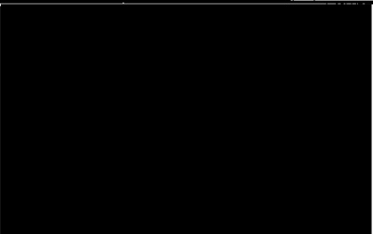
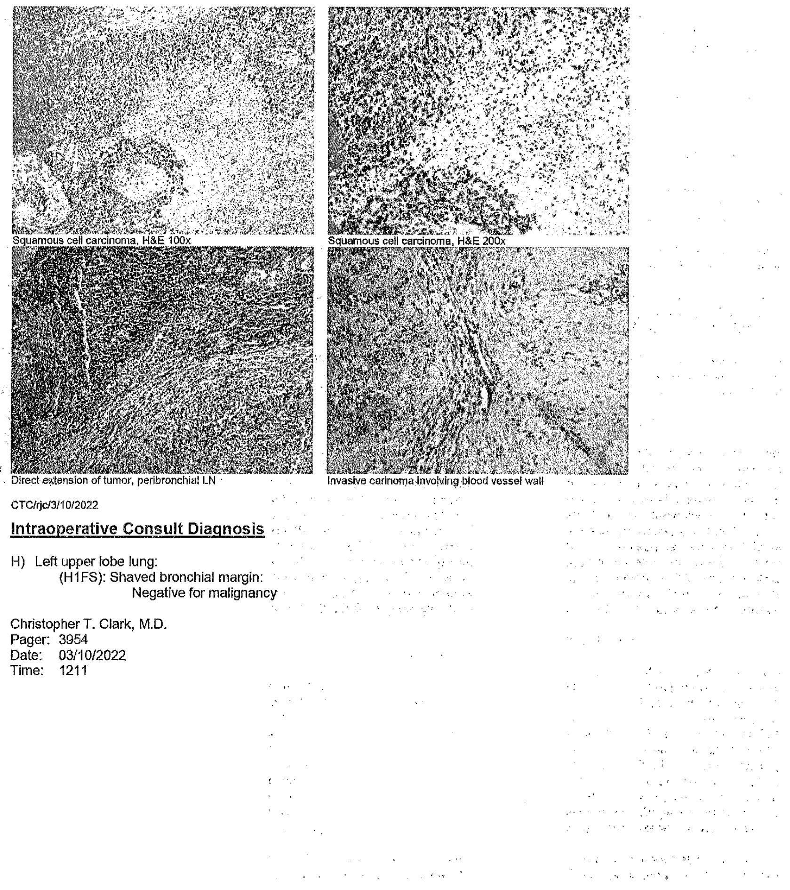
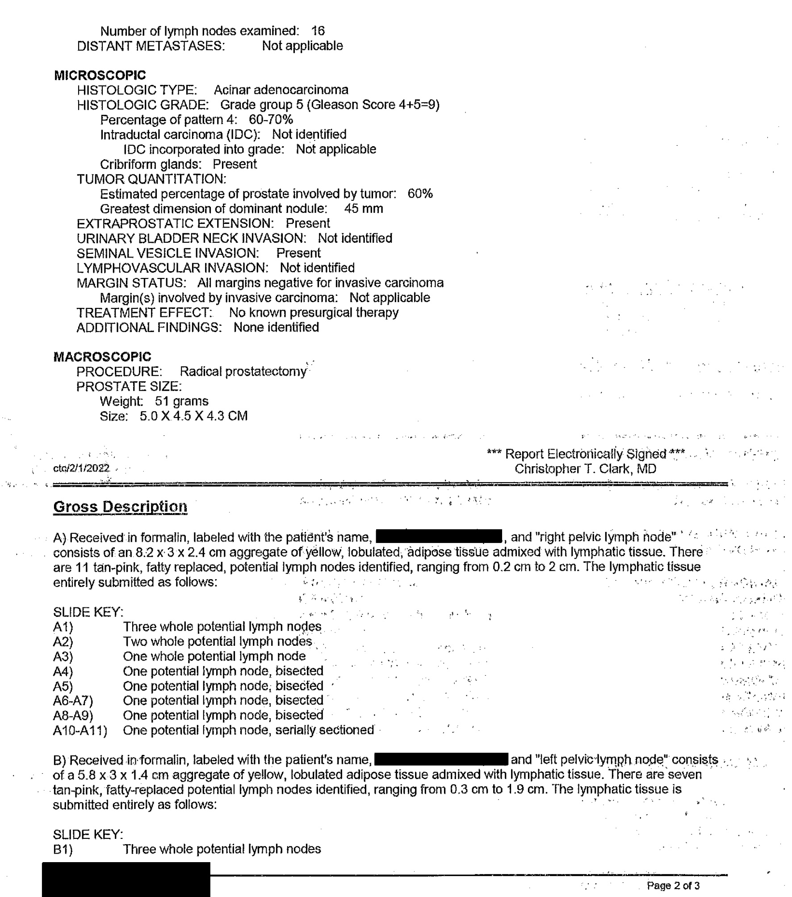

# Surgical Pathology Report  

Patient: Med. Rec.#: DOB/Gender: Soc. Sec.# Location: Physician(s):  

  

  

# Specimen(s) Received  

A:Right breast   
B:Additional anterior margin at right nipple base   
C:Left breast   
D:Additional anterior margin at left nipple base   
E:Sentinel lymph node #1, left axilla   
F:Sentinel lymph node #2, left axilla   
G:Sentinel lymph node #3, left axilla  

Clinical History and Diagnosis  

Left IDC, multifocal, three clips  

# Final Pathologic Diagnosis  

A) BREAST, RIGHT, SKIN-SPARInG TOTAL MASTECTOmY: 1) SCATTERED AREAS OF FLAT EPITHELIAL ATYPIA 2) PROMINENT FIBROCYSTIC CHANGE WITH A LARGE 15 mm CYST CONTAINING DENSE INSPISSATED SECRETIONS LOCATED WITHIN THE UPPER INNER/CENTRAL. QUADRANT (SEE COMMENT) 3) INTRADUCTAL PAPILLOMA 4) AREAS OF PROMINENT ADENOSIS AND SCLEROSING ADENOSIS 5) AREAS OF USUAL DUCTAL HYPERPLASIA 6) STROMAL FIBROSIS 7) SMALL INTRAPARENCHYMAL LYMPH NODE, NEGATIVE FOR MALIGNANCY (0/1) 8) NEGATIVE FOR DUCTAL CARCINOMA IN SITU AND INVASIVE CARCINOMA  

B) BREaST, RIGHT, ADDItIONAL ANTerIOR maRGIN AT NiPPLE BASE, EXCISIOn:NEGATIVE FOR DUCTAL CARCINOMA IN SITU AND INVASIVE CARCINOMA  

C) BREAST, LEFt, SKIN-SPARINg TOTAL MASTECTOmY: INVASIVE MAmmARY CaRCINOmA, DUCTAL TYPE, NOT OTHERWISE SPECIFiED - NOTTINGHAM SCORE: 6 OF $\mathfrak{g}$ (TUBULES $=2$ NUCLEI $=2$ MITOSES $=2\times$ - HISTOLOGIC GRADE: MODERATELY DIFFERENTIATED (G2) - TUMOR SIZE: NUMEROUS VARYING SIZED FOCI OF INVASIVE CARCINOMA ARISING  

IN CLOSE PROXIMITY TO ONE ANOTHER THAT COALESCE TOGETHER TO FORM A SINGLE LARGE CONFLUENT TUMOR MASS SPANNING 39 MM IN GREATEST DIMENSION THAT IS LOCATED WITHIN THE LOWER OUTER/CENTRAL BREAST SPECIMEN AT APPROXIMATELY 4-5 O CLOCK   
α LYMPH VASCULAR INVASION: NOT IDENTIFIED   
- PERINEURAL INVASION: PRESENT   
- IN SITU COmPONENT: PRESENT, DUCTAL CArCINOma In SITU NUCLEAR GRADE: 2 OF 3 TYPES: MICROPAPILLARY AND PAPILLARY TYPES SIZE/EXTENT: ASSOCIATED WITH THE INVASIVE CARCINOMA   
- MARGINS: NEGAtIVe FOr INVASIVE CARCINOMa ANd CARCINOMA In SITU WiTh THE CL.OSEST MARGIN BEING POSTERIOR WITH ONLY A COUPLE OF FIBROBLASTS PRESENT BETWEEN THE INKED MARGIN AND INVASIVE CARCINOMA. INVASIVE DUCTAL CARCINOMA AND DUCTAL CARCINOMA IN SITU . ALSO COMES EXCEEDINGLY CLOSE TO THE ANTERIOR MARGIN AT LESS THAN 1 mm  

DDITIONAL PATHOLOGIC FINDINGS: - THReE (3) METAL BIOpSY ClIPs WiTH ASSOCIATed PrIOR BIOPSY CHaNGES - MULTIPLE SMALL FIBROADENOMAS - EXTENSIVE FIBROCYSTIC CHANGE - ADENOSIS AND SCLEROSING ADENOSIS - PROMINENT STROMAL FIBROSIS  

D) BREAST, LEFT, ADDITIONAL ANTERIOR NIPPLE-BASE MARGIN, EXCISION: . : : NEGATIVE FOR DUCTAL CARCINOMA IN SITU OR INVASIVE CARCINOMA  

E) LyMPH NODe, LEFT AXILLA, SENTINEL #1, EXCISION: QNE L.yMPH NODE POSITIVE FOR METASTATIC CARCINOmA (1/1) - SIZE OF LARGEST METASTATIC FOCUS: 2.1 mm - EXTRACAPSULAR EXTENSION: NOT IDENTIFIED  

F) LYmPH NODE, LEFT AXILLA, SENTINEL #2, EXCISION: THREE LYMPH NODES, NEGATIVE FOR MALIGNANCY BY ROUTINE H&E AND PANCYTOKERATIN IMMUNOHISTOCHEMISTRY (0/3)  

G) LyMPH NODE, LEFT AXIlLA, SENTiNEl #3, EXCISIOn: ONE LYMPH NODE NEGATIVE FOR MALIGNANCY BY ROUTINE H&E AND PANCYTOKERATIN IMMUNOHISTOCHEMISTRY (O/1)  

# SYNOPTIC SUMMARY (LEFT BREAST)  

PATHOLOGIC STAGING PRIMARY TUMOR:  pT2 REGIONAL LYMPH NODES: pN1a Total number of lymph nodes examined: 5 Number of lymph nodes involved: 1 Number of sentinel nodes examined: 5 GrouStage  

Number of lymph nodes with macrometastases: 1 Number of lymph nodes with micrometastases: 0 Number of lymph nodes with isolated tumor cells: 0 Size of largest metastatic deposit: 2.1 mm Extranodal extension: Not identified DISTANT METASTASIS: Not applicable  

BREAST PATHOLOGIC PROGNOSTIC GROUP MARKERS OVERALL HISTOLOGIC GRADE (Nottingham histologic grade): Grade 2 ANCiLLARY STUDIES:  (Previously performed on prior biops HER 2/neu FISH: Negative/Not amplified RATIO OF AVERAGE HER2/CEN-17: 1.1 AVERAGE NUMBER OF HER2 SIGNALS/NUCLEUS: 2.6 ESTROGEN RECEPTOR: Positive $(90\%)$ PROGESTERONE RECEPTOR: Positive $(100\%)$ MIB-1 (Ki-67): $15\%$  

# MICROScOPIC:  

DUCTAL CARCINOMA IN-SITU (DCIS): : Present Size (extent) of DclS: Associated with invasive carcinoma Architectural Pattern(s): Micropapillary and papillary types  

Invasive carcinoma margins: Negative for invasive carcinoma Distance from closest margin: A couple of fibroblasts between the inked margin and carcinoma Specify margin: Posterior Anterior margin: Less than 1 mm Posterior margin: A couple of fibroblasts between the inked margin and carcinoma Superior margin: Greater 10 mm Inferior margin: Greater than 10 mm Medial margin: Greater than 10 mm Lateral margin: Greater than 10 mm.  

DCIS margins: Negative for Ductal carcinoma in situ Distance from closest margin: Less than 1 mm Specify margin: Anterior and Posterior margins Anterior margin: Less than 1 mm Posterior margin: Less than 1 mm Superior margin: Greater than 10 mm Inferior margin: Greater than 10 mm Medial margin: Greater than 10 mm Lateral margin: Greater than 10 mm TREATMENT EFFECT: Treatment effect in the breast: No known presurgical therapy Treatment effect in the lymph nodes: No known presurgical therapy LYMPHOVASCULAR INVASION: Not identified  

# MACROSCOPIC  

PROCEDURE: Bilateral skin-sparing total mastectomies with left axillary sentinel lymph nodes #1, #2. and #3 with additional right nipple base and left nipple base excisions  

# Comment:  

A) The right breast skin-sparing total mastectomy specimen demonstrates areas of flat epithelial atypia present within a background of prominent benign proliferative changes that includes adenosis, sclerosing adenosis, usual ductal hyperplasla, columnar cell hyperplasia, and stromal fibrosis. Within the upper/central inner quadrant is a 1.5-cm cyst containing dense inspissated secretions that likely represent the radiologic findings of a well-circumscribed oval homogeneous hypoechoic mass located at the 1-2 o'clock 1 cm from the nipple lesion. No evidence of ductal carcinoma in situ or invasive carcinoma is identified.  

C) The left breast skin-sparing totai mastectomy specimen demonstrates numerous varying sized invasive ductal parcinomas arising in close proximity to one another that coalesca together to form a single large confluent tumor mass located within the lower central/outer quadrant of the breast specimen at approximately 4-5 o clock spanning 39 mm in greatest dimension. Three (3) metal biopsy clips are associated the larger areas of the overall tumor. mass. Prominent intermediate grade micropapillary and papilary-type DCis is associated with the invasive carcinoma. Invasive carcinoma comes exceedingly close to the posterior margin with oniy a couple of fibroblasts separating the tumor from the inked margin. Invasive carcinoma also comes exceedingly close to the anterior margin at less than 1 :mm. Ductaf carcinoma in situ alsa comes very close to the anterior and posterior margin at less than 1 mm. All the other margins are negative at greater than 10 mm. ：：  

The sentinel lymph node #1 from the left axilla demonstrates metastatic carcinoma spanning 2.1 mm in greatest . dimension. The remaining sentinel lymph nodes #2 and #3 are negative for metastatic carcinoma by routine H&E and pancytokeratin immunohistochemistry.   
Overall, this is staged at pT2 pN1a.  

this are submitted for intradepartmental consultation with satisfactor \*\*\* Report Electronicaly Signed \*\* George M. Sneed, D.O.  

# Gross Description  

A) Received fresh from the OR for permanent section labeled "right breast, short $\asymp$ subareolar plexus, long = 12 o'clock is a skin-sparing total mastectomy specimen. A long black suture demarcates the superior, 12 o'clock aspect of the specimen. A short black suture is present demarcating the subareolar plexus. The specimen measures 17.5 cm from superior to inferior, 15.0 cm from medial to lateral, and 1.8 cm from anterior to posterior. The specimen is inkedas follows: The subareolar plexus is inked orange; the anterior is inked blue; and the posterior aspect is inked black. The specimen is then serialy sectioned from laterai to medial into 9 slices. Examining the slices reveal abundant dense breast stroma seen throughout the breast tissue most predominant within the central breast tissue. Scattered through the breast parenchyma are multiple small cysts ranging in size from 0.1 up to 0.3 cm in greatest dimension. Also seen within the upper mid to inner quadrant of the breast within slice 7 is a predominantly circumscribed nodular area within the dense breast stroma measuring $1.5\times1.0\times0.9$ cm. No other distinct masses or lesions are identified. Representative sections from the specimen are submited per the slide key.  

SLIDE KEY:  

A1-3) Slice 7, area of nodularity within the upper mid to inner quadrant, entrely submitted   
A4) Slice 3, upper outer quadrant   
A5) Slice $4,$ lower auter quadrant   
A6-7) Subareolar plexus and retroareolar tissue   
A8) Slice 8, lower inner quadrant   
A9) Slice 8, upper inner quadrant  

B) Received fresh from the OR for permanent section labeled "additional anterior margin at right nipple base, clips mark new margin" is a roughly rectangular fragment of pink-tan tissue that measures $1.2\times1.2\times0.3$ cm.Two staples are present along one side demarcating the new true margin. The new true margin is inked blue, and the opposite margin is inked black. The specimen is then serially sectioned and entirely submitted in cassette B1.  

C) Received fresh from the OR for radiologic assessment of clip placement labeled “left breast, short $\equiv$ subareolar plexus, long $=$ 12 o'clock" is a skin-sparing total mastectomy specimen that measures 20.0 cm from superior to inferior, 15.5 cm from medial to lateral, and 1.8 crm from anterior to posterior. There is a short black suture along the anterior surface demarcating the nipple base. A long black suture is present along one edge demarcating the 12 . o'clock superior aspect of the specirmen. The specimen is inked as follows: The area demarcated as the nipple base is inked orange, the anterior surface is inked blue, and the posterior aspect is inked black. The specimen is then serially sectioned from medial to lateral into ten slices. Within slice 7 at approximately 4-5 o'clock are two adjacent HydroMARK biopsy clips associated with a dense' white firm fibrous-type lesion. This lesion has vague borders and measures $3.9x$ 1.6 × 1.0 cm. This lesion comes to within 1.0 cm from the anterior margin, 0.1 cm from the posterior margin, 10.0 cm from the superior margin, 3.0 cm from the inferior margin, 9.0 cm from the rnedial margin, and 5.0 cm from the lateral margin. Within slice 8 there is a lesion present that appears to be extending from the Jesion seen Within slice 7 that appears irregular, white-firm, and nodular measuring $1.8\times1.1\times1.5$ cm and contains a non-HydroMARK metal biopsy clip. This lesion associated within slice 8 abuts the anterior and posterior margins, comes to within 8.5 from the superior margin, 1.1. from the inferior margin, 3.5 from the lateral margin, and 10.5 cm from the lateral margin. The tumor grossly is suspicious to extent in to slice $g$ focally. The two lesions seen together. within slices 7 and 8 have an overall measurement of $3.9\times3.5$ x 1.6 cm. The remaining breast tissue contain. abundant dense stromal fibrosis and scattered small cysts ranging in size from 0.1 up to 0.3 cm in greatest dimension. No other gross masses or lesions are identified. Representative sections from the specimen are submitted per the slide key.  

SLIDE KEY:  

C1-16) Slice 7 containing the two biopsy clip area and lesion from superior to inferior with C1-4 consecutive sections from superior to inferior, C6-8 consecutive sections from superior to inferior, C9-12 consecutive sections from superior to inferior, and C13-16 consecutive sections from superior to inferior   
C17-27) · Slice 8 from superior to inferior containing adjacent/continuous lesion from slice 7 with C17-20 quadrisected, C21-24 quadrisected with C22 containing area of biopsy clip, C25-27 trisected with C26 containing the inferior margin   
C28-29) Subareolar plexus from slice 4   
C30) Slice 2, upper inner quadrant   
C31) Slice 3, lower inner quadrant   
C32) Slice 9, upper outer quadrant   
C33) Slice 10, lower outer quadrant   
C34) Slice 9, adjacent/lateral to lesion   
C35-36) Slice 6, adjacent/medial to the lesion  

"  , D) Received fresh from the OR for permanent section labeled "additional anterior margin at left nipple base; clips - -. mark:new margin" is an iregularly-shaped fragment of pink-tan tissue that measures $0.9\times0.6\times0.2$ cm.Two staples are present along one side demarcating the true new margin. The true margin is inked blue, and the opposite margin is inked black. The specimen is then bisected and entirely submitted in cassette D1.  

E) Received in formalin labeled "sentinel lymph node #1, left axilla, hot, #3541" is a single oval fragment of pink-tan tissue that measures 2.2 x 1.5 x 1.0 cm. This portion of tissue is searched for lymph nodes and one possible lymph node is identified measuring $1.8\times1.3\times1.0$ cm. This possible lymph node is submitted per the sentinel lymph node protocol in cassettes E1-3.  

F) Received in formalin labeled "sentinel lymph node #2, left axila, hot, #1837" are multiple pink-yellow lobulatedfragments of tissue with the smallest measuring 0.8 and the largest measuring 2.0 cm in greatest dimension. These fragments of tissue are searched for lymph nodes, and three possible lymph nodes are identified ranging in size from 0.6 up to 1.3 cm in greatest dimension. These possible lymph nodes are submitted per the sentinel lymph node protocol per the slide key.  

SLIDE KEY:  

F1) One possible lymph node, serially sectioned F2) One possible lymph node, serially sectioned F3) One possible lymph node, serially sectioned  

G) Received in formalin labeled "sentinel lymph node #3, left axilla, hot, #948" is a single oval fragment of yellow-pink adipose tissue that measures $2.5\times1.4\times0.7$ cm. This portion of tissue is searched for lymph nodes, and one possible lymph node is identified measuring $1.5\times1.1\times0.3$ cm. This possible lymph node is serially sectioned per the sentine! lymph node protocol and is entirely submitted in cassettes G1-2.  

GMS/psk/1/8/2022  

# Microscopic Description  

C) Documentation of Medical Necessity for Immunohistochemistry: :  

Immunostains for a breast cocktail containing $p63$ anid heavy chain smooth muscle myosin is performed for further assessment of the extent of the invasive carcinorma and ductal carcinoma in situ. A pancytokeratin irmmunostain is also performed for further assessment of the presence of tumor cells in relation to the posterior margin. An E cadherin immunostain is also performed for further assessment of ductal carcinoma, lobular in origin.  

Description of Immunohistochemistry:  

A.breast cocktail immunostain containing p63 and heavy chain smooth muscle myosin is performed with adequate controls on blocks C11, C17, C18, C20, C22, C31, and C34. The breast cocktail immunostained sections highlight a loss of myoepithelial cells within the areas of interest, supportive of invasive carcinoma. A pancytokeratin immunostain is performed with adequate controls on block C18. The pancytokeratin immunostained section highlights the area of invasive carcinoma in relation to the margins' of excision. An E cadherin immunostain is performed with adequate controls on block C25 and demonstrates diffuse staining, supportive of ductal in origin.  

# Immunostain Summary:  

C11: Breast cocktail containing p63 and heavy chain smooth muscle myosin C17: Breast cocktail containing p63 and heavy chain smooth muscle myosin C18: Breast cocktail containing p63 and heavy chain smooth muscle myosin, Pancytokerati C20: Breast cocktail containing p63 and heavy chain smooth muscle myosin C22: Breast cocktail containing p63 and heavy chain smooth muscle myosin C25:E cadherin C31: Breast cocktail containing p63 and heavy chain smooth muscle myosin C34: Breast cocktail containing p63 and heavy chain smooth muscle myosin  

E) Documentation of Medical Necessity for Immunohistochemistry:  

Per protocol given the lymph node is a sentinel lymph node, a pancytokeratin immunostain is performed for further assessment of the presence of isolated tumor cells and micrometastasis.  

Description of Immunohistochemistry:  

A pancytokeratin immunostain is performed with adequate controls on blocks E1, E2, and E3. The pancytokeratin immunostained sections highlight small foci of metastatic carcinoma within section E1.  

Immunostain Summary: E1:Pancytokeratin E2: Pancytokeratin E3: Pancytokeratin  

F) Documentation of Medical Necessity for Immunohistochemistry:  

Per protocol given the lymph node is a sentinel lymph node, a pancytokeratin immunostain is performed for further assessment of the presence of isolated tumor cells and micrometastasis.  

Description of Immunohistochemistry:  

A pancytokeratin immunostain is performed with adequate controls on blocks F1, F2, and F3. The pancytokeratin immunostained sections are negative for metastatic carcinoma.  

Immunostain Summary: F1: Pancytokeratin F2: Pancytokeratin F3: Pancytokeratin  

G) Documentation of Medical Necessity for Immunohistochermistry:  

Per protocol given the lymph node is a sentinel lymph node, a pancytokeratin immunostain is performed for further assessment of the presence of isolated tumor cells and micrometastasis.  

Description of Immunohistochemistry:  

A pancytokeratin immunostain is performed with adequate controls on blocks G1 and G2. The pancytokeratin immunostained sections are negative for metastatic carcinoma.  

Immunostain Summary: G1: Pancytokeratin G2: Pancytokeratin  

In some tests, analyte specific reagents (AsRs) are used. In the case of an ASR, this test was developed and its performance characteristics determined by this laboratory. It has not been cleared or approved by the US Food and Drug Administration. The FDA has determined that such clearance or approval is not necessary. This test is used for clinical purposes. It should not be regarded as investigational or for research. This laboratory is certifed under the Clinical Laboratory Improverment Anendments of 1988 (CLiA '88) as qualfied to perform high complexity clinical laboratory testing.  

# Surgical Pathology Report  

Patlent: Med. Rec. #: DOB/Gender: Soc. Sec. #: Location: Physician(s):  

  

  

# Specimen(s) Received  

A:Level 9 lymph node B:Level 7 lymph node C:Level 10 lymph node D:Level 11 tymph node E:Levei 11 lymph node #2 F:Level 10 lymph node #2 G:Level 11 lymph node #3 H:Left upper lobe I:Level 5 iymph node  

Clinical History and Diagnosis  

Squamous cell carcinoma of left upper lobe of lung  

# Final Pathologic Diagnosis  

A) LYmPh NoDe, LeVEl 9, EXCISION : NEGATIVE FOR MALIGNANCY IN TWO LYMPH NODES (0/2)   
B) LYMPH NODE, LEVEL 7, EXCISION: NEGATIVE FOR MALIGNANCY IN TWO LYMPH NODES (0/2)   
C) LYmPH NoDe, LEVEL 10, EXCISION: NEGATIVE FOR MALIGNANCY IN ONE LYMPH NODE (0/1)   
D) LYMPH NODE, LEVEL 11, EXCISION: NEGATIVE FOR MALIGNANCY IN TWO LYMPH NODES (0/2)   
E) LYmPH NoDE, LEVEL 11, NODe #2, EXCISION: NEGATIVE FOR MALIGNANCY IN ONE LYMPH NODE (0/1)   
F)  LYmPH NoDE, LEVEL 10, NoDe #2, EXCISION: NEGATIVE FOR MALIGNANCY IN THREE LYMPH NODES (0/3)  

G) LYmPh NoDe, LEVEL. 11, NoDE #3, ExCISIon: NEGATIVE FOr MALIGNaNCY IN FOUR LYMPH NODES (0/4)  

H) LuNG, LefT UPper lobe, LobeCtomy: INVASIve SQUAmoUS CEll CARCINOmA, NON-KERATINIZINg TUMOR SIZE:  1.6 CM HISTOLOGIC GRADE: POORLY-DIFFERENTIATED (G3) MARGINS: NEGATIVE FOR MALIGNANCY DISTANCE TO CLOSEST MARGIN: 3.5 CM FROM BRONCHIAL / VASCULAR MARGIN VISCERAL PLEURAL INVASION: NOT IDENTIFIED ANGIOLYMPHATIC INVASION: PRESENT TUMOR IDENTIFIED WITH DIRECT EXTENSION INTO WALL OF LARGE CALIBER BLOOD VESSEL PERINEURAL INVASION: NOT IDENTIFIED NON-NEOPLASTIC LUNG: EMPHYSEMATOUS CHANGES  

PERIBRONCHIAL LYMPH NODES: POSITIVE FOR MALIGNANCY IN ONe OF ELEVEN LYmPH NODES BY DIRECT TUMOR EXTENSION (1/11), SEE COMMENT  

I) LYMPH NODE, LEVEL 5, EXCISION: NEGATIVE FOR MALIGNANCY IN ONE LYMPH NODE (0/1)  

# SYNOPTIC SUMMARY  

'ATHOLAGIG TSTAGRNG pT1b Group Stage 2B REGIONAL LYMPH NODES:  pN1 Number of lymph nodes with tumor:  1 Nodal site(s) with tumor: Peribronchial node with involvement by direct tumor extension Number of lymph nodes examined: 27 Nodal site(s) examined: Peribronchial and levels 5, 7, 9, 10, 11 : Lymph nodes from prior procedures:  Not applicable DISTANT METASTASES: Not applicable  

TUMOR SIZE TOTAL TUMOR SIZE: Greatest dimension: 1.6 CM Additional dimensions: 1.1 x 1.1 CM INVASIVE TUMOR SIZE: Greatest dimension:  1.6 CM Additional dimensions: 1.1 x 1.1 CM  

MIcrOscOPIC HISTOLOGIC TYPE: Invasive squamous cell carcinoma, non-keratinizing Histologic components present: Squamous cell carcinoma Histologic patterns present: Squamous cell carcinoma, non-keratinizing VISCERAL PLEURA INVASION: Not identified LYMPH-VASCULAR INVASION:  PreSent DIRECT INVASION OF ADJACENT STRUCTURES: Not applicable Involved adjacent structures: Not applicable MARGINS:  

Margin status for invasive carcinoma: All margins negative for invasive carcinoma Closest margin(s) to invasive carcinoma: Bronchial / vascular Distance from invasive carcinoma to closest margin: 3.5 CM Margins involved by invasive carcinoma: Not applicable Margin status for non-invasive tumor: Not applicable TREATMENT EFFECT: No known presurgical therapy Percentage of residual viable tumor: Not applicable  

MACROSCOPIC PROCEDURE: Lobectomy SPECIMEN LATERALITY: Left TUMOR SITE: Upper lobe TUMOR SIZE: 1.6 CM TUMOR FOCALITY: Unifocal SYNCHRONOUS TUMORS: Not applicable  

# Comment:  

There is one large peribronchial lymph node in immediate region of tumor showing involvement of squamous cell carcinoma by likely direct tumor extension.  

Tissue blocks with viable tumor for additional studies, if requested: H5, H6  

\*\*\* Report Electronically Signed \*\*\* Christopher T. Clark, MD  

Additional information added without change in diagnosis   
05/20/2022   
1  

\*\*\* Report Electronically Signed \*\* Christopher T. Clark, MD  

# Gross Description  

A) Received in formalin labeled with the patient's name, and "leve! $9$ lymph node" are two brown-yellow fragments of soft tissue. The larger fragment measures 0.8 cm and the smaller 0.4 cm in greatest dimension. The entire specimen is submitted as A1.  

B) Received in formalin labeled with the patient's name, .. -_ and "level 7 lymph node" are two anthracotic possible lymph nodes. The larger measures $1.7\times1.4\times0.5$ cm and the smaller measures $1.3\times1\times0.5$ Cm.Both are bisected and the larger is entirely submitted as B1 and the smaller entirely submitted as B2.  

C) Received in formalin labeled with the patient's name, and "level 10 lymph node" is a black-yellow possible Iymph node that measures $3\times1.5\times$ 1 cm. The specimen is bisected and is entirely submitted as C1-C2.  

G)'Received in formalin labeled with the patient's name, and "level 11 lymph #3" are four biack possible lymph nodes ranging in size from 0.2 cm up to 2.5 cm in greatest dimension. The largest is bisected and entirely submitted as G1-G2 and the three smaller entirely as G3. :  

# (cassettes verified)  

: \*.\* :  H) Reqeived fresh1 for intraoperative frozen section diagnosis labeled with the patient's name, Tand as: 1. "left upper lobe" is a lobe of lung weighing 235 grams and measuring 20 x 10.5 x 2.5 cm. The pleural surface is : .  black-tan and smooth throughout. There is a single firm, white pleural nodule measuring 0.4 cm in diameter. This nodule is located 9 cm from the bronchialvascular staple line margin. The vascular and bronchial margins are - stapled. The staple line is removed and the hronchial margin is submitted in cassette H1 for intraoperative frozen sectian diagnosis. Located 2.5 cm from the fim pleural nodule and 3.5 cm from the bronchial/vascular margin is a \*  frm, circumscribed, white nodule measuring 1:6x 1:1 x 1:1 cm- This lesion is located 1.5 cm-beneath tne nearest - -- ' pleural surface. The overlying pleural surface is smooth witt: no puckering evident. One representative piece of mass : is submitted to UTMC Biobank The remaining lung tissue is tan-brown with no other nodules-ormasses identified- No: , additional staple line at the parenchymal surface is noted. Representative sections including the entire mass are submitted with processing in fomalin under the folowing designations?  

SLIDE KEY:  

H1FS) Shaved bronchial margin   
(H2) Firm pleural nodule after decalcification   
(43) Representative tissue between firm pleural nodule and mass   
(4) Pleural surface closest to mass   
H5-H10) Mass, submitted entirely   
H11) Shaved vascular margin   
H12-H13) Multiple peribronchial lymph nodes   
H14) Single lymph node, bisected   
H15) Single lymph node, bisected   
H16-H17) Single lymph node, bisected   
H18-H19) Representative uninvolved lung parenchyma  

I) Received in formalin labeled with the patient's name, and "level 5 lymph node" is a single piece of tan tissue measuring $1.2\times0.3\times0.3$ cm. Embedded in toto in cassette I1.  

  

Phone: (865) 305-9080   
Fax: (865) 305-6866  

# Surgical Pathology Report  

  

  

Specimen(s) Received   
A:Right pelvic lymph node   
B:Left pelvic lymph node   
C:Prostate   
Clinical History and Diagnosis   
Prostate cancer (per PowerChart), C61  

Final Pathologic Diagnosis A) LYMPH NODES, RIOHT PELMO, LYMPH NODE DISSEOTION: NEGATIVE FOR MALIGNANCY IN TEN LYMPH NODES (O/10) B) LYMPH NODES, LEFT PELVC, LYMPH NODE DISSECTION: NEGATIVE FOR MALIGNANCY IN SIX L.YMPH NODES (O/6) C) PROSTATE, RADICAL PROSTATECTOMY: AGINAR ADENOCARCINOMA GLEASON PATTERN/SCORE: 45 $=9$ GRADE GROUP: 6 EXTENT: INVOLVES APPROXIMATELY 60-70% OF GLAND EXTRAPROSTATIC EXTENSION: PRESENT SEMINAL: VESICLE INVASION: PRESENT MARGNS: NEGATIVE.FOR MALIGNANCY ANGIOLYMPHATIC INVASION: NOT IDENTIFIED PERINEURAL INVASION: PRESENT  

# SYNOPTIC SUMMARY  

PATHOLOGIC STAGING PRIMARY TUMOR: pT3b REGIONAL LYMPH NODES:  pNO Number of lynph nodes with tumor: 0  

  

B2) Two whole potential lymph nodes B3) One potential lymph node, bisected B4-B5) One potential lymph node, bisected  

. C) Received in formalin, labeled with the patient's name, . and "prostate" consists of a 4.3 cm apex to base, 5 cm let to right, and 4.5 cm anterior to posterior prostate gland with attached bilateral adnexa. There is a 2.5 $\times1.5\times0.5$ cm left seminal vesicle that is fragmented and loosely attached, a 1.4 cm in length $x0.5$ cm in diameter left vas deferens, a $3\times2.3\times0.9$ cm right seminal vesicle, and a 1.7 cm in length $\tt x0.5$ cm in diameter right vas deferens. The capsule is tan-brown and diffusely cauterized and appears intact. The prostatic urethra is probe patent. The prostate gland devoid of adnexa is 51 grams. The left anterior and lateral half is inked blue, the right anterior and lateral half is inked orange, and the posterior is inked black. The specimen is serially sectioned from apex to base into seven slices to reveal pale tan-pink, diffusely nodular parenchyma. Representative sections are submitted as follows:  

SLIDE KEY:   
C1) Longitudinal section of left seminal vesicle and cross-section of left vas deferens   
C2) Longitudinal section of right seminal vesicle and cross-section of right vas deferens   
C3) Section of junction of left seminal vesicle, left vas deferens, and prostate   
C4) Junction of right seminal vesicle, right vas deferens, and prostate   
C5) Right angle sections of left apex   
C6) Right angle sections of right apex   
C7) Right angle sections of the left bladder base   
C8) Right angle sections of the right bladder base   
C9) Slice 1-left anterior   
C10) Slice 1-left posterior   
C11) Slice 1-right anterior   
C12) Slice 1-right posterior   
C13) Slice 2-left posterior   
C14) Slice 2-right posterior   
C15) Slice 3-left anterior   
C16) Slice $3$ -left posterior   
C17) Slice $3$ -right anterior   
C18) Slice 3-right posterior   
C19-C20) Slice 4-left posterior   
C21-C22) Slice 4-right posterior   
C23) Slice 5-left anterior   
C24-C25) Slice 5-left posterior   
C26) Slice 5-right anterior   
C27-C28) Slice 5-right posterior   
C29) Slice $6$ -left posterior   
C30) Slice 6-right posterior   
C31) Slice 7-left anterior   
C32) Slice 7-lef posterior   
C33) Slice 7-right anterior   
C34) Slice 7-right posterior   
(casselttes verified)   
TMS/rjc/1/31/2022  

Phone: (865) 305-9080   
Fax: (865) 305-6866  

Drawer U-108 1924 Alcoa Highway Knoxville, TN 37920  

# Surgical Pathology Report  

  

  

Specimen(s) Received A:Right renal mass  

# Clinical History and Diagnosis  

Right renal mass Operation: Robotic right partial nephrectomy  

# Final Pathologic Diagnosis  

A) RIGHT RENAL MASS, ROBOTIC RIGHT PARTIAL NEPHRECTOmY: PAPILLARY RENAL CELL CARCINOMA, 5.6 cm IN GREATEST DIMENSION, FUHRMAN NUCLEAR GRADE 1 OUTER SURFACES OF THE TUMOR ARE DISRUPTED HAMPERING ACCURATE EVALuATION OF MaRGINS; WHERE INTACT, TUmOR APPEaRS CONFINED TO THe KIDNEY. NO NECROSIS OR SARCOmATOID FEATURES ARE IDENTIFIED. PATHOLOGIC STAGE: pT1b pN-NOT ASSIGNED (NO LYMPH NODES SUBMITTED OR FOUND) SEE SYNOPTIC SUMMARY BELOW  

# SYNOPTIC SUMMARY  

PATHSTAASTION C $8^{t h}$ Eediton: Unable to group stage, no lymph PRIMARY TUMOR (pT): pT1b nodes removed REGIONAL LYMPH NODES (pN): pN - not assigned (no nodes submitted or found) DISTANT METASTASIS (pM): Not applicable - pM cannot be determined from the submitted specimen(s)  

MICROSCOPIC HISTOLOGIC TYPE: Papillary renal cell carcinoma SARCOMATOID FEATURES: Not identified RHABDOID FEATURES: Not identified HISTOLOGIC GRADE (WHO / ISUP Grade): G1  

TUMOR NECROSIS: Not identified   
TUMOR EXTENslON: Limited to kidney where not disrupted   
MARGINs: Cannot be determined: All margins negative for invasive carcinoma where not disrupted   
REGIONAL LYMPH NODE STATUS: Not applicable (no regional lymph nodes submitted or found)   
ADDITIONAL FINDINGS IN NONNEOPLASTIC KIDNEY: Insufficient tissue  

# MAcrOscOpIC  

PROCEDURE: Partial nephrectomy SPECIMEN LATERALITY: Right TUMOR SIZE: Greatest dimension: 5.6 cm TUMOR FOCALITY: Unifocal  

# Comment:  

Selected slides are seen in intradepartmental consultation with satisfactory agreement.  

psk/1/13/2022  

\*\*\* Report Electronically Signed \*\*\* Amila Orucevic, M.D., Ph.D.  

# Gross Description  

A) Received in formalin labeled with date of birth, and "right renal mass" is a multifocally disrupted, nan-intact irregularly shaped tumor mass which consists of a multifocally disrupted thin and delicate capsule. Where capsule is intact, it is inked blue. The capsule is associated with a soft to semisolid tumor that measures $5.6\times5.5x$ 3.8 cm and which, also, is multifocally disrupted. There is no grossly apparent renal parenchyma. Focally, on the exterior surface of the thin capsule is lobulated adipose tissue that appears unremarkable. The cut surfaces of the tumor tissue are uniformly solid and demonstrate significant areas of hemorrhage and softening. The cut surfaces demonstrate tiny rim of possible renal parenchyma in some areas which are not disrupted. Representative sections are subnmitted as follows:  

A1-A6) Representative sections of tumor, taken from areas with distinct gross appearance A7) Representative adipose tissue and membranous tissue away from tumor  

(cassettes verified)  

ELH/psp/1/11/2022  

Phone: (865) 305-9080   
Fax: (865) 305-6866  

# Surgical Pathology Report  

Patient: Med. Rec. #: DOB/Gender: Soc. Sec. #: Location: Physician(s):  

  

  

# Specimen(s) Received  

A:Left inguinal space sentinal lymph node #1 B:Palpable left inguinal space sentinal lymph node #2 C:WLE left lower thigh  

Clinical History and Diagnosis Melanoma  

# Final Pathologic Diagnosis  

A) LYMPH NODE, "LEFT INGUINAL SPACE SENTINEL #1," EXCISION: NEGATIVE FOR MALIGNANCY IN ONE LYMPH NODE  

B) LYMPH NODE, "PALPABLE LEFT INGUINAL SPACE SENTINEL #2," EXCISION: NEGATIVE FOR MALIGNANCY IN ONE LYMPH NODE  

C) SKIN AND SUBCUTANEOUS TISSUE, "LEFT LOWER THIGH," WIDE LOCAL EXCISION: 1) NEGATIVE FOR RESIDUAL MELANOMA 2) BIOPSY SITE CHANGES 3) UNREMARKABLE MARGINS OF EXCISION GrouinStaoe2R  

# See cOMMeNT  

# Comment:  

  

the final pathologic stage is pT4a No.  

\*\*\* Report Electronically Signed \*\* Alan Grindstaff, M.D.  

A) Received in formalin labeled with date of birth, and "left inguinal space sentinel lymph node #1, 1827, hot, blue" is a focally cauterized 2.5 x 1.3 x 1.3 cm faintly blue-stained lymph node which is sectioned and entirely submitted according to Sentinel Lymph Node Protocol in A1-A4. (cassettes verified)  

B) Received in formialin labeled with date of birth, and "palpable left inguinal sentinel lymph node #2, hot, not blue, 100" is a 2.2 x 1.3 x 1 cm lymph node which is sectioned and entirely submitted according to Sentinel Lymph Node Protocol in B1-B4. (cassettes verified)  

C) Received in formalin labeled with date of birth, and "WLE left Iower thigh, suture 12 o'clock superior" is an elliptical excision of thin, wrinkled, tan-white skin with subcutaneous tissue that has a suture at one tip marking the 12 o'clock. Using this orientation, the specimen measures 13.0 cm 12 to 6 o'clock $x^{i,0}$ cm9 to3 o'clock $x\geq5$ cm in thickness. The 12 to 3 to 6 o'clock is inked orange, the 6 to 9 to 12 o'clock is inked green, and the deep margin is inked black. On the skin surface is dark blue dye staining of the central portion, within. which is a focally retracted and white-tan consistent with a biopsy site and focally dark brown and pigmented, with the overall lesional area measuring. 1.0 cm from 12 to 6 o'clock x 0.7 cm from 9 to 3 o'clock and with this lesion located 1.5 cm from the 9 o'clock, 1.8 cm from the 3 o'clock, 6.2 cm from the 12 o'clock, and 5.8 cm from the 6 o'clock. On cut section is marked dark blue dye staining but no definite invasion of the subcutaneous tissue by the lesion. No other gross Iesions are Identified. Representative sections are submitted in cassettes as follows:  

SLIDE KEY:.  

C1) 12 o'clock tip, en face   
C2-C3) Bisected superficial half of slice, area before lesion   
C4-C5) Bisected superficial half of slice with lesion   
C6-C7) Bisecfed superficial half of slice with lesion   
C8) Deep margin closest to lesion   
C9-C10)  Bisected superficial half of slice with lesion   
C11-C12) Bisected superficial half of slice with lesion   
C13-C14) Bisected superficial half of slice, area after lesion   
C15) 6 o'clock tip, en face  

(cassettes verified)  

ELH/psp/1/4/2022  

# Microscopic Description  

Immunostains for melanA and Sox10 have been reviewed on all sentinel lymph node blocks.  

Phone: (865) 305-9080 Fax: (865) 305-6886 -  

# Surgical Pathology Report  

# Specimen(s) Received  

Clinical History and Diagnosis  

Cecal intramucosal adenocarcinoma s/p partial polypectomy  

Final Pathologic Diagnosis  

SMALL. BOWEL AND COLON, RIGHT HEMICOLECTOMY: 1) ADENOCARCINOMA : : : ( S HISTOLOOIC GRADE: WELL-TO-MODERATELY-DIFFERENTIATED (GRADE 1-2) SIZE: O.7 CM GREATEST-DIMENSION MAXIMUM TUMOR EXTENSION: SUBMUCOSA MARGINS: NEGATIVE L.YMPHOVASCULARINVASION: NOT IDENTIFIED : / : . 2) BENIGN APPENDIX WTH DISTAL FIBROUS LUMINAL OBLITERATION : 3) THIRTY-OME LYMPH NODES, NEGATIVE FOR METASTATIC ADENOCARCINOMA (0/31) 4) SEE SYNOPTIC SUMMARY  

PATHOLOGIC STAGING: PRIMARY TUMOR: pT1 REGIONAL LYMPH NODES: pN0 DISTANT METASTASIS: Not applicable  

ANCILLARY STUDIES: IMMUNOHISTOCHEMISTRY TESTING FOR MISMATCH REPAIR PROTEINS: Interpretatiorr: No loss of nuclear expression of MMR proteins: Low probabity of MSH Results: -MLH1: Intact nuclear expression, tumor cells MSH2: Intact nuclear expression, tumor cells MSH6: Intact nuclear expression, tumor cells  

PMS2: Intact nuclear expression, tumor cells  

# MIcrOscOpIc:  

HISTOLOGIC TYPE: Adenocarcinoma   
HISTOLOGIC GRADE: G1-2 (well-to-moderately-differentiated)   
TUMOR EXTENT: Invades submucosa   
MARGINS·  

# MACROSCOPIC:  

MACROSCOPIC TUMOR PERFORATION: Not identifed  

# Gross Description  

· Received fresh for Biobank, labeled with the patient's name and "ileum, appendix, right colon.. proximal ransverse colon' consists of an anatomicaly oriented72 om in iength $x\geq0$ cm in diameter portion of. \* terminal ileum (2.5 cm of mesentery) and a 25:0 cm in length x 4.0 cm in diameter portion of right colon (8.0 cm of : mesentery). The specimen has two stapled margihs and there is a 6.2' cm ini length $x0.7$ cm in dlameter i. .i . . :\*) : unremarkable vermiform appendix grossly identified. The serosa is tan-pink and smooth with no visible perforations. The lumen is filed with a moderate amount of green viscous.fecaf debris and there is a wall thickness of 0.2 cm. The : : : : mucosa is tan-pink with multiple dark red petechial hemorrhages. There is a $0.7X\cdot0.6$ cm puckered area (previous -\*' - polypectomy site) in the area of the cecum that is 3.5 cm from the appendiceal orifice, 4.5 cm from the ileus valve, 13:0 cm fiomthe proximal terminal ileummargin, and 24.0 cm from the distal cionic margin.The puckered area is. located on the antimesenteric surface and the serosa overlying the area is inked black. Sectioning reveals a tan-white : scarred cut surfaces that appear to be confined to the mucosa and submucosa and does not appear to involved the ' muscular layer. The remaining mucosa is unremarkable and in the teminal ileum there is a 1.5 x 1.0 cm tan-white : \* - discolored area on the serosa that is at the proximal resection margin and the overlying serosa is Inked blue. The cut sections display homogenous white cut surfaces within the muscular wall. No other lesions or polyps are grossly - - - identiffed. There are forty-five tan-pink possible Iymph-nodes grossly identiied ranging from 0.2 to.1.0:cm.: : . : :  

SLIDE KEY:  

A1-A2) Proximal resection margin, perpendicular with discolored possible lesion (margin inked orange, overlying serosa inked blue)  

3). Distal colonic margin, en face (4) Mesenteric margin, en face  

A5-A7) Puckered area in cecum, entirely and sequentialy (serasa inked black)  

A8) lleocecal valve   
A9) Appendix   
A10) Six whole possible lymph nodes   
A11) Six whole possible lymph nodes   
A12) Six whole possible lymph nodes   
A13) Five whole possible lymph nodes   
A14) Four whole possible lymph nodes   
A15) Four whole possible lymph nodes   
A16) Four whole possible lymph nodes   
A17) Four whole possible lymph nodes   
A18) Two possible lymph nodes, each bisected (one inked blue)   
A19) Two possible lymph nodes, each bisected (one inked blue)   
A20) One possible lymph node, bisected  

(cassettes verified)  

TMS/psp/2/16/2022  

# Microscopic Description  

Documentation of Medical Necessity for Immunohistochemistry.  

Evaluation for mismatch repair proteins as wellas single, slightly enlarged lymph node with architectural effacement by relatively monotonous, moderate size lymphocyte population with coarse chiromatin features  

Description of Immunohistochemistry:  

Immunostains are performed with adequate controls. There is intact nuclear expression of MLH1, MSH2, MSH6, and PMS2 within'the tumor cells. Within the lynph node in question, CD3 and CD20 highlight T-cells and B-cels, respectively, with B-cells forming srmali nodular aggregates. There is paracortical expansion of T cells in the lymph hode in question. CD5 and CD43 hignlight T-cells, without aberrant expression on B-cells. CD23 highlights follcular\* dendritic cell meshworks associated with foilicles. The germinal centers of secondary foilicles coexpress CD10 and " BCL6 without aberrant expression of BCL2, which highlights all T-cells and non-germinal center B-cells. Ki-67 is  

increased within the germinal centers, as expected, but not significantly increased otherwise. Cyclin D1 is negative. These finding support the diagnosis.  

# Immunostain Summary:  

# A6: MLH1, MSH2, MSH6, PMS2  

A13: CD3, CD20, CD5, CD23, CD10, BCL2, Ki-67,CD43, Cyclin D1 .  

In some tests, analyte specific reagents (ASRs) are used. Iin the case of an ASR, this test was developed and its performance.. characteristics determined by this laboratory. It has not been cleared or approved by the US Food and Drug Administration. The FDA.has determined that such clearance or approval is not necessary. This test is used for clinical purposes.It should not be. regarded as investigational or for research. This laboratory is certified under the Clinical Laboratory lmprovement Amendments o! 1988 (CLiA '8) as qualified to perform high. complexity clinical laboratory testing. -.  

# Bone Marrow Report  

  

  

Specimen(s) Received A:Bone marrow core biopsy B:Bone marrow aspirate clot section . C:Faurteen bone marrow aspirate smears D:Five peripheral blood smears  

Clinical History and Diagnosis  

Mantel cell lymphoma  

# Final Pathologic Diagnosis  

# BONE marrOW; COrE BIOPSY, ClOT SECtION, ASPIRATe SMEarS AND FlOW CYTOMETrY: 1) SUSPICIOUS FOR LOW LEVEL INVOLVEMENT BY MANTEL CElL LymPHOMA 2) NORMOCELLULAR BONE MARROW FOR AGE $(30\%)$ WITH TRILINEAGE HEMATOPOIESIS WITH ADEQUATE MATURATION 3) SEE COMMENT AND MICROSCOPIC DESCRIPTION  

PERIPHERAL BLOOD, SmEAR REVIEW:1) NORMOCYTIC ANEMIA (HGB - 10.1 g/dL, MCV - 81.9 fL)- RETICULOCYTE PRODUCTION INDEX: 0.492) SEE COMMENT AND MICROSCOPIC DESCRIPTION  

NO TNM on Lymphoma Group Stage 3  

# Comment:  

The patient's history of mantle cell lymphoma (MCL) s/p one cycle of treatment with Rituxan is noted. While no evidence of overt bone marrow involvement by MCL is noted, a small $(1.0\%)$ population of $\textcircled{<}\textcircled{>}5+$ kapparestricted B cells is detected by flow cytometric analysis, which is compatible with MCL. and suspicious for low level involvement. This may be related to the patient's therapy. Clinical correlation is required.  

Representative bone marrow aspirate samples were submitted to Integrated Oncology in Brentwood, TN. No molecular/cytogenetic studies were ordered at the time of biopsy. The bone marrow samples are held for 14 days for additional studies, if clinically indicated. They can be requested through send-outs (305-6771).  

\*\*\* Report lectronically Signed \*  

Yorke D. Young, M.D.  

# Addendum  

ADDENDUm rEPOrT: Additional information added without a change in the diagnosis. ADDENDUM NUMBER: 1   
ADDENDUM DATE: 1/5/2022  

ADDENDUM INFORMATION:  

Per report, no assay-specific abnormalities are detected by TCR (14q11.2) FIsH probe. Genetic changes other than those assayed cannot be ruled out on the basis of this testing. For more information, please see Integrated 1dated1/3/2022.  

+\*\* Report Electronically Signed \*\*\* Yorke D. Young, M.D.  

# Addendum  

ADDENDUM REPORT: ADDENDUM NUMBER: ADDENDUM DATE:  

Additional information added without a change in the diagnosis. 1   
1/5/2022  

# ADDENDUM INFORMATION:  

Per report, fluorescence in situ hybridization (FISH) analysis utilizing DNA probes for abnormalities associated with mature B cell Iymphomas (Lymphoma FIsH panel) detected no assay specific abnormalities. Genetic changes other than those assayed cannot be ruled out on the basis of this testing. For more information please see Integrated Oncologyreport dated 12/29/2021..:.  

\*\*\* Report Electronically Signed \*\*\* Yorke D. Young, M.D.  

# Gross Description  

The specimen consists of a single small, cylindrically-shaped piece of cancellous bone measuring 1.7 cm in length. (cassette verified)  

TLA/psp/12/29/2021  

Microscopic Description  

PERIPHERAL BLOOD:  

A CBC performed on 12/29/21 discloses the following:  

WBC . 4.13 [k/uL] RBC 3.75 [m/uL] HGB 10.1 [g/dL] HCT 30.7 [%] MCV 81.9 [fL]  

MCH 26.9 [pg]   
MCHC 32.9 [g/dL]   
RDW 17.7 [%]   
PLT 277 [k/uL]   
MPV 9.0 [fL]   
NEUT 2.82 [k/uL] 68.2 [%]   
LYMPH 0.80 [k/uL] 19.4 [%]   
MONO 0.23 [k/uL] 5.6 [%]   
EO 0.25 [k/uL] 6.1 [%]   
BASO 0.02 [k/uL] 0.5 [%]   
1G 0.01 [k/uL] 0.2 [%]   
NRBC 0.00 [k/uL] 0.0 [/100WBC]   
RET 0.95 [%] 0.0356 [m/uL]   
IRF 6.4 [%]   
RET-He 31.3 [pg]   
IPF 1.0 [%]   
RPI 0.49  

Peripheral blood smears and CBC data are reviewed. The peripheral blood is remarkable for a normocytic and normochromic anemia with occasional elliptocytes and no significant anisocytosis. There is no evidence of rouleaux, RBC agglutination, basophilic stippling, circulating nucleated red blood cells, or increased schistocytes. The reticulocyte production index is $C2$ . The WBc is normal and all leukocytes are within normal absolute reference : ranges. The lymphocytes:are sma!l to mcderate size and mature without overt atypical features. Occasional reactive and large granular forms are noted. The granuiocytes are appropriately segmented without overt dysplastic features. No circulating immature myeloid precursors or blasts are identified. The monocytes and eosinophils are mopohologically mature. The platelets are quantitatively normal. No agranular or giant forms are identified. There is nc significant platelet clumping. The immature platelet fraction is within normal limits.  

# BONE MARROW ASPIRATE  

: The bone marrow aspirate smears are spicular, celular, and adequate for evaluation. A 500 cel manual aspirate smear diferential reveals: $0.8\%$ blasts/blast equivalents, $1.5\%$ promyelocytes, $9.6\%$ myelocytes, $0.8\%$ metamyelocytes, $19.6\%$ bands, $16.2\%$ segs, $8.0\%$ eosinophils, $0.4\%$ basophils, $5.0\%$ lymphocytes, $0.6\%$ monocytes, : 1.0% plasma cells and $36.6$ maturing erythroid precursors. The M:E ratio is slightly decreased at 1.3:1. Blasts are not increased. There is no overt dysplasia of the myeloid or erythroid lineages. Megakaryocytes display a spectrum of maturation and are evenly distributed. There is no overt lymphocytosis (focally prominent) or plasmacytosis.  

# BONE MARROW CORE BIOPSY AND CLOI/ PARTICLE PREPARATION:  

Evaluation of the bone marrow core biopsy reveals a normocellular marrow for age (30-40%) with trabeculae of normal thickness. Myeloids elements display adequate maturation and erythroid islands are present. The .: megakaryocytes are quantitatively normal without significant morphologic atypia or clustering. There are several small, well circumscribed, interstitial lymphoid aggregates comprised of small, mature cels. No overtly lymphoid aggregates or granulomas are seen. The bone marrow clot section displays similar findings. -  

# FLOW CYTOMETRY:  

.1.0% Phenotype: CD $19+$ $C D2O+$ $\textcircled{\times}\textcircled{2}2+$ , CD5+(variable), CD10-, CD23-, CD38+, CD103-, FMC7+, Kappa+   
$0.7\%$ No significant phenotypic aberrancy   
Lymphocytes: - B cells: 0.0% - NK cells: 1.1% - T cells: 8.3% CD4:CD8 ratio: 0.8   
Granulocytes: $74.4\%$ Normal maturation   
Monocytes: $2.3\%$ Normal maturation   
Eosinophils: 4.0%   
Basophils: 0.5%   
Plasma Cells: 0.2%   
Hematogones: 0.3%   
CD45- events/debris: - Remaining events  

Antibodies Performed: CD2, CD3, CD4, CD5, CD7, CD8, CD10, CD11b, CD11c, CD13, CD14, CD16, CD19, CD20, CD22, CD23, CD33,CD34, CD38, CD45, CD56, CD57, CD64, CD103, CD117, HLADR, FMC7, kappa, lambda  

# SPECIAL STAINS:  

# IMMUNOHISTOCHEMICAL STAINS:  

\* - Documentation of Medical Necessty for Immunohistochemistry: To evaluate lymphocyte distribution and clonality.  

-\*   Description of mmunohistochenistry Immunostains are periormed with adequate positive and negative controls. The \* \*\*. results are as follows: CD3 and CD20/CD79a highlight T-cels and B cells, respectively, scattered throughout the \*\*\* interstitum and mixed within the lymphoid aggregates. B cells slightly predominate within the aggregates. CD5 .\* \*- appearsto only highlight the T-cells. PAX5 and CyelinD1 are appear negative, which may be technical artifact,  . :possiblyelated to decalcification:  

STAIN SUMMARY:   
A1: CD3, CD20, CD5, CyclinD1, CD79a, PAX5, Reticulin   
C1: 1ron  

The technical component of the flow cytometric analysis was performed at integrated Oncology in Brenfwood, Tennessee. For . more information; please see Integraled Oncology report BFT21-028798, dated 12/30/2021. The test was developed and its performance charactenistics determined by LabCorp. It has not been' cleared or approved by the U.S. Food and Drug Administration: The FDA has deternined that such clearance or approval is not necessary. This test is used for tlinicat purposes. t shouid not be regarded as invastigational or for research. This faboratory is certifed under the Clinical Labqratory Improvement Amondments of 1988 (CLIA-88) as qualified'to perfom high compilexity clinical laboratory testing.  