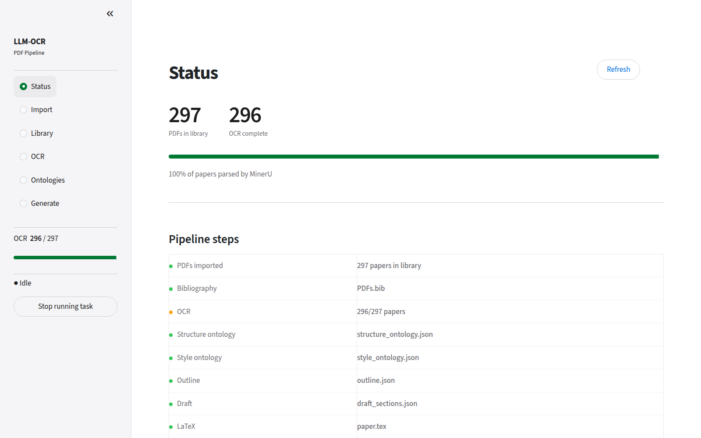
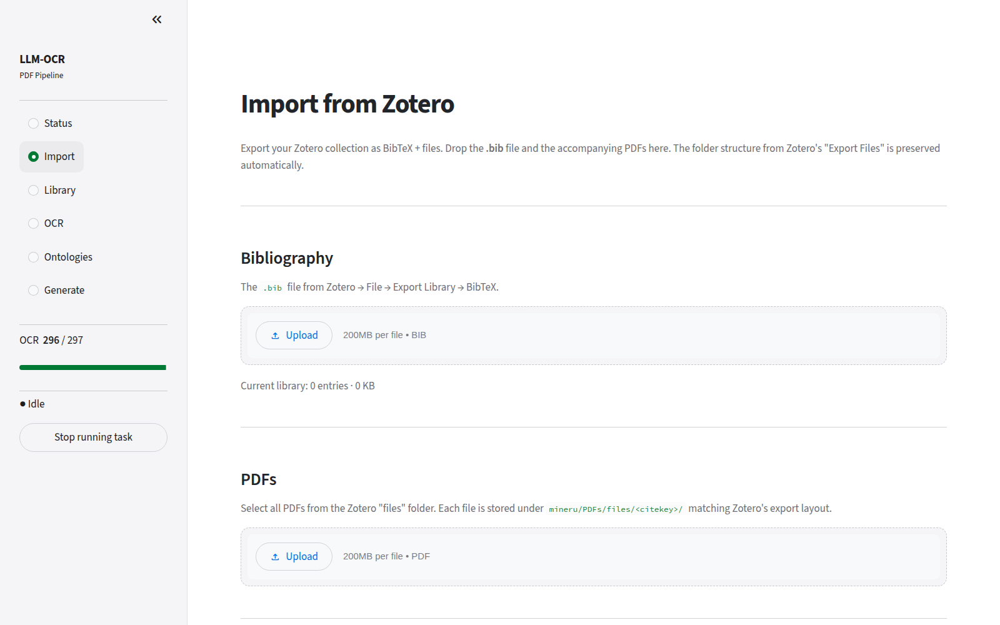
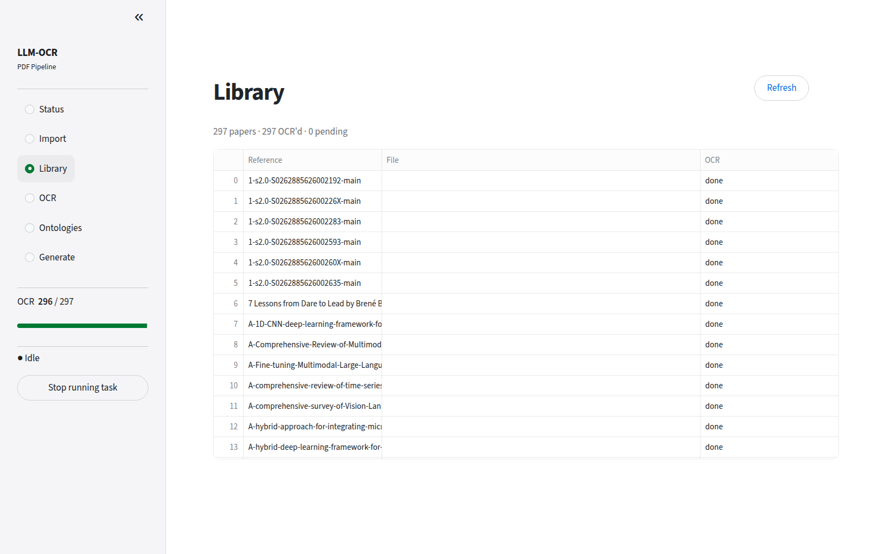
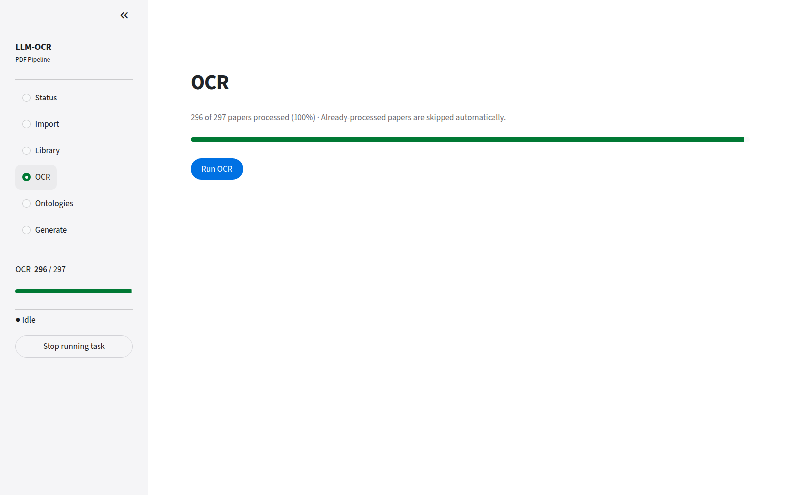
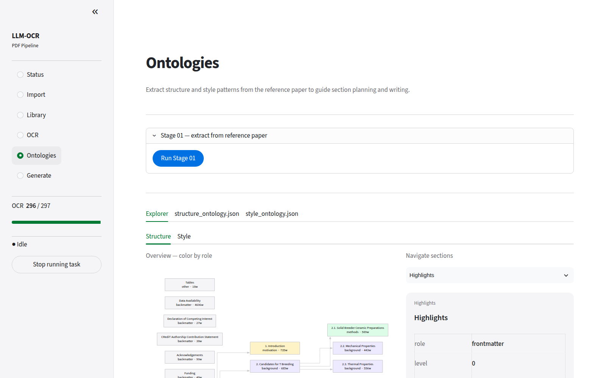
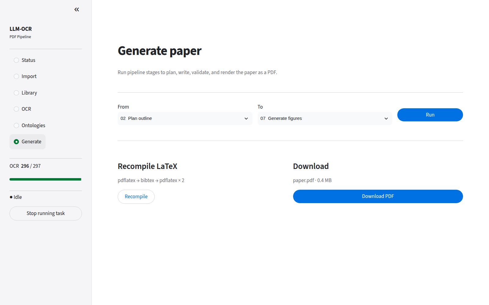
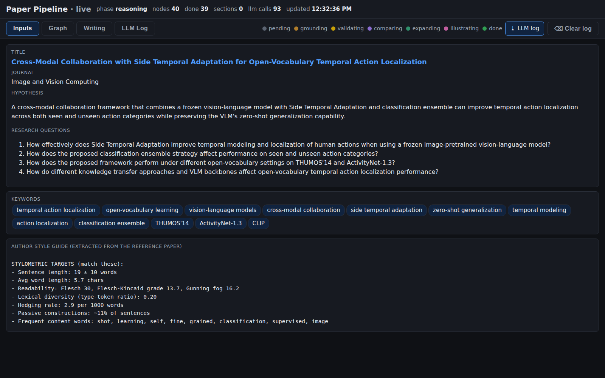
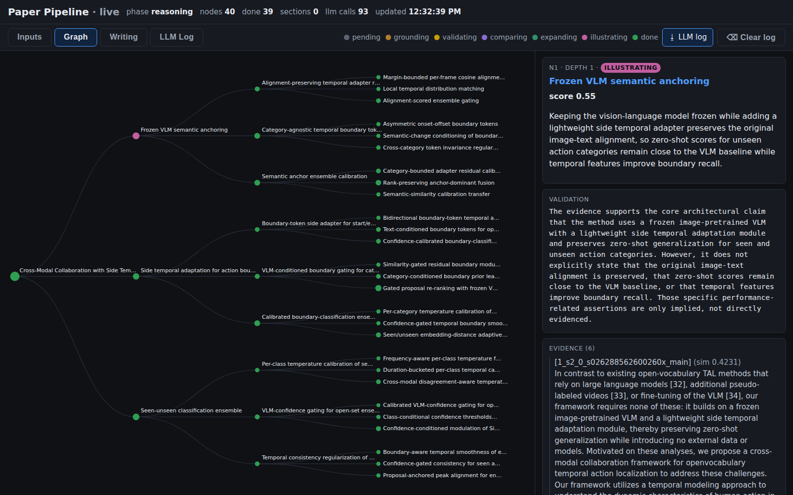
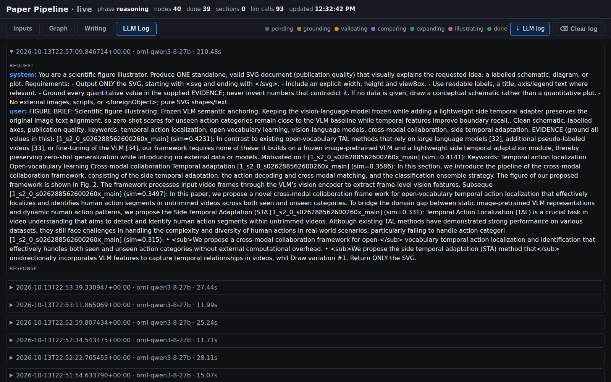

# Jose_LLM_OCR_PDF_Parser

PDF parser

## Web interfaces

Screenshots captured at 100% browser zoom (1600×1000).

### Management UI (Streamlit, `ui/`, port 7860)

`docker compose up -d --build ui` → http://localhost:7860. Set `WORKSPACE_DIR` to run it outside Docker (default `/workspace`).

| Status | Import |
|---|---|
|  |  |

| Library | OCR |
|---|---|
|  |  |

| Ontologies | Generate |
|---|---|
|  |  |

### Live pipeline view (`restructure/orchestrator/templates/live.html`)

Served from `restructure/outputs/` at http://localhost:8080/live.html while the pipeline runs.
The graph tab auto-fits to the pane; scrolling or dragging disables the auto-fit.

**Inputs** — hypothesis, research questions, keywords, extracted author style guide.



**Graph** — reasoning tree coloured by status; click a node for claim, validation, comparison and evidence.



**LLM Log** — every request/response, expandable.



- Testing Code Location on the RECOIL GPU Server
    - https://recoil.ise.utk.edu:8000/user/xli27/lab/tree/projects/shared_space/parserBibliographyJT/

# scripts

## flow by Jose
```
chmod -R 777 /home/recoil/shared_space/parserBibliographyJT/mineru

docker run -it --rm \
  --gpus=all \
  -v /home/recoil/shared_space/parserBibliographyJT/mineru/input_images:/workspace/input_images \
  -v /home/recoil/shared_space/parserBibliographyJT/mineru/output_images:/workspace/output_images \
  mineru_ilab:0.1

magic-pdf -p {some_pdf} -o {some_output_dir} -m auto

magic-pdf -p /workspace/input_images/2008_Winebrake_AssessingEnergyEnvironmental  and Economic Tradeoffs in Intermodal Freight Transportation.pdf -o /workspace/output_images/ -m auto

magic-pdf -p /workspace/input_images/'NCCN Breast Cancer Guidelines 6.2024 Nov.11,2024.pdf' -o /workspace/output_images/ -m auto

```

## test-run flow by Dr. Li

- docker build -t <image-name>:<tag> <path-to-dockerfile-directory>

    - docker build -t ilabutk/mineru_ilab:0.1 -f Dockerfile .
    - docker push ilabutk/mineru_ilab:0.1
- test run
    - chmod -R 777 /home/recoil/shared_space/parserBibliographyJT/mineru_xl

    - 
      ```
          docker run -it --rm \
          --gpus=all \
          -v /home/recoil/shared_space/parserBibliographyJT/mineru_xl/input:/workspace/input_images \
          -v /home/recoil/shared_space/parserBibliographyJT/mineru_xl/output:/workspace/output_images \
          ilabutk/mineru_ilab:0.1
    
      ```
     >
     > magic-pdf -p /workspace/input_images/2024_Zhang_SparrowSearchAlgorithmMMT.pdf -o /workspace/output_images/ -m auto
     > :tada:
     >

## Pdf_Parse_MinerU
    - allow batch process a folder

## End-to-end workflow: BibTeX → PDFs → MinerU

Goal: starting from an EndNote-exported `.bib` file, automatically resolve
missing DOI / URL fields, download an open-access PDF for each entry named
after its citation key, then parse every PDF with MinerU. The MinerU output
folder name will match the BibTeX key, keeping references and parsed
documents linked end-to-end.

### 1. Drop your `.bib` files

Place them in [mineru/initial_bib](mineru/initial_bib). One or many files
are supported — both `.bib` and `.txt` extensions are accepted (EndNote
exports BibTeX as `.txt` by default).

### 2. Enrich + download

From the host (one-off, needs `bibtexparser` and `requests`):

```bash
pip install bibtexparser requests

python mineru/bib_enrich_download.py \
    --bib-dir  mineru/initial_bib \
    --pdf-dir  mineru/input_images \
    --email    you@utk.edu
```

What it does, per entry:

1. Looks up the DOI on Crossref (by title + first author + year) when missing.
2. Sets `url = https://doi.org/<doi>` if no URL is present.
3. Asks Unpaywall for an open-access PDF (`best_oa_location` first).
4. Saves it as `mineru/input_images/<citekey>.pdf` and adds a `file =`
   field to the entry.

Enriched `.bib` copies are written to `mineru/initial_bib/_enriched/`.
Re-running is safe — existing PDFs are skipped unless you pass
`--overwrite`.

> Note: Unpaywall only returns legally available open-access copies.
> Paywalled entries will be enriched with DOI/URL but no PDF; download
> those manually into `mineru/input_images/<citekey>.pdf` to keep the
> naming convention.

### 3. Parse with MinerU

Launch the container and run the batch script (it picks up everything
in `input_images/`):

```bash
chmod -R 777 mineru
docker run -it --rm --gpus=all \
  -v "$PWD/mineru/input_images:/workspace/input_images" \
  -v "$PWD/mineru/output_images:/workspace/output_images" \
  -v "$PWD/process_all.sh:/workspace/process_all.sh" \
  ilabutk/mineru_ilab:0.1 \
  bash /workspace/process_all.sh
```

Result: `mineru/output_images/<citekey>/auto/<citekey>.md` (plus JSON +
images), so the parsed artefact is trivially joinable back to the
original BibTeX entry by `<citekey>`.

## Optional helper services (Docker)

`bib_enrich_download.py` will transparently use these if they are running.
All are off by default — start whichever ones you want.

### SearXNG (privacy meta-search)
```bash
docker compose -f searxng/docker-compose.yml up -d   # http://localhost:8080
```

### Zotero translation-server (publisher-aware PDF extractor)
~650 hand-maintained scrapers for Elsevier, Wiley, IEEE, Springer, ACS,
RSC, T&F, IOP, Cambridge, etc. Highest-impact addition for paywalled
journals.
```bash
docker compose -f zotero/docker-compose.yml up -d    # http://localhost:1969
# smoke test:
curl -d '{"url":"https://doi.org/10.1038/s41467-023-36655-1"}' \
     -H "Content-Type: application/json" \
     http://localhost:1969/web | jq '.[0].attachments'
```

### Crawl4AI (self-hosted JS-rendering crawler)
Pre-built Docker Hub image (amd64 + arm64, 1M+ pulls). Handles anti-bot
challenges, JS-only pages, and rate limiting without custom selectors.
```bash
docker compose -f crawl4ai/docker-compose.yml up -d  # http://localhost:11235
# UI / playground: http://localhost:11235/playground
```

### Full enrichment run with everything enabled
```bash
python3 mineru/bib_enrich_download.py \
    --bib-dir      mineru/initial_bib \
    --pdf-dir      mineru/input_images \
    --email        you@utk.edu \
    --searxng-url   http://localhost:8080 \
    --zotero-url    http://localhost:1969 \
    --crawl4ai-url  http://localhost:11235 \
    --core-key      <optional core.ac.uk key> \
    --proxy-url     https://proxy.lib.utk.edu/login?url=
```

Source order tried per entry:
`unpaywall → crossref → openalex → semanticscholar → arxiv → core → searxng → zotero → crawl4ai → ezproxy`.
The `source` column in `_enriched/download_report.csv` records which one won.


# After OCR:

"create slides max 10 regarding the approach pipeline with traceability grounded text analytics ... we automatically create a literature reserarch article also for this we validate against a human created one we define megtrics and math behind it!

We want to create a pipeline

notes for the slides
10 min, no more than 10 slides (including cover and acknowledgement slides)

be a little heavy on the introduction, 2 – 3 slides. Rest time should be devoted to the breeder results. If you need help for background

"

- we crawl  based on a literature search but lets say we automate this based on keywords we search possible DOIs

define tools used ... searngx ... some other api and crawlers


- We download thise pdf  we use proxies custom and pre packaged paywall tools to address this ...


WE NEED TO CREATE THIS PIPELINE THAT GENERATES A ELSEVIER PAPER:

We need to:

-  Extract from "/home/jose/Jose_LLM_OCR_PDF_Parser/mineru/output_images/05082026-Article-BNT Review-draft 2 clean/auto/05082026-Article-BNT Review-draft 2 clean.md"  WE HAVE TO CREATE AN ONTOLOGY THAT WE BASED ON STYLE AND STRUCTURE SO WE CREATE TWO ONLOGIES IN .JSON

( we use an ontology for structure mapping AND ONE FOR STYLE : HOW RESEARCH QUESTIONS ARE ADDRESSED MAPPED!) 


- HOW DO WE CREATE A THINKING AGENT TO GO TRHOUGH EACH IF THE NODES agents this? how do we solve conflicT BETWEEN IDEAS? IS THERE AN ALREADY CREATED FRAMEWORK? WELL KNOWN?

- how do we validate the ideas and research directions based on this? AGAINST "/home/jose/Jose_LLM_OCR_PDF_Parser/mineru/output_images/05082026-Article-BNT Review-draft 2 clean/auto/05082026-Article-BNT Review-draft 2 clean.md"

- WE NEED TO mathematically validate this??


WE CAN USE THESE MODELS!


# New instruction:


```

<!-- DOCKER IMAGE -->
cd /home/jose/Jose_LLM_OCR_PDF_Parser
chmod +x docker_run.sh
./docker_run.sh


<!-- RUNNING WHAT IS ON PDFs -->


chmod -R 777 mineru

docker run -it --rm --gpus=all \
  -v "$PWD/mineru/PDFs/files:/workspace/input_images" \
  -v "$PWD/mineru/output_images:/workspace/output_images" \
  -v "$PWD/mineru/models:/models" \
  -e BACKEND=pipeline \
  -e MINERU_MODEL_SOURCE=local \
  mineru:latest \
  process_all.sh


<!-- RUNNING WHAT IS ON PDFs  NEW-->


tail -f /tmp/mineru_build.log

docker compose up -d mineru
docker exec mineru process_all.sh


<!-- GENERATION PIPELINE -->

source /home/jose/Jose_LLM_OCR_PDF_Parser/venv/bin/activate
cd /home/jose/Jose_LLM_OCR_PDF_Parser/paper_generation
python 01_extract_ontologies.py
python 02_plan_paper.py --topic "Lithium orthosilicate as tritium breeder: a comparative review with Li2TiO3 and Li2ZrO3"
python 03_agents_write.py
python 04_validate.py
python 05_render_elsevier.py
```
