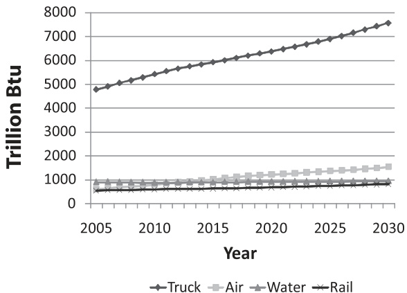
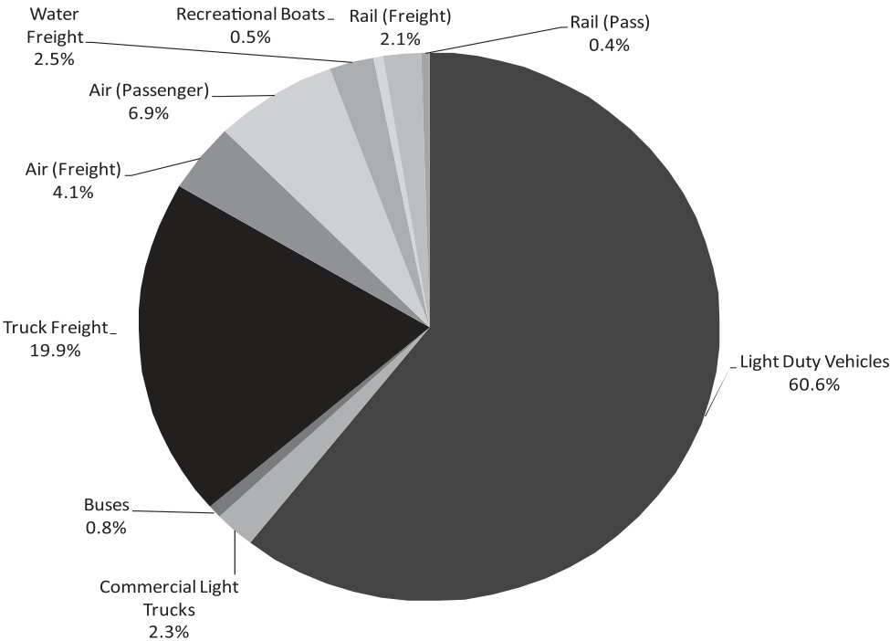
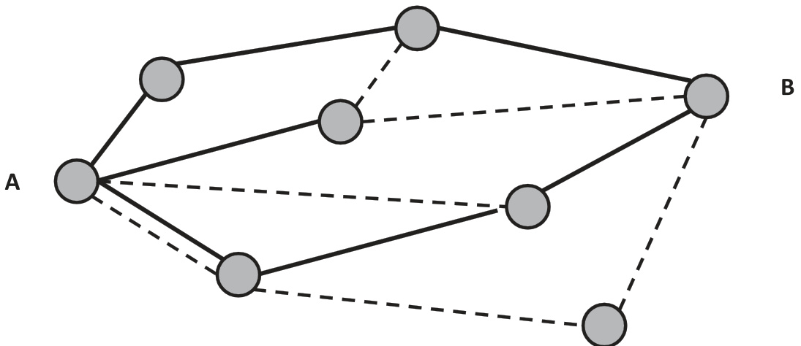
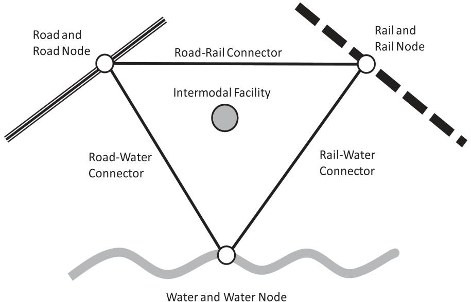
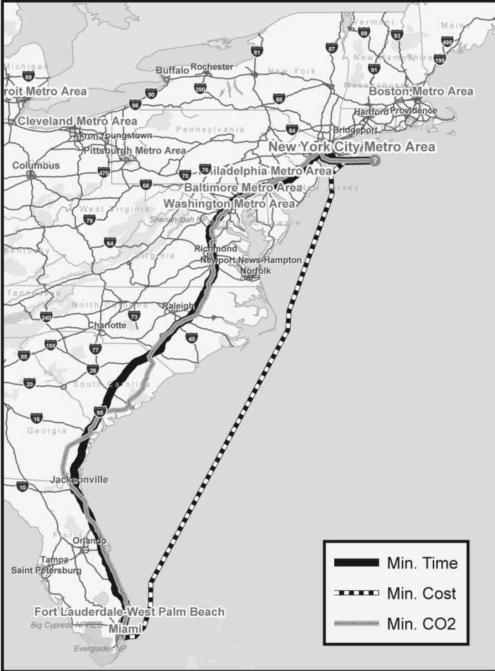

# Assessing Energy, Environmental, and Economic Tradeoffs in Intermodal Freight Transportation  

James J. Winebrake, James J. Corbett, Aaron Falzarano, J. Scott Hawker, Karl Korfmacher, Sai Ketha & Steve Zilora  

To cite this article: James J. Winebrake, James J. Corbett, Aaron Falzarano, J. Scott Hawker, Karl Korfmacher, Sai Ketha & Steve Zilora (2008) Assessing Energy, Environmental, and Economic Tradeoffs in Intermodal Freight Transportation, Journal of the Air & Waste Management Association, 58:8, 1004-1013, DOI: 10.3155/1047-3289.58.8.1004  

To link to this article:  https://doi.org/10.3155/1047-3289.58.8.1004  

# Assessing Energy, Environmental, and Economic Tradeoffs in Intermodal Freight Transportation  

James J. Winebrake Department of STS/Public Policy, Rochester Institute of Technology, Rochester, NY  

James J. Corbett Marine Policy Program, College of Marine and Earth Studies, and Department of Civil and Environmental Engineering, College of Engineering, University of Delaware, Newark, DE  

Aaron Falzarano Department of STS/Public Policy, Rochester Institute of Technology, Rochester, NY  

J. Scott Hawker Department of Software Engineering, Rochester Institute of Technology, Rochester, NY  

Karl Korfmacher Environmental Science Program, Rochester Institute of Technology, Rochester, NY  

Sai Ketha Department of Information Technology, Rochester Institute of Technology, Rochester, NY  

Steve Zilora Department of Information Technology, Rochester Institute of Technology, Rochester, NY  

# ABSTRACT  

This paper presents an energy and environmental network analysis model to explore tradeoffs associated with freight transport. The geospatial model uses an intermodal network built by the authors to connect various modes (rail, road, water) via intermodal terminals. Routes along the network are characterized not only by temporal and distance attributes, but also by cost, energy, and emissions attributes (including emissions of carbon dioxide, particulate matter, sulfur oxides, volatile organic compounds, and oxides of nitrogen). Decision-makers can use the model to explore tradeoffs among alternative route selection across different modal combinations, and to identify optimal routes for objectives that feature energy and environmental parameters (e.g., minimize carbon dioxide emissions). The model is demonstrated with three case studies of freight transport along the U.S. eastern seaboard.  

# IMPLICATIONS  

Freight transportation represents a large and growing component of global energy demand and emissions inventories. This paper discusses the environmental impacts of freight and presents a model that allows analysts to evaluate tradeoffs in an intermodal freight transportation context. The results shed new light on how we think about freight transportation and the importance of these energy, environmental, and economic tradeoffs.  

# INTRODUCTION  

Energy use and emissions from freight transport are increasing at a more rapid rate than other types of transportation. In the United States in 2005, freight transport accounted for approximately 6800 trillion Btu (TBtu) of energy consumption, representing $25.7\%$ of total nonmilitary transportation energy use. This consumption is expected to increase at an average rate of $1.8\%$ per annum (compared with $1.4\%$ for the transportation sector as a whole and compared with $1.1\%$ for the electric utility sector). As such, by 2030 energy consumption from freight transport is expected to grow by almost $60\%$ to 10,850 TBtu, representing $28.6\%$ of total transportation energy use.1 Along with this increase in energy consumption are concomitant and problematic increases in petroleum consumption and emissions of greenhouse gases (GHGs) and other pollutants.  

One way to address these trends is through careful consideration of routes along an intermodal freight system.2 Route selection based on environmental or energy criteria could help identify energy-efficient and environmentally sustainable ways to move freight throughout the United States and abroad. By identifying these opportunities, policymakers would have critical data to inform regulatory and/or policy decisions that might provide incentives for shippers to meet both private (profit-maximizing) and public goals.  

The purpose of this paper is to present a geospatial intermodal transportation network analysis model that can be used to identify energy, environmental, cost, and time tradeoffs associated with intermodal freight transport. The geographic information system (GIS)-based model uses an intermodal network built by the authors to connect various modes (rail, road, water) via intermodal facilities. Routes along the network are characterized not only by distance, time of delivery, and costs, but also by energy (Btu) and emissions (carbon dioxide $[\mathrm{CO}_{2}]$ , coarse particulate matter $[\mathrm{PM}_{10}].$ , oxides of nitrogen $\mathrm{[NO_{x}]}$ , volatile organic compounds [VOCs], and sulfur oxides $[\mathrm{SO_{x}J}]$ ). Policy-makers and decision-makers in the goods-movement industry can use the model to explore tradeoffs among alternative route selection across different modes and identify optimal routes for objective functions that feature energy and environmental parameters (e.g., minimize GHG emissions). We call the model the Geospatial Intermodal Freight Transport (GIFT) model.  

This paper first discusses the energy, environmental, and congestion issues surrounding freight transport in the United States and elsewhere. Next, the paper presents an overview of GIFT and its development methodology. The paper then demonstrates an application of GIFT for the case of freight transport along the U.S. eastern seaboard. Finally, the paper concludes with a discussion of future GIFT applications in the transport planning and policy areas.  

# BACKGROUND  

# Intermodal Freight Transport Defined  

Although several definitions for intermodal freight transport exist,3 this paper defines intermodal freight transport as “the movement of goods in one and the same loading unit or vehicle, which uses successive, various modes of transport (road, rail, water) without any handling of the goods themselves during transfers between modes.”4,5 This paper addresses containerized freight transport using movement along and transfers between multiple transportation modes.  

The intermodal system is much more complex than a monomodal system. From a stakeholder perspective, the system includes many actors: (1) shippers (those responsible for shipping freight and who make choices regarding transport modes and logistics); (2) receivers (those responsible for receiving freight); (3) drayage operators (those responsible for moving freight from primary terminals to secondary transfer facilities—e.g., moving a container from a major port to an off-site trucking facility for the purpose of hitching the container to a long-haul truck); (4) terminal operators (those responsible for managing terminal operations); (5) network operators (those responsible for managing the logistical network on which a shipment is traversing); and (6) policymakers and analysts interested in understanding the impact on the freight industry due to policy actions.5  

Geographically, the network includes nodes representing origins, destinations, ports, railyards, and intermodal terminals; and arcs linking these nodes on road, rail, air, or water.6 From a technical perspective, the system includes trucks, trains, planes, ships, and the host of equipment that allows intermodal terminals to operate effectively. In short, to understand intermodal freight transport is to understand a complex web of people, places, and technologies that are intertwined in a network constructed to deliver goods throughout the country in the most efficient, timely, and environmentally sustainable way possible.  

# Energy Use and Freight Transport Growth  

The United States spends approximately $6-7\%$ of its gross domestic product (GDP) on freight transport annually, and U.S. reliance on the freight transportation system has been growing considerably for some time.7 More generally, the role of exported and imported goods and services represented approximately $22\%$ of the U.S. GDP in 2005, up from $12\%$ in 1990 and $10\%$ in 1970 as product manufacturing moved to globalized markets.8 For example, the amount of U.S. domestic ton-miles of goods transported via multiple modes rose $12.2\%$ from 1993 to 2002, whereas the value of such goods leapt $68\%$ .7 These results are consistent with earlier analyses that showed increasing energy use (and GHG emissions) in freight transportation in the United States since the early 1970s.9–11 Similar trends are evident in the European Union (EU).12  

These trends are likely to continue in the coming decades because of increasing international and domestic trade. For instance, the total vehicle miles traveled (VMT) for freight trucking is expected to increase from 230 billion to 413 billion VMT between 2005 and 2030, an annual increase of $2.3\%$ . Likewise, rail freight transport is expected to increase from approximately 1550 billion ton-miles (BTM) to 2403 BTM $(1.7\%/\mathrm{yr})$ over the same period, whereas domestic marine freight is expected to increase from 650 to $844~\mathrm{BTM}$ $(1\%/\mathrm{yr})$ . Most notably, air freight is expected to increase from approximately 29 BTM to almost 102 BTM $(4.9\%/\mathrm{yr})$ during this period.1  

The U.S. Energy Information Administration has predicted significant increases in energy use in the freight sector because of these growth trends.1 Energy consumption trends are shown in Figure 1, which depicts expected future growth of freight energy use by mode from 2005 to 2030. Much of this growth will occur in the truck and air sectors, which are traditionally the most energy- and carbon-intensive modes of freight transport.13 Figure 2 shows the expected proportion of freight transport energy consumption relative to other transportation services in 2030.1  

  
Figure 1. Expected freight growth from 2005 to 2030.  

  
Figure 2. Energy consumption by transportation sector service, 2030.  

Some researchers expect that along with this increase in overall freight transport will be a rebalancing of modeshare in intermodal domestic freight transport. This increased intermodalism may be driven by highway congestion and general improvements in intermodal facility service operations.14 –19 In addition, increasing environmental pressures (either from environmentally conscious consumers and producers or from government policy) may encourage more rail, near-coast, and inland ship traffic; yet because final freight delivery will still require “last mile” truck service, more intermodal transport using rail/water for long-haul and truck for shorthaul is possible.  

# Emissions from Freight Transport  

With increasing freight transport activity (and accompanying energy use), we expect emissions to increase at a similar pace. Indeed, researchers have expressly noted these trends in the past.10 Currently, freight transport (including rail, truck, air, and domestic and international shipping to the United States) is responsible for approximately 470 million metric tons of $\mathrm{CO}_{2}$ $\mathrm{MMTCO}_{2}$ ) per year in the United States, or approximately $8.3\%$ of U.S. fossil fuel $\mathrm{CO}_{2}$ combustion emissions, and approximately $7.8\%$ of total $\mathrm{CO}_{2}$ emissions. This is consistent with other industrialized countries, such as Canada where freight transport represents approximately $9\%$ of total GHG emissions.20  

In addition to global pollutants such as $\mathrm{CO}_{2},$ other emissions associated with transporting freight can be significant.21–23 U.S. Environmental Protection Agency (EPA) data suggest that heavy-duty truck, rail, and water transport together account for approximately $50\%$ of recent $\mathrm{NO}_{\mathrm{x}}$ emissions and nearly $40\%$ of the PM emissions from all mobile sources.24,25 The largest portion of national emissions from freight comes from heavy-duty vehicles, which produce two-thirds of $\mathrm{NO}_{\mathrm{x}}$ and $\mathrm{PM}_{10}$ emissions. Emissions from marine vessels account for $18\%$ of freight $\mathrm{NO}_{\mathrm{x}}$ emissions and $24\%$ of freight $\mathrm{PM_{10}}$ emissions, followed by railroads at $15\%\ \mathrm{NO_{x}}$ and $12\%\ \mathrm{PM_{10}}$ . These pollutants are especially a concern for major freight thoroughfares along populated corridors, such as that represented by the Interstate 95 (I-95) corridor along the U.S. East Coast, and its sister, Interstate 5 (I-5) on the West Coast.26  

In the future, policymakers and planners will look to operational strategies to reduce overall pollution by changing how trucks, trains, and ships operate.27 Examples of such methods include reducing highway speeds, improving freight logistics, restricting engine idling time, and utilizing new technologies and fuels, to name a few.28,29 Also, reducing freight emissions can be achieved by shifting from higher to lower pollution-intensive modes (such as from trucks to rail).30 This paper will demonstrate the impacts of such modal shifts in an intermodal freight network.  

# Freight and Congestion  

Traffic congestion has also emerged as a major challenge facing freight transportation, particularly across the Atlantic seaboard. Major cities such as Boston; Washington, DC; and Philadelphia lie on the I-95 corridor and are among the top 12 most congested major metropolitan areas in the United States.26 In 2005, it is estimated that traffic congestion caused over 112.3 million hours of delay for passenger car and truck drivers in the Philadelphia area, 62.4 million hours in Baltimore, and 8.3 million hours in Richmond.31 Additional travel time incurred by highway congestion also results in excess fuel consumption, which subsequently leads to higher emissions and drives up costs for travelers and shippers. Trucks contribute to the increase in highway congestion at a rate more than double that of passenger cars.32 Intermodal freight networks may create an opportunity to reduce this congestion along our major highways by moving this freight to other modes.33  

# MODELING APPROACH  

# Overview  

Intermodal freight research does not have a long history, particularly with respect to the application of operation research techniques to intermodal problems.5 However, over the past 5 yr researchers have begun to apply such techniques to better understand these systems. In this paper we introduce the GIFT model to help evaluate the cost, time-of-delivery, environmental, and energy impacts associated with monomodal and intermodal freight transport.  

# Approaches to Modeling Intermodal Freight  

Network optimization models are an important tool for evaluating freight transport logistics. Two important types of network optimization models are trans-shipment models and shortest-path models. Model choice depends on the problem being studied.  

In trans-shipment models, macro-level supply and demand for commodities are identified (usually exogenously). The network models are used to determine how to meet demand at least cost given constraints on supply and delivery mechanisms. An example of this type of modeling could be a manufacturer looking to find the least-cost way to distribute product from several production facilities to several distribution outlets throughout the country.  

Integrated into these models could be shortest-path algorithms, such as the Dijkstra algorithm,34 to ensure the model selects the distribution network that achieves least cost. Researchers have used such models to better understand large-scale intermodal freight transport in the United States.35–37 These intermodal freight models are unique in that they must include the costs (penalties) associated with intermodal terminal operations, as discussed in detail by others,38 and they must reflect the constraint that transferring freight from one mode to another can only occur at dedicated transfer facilities such as ports and train yards.  

The integration of these modeling approaches with GIS is also relatively new. For example, Boile applied a GIS-based system (TransCAD) with a linear programming approach to conduct shortest-path analyses of intermodal freight movement.39 Standifer and Walton also integrated highway, rail, and marine networks in an intermodal GIS environment to study freight transport,40 as did others.36 Finally, recent work by the U.S. Bureau of Transportation Statistics has combined some shortest path algorithms in a GIS environment to validate travel distances for freight movement in the United States.41  

It is worthwhile to put our work in the context of general freight modeling objectives and to recognize that the modeling approach taken needs to align with the overall purpose of the model. We identify three different types of modeling purposes and the modeling approaches that might be best suited for these purposes: (1) routing and logistics models, (2) freight systems models, and (3) policy tradeoff models.  

Routing and Logistics Models. These models are intended to inform decision-makers (often shippers) of the best way to move freight from origin to destination. The models generally focus on a single optimizing variable, such as time or distance. These optimization models are common and require fairly detailed knowledge of a particular shipper’s objectives and constraints. Examples that many readers may be familiar with are the models offered by MapQuest or Google Map, whereby a user can evaluate shortest time or distance paths from an origin to a destination. Freight service providers use similar models in their business operations.  

Freight Systems Models. These models are intended to provide information about an entire system (e.g., cargo flow system) to decision-makers who may be more interested in macro-level impacts on a transportation network. These systems models can be exercised through a variety of assumptions placed on the system to determine, for example, the resiliency of the system to disruptions, or the overall impacts on congestion or air quality due to system flows.  

Policy Tradeoff Models. These models would involve atypical elements of routing/logistics models and systems models, such as human health, network infrastructure, community welfare, and environmental concerns. They are intended to identify tradeoffs associated with alternative policy decisions that expand the current focus on economic efficiency. On the one hand, these models use routing/logistics models to simulate the likely behavior of individual stakeholders affected by policy decisions. On the other hand, these models must take a systems approach and incorporate systems modeling techniques, because policies affect multiple stakeholders (i.e., the system as a whole). There are few examples of these types of models because the question of the interaction of the freight transportation system with other social goals is only now gaining in importance; however, several recently published papers would fit into this category.42–44  

The model discussed in this paper fits best into this third category. We are not looking for an optimal route for a particular situation; rather, we are interested in the impact of policies on diverse stakeholders and across a range of situations, past, present, and future. By analyzing a diversity of scenarios, we can assess various policy options and identify numerous economic, environmental, and social tradeoffs.  

# Our Approach  

Our modeling approach can be illustrated through a simple example. Figure 3 shows a network of alternative pathways to move freight from point A to point B. Freight can move along pathways through each node (shown by the circles). Certain network segments (represented by lines connecting the nodes) may be accessible only by truck, or ship, or rail. Some routes may be accessible by multiple modes. Nodes and segments can be associated with metropolitan traffic characteristics, descriptive of congestion delays, engine load, and emissions patterns that may differ from open freeway, long-haul rail, and/or interport segments.  

  
Figure 3. Example of a freight network from point A to point B (solid line $=$ mode 1, dashed line $=$ mode 2).  

The decision-maker may wish to analyze alternative pathways from A to B under various assumptions, constraints, and objectives. For example, one may want to know what pathway leads to the least-cost transport of freight from A to B, a traditional context for the application of optimization routines. To analyze this, each route from node $i$ to node $j$ must include “attribute data” that help characterize attributes along that route. That dataset would include information about mode accessibility, operating costs, average speed, distance, and emissions, among others. For a least-cost example, we can set up a network optimization model of the form:  

$$
\operatorname*{min}_{\mathrm{ijk}}\,\sum_{\mathrm{ijk}}C_{\mathrm{ijk}}\cdot X_{\mathrm{ijk}}(2)
$$  

where $C_{\mathrm{ijk}}$ is the operating cost of moving freight from node $i$ to node $j$ using mode $k;$ and $X_{\mathrm{ijk}}$ is a binary variable that takes on a value of 1 if mode $k$ is used to move freight from $i$ to $j,$ and 0 otherwise. We have simplified this equation for this paper; in our GIFT model, cost components $(C_{\mathrm{ijk}})$ could be complex functions that include variable, fixed, and other components that affect total segment cost. In addition, these objective functions can include multiple criteria with appropriate coefficient weights.  

In our approach, we model this network system with other optimization objectives. For example, we may want to explore the pathway (again, characterized by routes and modes) that minimizes emissions of GHGs (or other pollutants). We might then apply the following objective:  

$$
\operatorname*{min}_{\downarrow\uparrow}\sum_{\downarrow\downarrow}E_{\downarrow\downarrow}\cdot X_{\mathrm{ijk}}
$$  

where $E_{\mathrm{ijk}}$ is the emissions associated with moving freight from node $i$ to node $j$ using mode $k$ . (Again, for simplicity we don’t show the potentially complex equations associated with calculating segment emissions). In addition, associated with this formulation would be any constraints placed on the model—such as the requirement that freight must be moved from point A to point B. Other constraints, such as a constraint on time-of-delivery are also possible and would be useful if the model is to be applied in a logistics routing fashion.  

Through GIFT, we apply this general approach in a GIS environment (ESRI’s ArcView version 9.1). By adding energy and environmental attribute information to segments of the national highway, rail, and waterway network and to intermodal transfer facilities, we can determine not only the least-cost or shortest-distance intermodal routes for moving freight, but also routes that minimize energy consumption and emissions of $\mathrm{CO}_{2}$ , $\mathrm{PM}_{10},\,\mathrm{NO}_{\mathrm{x}},\,\mathrm{SO}_{\mathrm{x}},$ and VOCs.  

By analyzing the network using energy and environmental objective functions, we can identify and explore tradeoffs among these goals and more traditional ones (operating cost and time-of-delivery). We can also evaluate policy mechanisms that can be used (such as modal taxes or subsidies) to determine how they might affect the overall energy and environmental character of freight transport. The next two sections present the GIFT model in more detail and apply it to a case study of the I-95 corridor.  

# The GIFT Model  

We built the GIFT model in ArcGIS 9.1 using ArcGIS Network Analyst and custom software that extends ArcGIS. We use a GIS environment for our work for two important reasons: (1) GIS allows for increased functionality, usability, and visualization of impacts; and (2) GIS allows us to attribute emissions geospatially, which can later be used with atmospheric dispersion models and health impact models to determine the impacts of emissions from freight. We constructed our intermodal network using road, rail, and waterway routes provided by the 2005 version of the National Transportation Atlas Database (NTAD), currently maintained by the U.S. Department of Transportation’s Bureau of Transportation Statistics (BTS). NTAD also includes data on intermodal facility locations.  

The key to building the intermodal network was creating nodes (modal transfer points) where the independent modal networks (road, rail, and waterway) intersected at an intermodal facility. To do this, we created new, “artificial” geographic data features as shown in Figure 4. The new features are: (1) road-to-rail connection, (2) road-to-water connection, and (3) rail-to-water connection. These connections are artificial in the sense that they are merely representations of actual transfer infrastructure. Notice in Figure 4 that connectivity occurs around a particular intermodal facility location. Using this construct, we can allow freight to transfer from one mode to another along these new connection arcs. In addition, we can create attributes for each intermodal arc that account for cost, time, energy, and emissions associated with such transfers. Details on how this network was programmed in the ArcGIS environment are discussed in related work.45  

  
Figure 4. Depiction of new nodes at intermodal transfer points  

ArcView Network Analyst is currently able to solve shortest-path routes from an origin to destination using distance and time objectives, because both are common GIS attributes included in most network datasets. We expanded the attribute set for each network segment by including attributes associated with cost, energy use, and emissions. These new attributes are as follows, with appropriate input and output units defined. For the most part, our inputs are identified in per mile-TEU units for network segments and per TEU for transfer nodes. Note that a TEU is a common measure of goods movement and stands for $^{\prime\prime}20.$ -ft equivalent unit.” TEU is essentially a volumetric measure (as opposed to weight) and represents the equivalent volume of a 20-ft container. Our outputs are identified in per-trip units.  

Energy: Input in Btu/TEU-mi for transportation segments or Btu/TEU for transfer facilities; output in Btu/trip or million Btu (mmBtu)/trip. Emissions: Input in g/TEU-mi or g/TEU; output in g/trip or kg/trip for VOCs, CO, $\mathrm{NO}_{\mathrm{x}},$ PM, $\mathrm{SO}_{\mathrm{x}},$ and CO2. Time: Input in hr/TEU-mi or hr/TEU; output in hr/trip. • Distance: Input in mi/TEU; output in mi/trip. Operating Cost: Input in US\$/TEU-mi or ${\mathrm{USS}}/{}$ TEU; output in US\$/trip.  

With these data included as attributes in the intermodal network, we programmed ArcView’s Network Analyst to conduct shortest-path analyses on the basis of each of these attributes. For example, GIFT can generate intermodal routes minimizing time-of-delivery, $\mathrm{CO}_{2},$ energy, or any other of the abovementioned parameters or weighted combinations of parameters. As a final point, we have used the best publicly available data for our route segments and nodes for the attributes mentioned above. These data must often be generalized given the dearth of empirical emissions studies (particularly at transfer nodes). Users with more specific data could easily integrate them into our model and improve the accuracy of the model’s results; however, even with generalized data, we demonstrate some important insights that give pause to conventional thinking about freight transportation logistics. Also, by making it easy to change data, we enable analysis of possible future scenarios and the impact of various policy options (e.g., subsidies for shippers implementing emission reduction technologies).  

# THREE CASE STUDIES  

# Overview of Cases  

To demonstrate GIFT, we outline three case studies of route selection from an origin to a destination along the U.S. eastern seaboard. In GIFT, our case studies are used to exercise the model to investigate intermodal route tradeoffs on the basis of environmental and other objective functions.  

The first case we analyze is one in which the origin is open water (OW) off of the coast of New York City (NYC) and the destination is Miami, FL. The second case is another long-haul journey in which the origin is a hypothetical distribution center located in Rochester, NY, and the destination is Jacksonville, FL. The third case is a short-haul route with an origin located in northern New Jersey and the destination is Boston, MA. The case studies are shown in Table 1.  

# Case Study Data  

The data used for the case studies were drawn from a variety of sources. Data included both segment attributes and intermodal transfer “penalties,” as shown in Tables 2 and 3.  

Emissions and energy-use segment data for each mode were obtained using a combination of the Total  

Table 1. Origins and destinations for each case study.   

<html><body><table><tr><td>Case Number</td><td>Origin</td><td>Destination</td></tr><tr><td></td><td>NYCOW</td><td>Miami, FL</td></tr><tr><td>=</td><td>Rochester,NY</td><td>Jacksonville,FL</td></tr><tr><td>川</td><td>NY/NJMetro</td><td>BostonMetro</td></tr></table></body></html>  

Energy and Emissions Analysis for Marine Systems (TEAMS) model and the most recent Greenhouse Gas, Regulated Emissions, and Energy Use in Transportation (GREET version 1.7) model.46–48 With the exception of $\mathrm{CO}_{2},$ tailpipe and stack emissions were extracted for all pollutants; this allows us to attribute these local pollutants geospatially in later work. Because $\mathrm{CO}_{2}$ is a global pollutant and therefore geospatial resolution is not important, we used total fuel-cycle emissions, which include carbon emissions associated with processing and delivering the fuel. The use of total fuel-cycle emissions allows us to compare carbon emissions in total from the use of different fuels and fuel blends (e.g., biodiesel fuels). The emissions data for the intermodal transfers were derived using the Port of Los Angeles Baseline Air Emissions Inventory 2001 report that was released in July 2005, and included emissions and activity estimates for a variety of port handling and transfer equipment.49  

Modal operating costs for each segment were derived from the Four Corridor Case Studies of Short-Sea Shipping Services prepared by Global Insight.50,51 Intermodal transfer costs were obtained from a report on short-sea shipping and are a sum of the port cost and the local drayage costs outlined in that report.52  

Table 2. Data for transport modes for case studies.   

<html><body><table><tr><td>Mode of Transport</td><td>($/TEU-mi)</td><td>Energy (Btu/TEU-mi)</td><td>CO2 (g/TEU-mi)</td><td>PM10 (g/TEU-mi)</td><td>SOx (g/TEU-mi)</td></tr><tr><td>Truck</td><td>0.87</td><td>10,704</td><td>1,001</td><td>0.12</td><td>0.22</td></tr><tr><td>Rail</td><td>0.55</td><td>2,590</td><td>201</td><td>0.09</td><td>0.04</td></tr><tr><td>Ship</td><td>0.50</td><td>13,040</td><td>1,094</td><td>0.98</td><td>3.33</td></tr></table></body></html>  

Table 3. Data for intermodal transfer penalties for case studies.   

<html><body><table><tr><td>Type of Transfer</td><td>Time (hr/TEU)</td><td>Cost ($/TEU)</td><td>Energy (Btu/TEU)</td><td>CO2 (g/TEU)</td><td>PM10 (g/TEU)</td><td>S0x (g/TEU)</td></tr><tr><td>Ship-rail</td><td>2</td><td>67.50</td><td>16,400</td><td>360</td><td>20</td><td>11</td></tr><tr><td>Ship-truck</td><td>2</td><td>67.50</td><td>60,100</td><td>380</td><td>22</td><td>11</td></tr><tr><td>Truck-rail</td><td>2</td><td>67.50</td><td>75,500</td><td>407</td><td>22</td><td>8</td></tr></table></body></html>  

Table 4. Results for case study I.   

<html><body><table><tr><td>OW-Miami, FL Route Analysis</td><td colspan="8"></td></tr><tr><td></td><td>C02 (kg)</td><td>S0×(g)</td><td>PM10 (g)</td><td>Energy (mmBtu)</td><td>($) 15o2</td><td>Time (hr)</td><td>Distance (mi)</td><td>PredominantMode</td></tr><tr><td>Min CO2</td><td>390</td><td>387</td><td>255</td><td>5.13</td><td>925</td><td>61</td><td>1432</td><td>Rail</td></tr><tr><td>Mincost</td><td>1295</td><td>3889</td><td>1164</td><td>15.42</td><td>668</td><td>49</td><td>1185</td><td>Ship</td></tr><tr><td>Mintime</td><td>1388</td><td>641</td><td>277</td><td>15.24</td><td>1226</td><td>25</td><td>1376</td><td>Truck</td></tr></table></body></html>  

  
Figure 5. Routing results for case study I.  

Finally, intermodal transfer time penalties for ship transfers were taken from the Twin Ports Intermodal Freight Terminal Study.49 The truck-to-rail transfer is an estimation using data taken from the Los Angeles/Long Beach Inventory rail switching times.51,53  

Case Study I: New York City OW to Miami, FL We ran a case illustrating a container on a vessel in OW approximately $90\ \mathrm{mi}$ outside the port of New York. The ultimate destination for the container was Miami, FL. We used GIFT to run an intermodal route optimization on the basis of three different objectives: minimize $\mathrm{CO}_{2},$ minimize cost, and minimize time. Results from our analysis are shown in Table 4 and Figure 5. We also show in Table 4 the values of other key attributes, such as $\mathrm{SO}_{\mathrm{x}},$ $\mathrm{PM}_{10},$ energy, and distance.  

The results of case study I clearly indicate three modal preferences for each of our objectives. To minimize $\mathrm{CO}_{2},$ the mode of choice is predominantly rail; to minimize cost, the choice is predominantly ship; and to minimize time, the choice is predominantly truck.  

Table 5. Results for case study II.   

<html><body><table><tr><td></td><td colspan="8">Rochester, NY-Jacksonville, FL Route Analysis</td></tr><tr><td></td><td>C02 (kg)</td><td>S0x (g)</td><td>PM0 (g)</td><td>Energy (mmBtu)</td><td>($) 150]</td><td>Time (hr)</td><td>Distance (mi)</td><td>Predominant Mode</td></tr><tr><td>Min CO2</td><td>328</td><td>83</td><td>162</td><td>4.18</td><td>866</td><td>54</td><td>1278</td><td>Rail</td></tr><tr><td>Mincost</td><td>328</td><td>83</td><td>162</td><td>4.18</td><td>866</td><td>54</td><td>1278</td><td>Rail</td></tr><tr><td>Mintime</td><td>1158</td><td>255</td><td>139</td><td>12.39</td><td>1007</td><td>17</td><td>1157</td><td>Truck</td></tr></table></body></html>  

From our results one can identify the tradeoffs that exist between lowering $\mathrm{CO}_{2}$ emissions and reducing time. Although the least- $\mathrm{{\cdotCO}}_{2}$ route emits about one-third of the $\mathrm{CO}_{2}$ from the least-time route, the journey lasts approximately $36\,\mathrm{hr}$ longer. When comparing the least- $\mathrm{CO}_{2}$ case (predominantly rail) with the least-cost case (predominantly ship), the $\mathrm{CO}_{2}$ savings are approximately $900\ \mathrm{kg/}$ TEU and the cost differential is about $\mathbb{S}250$ /TEU. For the policymaker only interested in costs and carbon, this would imply a tradeoff of roughly ${\mathbb{S}}280/\mathrm{t}$ of $\mathrm{CO}_{2}$ (or about ${\mathbb{S}}75/{\mathrm{t}}$ carbon). This is a bit higher than the ${\mathbb{S}}5{-}15/\mathfrak{t}$ carbon at which some global emissions markets have priced carbon. From a policy standpoint, our result suggests that a tax of greater than ${\bf575/t}$ carbon would be needed for a profit-maximizing shipper to switch (in this case) from rail to ship. But looking at only these two variables ignores the other important attributes related to this decision, including time-of-delivery, local pollutants, and geospatial location of those pollutants (e.g., over water vs. over land). One of the values of our model is that we can begin to evaluate some of these multiattribute tradeoffs.  

Case Study II: Rochester, NY, to Jacksonville, FL This case study is a common representation for many domestic shippers. Here, we have a container at a landbased local distribution center in Rochester, NY (origin), traveling to Jacksonville, FL (destination). Results from our analysis are shown in Table 5.  

These results once again depict the tradeoffs associated with different modal choice. Here, both the least$\mathrm{CO}_{2}$ route and the least-cost route are the same—predominantly rail, with some movement by truck to an intermodal truck-rail transfer facility near Buffalo, and once again back to truck near Jacksonville for final delivery. Given the lack of an adequate intermodal transfer facility within the Rochester area, the freight made the initial leg of the journey on highway to Buffalo and then transferred to rail. This type of event may help transportation planners and policymakers when determining the need for appropriate intermodal freight facilities in their respective area. This example also illustrates opportunities to modify the network by adding or subtracting nodes or segments and seeing what impact these modifications would have on the overall intermodal route logistics. The emissions and economic benefits associated with the least- $\cdot{\mathrm{CO}_{2}}$ route must be considered in light of the additional $37~\mathrm{hr}$ it takes to deliver this shipment.  

# Case Study III: NY/NJ Metro to Boston, MA, Metro  

The third case study is one looking at a container originating approximately $15\ \mathrm{mi}$ west of the Newark, NJ, airport and destined for Boston, MA. Results from this analysis are shown in Table 6.  

Here, the route that minimizes time and cost uses predominantly trucking during its journey, with the only difference being a slight diversion in the Connecticut area to reduce distance (directly related to cost) by moving from a slightly longer but quicker highway to a shorter but slower road. However, the least- $\mathrm{CO}_{2}$ route uses rail and makes two intermodal switches.  

# Case Analysis Summary  

Although the intention of our case analysis is to demonstrate the model, a quick look at the resulting tables generates several interesting insights.  

First, we notice the significant advantage that trucking presents for time-of-delivery, dominating routes in all three cases in which time was an objective. This time-of-delivery advantage usually comes at a cost penalty (especially for longhaul trips) and an emissions penalty. Second, we observe that there are specific emissions tradeoffs associated with some route selection. For example, in case study III, the least- $\mathrm{CO}_{2}$ route also represents higher emissions of $\mathrm{PM_{10}}$ . This is actually driven by emissions occurring at the intermodal transfer facilities. Therefore, particularly for short-haul activity, one must consider the impacts of intermodal transfers on emissions and energy consumption.  

Table 6. Results for case study III.   

<html><body><table><tr><td></td><td colspan="8">New York/New Jersey-Boston Route Analysis</td></tr><tr><td></td><td>CO2 (kg)</td><td>S0x (g)</td><td>PM10 (g)</td><td>Energy (mmBtu)</td><td>($) 1503</td><td>Time (hr)</td><td>Distance (mi)</td><td>PredominantMode</td></tr><tr><td>Least CO2</td><td>74</td><td>31</td><td>70</td><td>1.05</td><td>299</td><td>15</td><td>286</td><td>Rail</td></tr><tr><td>Leastcost</td><td>245</td><td>54</td><td>29</td><td>2.62</td><td>213</td><td>5</td><td>245</td><td>Truck</td></tr><tr><td>Leasttime</td><td>253</td><td>56</td><td>30</td><td>2.70</td><td>220</td><td>4</td><td>253</td><td>Truck</td></tr></table></body></html>  

We end this section by presenting an important caveat to our results. The generalization of these results is difficult given that they are dependent on our origin and destination points. Future work may be to test a set of origin-destination pairs that have controlled characteristics for a more systematic analysis. We also caution readers that our demonstration lacks the appropriate sensitivity analysis that might be associated with a full-blown case study of freight movement along the U.S. eastern seaboard. Future work will include integrated parametric sensitivity analyses that conform to the probability distributions we might expect for the data we have, and the inclusion of multiattribute objective functions. Nevertheless, our demonstration indicates the rich types of analyses that can be conducted using the GIFT model.  

The cases we demonstrate also are generated using single criterion objective functions. The use of single objective (such as cost, or time, or $\mathrm{CO}_{2}$ ) allows us to explore the extreme values and tradeoffs associated with different criterion choices. Our model can also use a more complex multiobjective criteria function as our objective function on the basis of values elicited from various stakeholder groups.  

# CONCLUSIONS  

This paper introduces the GIFT model. Using this model, analysts can analyze the cost, time-of-delivery, energy, and environmental impacts of intermodal freight transport. The paper discusses the development of GIFT and demonstrates its use for three case studies.  

We believe GIFT can be used to study several interesting problems currently facing freight transportation. For example, GIFT can be used to study the impacts of infrastructure investment along our transportation networks by: creating nodes that represent proposed new intermodal transfer facilities; reducing intermodal transfer penalties to represent investments in improved freight-handling equipment; or increasing speed limits to evaluate the potential impact of highway expansion. Likewise, an opposite approach can be used to evaluate the impacts of freight movement due to natural- or human-caused disasters that might affect nodes and/or segments in the U.S. transportation network.  

We are also aware of the geospatial dimensions of pollution, particularly local and regional pollutants such as $\mathrm{NO}_{\mathrm{x}},$ $\mathrm{SO}_{\mathrm{x}},$ and PM. GIFT can potentially ascribe emissions geospatially, so for example, one could evaluate the spatial distribution of $S O_{\mathrm{x}}$ emissions for each of the routes presented above. That distribution may then be integrated into pollution dispersion models and ultimately health impact analyses. One would then be able to link the environmental impacts of freight transport with health conditions. In such cases, one may find that although certain emissions may be higher for certain modes (e.g., $S O_{\mathrm{x}}$ for ships), the location of those emissions (e.g., over the ocean), may not have as detrimental an impact on human health as other, less polluting modes.  

GIFT could also be run to study entire cargo flow systems using a set of origin-destination (O-D) pairs representing cargo flow segment endpoints. We have developed a method to conduct these network optimization analyses using O-D pairs and will be applying these techniques in the future.  

Lastly, policymakers can use GIFT to test the impacts of carbon taxes, fuel taxes, or modal subsidies by adjusting costs in GIFT and observing the routing impacts due to these economic instruments. For example, to simulate the potential impacts of a carbon tax on fuel, the user could increase fuel costs in the model to see how this increase would affect routing, if at all. Policy-makers could also modify emissions factors or energy consumption to simulate the impact of new emissions control technologies or fuel efficiency mandates.  

# REFERENCES  

1. Annual Energy Outlook 2007 with Projections to 2030; DOE/EIA-0383; U.S. Energy Information Administration; U.S. Department of Energy: Washington, DC, 2007. 2. Owens, E.; Lewis, C.A. ISTEA and Intermodalism: a User and Reference Guide to Intermodalism; SWUTC/02/466050-1; Southwest Region University Transportation Center: Austin, TX, 2002.   
3. Bontekoning, Y.M.; Macharis, C.; Trip, J.J. Is a New Applied Transportation Research Field Emerging? A Review of Intermodal Rail-Truck Freight Transport Literature; Transport. Res. Part A 2004, 38, 1-34.   
4. Glossary for Transport Statistics; Intersecretariat Working Group on Transport Statistics, 2nd ed.; Eurostat; European Conference of Ministers of Transport; United Nations Economic Commission for Europe Statistical Division: Geneva, Switzerland, 1997; p 2.   
5. Macharis, C.; Bontekoning, Y.M. Opportunities for or in Intermodal Freight Transport; Eur. J. Op. Res. 2004, 153, 400-416. 6. Janic, M. Modeling the Full Costs of an Intermodal and Road Freight Transport Network; Transport. Res. Part D 2007, 12, 33-44.   
7. National Transportation Statistics 2005; Bureau of Transportation Statistics; U.S. Department of Transportation; Research and Innovation Technology Administration: Washington, DC, 2005. 8. Bureau of Economic Analysis, National Income and Product Accounts; Interactive Access to National Income and Product Accounts Tables; available at http://www.bea.gov/bea/dn/nipaweb/index.asp (accessed June 12, 2007).   
9. Greening, L.A.; Ting, M.; Davis, W.B. Decomposition of Aggregate Carbon Intensity for Freight: Trends from 10 OECD Countries for the Period 1971–1993; Energy Econ. 1999, 21, 331-361.   
10. Schipper, L.; Scholl, L.; Price, L. Energy Use and Carbon Emissions from Freight in 10 Industrialized Countries: an Analysis of Trends from 1973 to 1992; Transport. Res. Part D 1997, 2, 57-76.   
11. Vanek, F.M.; Morlok, E.K. Improving the Energy Efficiency of Freight in the United States through Commodity-Based Analysis: Justification and Implementation; Transport. Res. Part D 2000, 5, 11-29.   
12. Koopman, G.J. Long-Term Challenges for Inland Transport in the European Union: 1997–2010; Energy Policy 1997, 25, 1151-1161.   
13. U.S. Greenhouse Gas Inventory Report, Annex 2; EPA No. 430-R-06-002; U.S. Environmental Protection Agency: Washington, DC, 2006.   
14. Arnold, P.; Peeters, D.; Thomas, I. Modeling a Rail/Road Intermodal Transportation System; Transport. Res. Part E 2004, 40, 255-270.   
15. Ballis, A.; Golias, J. Comparative Evaluation of Existing and Innovative Rail-Road Freight Transport Terminals; Transport. Res. Part A 2002, 36, 593-611.   
16. Ballis, A.; Golias, J. Towards the Improvement of a Combined Transport Chain Performance; Eur. J. Op. Res. 2004, 152, 420-436.   
17. Golob, T.; Regan, A.C. Impacts of Highway Congestion on Freight Operations: Perceptions of Trucking Industry Managers; Transport. Res. Part A 2001, 35, 577-599.   
18. Golob, T.F.; Regan, A.C. Freight Industry Attitudes Towards Policies to Reduce Congestion; Transport. Res. Part E 2000, 36, 55-77.   
19. Shinghal, N.; Fowkes, T. Freight Mode Choice and Adaptive Stated Preferences; Transport. Res. Part E 2002, 38, 367-378.   
20. Steenhof, P.; Woudsma, C.; Sparling, E. Greenhouse Gas Emissions and the Surface Transport of Freight in Canada; Transport. Res. Part D 2006, 11, 369-376.   
21. Hecht, J. The Environmental Effects of Freight; Organisation for Economic Cooperation and Development: Paris, France, 1997.   
22. Energy Efficiency Initiative, Vol. 1: Energy Policy Analysis; International Energy Agency: Paris, France, 1998.   
23. Skjølsvik, K.O.; Andersen, A.B.; Corbett, J.J.; Skjelvik, J.M. Study of Greenhouse Gas Emissions from Ships; Report MT00-a23-038, MEPC 45/8; International Maritime Organization: Trondheim, Norway, 2000.   
24. Inventory of U.S. Greenhouse Gas Emissions and Sinks: 1990 –2003; EPA 430-R-05-003; U.S. Environmental Protection Agency: Washington, DC, 2005.   
25. National Air Pollutant Emission Trends, 1970 –2002; U.S. Environmental Protection Agency; available at http://www.epa.gov/ttn/chief/trends/ (accessed May 11, 2005).   
26. Short-Sea and Coastal Shipping Options Study; Cambridge Systematics; available at http://144.202.240.28/pman/projectmanagement/Upfiles/ reports/full343.pdf (accessed November 20, 2005).   
27. Ang-Olson, J.; Schroeer, W. Energy Efficiency Strategies for Freight Trucking: Potential Impact on Fuel Use and Greenhouse Gas Emissions. Presented at the 81st Annual Meeting of the Transportation Research Board, Washington, DC, 2002.   
28. Komor, P. Reducing Energy Use in U.S. Freight Transport; Transport Policy 1995, 2, 119-128.   
29. Smartway Transport Partnership; U.S. Environmental Protection Agency; available at http://www.epa.gov/smartway/smartway_ fleets_strategies.htm (accessed March 13, 2007).   
30. Nijkamp, P.; Reggiani, A.; Bolis, S. European Freight Transport and the Environment: Empirical Applications and Scenarios; Transport. Res. Part D 1997, 2, 233-244.   
31. Schrank, D.; Lomax, T. 2005 Urban Mobility Report; Texas Transportation Institute: College Station, TX, 2005.   
32. Ostria, S.J. 2010 and Beyond: a Vision of America’s Transportation Future; American Association of State Highway and Transportation Officials: Fairfax, VA, 2004.   
33. Freight-Rail Bottom Line Report; American Association of State Highway and Transportation Officials: Washington, DC, 2003.   
34. Zhan, F.B. Three Fastest Shortest Path Algorithms on Real Road Networks: Data Structures and Procedures; J. Geo. Info. & Decision Anal. 1997, 1, 69-82.   
35. Luo, M.; Grigalunas, T.A. A Multimodal Transportation Simulation Model for U.S. Coastal Container Ports. Presented at the 2003 Transportation Research Board Conference, Washington, DC, 2002.   
36. Southworth, F. In Geographic Information Systems in Transportation Research; Thill, J.-C., Ed.; Pergamon: Amsterdam, the Netherlands, 2000; pp 147-166.   
37. Xu, J.; Hancock, K.L.; Southworth, F. Simulation of Regional Freight Movement with Trade and Transportation Multi-Networks; Transport. Res. Record 2002, 1854, 152-161.   
38. Ziliaskopoulos, A.; Wardell, W. An Intermodal Optimum Path Algorithm for Multimodal Networks with Dynamic Arc Travel Times and Switching Delays; Eur. J. Op. Res. 2000, 125, 486-502.   
39. Boile, M.P. Intermodal Transportation Network Analysis—a GIS Application. Presented at the 10th Mediterranean Electrotechnical Conference, Lemesos, Cyprus, 2000.   
40. Standifer, G.; Walton, C.M. Development of a GIS Model for Intermodal Freight; Southwest Regional University Transportation Center: Austin, TX, 2000.   
41. Lewis, S.; Ammah-Tagoe, F. How Freight Moves: Estimating Mileage and Routes Using an Innovative GIS Tool; TR-001; Bureau of Transportation Statistics: Washington, DC, 2007.   
42. Corbett, J.J.; Winebrake, J.J.; Green, E.H.; Kasibhatla, P.; Eyring, V.; Lauer, A. Mortality from Ship Emissions: a Global Assessment; Environ. Sci. Technol. 2007, 41, 8233-8239.   
43. Wang, C.; Corbett, J.J.; Firestone, J. Improving Spatial Representation of Global Ship Emissions Inventories; Environ. Sci. Technol. 2008, 42, 193-199.   
44. Wang, C.; Corbett, J.J.; Winebrake, J.J. Cost Effectiveness of Reducing Ship Sulfur Emissions; Environ. Sci. Technol. 2007, 41, 8233-8239.   
45. Hawker, J.S.; Falzarano, A.; Ketha, S.; Korfmacher, K.; Winebrake, J.; Zilora, S. Intermodal Transportation Network Custom Evaluators for Environmental Policy Analysis. Presented at the ESRI International User Conference, San Diego, CA, 2007.   
46. Wang, M.Q. GREET 1.5-Transportation Fuel-Cycle Model, Vol. 1; ANL/ ESD-39; Argonne National Laboratory: Argonne, IL, 1999.   
47. Wang, M.Q. Development and Use of GREET 1.6 Fuel-Cycle Model for Transportation Fuels and Vehicle Technologies; ANL/ESD/TM-163; Center for Transportation Research at Argonne National Laboratory: Argonne, IL, 2001.   
48. Winebrake, J.J.; Corbett, J.J.; Meyer, P. Energy Use and Emissions from Marine Vessels: a Total Fuel Life Cycle Approach; J. Air & Waste Manage. Assoc. 2007, 57, 102-110.   
49. Port of Los Angeles Baseline Air Emission Inventory—2001; Starcrest Consulting Group: Los Angeles, CA, 2005.   
50. Four Corridor Case Studies of Short-Sea Shipping Services; Executive Summary Prepared for the U.S. Department of Transportation, Washington, DC, by Global Insight and Reeve and Associates: Yarmouthport, MA, 2006.   
51. The Public Benefits of the Short-Sea Intermodal System; National Ports and Waterways Institute; available at http://www.shortsea.us/benefits_ study.pdf (accessed March 30, 2006).   
52. Twin Ports Intermodal Freight Terminal Study: Evaluation of Shipper Requirements and Potential Cargo Required to Establish a Rail-Truck-Marine Intermodal Terminal in the Twin Ports of Superior, Wisconsin and Duluth, Minnesota; Midwest Regional University Transportation Center; University of Wisconsin–Madison: Madison, WI, 2003.   
53. Middendorf, D.P. Intermodal Terminals Database: Concepts, Design, Implementation, and Maintenance; Oak Ridge National Laboratory: Oak Ridge, TN, 1998.  

# About the Authors  

Dr. James Winebrake is a professor and Chair of the Department of Science and Technology Studies (STS)/Public Policy at the Rochester Institute of Technology (RIT). Dr. James Corbett is an associate professor in the Marine Policy Program of the College of Marine and Earth Studies and in the Department of Civil and Environmental Engineering of the College of Engineering at the University of Delaware, Newark, DE. Aaron Falzarano is a graduate student at RIT. Dr. Scott Hawker is an assistant professor in the Department of Software Engineering at RIT. Dr. Karl Korfmacher is an associate professor and program director in the Environmental Science Program at RIT. Sai Ketha is a graduate student at RIT. Steve Zilora is an assistant professor in the Department of Information Technology at RIT. Please address correspondence to: James Winebrake, Rochester Institute of Technology, Public Policy Department, 92 Lomb Memorial Drive, Rochester, NY 14623; phone: $+1$ -585- 475-4648; fax:  1-585-475-5291; e-mail: jjwgpt@rit.edu.  