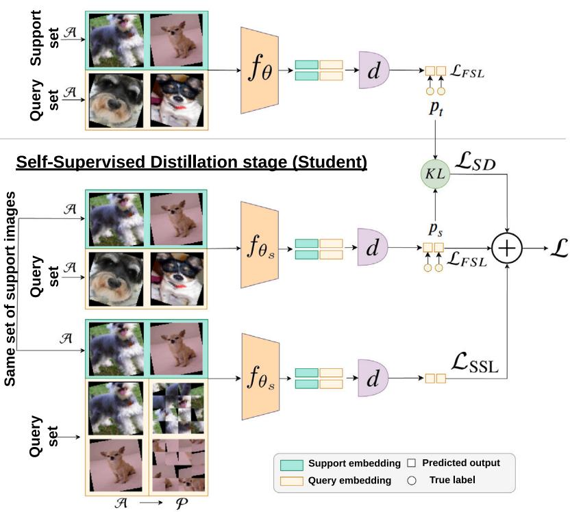
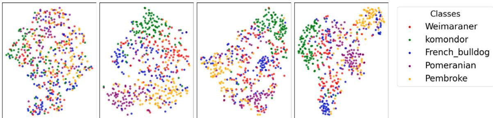
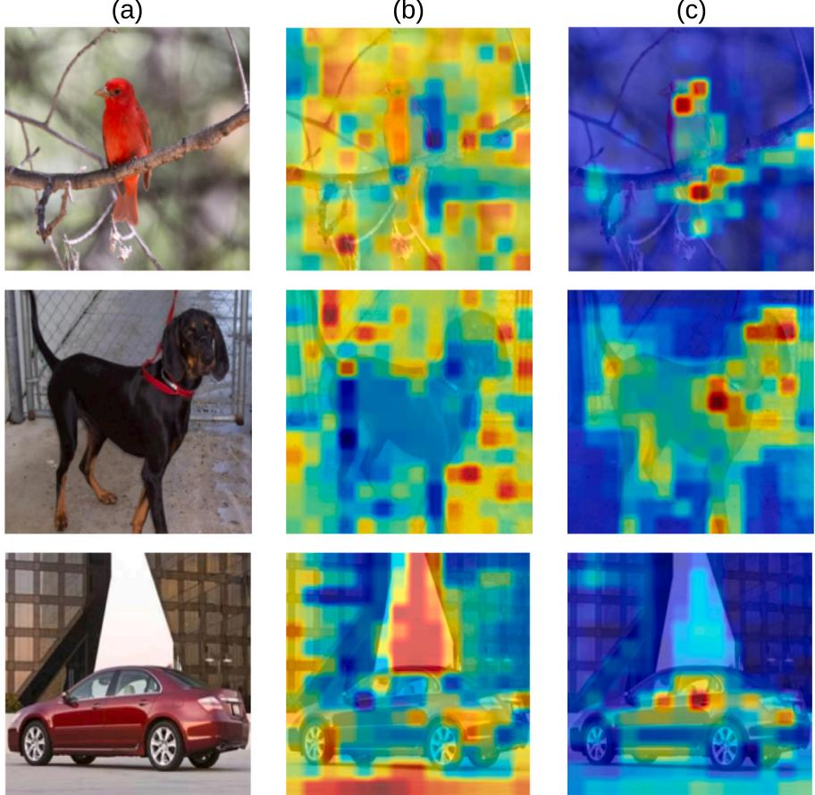
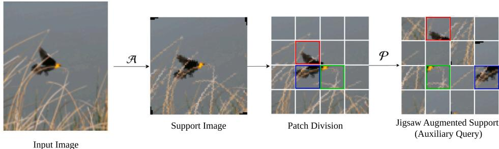

# DistillCvT: Self-supervised distillation of Convolutional Vision Transformers for few-shot fine-grained classification

Jia Min Lim a , Kian Ming Lim b ,∗, Jit Yan Lim c ,∗, Chin Poo Lee b , Pey Yun Goh a

a Faculty of Information Science and Technology, Multimedia University, Jalan Ayer Keroh Lama, Bukit Beruang, 75450, Melaka, Malaysia

b School of Computer Science, University of Nottingham, Ningbo, 315100, Zhejiang Province, China

c School of Information Technology, Monash University, Jalan Lagoon Selatan, Bandar Sunway, 47500, Selangor, Malaysia

## A R T I C L E I N F O

Keywords: Few-shot learning Fine-grained image classification Self-supervised learning Prototypical network Self-distillation

## A B S T R A C T

Few-shot fine-grained image classification remains a challenging task due to the subtle inter-class variations and the scarcity of labeled data. Existing few-shot fine-grained methods often struggle to generalize effectively under low-data regimes and fail to discriminate between visually similar samples. To address these challenges, we propose DistillCvT, a two-stage framework to enhance model generalization and feature discrimination through self-supervised learning and self-distillation within prototypical network structure. Convolutional Vision Transformer (CvT) is employed as the feature extractor, which integrates convolutional locality with transformer-based global modeling to capture fine-grained details while preserving global context. DistillCyT mitigates these issues through a two-stage strategy. In the first stage, the model is trained using a prototypica distance-based classification loss, where class probabilities are computed from the distances between query samples and class prototypes, complemented by standard data augmentation to mitigate data scarcity and learn discriminative class representations. In the second stage, an identical student model is trained with a self-supervised jigsaw task to enhance feature discrimination and robustness by aligning support samples with their augmented query counterparts. Simultaneously, the teacher model from stage one guides it through logit-based self-distillation to further improve generalization. Experiments on CUB-200-2011, Stanford Dogs, and Stanford Cars demonstrate that DistillCvT consistently improves performance and achieves competitive results compared with recent state-of-the-art few-shot fine-grained image classification methods.

## 1. Introduction

Learning to recognize objects from limited data is a fundamental challenge in computer vision and machine learning. While deep learn ing has achieved remarkable success in large-scale image recognition, these methods typically require massive annotated datasets and struggle in low-data regimes. This limitation is particularly pronounced in fine-grained image classification (FGIC), where models must distinguish between subordinate categories with subtle differences, such as bird species, dog breeds, or vehicle types. The scarcity of annotated data, combined with high intra-class variation and low inter-class variance, makes FGIC a demanding benchmark for advancing learning algorithms. Compared to generic object recognition, FGIC requires cap turing subtle cues and producing highly discriminative representations. Traditional FGIC methods rely on deep learning models trained on large-scale annotated datasets, yielding strong performance in data-rich settings [1–4]. More broadly, the ability to generalize from few examples is essential in many real-world applications, including medical imaging, remote sensing, and biometric recognition, where collecting large-scale labeled datasets is impractical or costly.

Few-shot learning (FSL) has emerged as a promising paradigm for addressing such low-data challenges. By learning to adapt from only a handful of labeled examples, FSL provides a pathway toward dataefficient recognition systems. Recent studies have further improved few-shot learning through enhanced meta-learning, regularization, and inference strategies [5]. Most existing FSL approaches are framed within the meta-learning paradigm, enabling rapid adaptation to new tasks with limited supervision. Meta-learning approaches for few-shot fine-grained image classification (FS-FGIC) can be broadly categorized into model-based approaches, which design adaptive architectures but often lack flexibility to generalize to unseen tasks [6–8]; optimizationbased approaches, which focus on fine-tuning model parameters but are prone to overfitting [9–11]; and metric-based approaches, which learn a feature embedding space by comparing distances between query samples and support examples [12–14]. Among these, metric-based methods have become especially popular due to their simplicity, effi ciency, and strong performance in few-shot settings. However, existing methods often rely on static similarity measures and employ backbones that either prioritize local features or global context, thereby overlook ing sample-specific discriminative cues and limiting their effectiveness in fine-grained and low-data regimes.

To address these limitations, we propose DistillCvT, a two-stage metric-based framework that integrates self-supervised learning and self-distillation to improve generalization and feature discrimination for FS-FGIC. Unlike conventional backbones, Convolutional Vision Transformer (CvT) [15] is employed as the feature extractor. CvT extends the standard Vision Transformer (ViT) [16] by incorporating convolutional projections in both token embedding and attention layers, enabling bet ter preservation of spatial locality while maintaining global modeling capacity. It also introduces a hierarchical architecture with progressive downsampling, similar to CNNs, while retaining the flexibility of transformers. Although CvT provides strong local–global representa tions, adapting it to few-shot fine-grained classification is challenging, as transformers generally require large-scale training data and are prone to overfitting in low-data regimes. DistillCvT mitigates these challenges through a principled two-stage learning strategy. Specifically, CvT captures both subtle local details and global contextual relationships that are crucial for fine-grained recognition, while the second stage combines self-supervised learning and self-distillation to address the limited-data nature of FS-FGIC. The self-supervised objective enhances part-aware and semantically consistent representations under spatial perturbations, whereas self-distillation regularizes the learning process and reduces overfitting. Together, these components form a complementary framework that simultaneously improves feature discrimination and robustness in low-data fine-grained classification.

In the first stage, CvT is trained from scratch using standard data augmentation to increase data diversity and learn robust local–global representations. In the second stage, a jigsaw-based self-supervised objective is introduced to regularize representation learning without requiring additional labels. Specifically, an identical student model is trained with spatially permuted query images, encouraging the extrac tion of discriminative local cues that remain informative despite spatial perturbations, while support samples serve as pseudo-classes. Simultaneously, a self-distillation process is applied, where the pretrained teacher model from the first stage guides the student through its logits. By jointly leveraging jigsaw-based self-supervision and teacher–student distillation, DistillCvT learns more discriminative and generalizable representations for few-shot fine-grained image classification.

Extensive experiments on CUB-200-2011, Stanford Dogs, and Stan ford Cars demonstrate that the proposed DistillCvT achieves consistent performance improvements in both 1-shot and 5-shot scenarios. The main contributions of this work are summarized as follows

• We propose DistillCvT, a two-stage metric-based framework that improves generalization and feature discrimination for few-shot fine-grained image classification.

• We adopt Convolutional Vision Transformer (CvT) as the back- bone and enhance its few-shot robustness via a combination of self-supervised learning and self-distillation.

• We introduce a jigsaw-based self-supervised learning task that improves feature robustness without additional annotations by encouraging semantic consistency under spatial perturbations, enabling the model to better capture subtle fine-grained visual differences.

• We design a self-distillation strategy in which a teacher model provides soft logits to guide the student, leading to more discriminative representations and reduced overfitting.

## 2. Related work

## 2.1. Model-based methods

Model-based methods aim to develop adaptable learning mechanisms for few-shot fine-grained image classification across diverse datasets and tasks. Wu et al. [6] propose a bi-directional reconstruction framework to improve class separability and feature consistency, while Cheng et al. [17] introduce DFR to disentangle discriminative features from class-irrelevant variations. Attention-based approaches, such as TWA [18], guide the extraction of task-specific and complementary object representations. Other studies enhance feature learning through cross-modal distillation [7], second-order pooling [19], pose-normalized representations [8], and deep object parsing [20]. Although effective, these methods often depend on carefully designed architectural components or structural priors, which may limit their adaptability and generalization in highly data-scarce scenarios.

## 2.2. Optimization-based methods

Optimization-based methods focus on improving adaptation to new tasks by modifying the training process or feature optimization strategy. Zhou et al. [9] design a graph neural network-based optimizer to enhance embedding adaptation across tasks. Other approaches introduce auxiliary mechanisms to improve feature learning, such as attention optimization for discriminative region focusing [10], cross-feature refinement [11,21], and self-optimal transport for improved matching and grouping [22]. Feature reconstruction-based methods [23] further enhance spatial consistency while suppressing irrelevant information. More recently, FHNet [24] incorporates frequency-guided hierarchical optimization to better capture both local and global fine-grained patterns. Despite their effectiveness in adapting to new tasks, these methods remain prone to overfitting under extremely limited training data.

## 2.3. Metric-based methods

Metric-based methods aim to learn an embedding space where samples from the same class are closer than those from different classes. Recent approaches enhance feature discrimination through multi-scale attention and feature alignment mechanisms, including DLG [25], FFSNet [12], BSNet [26], TDSNet [27], and foreground alignment strategies [28]. Attention-based metric learning has been further explored in TDM [29], HelixFormer [30], BFGL [31], Fec-Net [32], and Attention-Guided Pyramidal Features (AGPF) [33] which utilize task-specific attention, multi-level feature learning, and supportquery alignment to capture discriminative local representations. To improve similarity modeling, existing methods employ cosine similarity [34], non-linear projection metrics [35], part-aware learning [36], saliency-guided distillation [14], and query-guided feature weighting [37]. Reconstruction-based approaches further enhance feature consistency and discrimination through self-reconstruction [13], bidirectional reconstruction [38], cross-reconstruction [39], channel-wise attention-enhanced mutual reconstruction [40], and cross-sample feature interaction [41]. In addition, interactive triplet attention [42] models complementary spatial and channel interactions to capture subtle fine-grained differences. Despite these advances, existing metricbased methods often rely on predefined similarity measures and may struggle to fully exploit sample-level discriminative information under extremely limited training data.

Beyond metric learning, recent advances in fine-grained few-shot learning have explored reconstruction strategies, attention mechanisms, and transformer-based architectures to improve feature discrimination and generalization under limited training data [24,40–42]. In the broader fine-grained visual categorization domain, hierarchical and multi-scale attention mechanisms have demonstrated effectiveness in capturing discriminative semantic information across multiple granularities [43]. Transformer-based approaches further enhance representation learning through improved token interactions and discriminative feature extraction [44], while self-supervised priors have been utilized to strengthen foreground structure learning and suppress background interference [45]. Transformer-based models such as CvT [15] effec tively capture both local and global visual representations, whereas augmentation-based methods including SnapMix [46], FN-Net [47], and DRDM [48] improve feature learning by enriching training samples through semantic-preserving augmentation. In addition, VFI [49] incorporates visual descriptions as auxiliary semantic guidance to enhance feature imitation and class discrimination under few-shot settings.

Despite these advances, existing methods primarily focus on feature enhancement or sample generation and often rely heavily on supervised learning signals. Consequently, preserving representation diversity and semantic consistency remains challenging when only a few labeled samples are available. Moreover, the integration of self-supervised learning and self-distillation for learning robust multi-granularity representations in fine-grained few-shot classification remains insufficiently explored. To address this gap, DistillCvT integrates a jigsaw-based self supervised learning strategy with a self-distillation mechanism under a CvT backbone, encouraging consistency between global and local representations while preserving representation diversity. This enables the learning of more robust and discriminative features for low-data fine-grained classification scenarios.

## 3. The DistillCvT framework

Fig. 1 illustrates the overall architecture of the proposed Distill CvT framework, developed under the few-shot learning paradigm with an 𝑁-way 𝐾-shot setup. The framework consists of two sequential stages: (1) Supervised Training, where a teacher model is trained from scratch to learn strong local–global feature representations; and (2) Self-Supervised Distillation, where a jigsaw-based self-supervised task improves representation robustness and a logit-based self-distillation mechanism transfers knowledge from the teacher to a student model, thereby reducing overfitting and enhancing generalization.

The two-stage design is adopted to facilitate effective self-distillation. In the first stage, the teacher model is trained under the few-shot learning objective to learn reliable task-specific representations and class relationships. The resulting teacher subsequently provides informative soft targets for student optimization in the second stage. This decoupled training process enables effective knowledge transfer while allowing the student to simultaneously benefit from self-supervised learning.

During training, a mini-batch $b \subset D$ is sampled from the dataset 𝐷. The support set is denoted by $S ~ = ~ \{ ( x _ { 1 } , y _ { 1 } ) , \ldots , ( x _ { I } , y _ { I } ) \}$ , where each fine-grained image is represented by 𝑥 and its corresponding label by $y \in \{ 1 , \ldots , N \}$ . For each class $k ,$ the subset of support samples is denoted by $S _ { k } ,$ and the query set is denoted by .

## 3.1. Supervised training stage

The first stage aims to learn both local and global feature representations under few-shot settings. The model is trained from scratch using episodic few-shot learning and is enhanced through standard data augmentation to increase sample diversity and improve regularization.

Standard data augmentation techniques,  including padding and random rotation are applied throughout the training process to generate realistic variations of the input while preserving their semantic content. The standard data augmentation process is defined as:

$$
\tilde {b} = \{(\mathcal {A} (x), y) \mid (x, y) \in b \},\tag{1}
$$

where the $\tilde { b }$ denotes the augmented mini-batch. For each class 𝑘, the prototype vector $c _ { k }$ is computed as the average embedding of all support set samples belonging to that class:

$$
c _ {k} = \frac {1}{| \mathcal {S} _ {k} |} \sum_ {(x _ {i}, y _ {i}) \in \mathcal {S} _ {k}} f _ {\theta} (x _ {i}),\tag{2}
$$

where $\vert S _ { k } \vert$ denote the number of support samples for class 𝑘. We train the model using a prototype-based classification loss that guides query samples in the query set $\mathcal { Q }$ to align closely with their respective class prototypes while maintaining distinctiveness from other class centers. The classification loss for a query sample $( x _ { i } , y _ { i } )$ is formulated as:

$$
\ell (x _ {i}, y _ {i}) = - \log \frac {\exp \bigl (- d (f _ {\theta} (x _ {i}) , c _ {y _ {i}}) \bigr)}{\sum_ {k ^ {\prime} = 1} ^ {N} \exp \bigl (- d (f _ {\theta} (x _ {i}) , c _ {k ^ {\prime}}) \bigr)},\tag{3}
$$

where $d ( \cdot , \cdot )$ represents the squared Euclidean distance and $c _ { y _ { i } }$ is the prototype for class $y _ { i } .$ . The overall few-shot classification loss is computed as the average over all query instances:

$$
\mathcal {L} _ {F S L} = \frac {1}{| \mathcal {Q} |} \sum_ {(x _ {i}, y _ {i}) \in \mathcal {Q}} \ell (x _ {i}, y _ {i}).\tag{4}
$$

This objective promotes tight clustering of query features around their correct class prototypes while ensuring clear separation from non-matching classes, facilitating more effective discrimination under limited supervision. The trained model obtained in this stage is retained as the teacher model for the subsequent self-supervised distillation stage.

The training procedure of the Supervised Training stage is presented in Algorithm 1. In Algorithm 1, line 4, the standard data augmentation technique  is applied to the fine-grained input images 𝑥 of the minibatch $^ { b , }$ resulting in the augmented mini-batch 𝑏̃. Lines 7–12 describe the few-shot process in this stage. Prototype vectors $c _ { k }$ are produced for each class (𝑁-way) based on the number of support samples (𝐾- shot). Each query sample $x _ { i } \in \mathcal { Q }$ is compared with the corresponding prototype vector $c _ { k }$ to compute the few-shot loss $\mathcal { L } _ { F S I }$ using Euclidean distance $\| x _ { i } - c _ { k } \| ^ { 2 } \ ( \mathrm { l i n e } \ 1 0 )$ . The final loss $\mathcal { L } _ { F S L }$ is then backpropagated to update model parameters (line 12–13).

Algorithm 1 The training procedure of the Supervised Training stage for the proposed DistillCvT.
Require: Mini batch b from the training dataset $D$, embedding backbone $f_{\theta}$, squared Euclidean distance, $d(\cdot,\cdot)$, learning rate $\alpha$, standard data augmentation $\mathcal{A}$
randomly initialize $\theta$
for $b \sim D$ do
    apply standard data augmentation:
    $\tilde{b} \leftarrow \{(\mathcal{A}(x),y) \mid (x,y) \in b\}$ $\{S_k\}_{k=1}^N, Q \leftarrow \tilde{b}$
    compute few-shot loss:
    $\mathcal{L}_{\text{FSL}} \leftarrow 0$ $c_k \leftarrow \frac{1}{|S_k|} \sum_{(x_i,y_i) \in S_k} f_\theta(x_i)$
    for each $(x_i, y_i) \in \mathcal{Q}$ do
        $\mathcal{L}_{\text{FSL}} \leftarrow \mathcal{L}_{\text{FSL}} + \ell(x_i, y_i)$
    end for
    $\mathcal{L}_{\text{FSL}} \leftarrow \frac{1}{|\mathcal{Q}|} \mathcal{L}_{\text{FSL}}$ $\theta \leftarrow \theta - \alpha \nabla_\theta \mathcal{L}_{\text{FSL}}$
end for
return Trained $f_{\theta}$ as the teacher model

## 3.2. Self-supervised distillation stage

The self-supervised distillation stage consists of three main components: few-shot learning, self-supervised learning, and self-distillation. This entire stage is performed using a student model that shares the same architecture as the teacher model in the first stage. Similar to the supervised training stage, each fine-grained input image 𝑥 in the mini-batch 𝑏 is subjected to form an augmented mini-batch 𝑏̃ through standard data augmentation .

Supervised Training stage (Teacher)  
  
i h ll h f h d ll h d h d l b dd b kb d d b $f _ { \theta }$ f h h d $f _ { \theta _ { s } }$ for the student. In both the Supervised Training stage (teacher) and Self-Supervised Distillation stage (student), standard data augmentation is applied to both support and query images, denoted by . In addition, during the self-supervised learning branch of the student stage, jigsaw-augmented images generated by  are used to compute the self-supervised loss $\mathcal { L } _ { S S L } .$ . The few-shot loss $\mathcal { L } _ { F S L }$ is applied to both teacher and student predictions, while the self-distillation loss $\mathcal { L } _ { S D }$ is computed as the 𝐾𝐿 divergence between the teacher’s and student’s predicted distributions, $p _ { t }$ and $p _ { s } ,$ , respectively. Here, $p _ { t }$ and $p _ { s }$ represent vectors of negative squared Euclidean distances $d ( \cdot , \cdot )$ from the query embeddings to the teacher and student prototypes. In the Self-Supervised Distillation stage, the final training objective  integrates the few-shot loss $\mathcal { L } _ { F S L }$ , the self-supervised loss ${ \mathcal { L } } _ { S S L } ,$ and the self-distillation loss $\mathcal { L } _ { S D }$ through a weighted combination.

The few-shot process maintains the same episodic structure as in the supervised training stage. To enhance the ability of the student model to capture subtle and discriminative patterns, we introduce a jigsaw-based self-supervised learning (SSL) task [50], which encourages the learning of robust and part-aware representations without additional annotations. Unlike SimCLR [51] and Bootstrap Your Own Latent (BYOL) [52], which primarily emphasize global instance-level invariance and often require large batch sizes or memory banks, the proposed jigsaw formulation exposes the model to spatially perturbed views of the same image while preserving semantic consistency. This encourages the extraction of discriminative local cues and reduces over-reliance on fixed global object layouts, making it particularly suitable for few-shot fine-grained classification where category distinctions often reside in subtle local regions.

Each support sample, $x _ { i } \in \mathbb { R } ^ { 3 \times W \times H }$ is equally split into $n ^ { 2 }$ patches, each of size 3× $\textstyle { \frac { W } { n } } \times { \frac { H } { n } }$ , where 𝑊 and 𝐻 are divisible by 𝑛. These patches are randomly shuffled and reassembled to create a new query sample $\boldsymbol { \hat { x } } _ { i } .$ . Although the jigsaw transformation alters the original spatial arrangement of image patches, the underlying semantic content remains unchanged. Therefore, the student model is encouraged to maintain semantic consistency between the original and jigsaw-transformed sam ples by minimizing the distance between their feature representations:

$$
d (\hat {x} _ {i}, x _ {i}) = \| f _ {\theta_ {s}} (\hat {x} _ {i}) - f _ {\theta_ {s}} (x _ {i}) \| ^ {2}.\tag{5}
$$

To further enforce representation consistency, a distribution-level alignment objective that compares the similarity distribution of the jigsaw sample with respect to all support samples is introduced. The softmax-based divergence is formulated as:

$$
l _ {S S L} (i) = - \log \frac {\exp (- d (f _ {\theta_ {s}} (\hat {x} _ {i}) , f _ {\theta_ {s}} (x _ {i})))}{\sum_ {x _ {j} \in S} \exp (- d (f _ {\theta_ {s}} (\hat {x} _ {i}) , f _ {\theta_ {s}} (x _ {j})))}.\tag{6}
$$

This encourages the network to maintain semantic consistency between the original and jigsaw-augmented samples while extracting discriminative local features that remain informative under spatial perturbations. The self-supervised loss $\mathcal { L } _ { S S L }$ is defined as:

$$
\mathcal {L} _ {S S L} = \frac {1}{| \mathcal {S} |} \sum_ {i = 1} ^ {| \mathcal {S} |} l _ {S S L} (i),\tag{7}
$$

where || is the total number of support samples in the mini-batch.

While the distribution-level alignment objective encourages semantic consistency between original and jigsaw-augmented samples, it primarily focuses on preserving feature relationships among samples within the current episode. However, the jigsaw transformation alters the original spatial arrangement of image patches, which may weaken certain global semantic cues learned during supervised training. To complement the self-supervised objective, self-distillation is introduced to transfer stable task-specific knowledge from the teacher model trained on intact images. This additional supervision regularizes the student representations and helps maintain a balance between learning robust local discriminative features and preserving global semantic consistency.

To transfer knowledge from the supervised teacher, logit-based self distillation is employed. The model trained in the first stage serves as the teacher, having learned task-specific representations. Specifically, the student learns to mimic the refined local–global feature representations from the teacher through the following self-distillation loss $\mathcal { L } _ { S D } \mathrm { : }$

$$
\mathcal {L} _ {S D} = K L \bigg (\sigma \Big (\frac {p _ {t}}{\tau} \Big) \left\| \sigma \Big (\frac {p _ {s}}{\tau} \Big)\right),\tag{8}
$$

where $K L$ denotes the Kullback–Leibler divergence between the student prediction $p _ { s }$ and soft target $p _ { t }$ from teacher model. The softmax function 𝜎 is applied to both $p _ { s }$ and $p _ { t } ,$ and the temperature parameter 𝜏 is used to soften the output distributions, facilitating smoother knowledge transfer. This process enhances generalization and reduces overfitting, particularly in fine-grained tasks with limited data.

The final objective for the student integrates few-shot supervision, jigsaw self-supervision, and self-distillation is computed as follows:

$$
\mathcal {L} = (1 - \gamma) \cdot \mathcal {L} _ {F S L} + \beta \cdot \mathcal {L} _ {S S L} + \gamma \cdot \mathcal {L} _ {S D},\tag{9}
$$

where $\gamma \in [ 0 , 1 ]$ balances the contributions of teacher guidance and task supervision, and $\beta \geq 0$ controls the weight of the jigsaw objective. The few-shot loss $\scriptstyle { \mathcal { L } } _ { F S L }$ follows the formulation in Eq. (4). This joint training approach enables the student model to benefit from both the supervision of the teacher model and the semantic consistency regularization provided by the jigsaw-based self-supervised task. As a result, the model learns more generalizable and robust representations, improving performance in few-shot fine-grained classification settings.

The overall training procedure for the Self-Supervised Distillation stage is presented in Algorithm 2. Standard data augmentation  is applied to each image in the batch (line 5). During the self-supervised learning process (lines 8–14), each support sample $x _ { i }$ is divided into $n ^ { 2 }$ patches, which are then shuffled and reassembled to create a jigsawaugmented query sample $\hat { x } _ { i }$ (lines 10). The few-shot classification loss $\scriptstyle { \mathcal { L } } _ { F S L }$ is computed as shown in lines 20–21 and 26. For the self distillation loss $\mathcal { L } _ { S D } ,$ two sets of prediction outputs $p _ { t }$ and $p _ { s }$ are produced by the teacher and student model (lines 22–23) with corresponding prototype vectors $c _ { k , t }$ and $c _ { k , s }$ (line 17–18). These predictions are used to calculate self-distillation loss $\mathcal { L } _ { S D }$ (line 24 and 27) and update the student model together with other losses (line 28–29).

## 4. Experiments

This section presents the datasets, evaluation protocols, implementation details, and experimental results. It also includes an ablation study, t-SNE and Grad-CAM visualizations, and detailed analyses of the contributions of self-supervised learning and self-distillation.

## 4.1. Datasets

We evaluate the proposed DistillCvT on three widely used FS-FGIC benchmarks. To ensure fair comparisons, we strictly follow the class splits defined in prior works [20,53–55].

• CUB-200-2011 [56]: This dataset, comprising 11,788 images across 200 bird species, is known for its fine-grained granularity and subtle visual distinctions between categories. The challenges stem from similar plumage, backgrounds, and bird postures, which demand detailed attention to local visual cues. It is divided into 100 training classes, 50 validation classes, and 50 testing classes.

• Stanford Dogs [57]: This dataset contains 20,580 images across 120 dog breeds. It is particularly challenging due to high interclass similarity, as many breeds share similar appearances in terms of size, shape, and color patterns. The dataset is split into 70 training classes, 20 validation classes, and 30 testing classes.

Algorithm 2 The training procedure of the Self-Supervised Distillation stage for the proposed DistillCvT
Require: The training dataset $D$, jigsaw puzzle $\mathcal{P}(.,.)$, granularity of patches $n$, embedding backbone $f_{\theta_s}$, squared Euclidean distance $d(\cdot,\cdot)$, learning rate $\alpha$, temperature $\tau$, standard data augmentation $\mathcal{A}$
receive $\theta$ from Supervised Training stage as teacher model
initialize student model $\theta_s$
for $b \sim D$ do
    apply standard data augmentation:
    $\tilde{b} \leftarrow \{(\mathcal{A}(x),y) \mid (x,y) \in b\}$ $\{S_k\}_{k=1}^N, Q \leftarrow \tilde{b}$
    compute self-supervised loss:
    $\mathcal{L}_{SSL} \leftarrow 0$
    for $x_i$ in $S$ do
        $\hat{x}_i \leftarrow \mathcal{P}(x_i, n^2)$ $l_{SSL}(i) \leftarrow -\log \frac{\exp(-d(f_{\theta_s}(\hat{x}_i), f_{\theta_s}(x_i)))}{\sum_{x_j \in S} \exp(-d(f_{\theta_s}(\hat{x}_i), f_{\theta_s}(x_j)))}$ $\mathcal{L}_{SSL} \leftarrow \mathcal{L}_{SSL} + l_{SSL}(i)$
    end for
    $\mathcal{L}_{SSL} \leftarrow \frac{1}{|S|} \mathcal{L}_{SSL}$
    compute few-shot and self-distillation loss:
    $\mathcal{L}_{FSL}, \mathcal{L}_{SD} \leftarrow 0$ $c_{k,t} \leftarrow \frac{1}{|S_k|} \sum_{(x_i, y_i) \in S_k} f_\theta(x_i)$ $c_{k,s} \leftarrow \frac{1}{|S_k|} \sum_{(x_i, y_i) \in S_k} f_{\theta_s}(x_i)$
    for $(x_i, y_i)$ in $Q$ do
        compute few-shot loss $\ell(x_i, y_i)$ using $f_{\theta_s}$ and $c_{k,s}$:
        $\mathcal{L}_{FSL} \leftarrow \mathcal{L}_{FSL} + \ell(x_i, y_i)$ $p_t \leftarrow [-d(f_\theta(x_i), c_{1,t}), ..., -d(f_\theta(x_i), c_{N,t})]$ $p_s \leftarrow [-d(f_{\theta_s}(x_i), c_{1,s}), ..., -d(f_{\theta_s}(x_i), c_{N,s})]$ $\mathcal{L}_{SD} \leftarrow \mathcal{L}_{SD} + KL\left(\sigma\left(\frac{p_t}{\tau}\right) \| \sigma\left(\frac{p_s}{\tau}\right)\right)$
    end for
    $\mathcal{L}_{FSL} \leftarrow \frac{1}{|Q|} \mathcal{L}_{FSL}$ $\mathcal{L}_{SD} \leftarrow \frac{1}{|Q|} \mathcal{L}_{SD}$ $\mathcal{L} \leftarrow (1 - \gamma) \cdot \mathcal{L}_{FSL} + \beta \cdot \mathcal{L}_{SSL} + \gamma \cdot \mathcal{L}_{SD}$ $\theta_s \leftarrow \theta_s - \alpha\nabla_{\theta_s} \mathcal{L}$
end for

• Stanford Cars [58]: This dataset includes 16,185 images covering 196 car models. It poses difficulty due to minimal inter-class differences between similar car models and large intra-class variation caused by different viewing angles, occlusions, and lighting conditions. The class split includes 130 training, 17 validation, and 49 testing classes.

## 4.2. Evaluation protocols

The proposed DistillCvT is evaluated under standard few-shot learning settings using 5-way 1-shot and 5-way 5-shot tasks. Each episode consists of 5 classes, with 1 or 5 support samples per class and 15 query samples per class. A total of 600 episodes are randomly sampled from unseen test classes, and the average classification accuracy with a 95% confidence interval is reported to ensure statistical reliability.

## 4.3. Implementation details

The experiments follow standard protocols widely adopted in finegrained few-shot learning research [53–55,59]. All images are resized to $8 4 \times 8 4$ pixels. The model is trained using the Adam optimizer over 30 epochs, each consisting of 10,000 episodes. The initial learning rate 𝛼 is set to 0.0005 for CUB-200-2011 and Stanford Dogs, and 0.0002 for Stanford Cars. To improve performance, the learning rate is reduced to 10% every 100,000 episodes, and a 0.001 L2 regularization is applied to prevent overfitting. The self-supervised loss coefficient 𝛽 and the number of jigsaw patches 𝑛 are discussed in Section 4.8, while the selfdistillation loss coefficient 𝛾 is explained in Section 4.9. Following the hyperparameter setting from previous works [60], the temperature 𝜏 is set to 4 to soften the class distribution during self-distillation. We implemented our code using PyTorch1.

Comparison of the state-of-the-art methods with 95% confidence intervals across the three datasets. Bold and underlined values indicate the best and second-best results, respectively.

<table><tr><td rowspan="2">Method</td><td rowspan="2">Backbone</td><td colspan="2">CUB-200–2011</td><td colspan="2">Stanford Dogs</td><td colspan="2">Stanford Cars</td></tr><tr><td>1-shot</td><td>5-shot</td><td>1-shot</td><td>5-shot</td><td>1-shot</td><td>5-shot</td></tr><tr><td>Matching  $Nets^a$  [61]</td><td>Conv-4</td><td>61.16 ± 0.89</td><td>72.86 ± 0.70</td><td>35.80 ± 0.99</td><td>47.50 ± 1.03</td><td>34.80 ± 0.98</td><td>44.70 ± 1.03</td></tr><tr><td>Prototypical  $Net^a$  [62]</td><td>Conv-4</td><td>51.31 ± 0.91</td><td>70.77 ± 0.69</td><td>37.59 ± 1.00</td><td>48.19 ± 1.03</td><td>40.90 ± 1.01</td><td>52.93 ± 1.03</td></tr><tr><td> $adaCNN^b$  [63]</td><td>Conv-4</td><td>-</td><td>-</td><td>42.16 ± 0.43</td><td>54.12 ± 0.39</td><td>41.88 ± 0.40</td><td>49.87 ± 0.37</td></tr><tr><td> $MAML^c$  [64]</td><td>Conv-4</td><td>35.06 ± 0.54</td><td>53.20 ± 0.54</td><td>-</td><td>-</td><td>31.12 ± 0.54</td><td>43.71 ± 0.56</td></tr><tr><td>Relation  $Nets^c$  [65]</td><td>Conv-4</td><td>39.29 ± 0.54</td><td>55.29 ± 0.52</td><td>-</td><td>-</td><td>30.46 ± 0.44</td><td>43.58 ± 0.56</td></tr><tr><td> $PCM^d$  [66]</td><td>AlexNet</td><td>42.10 ± 1.96</td><td>62.48 ± 1.21</td><td>28.78 ± 2.33</td><td>46.92 ± 2.00</td><td>29.63 ± 2.38</td><td>52.28 ± 1.46</td></tr><tr><td>Deep K-tuplet  $Network^d$  [67]</td><td>ResNet-34</td><td>-</td><td>-</td><td>37.33 ± 0.65</td><td>49.97 ± 0.66</td><td>31.20 ± 0.58</td><td>47.10 ± 0.62</td></tr><tr><td> $BSNet (P&C)^d$  [26]</td><td>Conv-64</td><td>55.81 ± 0.97</td><td>76.34 ± 0.65</td><td>43.13 ± 0.85</td><td>62.61 ± 0.73</td><td>44.56 ± 0.83</td><td>63.72 ± 0.78</td></tr><tr><td> $AGPF^d$  [33]</td><td>Conv-64</td><td>74.03 ± 0.90</td><td>86.54 ± 0.50</td><td>60.89 ± 0.98</td><td>78.14 ± 0.62</td><td>78.14 ± 0.84</td><td>87.42 ± 0.57</td></tr><tr><td> $TSMD^d$  [68]</td><td>Conv-4</td><td>56.13 ± 1.76</td><td>69.22 ± 0.97</td><td>38.67 ± 1.80</td><td>53.89 ± 0.89</td><td>-</td><td>-</td></tr><tr><td>TKD- $Net^d$  [60]</td><td>Conv-4</td><td>40.69 ± 0.51</td><td>57.85 ± 0.53</td><td>-</td><td>-</td><td>31.36 ± 0.46</td><td>43.93 ± 0.52</td></tr><tr><td> $VFI^d$  [49]</td><td>Conv-4</td><td>90.37 ± 0.16</td><td>95.46 ± 0.10</td><td>83.82 ± 0.18</td><td>92.55 ± 0.10</td><td>89.47 ± 0.15</td><td>95.62 ± 0.08</td></tr><tr><td> $DRDM^d$  [48]</td><td>ResNet12</td><td>89.99 ± 0.14</td><td>94.63 ± 0.10</td><td>-</td><td>-</td><td>81.53 ± 0.15</td><td>90.03 ± 0.12</td></tr><tr><td> $MSENet^d$  [69]</td><td>ResNet-18</td><td>52.95</td><td>71.59</td><td>-</td><td>-</td><td>-</td><td>-</td></tr><tr><td> $GEPL^d$  [70]</td><td>GConv4</td><td>58.45 ± 0.89</td><td>75.78 ± 0.65</td><td>-</td><td>-</td><td>-</td><td>-</td></tr><tr><td> $LDP^d$  [71]</td><td>ResNet12</td><td>51.61 ± 0.24</td><td>63.04 ± 0.24</td><td>-</td><td>-</td><td>34.72 ± 0.19</td><td>47.02 ± 0.20</td></tr><tr><td>DistillCvT (Ours)</td><td>CvT</td><td>61.71 ± 1.00</td><td>76.59 ± 0.58</td><td>50.12 ± 0.99</td><td>68.86 ± 0.78</td><td>44.58 ± 0.85</td><td>72.36 ± 0.73</td></tr></table>

a Results reported by Chen et al. [53].  
b Results reported by Wu et al. [72].  
c Results reported by Ji et al. [60].  
d Results reported by the original work.

## 4.4. Experimental results and analysis

We evaluate DistillCvT under 5-way 1-shot and 5-way 5-shot set tings on three widely used few-shot fine-grained benchmarks: CUB-200-2011, Stanford Dogs, and Stanford Cars. Table 1 presents comparisons with representative and recent state-of-the-art methods. DistillCvT achieves accuracies of $6 1 . 7 1 ~ \pm ~ 1 . 0 0$ and $7 6 . 5 9 ~ \pm ~ 0 . 5 8$ on CUB-200-2011, $5 0 . 1 2 ~ \pm ~ 0 . 9 9$ and $6 8 . 8 6 ~ \pm ~ 0 . 7 8$ on Stanford Dogs, and $4 4 . 5 8 \pm 0 . 8 5$ and $7 2 . 3 6 \pm 0 . 7 3$ on Stanford Cars under the 1- shot and 5-shot settings, respectively. The results demonstrate that DistillCvT remains competitive with existing approaches while relying on a unified framework that integrates self-supervised learning and self-distillation for fine-grained representation learning.

DistillCvT consistently outperforms several recent methods incor porating self-supervised learning and knowledge transfer mechanisms, including TSMD [68] and TKD-Net [60]. Compared with TSMD, DistillCvT achieves improvements of +5.58% and +7.37% on CUB-200- 2011 under the 1-shot and 5-shot settings, respectively, and gains of +11.45% and +14.97% on Stanford Dogs. Furthermore, DistillCvT surpasses TKD-Net by +21.02% and +18.74% on CUB-200-2011, as well as +13.22% and +28.43% on Stanford Cars. These improvements demonstrate the effectiveness of integrating jigsaw-based self supervised learning with self-distillation to enhance feature discrimi nation and representation robustness under limited supervision.

Recent methods such as AGPF [33], VFI [49], and DRDM [48] have further advanced few-shot fine-grained recognition through hierarchi cal attention modeling, visual-description-guided feature imitation, and diffusion-based augmentation, respectively. As shown in Table 1, these methods achieve strong performance on the reported benchmarks. However, these methods rely on complex attention designs, auxiliary semantic information, or generative augmentation mechanisms. In contrast, DistillCvT improves representation learning through the joint use of self-supervised learning and self-distillation within a CvT backbone, without requiring additional textual descriptions or diffusion-based image generation. These results demonstrate that DistillCvT provides a competitive alternative for fine-grained few-shot classification while adopting a simpler visual-only learning framework.

## 4.5. Ablation study

The ablation study provides a detailed evaluation of each component in the proposed DistillCvT framework for 5-way 𝐾-shot classification tasks on the CUB-200-2011, Stanford Dogs, and Stanford Cars datasets, as summarized in Table 2.

The baseline model trained using only the few-shot learning objective $\mathcal { L } _ { F S L }$ achieves limited performance, with 1-shot and 5-shot accuracies of 40.81% and 50.05% on CUB-200-2011, 32.71% and 39.67% on Stanford Dogs, and 27.84% and 32.97% on Stanford Cars. Standard data augmentation  is a commonly adopted component in few-shot learning training pipelines and is used as part of the baseline configuration in our experiments. Incorporating  significantly im proves performance across all datasets, particularly on Stanford Dogs, where it increases accuracy from 32.71% to 43.24% in the 1-shot setting and from 39.67% to 62.92% in the 5-shot setting, demonstrating its effectiveness in enhancing data diversity and reducing overfitting.

Building upon this strong augmented baseline, the proposed selfsupervised learning loss $\mathcal { L } _ { S S L }$ is introduced to further improve feature robustness. By enforcing semantic consistency between original and jigsaw-augmented samples, the model is encouraged to learn spatially aware and discriminative local representations. When applied without standard augmentation, $\mathcal { L } _ { S S L }$ improves performance over the baseline (+3.82% in 1-shot and +4.71% in 5-shot on Stanford Dogs). When combined with standard augmentation, it further improves over the augmented baseline, reaching 46.97% and 65.74% in the 1-shot and 5-shot settings, respectively. The effect of the weighting coefficient 𝛽 for $\mathcal { L } _ { S S L }$ is further analyzed in Section 4.8.

Finally, the self-distillation loss $\mathcal { L } _ { S D }$ is applied on top of the $\mathcal { L } _ { F S L } +$ $\mathcal { A } + \mathcal { L } _ { S S L }$ configuration. The student network is trained to match the soft predictions of the teacher, facilitating improved modeling of fine-grained inter-class relationships. Although the improvement in absolute accuracy is relatively modest (i.e., +3.15% in 1-shot and +3.12% in 5-shot on Stanford Dogs), such behavior is expected in a high-performance regime where performance gains tend to become increasingly incremental. Importantly, $\mathcal { L } _ { S D }$ consistently improves performance across all datasets, demonstrating its role in consistently improving generalization. The impact of the self-distillation weighting coefficient 𝛾 is discussed in Section 4.9.

Table 2  
The ablation study of the proposed DistillCvT for 5-way 𝐾-shot classification tasks.

<table><tr><td rowspan="2">Model</td><td colspan="2">CUB-200–2011</td><td colspan="2">Stanford Dogs</td><td colspan="2">Stanford Cars</td></tr><tr><td>1-shot</td><td>5-shot</td><td>1-shot</td><td>5-shot</td><td>1-shot</td><td>5-shot</td></tr><tr><td> $f_{\theta} + \mathcal{L}_{FSL}$ </td><td>40.81 ± 0.97</td><td>50.05 ± 0.81</td><td>32.71 ± 0.76</td><td>39.67 ± 0.67</td><td>27.84 ± 0.66</td><td>32.97 ± 0.59</td></tr><tr><td> $f_{\theta} + \mathcal{L}_{FSL} + \mathcal{A}$ </td><td>55.67 ± 0.98</td><td>71.35 ± 0.81</td><td>43.24 ± 0.94</td><td>62.92 ± 0.79</td><td>30.72 ± 0.67</td><td>63.29 ± 0.75</td></tr><tr><td> $f_{\theta_{s}} + \mathcal{L}_{FSL} + \mathcal{L}_{SSL}$ </td><td>46.82 ± 0.74</td><td>55.80 ± 0.65</td><td>36.53 ± 0.61</td><td>44.38 ± 0.54</td><td>31.39 ± 0.53</td><td>39.17 ± 0.53</td></tr><tr><td> $f_{\theta_{s}} + \mathcal{L}_{FSL} + \mathcal{A} + \mathcal{L}_{SSL}$ </td><td>58.34 ± 0.98</td><td>76.49 ± 0.56</td><td>46.97 ± 0.95</td><td>65.74 ± 0.78</td><td>42.66 ± 0.81</td><td>72.02 ± 0.78</td></tr><tr><td> $f_{\theta_{s}} + \mathcal{L}_{FSL} + \mathcal{A} + \mathcal{L}_{SSL} + \mathcal{L}_{SD}$ </td><td>61.71 ± 1.00</td><td>76.59 ± 0.58</td><td>50.12 ± 0.99</td><td>68.86 ± 0.78</td><td>44.58 ± 0.85</td><td>72.36 ± 0.73</td></tr></table>

  
Fig. 2. Sample embeddings of the Stanford Dogs dataset under the 5-way 1-shot setting visualized with t-SNE.

Table 3  
Quantitative analysis of clustering quality across different model configurations using the Davies–Bouldin Index (DBI).

<table><tr><td>Stage</td><td>Model configuration</td><td>DBI ↓</td></tr><tr><td>(1)</td><td>Baseline Model</td><td>171.247</td></tr><tr><td>(2)</td><td>with Standard Augmentation</td><td>81.563</td></tr><tr><td>(3)</td><td>with SSL Module</td><td>5.303</td></tr><tr><td>(4)</td><td>Full DistillCvT (Self-Distillation)</td><td>4.935</td></tr></table>

Table 4

## 4.6. Visualization

## 4.6.1. t-SNE

To evaluate the generalization capability of DistillCvT, the learned embedding space is visualized using t-SNE on the Stanford Dogs dataset under the 5-way 1-shot setting. Five novel test classes, each with 100 samples, were randomly selected: Weimaraner, Komondor, French bulldog, Pomeranian, and Pembroke. Fig. 2 (left to right) compares embeddings from (1) the baseline model, (2) with standard augmentation, (3) with SSL, and (4) with self-distillation. To quantitatively assess the clustering quality across these stages, Table 3 presents the Davies– Bouldin Index (DBI) values for each configuration. A lower DBI score indicates more compact intra-class clustering and better inter-class separation, reflecting superior clustering performance. The baseline model (1) exhibits severe class overlap, reflected by a high DBI of 171.247. The introduction of standard augmentation (2) mitigates this scattering, reducing the DBI to 81.563. The addition of the SSL module (3) yields a substantial improvement in class boundary delineation, dropping the DBI dramatically to 5.303. Finally, the full DistillCvT model with selfdistillation (4) produces the most highly discriminative feature space, achieving the lowest DBI of 4.935. These qualitative and quantitative enhancements progressively demonstrate that self-distillation improves generalization while self-supervised learning enhances representation robustness.

Mean rank comparison from the Friedman test across datasets. Lower rank indicates better overall performance.

<table><tr><td>Method</td><td>Mean Rank</td><td>Post-hoc Nemenyi p-values</td></tr><tr><td>PCM [66]</td><td>5.00</td><td>0.0167</td></tr><tr><td>Matching Nets [74]</td><td>3.33</td><td>0.3692</td></tr><tr><td>Prototypical Net [62]</td><td>3.33</td><td>0.3692</td></tr><tr><td>BSNet [26]</td><td>2.33</td><td>0.8402</td></tr><tr><td>DistillCvT (Ours)</td><td>1.00</td><td>-</td></tr></table>

## 4.6.2. Attention rollout

In hybrid architectures such as Convolutional Vision Transform ers (CvT), conventional gradient-based visualization methods often produce diffuse activation maps because the global interactions introduced by deep self-attention layers tend to weaken spatial correspon dence [73]. To better understand the model’s decision-making process, we employ Attention Rollout on the deepest semantic stage, allowing us to trace how information is propagated through the attention lavers. As shown in Fig. 3. the baseline CyT model is highly suscepti ble to background distraction, with attention frequently spreading to irrelevant regions such as tree branches and surrounding structures instead of focusing primarily on the target object. In contrast, the proposed DistillCvT exhibits a more concentrated attention pattern, emphasizing the most discriminative regions of the object while suppressing responses from irrelevant background regions. These visualizations confirm that DistillCvT enforces a highly robust, object-centric feature representation and exhibits reduced sensitivity to contextual distractions.

## 4.7. Statistical analysis of model performance

To rigorously evaluate the comparative performance of the classification models, the Friedman test was conducted across all experimental conditions, and the resulting mean rank scores are reported in Table 4. The omnibus test produced a chi-square statistic of $\chi ^ { 2 } = 1 0 . 4$ with a 𝑝-value of 0.0342. Since this value is below the standard significance threshold of $\alpha ~ = ~ 0 . 0 5 ,$ , the null hypothesis of equal performance is rejected, indicating statistically significant differences among the five evaluated models.

The mean rank analysis shows that the proposed DistillCvT achieved the best and most consistent performance, obtaining the lowest mean rank of 1.00. It outperformed BSNet (2.33), Prototypical Net (3.33),

(a)

(b)  
(c)  
  
Fig. 3. Attention Rollout visualizations for the baseline CvT and the proposed DistillCvT. (a) Original images, (b) baseline CvT, and (c) DistillCvT.  
Table 5

Matching Nets (3.33), and PCM (5.00). To determine where these differences occur, a post-hoc Nemenyi test was conducted. The pairwise comparisons reveal that DistillCvT significantly outperforms PCM $( p =$ $0 . 0 1 6 7 < 0 . 0 5 )$ . Although DistillCvT consistently ranks first, its margins over BSNet $( p = 0 . 8 4 0 2 )$ , Prototypical Net $( p = 0 . 3 6 9 2 )$ , and Matching Nets $( p = 0 . 3 6 9 2 )$ do not reach statistical significance. Furthermore, no statistically significant differences are observed among the baseline methods themselves.

## 4.8. Self-supervised analysis

To evaluate the effect of the self-supervised loss ${ \mathcal { L } } _ { S S L }$ , we investigate different values of the weighting coefficient $\beta \in \{ 0 . 0 5 , 0 . 1 , 0 . 5 \}$ and the number of jigsaw patches $n \in \{ 2 , 3 , 4 \}$ on the Stanford Dogs dataset under the 5-way 1-shot setting. As shown in Table 5, the highest accuracy of $4 6 . 9 7 \pm 0 . 9 5$ is achieved with $\beta = 0 . 1$ and $n = 4 ,$ highlighting the importance of properly balancing the self-supervised and few-shot loss terms. While increasing the number of jigsaw patches generally improves performance, the benefit is most evident when 𝛽 is appropriately tuned. These findings demonstrate that selecting suitable values for both 𝛽 and 𝑛 is crucial for learning robust representation and improving few-shot classification performance

As illustrated in Fig. 4, the support image is divided into multiple patches and randomly shuffled to generate a jigsaw-augmented sample. Although the spatial arrangement of object parts is altered, discriminative fine-grained characteristics, such as the bird head, beak, and wing patterns, remain present in the transformed image. By encouraging semantic consistency between the original and jigsaw-augmented samples, the proposed self-supervised task promotes the extraction of discriminative local features that remain informative under spatial perturbations. This regularization effect helps the model focus on subtle fine-grained cues rather than relying excessively on fixed global object layouts. Such robust feature learning is particularly beneficial in fewshot fine-grained image classification, where the scarcity of labeled samples makes learning discriminative representations challenging.

f f ll h f d d f h classification task, showing the effect of different self-supervised loss $\mathcal { L } _ { S S L }$ coefficients 𝛽 and varying numbers of patches 𝑛.  
Number of Patches (n)

<table><tr><td rowspan="2">p</td><td colspan="3">Number of Patches (n)</td></tr><tr><td>2</td><td>3</td><td>4</td></tr><tr><td>0.05</td><td> $45.35 \pm 0.70$ </td><td> $45.99 \pm 0.72$ </td><td> $45.26 \pm 0.72$ </td></tr><tr><td>0.1</td><td> $46.43 \pm 0.75$ </td><td> $46.92 \pm 0.70$ </td><td> $46.97 \pm 0.95$ </td></tr><tr><td>0.5</td><td> $46.79 \pm 0.70$ </td><td> $46.31 \pm 0.73$ </td><td> $45.93 \pm 0.70$ </td></tr></table>

## 4.9. Self-distillation analysis

To assess the impact of the self-distillation weight 𝛾, we evaluate $\gamma \in \{ 0 . 1 , 0 . 3 , 0 . 5 , 0 . 7 \}$ on the Stanford Dogs dataset under 5-way 1-shot and 5-way 5-shot settings. As shown in Table $^ { 6 , }$ the best performance for 1-shot is achieved at $\gamma = 0 . 7$ with an accuracy of $5 0 . 1 2 \pm 0 . 9 9$ , while 5-shot classification peaks at $\gamma = 0 . 3$ with $6 8 . 8 6 \pm 0 . 7 8$ . These findings indicate that using $\gamma = 0 . 7$ for 1-shot and $\gamma = 0 . 3$ for 5-shot provides the most effective balance between the self-distillation loss $\mathcal { L } _ { S D }$ and self-supervised learning loss ${ \mathcal { L } } _ { S S L } ,$ , without overpowering the few-shot classification loss $\mathcal { L } _ { F S L }$ . Thus, we adopt these settings for all datasets.

## 5. Conclusion

This paper presents DistillCvT, a two-stage framework that integrates self-supervised learning and self-distillation to improve feature discrimination and generalization for few-shot fine-grained image classification. Built on the Convolutional Vision Transformer (CvT) back bone, which combines convolutional locality with transformer-based global modeling, the framework is designed to capture both local and global representations crucial for fine-grained recognition. In the first stage, CvT is trained from scratch using standard data augmentation to enhance data diversity and representation robustness. In the second stage, a student model with an identical architecture leverages a jigsaw-based self-supervised objective that encourages semantic consistency under spatial perturbations, promoting the extraction of robust local discriminative features without requiring additional annotations. Simultaneously, a self-distillation process is employed, where the pretrained model from the first stage acts as a teacher to transfer task-specific knowledge to the student model, thereby reducing overfit ting and preserving global semantic information. By jointly leveraging self-supervised learning and self-distillation, DistillCvT demonstrates the effectiveness of training CvT in low-data regimes. Experiments on three benchmark datasets show that DistillCvT achieves competitive performance compared with existing methods in few-shot settings. Future work will explore adaptive region-level augmentation and cross modal supervision to further improve fine-grained discrimination and advance data-efficient learning in computer vision.

  
Fig. 4. Illustration of the standard data augmentation  and the jigsaw puzzle process . The support image is partitioned into patches and randomly permuted to generate a jigsaw-augmented sample. Although the spatial arrangement changes, discriminative local cues highlighted by the color-coded bounding boxes remain present in the transformed image.

Table 6  
Performance analysis of different 𝛾 values for the self-distillation loss on the Stanford Dogs dataset under 5-way 1-shot and 5-way 5-shot settings.

<table><tr><td> $\gamma$ </td><td>5-way 1-shot</td><td>5-way 5-shot</td></tr><tr><td>0.1</td><td>46.34 ± 0.94</td><td>67.96 ± 0.78</td></tr><tr><td>0.3</td><td>48.98 ± 0.95</td><td>68.86 ± 0.78</td></tr><tr><td>0.5</td><td>49.79 ± 0.95</td><td>68.37 ± 0.80</td></tr><tr><td>0.7</td><td>50.12 ± 0.99</td><td>68.02 ± 0.78</td></tr></table>

## CRediT authorship contribution statement

Jia Min Lim: Writing – review & editing, Writing – original draft, Methodology, Investigation, Formal analysis, Conceptualization. Kian Ming Lim: Writing – review & editing, Supervision, Resources, Method ology, Investigation, Formal analysis, Conceptualization. Jit Yan Lim: Writing – review & editing, Resources, Funding acquisition. Chin Poo Lee: Writing – review & editing. Pey Yun Goh: Writing – review & editing.

## Declaration of competing interest

The authors declare that they have no known competing finan cial interests or personal relationships that could have appeared to influence the work reported in this paper.

## Acknowledgments

This research is supported by the School of Information Technology, Monash University Malaysia, Grant Code I-M010-SED-000416.

## Data availability

The datasets used in the experiments are publicly available.

## References

[1] Q. Diao, Y. Jiang, B. Wen, J. Sun, Z. Yuan, Metaformer: A unified meta framework for fine-grained recognition, 2022, arXiv preprint arXiv:2203.02751.

[2] J. He, J.-N. Chen, S. Liu, A. Kortylewski, C. Yang, Y. Bai, C. Wang, Transfg: A transformer architecture for fine-grained recognition, in: Proceedings of the AAAI Conference on Artificial Intelligence, vol. 36, No. 1, 2022, pp. 852–860.

[3] A. Bera, Z. Wharton, Y. Liu, N. Bessis, A. Behera, Sr-gnn: Spatial relation-aware graph neural network for fine-grained image categorization, IEEE Trans. Image Process. 31 (2022) 6017–6031.

[4] D. Liu, L. Zhao, Y. Wang, J. Kato, Learn from each other to classify better: Crosslayer mutual attention learning for fine-grained visual classification, Pattern Recognit. 140 (2023) 109550.

[5] H. Tang, Z. Li, Z. Peng, J. Tang, Blockmix: meta regularization and self-calibrated inference for metric-based meta-learning, in: Proceedings of the 28th ACM International Conference on Multimedia, 2020, pp. 610–618.

[6] J. Wu, D. Chang, A. Sain, X. Li, Z. Ma, J. Cao, J. Guo, Y.-Z, Song, Bi-directional ensemble feature reconstruction network for few-shot fine-grained classification, JEEE Trans. Pattern Anal. Mach, Intell, (2024).

[7] J. Zhao, X. Lin, Y. Yang, J. Yang, L. He, Cross-modal knowledge distillation for fine-grained one-shot classification, in: ICASSP 2021-2021 IEEE International Conference on Acoustics, Speech and Signal Processing, ICASSP, IEEE, 2021, pp. 4295-4299

[8] L. Tang, D. Wertheimer, B. Hariharan, Revisiting pose-normalization for finegrained few-shot recognition, in: Proceedings of the IEEE/CVF Conference on Computer Vision and Pattern Recognition, 2020, pp. 14352–14361.

[9] X. Zhou, Y. Zhang, Q. Wei, Few-shot fine-grained image classification via GNN, Sensors 22 (19) (2022) 7640.

[10] Y. Zhu, C. Liu, S. Jiang, Multi-attention meta learning for few-shot fine-grained image recognition., in: IJCAI, 2020, pp. 1090–1096.

[11] Z.-X. Ma, Z.-D. Chen, L.-J. Zhao, Z.-C. Zhang, X. Luo, X.-S. Xu, Cross-layer and cross-sample feature optimization network for few-shot fine-grained image classification, in: Proceedings of the AAAI Conference on Artificial Intelligence, vol. 38, No. 5, 2024, pp. 4136–4144.

[12] Y. Yang, Y. Feng, L. Zhu, H. Fu, X. Pan, C. Jin, Feature fusion network based on few-shot fine-grained classification. Front. Neurorobotics 17 (2023) 1301192

[13] X. Li, Z. Li, J. Xie, X. Yang, J.-H. Xue, Z. Ma, Self-reconstruction network for fine-grained few-shot classification. Pattern Recognit. 153 (2024) 110485

[14] H. Liu, C.P. Chen, X. Gong, T. Zhang, Robust saliency-aware distillation for few-shot fine-grained visual recognition, IEEE Trans. Multimed. (2024).

[15] H. Wu, B. Xiao, N. Codella, M. Liu, X. Dai, L. Yuan, L. Zhang, Cvt: Intro ducing convolutions to vision transformers, in: Proceedings of the IEEE/CVF International Conference on Computer Vision, 2021, pp. 22–31.

[16] A. Dosovitskiy, L. Beyer, A. Kolesnikov, D. Weissenborn, X. Zhai, T. Unterthiner, M. Dehghani, M. Minderer, G. Heigold, S. Gelly, et al., An image is worth 16x16 words: Transformers for image recognition at scale, 2020, arXiv preprint arXiv:2010.11929.

[17] H. Cheng, Y. Wang, H. Li, A.C. Kot, B. Wen, Disentangled feature representation for few-shot image classification, JEEE Trans, Neural Networks Learn, Syst (2023).

[18] G. Cheng, R. Li, C. Lang, J. Han, Task-wise attention guided part complementary learning for few-shot image classification, Sci. China Inf. Sci. 64 (2) (2021) 120104.

[19] P. Koniusz, H. Zhang, Power normalizations in fine-grained image, few-shot image and graph classification, IEEE Trans. Pattern Anal. Mach. Intell. 44 (2) (2021) 591–609.

[20] R. Zhu, P. Zhu, S. Mishra, V. Saligrama, Fine-grained few-shot recognition by deep object parsing, 2022, arXiv preprint arXiv:2207.07110.

[21] Y. Wang, Y. Ji, W. Wang, B. Wang, Bi-channel attention meta learning for few-shot fine-grained image recognition, Expert Syst. Appl. 242 (2024) 122741.

[22] D. Shalam, S. Korman, The self-optimal-transport feature transform, 2022, arXiv preprint arXiv:2204.03065

[23] D. Wertheimer, L. Tang, B. Hariharan, Few-shot classification with feature map reconstruction networks, in: Proceedings of the IEEE/CVF Conference on Computer Vision and Pattern Recognition, 2021, pp. 8012–8021.

[24] Y. Wang, X. Dong, X. Wan, S. Chen, Y. Qin, W. Liu, Y.-J. Liu, J. Luo, Q. h d d h h l k f f h fine-grained classification of spatially dispersed and aggregated data, Inf. Fusion (2026) 104379.

[25] S. Cao, W. Wang, J. Zhang, M. Zheng, Q. Li, A few-shot fine-grained image classification method leveraging global and local structures, Int. J. Mach. Learn. Cybern, 13 (8)(2022) 2273–2281.

[26] X. Li, J. Wu, Z. Sun, Z. Ma, J. Cao, J.-H. Xue, BSNet: Bi-similarity network for few-shot fine-grained image classification, IEEE Trans. Image Process. 30 (2020) 1318–1331.

[27] Y. Qi, H. Sun, N. Liu, H. Zhou, A task-aware dual similarity network for finegrained few-shot learning, in: Pacific Rim International Conference on Artificia Intelligence, Springer. 2022, pp. 606–618

[28] Z. Zha, H. Tang, Y. Sun, J. Tang, Boosting few-shot fine-grained recognition with background suppression and foreground alignment, IEEE Trans. Circuits Syst. Video Technol. 33 (8) (2023) 3947–3961.

[29] S. Lee, W. Moon, J.-P. Heo, Task discrepancy maximization for fine-grained fewshot classification, in: Proceedings of the IEEE/CVF Conference on Computer Vision and Pattern Recognition, 2022, pp. 5331–5340.

[30] B. Zhang, J. Yuan, B. Li, T. Chen, J. Fan, B. Shi, Learning cross-image object semantic relation in transformer for few-shot fine-grained image classification, in: Proceedings of the 30th ACM International Conference on Multimedia, 2022, pp. 2135–2144.

[31] X. Shi, B. Liu, Boosting few-shot fine-grained image classification with global and local feature learning, J. Supercomput. 82 (2) (2026) 94.

[32] J. Wang, B. Xu, W. Pan, S. Dai, C. Xu, H. Liu, Enhancing few-shot fine-grained image classification via adaptive attention and task-specific modulation, Eng. Res. Express (2026)

[33] H. Tang, C. Yuan, Z. Li, J. Tang, Learning attention-guided pyramidal features for few-shot fine-grained recognition. Pattern Recognit. 130 (2022) 108792

[34] J. Wang, D. Chen, A few-shot fine-grained image recognition method, Bull. Pol. Acad, Sci, Tech, Sci, 71 (1) (2023).

[35] W. Zhang, X. Liu, Z. Xue, Y. Gao, C. Sun, NDPNet: A novel non-linear data projection network for few-shot fine-grained image classification, 2021, arXiv preprint arXiv:2106.06988.

[36] C. Wang, H. Fu. H. Ma, Pacl: Part-level contrastive learning for fine-grained few-shot image classification in: Proceedings of the 30th ACM Internationa Conference on Multimedia, 2022, pp. 6416–6424.

[37] B. Munjal, A. Flaborea, S. Amin, F. Tombari, F. Galasso, Query-guided networks for few-shot fine-grained classification and person search. Pattern Recognit. 133 (2023) 109049.

[38] J. Wu, D. Chang, A. Sain, X. Li, Z. Ma, J. Cao, J. Guo, Y.-Z. Song, Bi-directional feature reconstruction network for fine-grained few-shot image classification, in Proceedings of the AAAI Conference on Artificial Intelligence, vol. 37, No. 3, 2023. pp. 2821–2829

[39] M. Hu, H. Wan, H. Wang, J. Xu, X. Wei, Enhanced local homogenization and reconstruction network for few-shot fine-grained image classification, Comput. Vis, Image Underst. (2026) 104686.

[40] Q. Ou, J. Zou, Channel-wise attention-enhanced feature mutual reconstruction for few-shot fine-grained image classification, Electronics 14 (2) (2025) 377

[41] K. Liao, Y. Tan, Y. Zheng, D. Song, Cross-sample feature interaction enhancement for few-shot fine-grained classification, Displays (2025) 103157.

[42] X. Li, S. Xue, J. Xie, X. Yang, Z. Ma, J.-H. Xue, Interactive triplet attention for few-shot fine-grained image classification. Neurocomputing (2025) 131377.

[43] Z. Hu, R. Kojima, X.-H. Han, Multi-scale attention-driven hierarchical learning for fine-grained visual categorization, Electronics 14 (14) (2025) 2869.

[44] B. Ma, Z. Jin, J. Li, J. Li, P. Zhang, X. Song, B. Jin, Token injection transformer for enhanced fine-grained recognition. Processes 14 (3) (2026) 492.

[45] H. He, Y. Li, F. Cao, H. Yang, SPG-mask: Fine-grained visual classification with self-supervised foreground structural prior driven dynamic mask optimization, Knowl.-Based Syst. (2026) 115678.

[46] S. Huang, X. Wang, D. Tao, Snapmix: Semantically proportional mixing for augmenting fine-grained data, in: Proceedings of the AAAI Conference on Artificial Intelligence, vol. 35, No. 2, 2021, pp. 1628–1636.

[47] S. Ye, Q. Peng, Y.-m. Cheung, Y. Wang, Z. Zou, X. You, FN-NET: Adaptive dat augmentation network for fine-grained visual categorization, Pattern Recognit. 165 (2025) 111618.

[48] T. Wu, S. Ye, S. Chen, Q. Peng, X. You, Detail reinforcement diffusion model: augmentation fine-grained visual categorization in few-shot conditions, IEEE Trans. Emerg. Top. Comput. Intell. 9 (1) (2024) 630–640.

[49] X. Lu, Y. Pan, Y. Cao, X. Zhou, X. Lu, Variational feature imitation conditioned on visual descriptions for few-shot fine-grained recognition, IEEE Trans. Circuits d h l ( ) ( )

[50] C. Wei, L. Xie, X. Ren, Y. Xia, C. Su, J. Liu, Q. Tian, A.L. Yuille, Iterative reorganization with weak spatial constraints: Solving arbitrary jigsaw puzzles for unsupervised representation learning, in: Proceedings of the IEEE/CVF Conference on Computer Vision and Pattern Recognition, 2019, pp. 1910–1919.

[51] T. Chen, S. Kornblith, M. Norouzi, G. Hinton, A simple framework for contrastive learning of visual representations, in: International Conference on Machine Learning, PmLR, 2020, pp. 1597–1607.

[52] J.-B. Grill, F. Strub, F. Altché, C. Tallec, P. Richemond, E. Buchatskaya, C. Doersch, B. Avila Pires, Z. Guo, M. Gheshlaghi Azar, et al., Bootstrap your own latent-a new approach to self-supervised learning, Adv. Neural Inf. Process. Syst. 33 (2020) 21271–21284.

[53] H. Chen, H. Li, Y. Li, C. Chen, Multi-scale adaptive task attention network for few-shot learning, in: 2022 26th International Conference on Pattern Recognition, ICPR, IEEE, 2022, pp. 4765–4771.

[54] W. Li, L. Wang, J. Xu, J. Huo, Y. Gao, J. Luo, Revisiting local descriptor based image-to-class measure for few-shot learning, in: Proceedings of the IEEE/CVF Conference on Computer Vision and Pattern Recognition, 2019, pp. 7260–7268.

[55] W. Li, J. Xu, J. Huo, L. Wang, Y. Gao, J. Luo, Distribution consistency based covariance metric networks for few-shot learning, in: Proceedings of the AAAI Conference on Artificial Intelligence, vol. 33, No. 01, 2019, pp. 8642–8649.

[56] C. Wah, S. Branson, P. Welinder, P. Perona, S. Belongie, The caltech-ucsd birds-200–2011 dataset, 2011.

[57] A. Khosla, N. Jayadevaprakash, B. Yao, F.-F. Li, Novel dataset for fine-grained image categorization: Stanford dogs, in: Proc. CVPR Workshop on Fine-Grained Visual Categorization. Vol. 2. No. 1. FGVC. Citeseer. 2011

[58] J. Krause, M. Stark, J. Deng, L. Fei-Fei, 3D object representations for fine-grained categorization, in: Proceedings of the IEEE International Conference on Computer Vision Workshops, 2013, pp. 554–561.

[59] H. Huang, J. Zhang, J. Zhang, J. Xu, Q. Wu, Low-rank pairwise alignment bilinear network for few-shot fine-grained image classification, IEEE Trans. Multimed, 23 (2020) 1666–1680

[60] Z. Ji, J. Ni, X. Liu, Y. Pang, Teachers cooperation: team-knowledge distillation for multiple cross-domain few-shot learning, Front. Comput. Sci. 17 (2) (2023) 172312.

[61] O. Vinyals, C. Blundell, T. Lillicrap, D. Wierstra, et al., Matching networks for one shot learning, Adv. Neural Inf. Process. Syst. 29 (2016).

[62] J. Snell, K. Swersky, R. Zemel, Prototypical networks for few-shot learning, Adv. Neural Inf. Process. Syst. 30 (2017)

[63] T. Munkhdalai, X. Yuan, S. Mehri, A. Trischler, Rapid adaptation with conditionally shifted neurons, in: International Conference on Machine Learning, PMLR, 2018. pp. 3664–3673

[64] C. Finn, P. Abbeel, S. Levine, Model-agnostic meta-learning for fast adaptation of deep networks. in: International Conference on Machine Learning. PMLR. 2017 pp. 1126-1135.

[65] F. Sung, Y. Yang, L. Zhang, T. Xiang, P.H. Torr, T.M. Hospedales, Learning to compare: Relation network for few-shot learning, in: Proceedings of the IEEE Conference on Computer Vision and Pattern Recognition. 2018, pp. 1199–1208

[66] X.-S. Wei, P. Wang, L. Liu, C. Shen, J. Wu, Piecewise classifier mappings: Learning fine-grained learners for novel categories with few examples, IEEE Trans. Image Process. 28 (12) (2019) 6116–6125.

[67] X. Li, L. Yu, C.-W. Fu, M. Fang, P.-A. Heng, Revisiting metric learning for few-shot image classification. Neurocomputing 406 (2020) 49–58.

[68] Y. Wu, S. Chanda, M. Hosseinzadeh, Z. Liu, Y. Wang, Few-shot learning of compact models via task-specific meta distillation. in: Proceedings of the IEEE/CVF Winter Conference on Applications of Computer Vision, 2023, pp. 6265–6274.

[69] F. Askari, A. Fateh, M.R. Mohammadi, Enhancing few-shot image classification through learnable multi-scale embedding and attention mechanisms, Neural Netw. 187 (2025) 107339

[70] M. Su, L. Yan, F. Li, Group equivariant learning for few-shot image classification, Appl. Intell. 55 (7) (2025) 710.

[71] M. Jiang. F. Li. Learning discriminative prototypes: adaptive relationaware refinement and patch-level contextual feature reweighting for few-shot classification, Neural Netw. (2026) 108649.

[72] H. Wu, Y. Zhao, J. Li, Selective, structural, subtle: Trilinear spatial-awareness for few-shot fine-grained visual recognition, in: 2021 IEEE International Conference on Multimedia and Expo, ICME, IEEE, 2021, pp. 1–6.

[Z3] S. Ye, S. Yu. Y. Wang. X. You R2-trans: Fine-grained visual categorization with redundancy reduction, Image Vis, Comput, 143 (2024) 104923.

[74] H. Huang, J. Zhang, J. Zhang, Q. Wu, J. Xu, Compare more nuanced: Pairwise alignment bilinear network for few-shot fine-grained learning, in: 2019 IEEE International Conference on Multimedia and Expo ICME IFFF 2019 pp 91-96